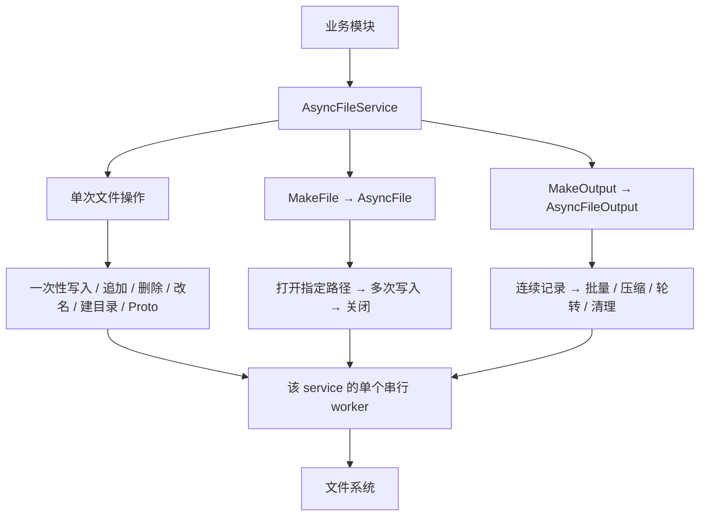

# Async_File：业务模块的异步文件 IO 库

`base/async_file` 把文件 IO 从业务线程移到后台执行。业务交出路径、数据和可选回调，后台负责打开、写入、同步、改名、删除和关闭。它同时支持采集数据的持续输出，包括批量、定时刷新、zstd 压缩、轮转及旧文件清理。

源码目录为 `/sandbox/common/base/async_file`，命名空间为 `deeproute::base::async_file`。本文描述当前实现；连续输出的能力基线是提交 `0428f57266b3c4e1558e066d9be33d4dea38fb9f` 中的 `base/file_sink`。

## 一分钟理解入口

库由一个执行服务和两种文件对象组成。服务管理线程及容量，文件对象管理一个普通文件或一条连续输出流。



| 业务需求 | 推荐入口 | Bazel 依赖 |
| --- | --- | --- |
| 保存一份完整状态、配置或快照 | `AsyncWriteFile` | `//base/async_file:async_file` |
| 向已知路径单次追加、删除文件、改名、建目录 | service 的对应 `Async*` 方法 | `//base/async_file:async_file` |
| 在指定路径保持打开并持续写字节 | `MakeFile()` → `AsyncFile` | `//base/async_file:async_file` |
| 采集数据长期落盘，需要批量、轮转、压缩 | `MakeOutput(options)` → `AsyncFileOutput` | `//base/async_file:async_file_output` |
| 保存 protobuf 文本或二进制快照 | `AsyncWriteProtoText/Binary` | `//base/async_file:async_proto_file` |

所有异步提交方法都以 **`Async`** 开头。`MakeFile`、`MakeOutput` 只创建内存对象，`GetStats` 查询内存状态；`Wait` 和 `Shutdown` 会同步等待，适合管理线程。

## 三个必须先理解的约定

1. **返回 `true` 只表示接收。** IO 成败在回调或统计中观察；返回 `false` 的请求不会执行，也不会回调，库不会退回业务线程同步写文件。
2. **一个 service 对应一个串行 worker。** 共享 service 的业务共享顺序、容量和排队延迟；需要隔离排队时创建不同实例。
3. **接收、写出、持久化是不同阶段。** `AsyncFlush` 处理缓冲与顺序，`AsyncSync` 额外请求文件 `fsync`；文件系统和设备最终持久化仍受平台语义约束。

```cpp
#include "base/async_file/async_file_service.h"

namespace af = deeproute::base::async_file;

// 初始化阶段创建并复用，不要在每帧中构造 service。
af::AsyncFileService service;
bool accepted = service.AsyncWriteFile(
    "/tmp/app/state.txt", "new snapshot", {},
    [](const af::FileResult& result) {
      // 在 worker 上执行；快速记录结果或通知其他线程。
      if (!result) {
        // 用 stage、error、path、target 定位失败。
      }
    });
if (!accepted) {
  // 业务决定丢弃、计数或稍后重试。
}

// 停止生产者后，在管理线程排空并等待退出。
service.Shutdown();
```

更完整的接收检查、普通文件、连续输出及 Proto 示例见[接入指南](./接入指南.md)。

## 与原 FileSink 的关系

新库独立实现执行服务，并把原 `base/file_sink` 的文件输出能力收进 `AsyncFileOutput`。普通文件操作放在 service / `AsyncFile` 中，轮转、压缩等记录策略放在输出对象中，避免一个类承担所有职责。

| 能力 | 当前承载位置 |
| --- | --- |
| 普通异步文件操作、单次完整写入 | `AsyncFileService` |
| 指定路径的文件生命周期及连续字节写入 | `AsyncFile` |
| 逐条、自动批量、手动批量 | `AsyncFileOutput` |
| 空闲时尾批刷新、分隔符、每文件头 | `AsyncFileOutput` |
| zstd 编码、大小轮转、时间范围命名 | `AsyncFileOutput` 及内部模块 |
| 已完成文件数量和总大小保留策略 | `internal/retention` |
| 有界接收、回调、统计、Drain/Fast 关闭 | 共享的 `internal/executor` |

新库不依赖或修改旧 `file_sink`，也没有继承旧 `Sink` 接口。旧库的独立 stdout sink 不属于这里的文件输出对象。首期没有异步读取、原始 fd 接管、递归删除或 `io_uring` 后端。

## 阅读路线

| 文档 | 解决的问题 |
| --- | --- |
| [设计架构](./设计架构.md) | 为什么这样拆分；线程、任务、容量、所有权与扩展位置 |
| [API参考](./API参考.md) | 方法签名、默认配置、返回值、状态和统计的准确含义 |
| [连续输出机制](./连续输出机制.md) | 批量、分隔符、压缩、轮转、命名和清理如何配合 |
| [接入指南](./接入指南.md) | 如何选择依赖、编写调用代码、处理拒绝并正常停机 |
| [运行与排障](./运行与排障.md) | 关闭时序、常见问题、故障边界、构建和验证情况 |

## 适用边界

这是通过后台线程隔离阻塞式文件系统调用的库。业务入口仍可能进行内存分配、复制和短锁竞争；它不承诺无锁或硬实时延迟。慢盘和慢回调会阻塞所在 worker，创建多个 service 只能隔离排队，不能隔离同一设备的阻塞。

默认容量限制的是未完成输入负载，不是进程 RSS 或内核 dirty page 的硬上限。服务析构采用有限等待，正常停机要显式 Drain；超时不能理解成在途 IO 已停止。详细说明见[设计架构](./设计架构.md)和[运行与排障](./运行与排障.md)。
