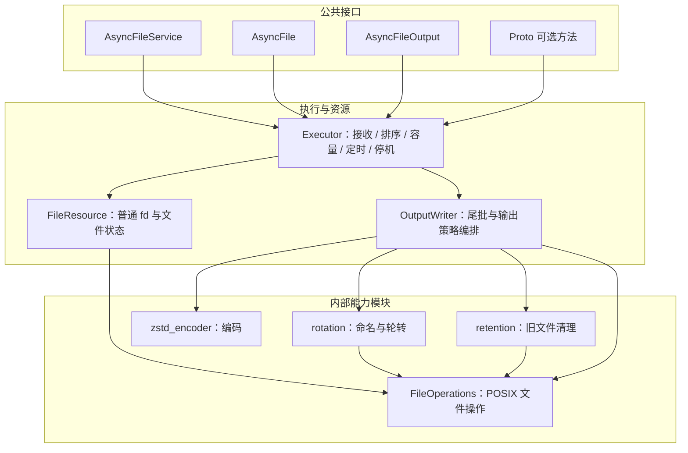
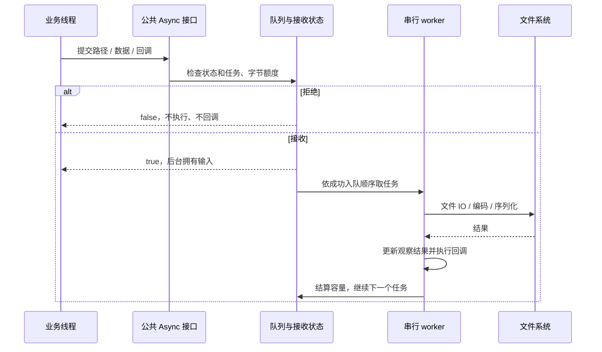
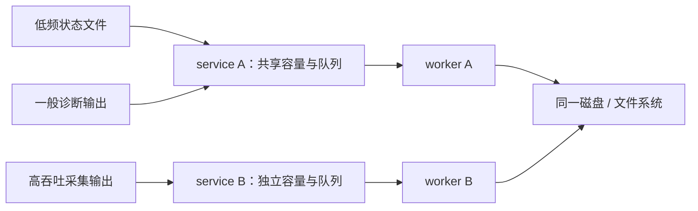
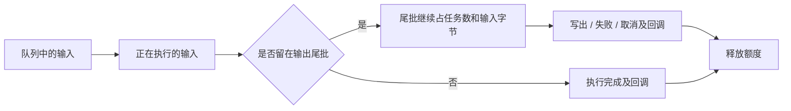
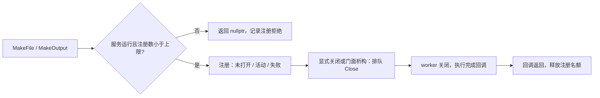
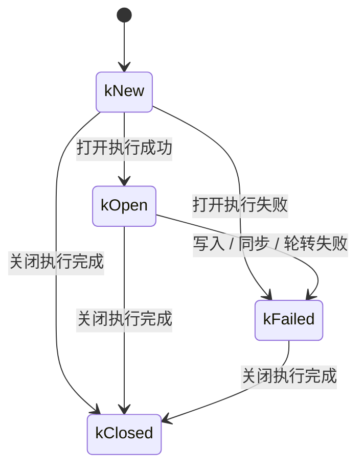
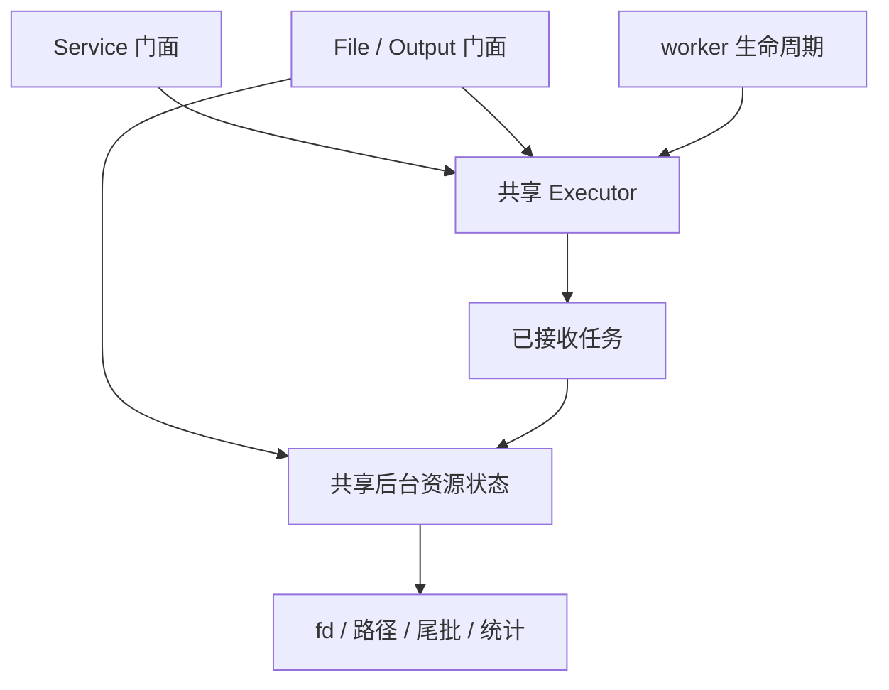

# 设计架构

设计目标是让业务以简单接口交出工作，同时把文件生命周期、容量与关闭语义统一起来。库采用“一实例、一队列、一 worker”，以明确顺序换取较低的使用和维护成本。基本定位见[专题首页](./index.md)。

## 职责分层



| 模块 | 负责 | 主要文件 |
| --- | --- | --- |
| 公共门面 | 接收业务参数、提交请求、查询统计 | `async_file_service.*`、`async_file.*`、`async_file_output.*` |
| 统一结果 | 阶段、错误、配置、统计等公共类型 | `file_result.h` |
| 执行器 | 接收状态、队列、worker、控制槽、容量结算、定时和停机 | `internal/executor.*` |
| 普通文件资源 | fd、路径、已执行状态、普通写入和关闭 | `internal/file_resource.*` |
| 连续输出资源 | 记录尾批、触发写出、文件头、编码与策略组合 | `internal/output_writer.*` |
| 文件原语 | 完整写入、fsync、close、rename、unlink、原子替换 | `internal/file_operations.*` |
| 独立输出策略 | 时间戳命名、轮转、保留和 zstd 编码 | `internal/rotation.*`、`retention.*`、`zstd_encoder.*` |
| Proto 扩展 | 快照持有、后台序列化、复用原子替换 | `async_proto_file.*` |

普通业务不直接使用 `internal`，也不能向执行器提交任意函数。这样可以避免绕过容量、状态和关闭协议。核心 Bazel target 不依赖 zstd 或 protobuf；只有选择相应能力时才链接扩展。

## 线程模型与顺序



worker 统一通过公司公共库 `//base/thread:thread` 的 `deeproute::base::Thread` 创建和命名，名称为 `async_file_io`。线程亲和性、调度策略与栈大小由公共线程库配置机制管理，可通过 `THREAD_CONFIG_PATH` 按线程名配置；线程分离后仍自持执行器状态，不改变服务的 Drain/Fast 关闭协议。

诊断日志统一使用 `//common:log` 的 `MLOG`。库内操作失败继续通过回调和统计报告，示例的错误与统计日志同样使用公共接口。

同一 service 的普通任务串行执行，多线程生产者之间以成功入队顺序为准。跨路径改名等操作也进入这条队列，无需业务配置路径 key。不同 service 之间没有顺序保证。

连续输出的记录进入 worker 后，可能先留在尾批中，而没有立即写文件。因此“前一个记录任务已执行”不等于“这条记录已写出”。若后续普通文件操作依赖这些数据，先接收该输出的 `AsyncFlush`，再提交依赖操作，并检查各次提交结果。

定时刷新也由同一个 worker 处理。执行器根据尾批期限进行条件变量等待，即使没有新记录也能唤醒刷新；它不是另建定时线程。慢 IO、压缩和慢回调都会推迟其他任务与定时刷新。

## 共享服务还是独立服务



默认建议模块初始化时创建并复用 service。多个低频使用者共享实例可以节约线程；持续大流量采集可以单独使用一个实例，避免占满状态快照的队列。独立实例不能消除设备层竞争，每条记录新建 service 还会引入线程与生命周期成本。

调用入口只承担参数持有、必要复制和短锁下的接收检查。`std::string` 可以移动，`string_view` 会复制；Proto 引用重载会在调用线程深拷贝。后台负责所有文件 IO、压缩和序列化，但调用入口并不具有硬实时上界。

## 容量为什么要包含尾批

默认限制为 1000 个普通任务、10 MiB 输入负载，另有 128 个注册资源额度。容量从请求被接收开始占用，直到工作完成并释放；一个输出记录被移入尾批时，预算跟随记录保留。



若只计算队列长度，Manual 尾批可以不断从队列“消失”，却仍在内存里积累。当前计费覆盖 **排队 + 执行（含回调）+ 尾批**，避免这种绕过；零字节记录仍占一个任务名额。

| 纳入预算 | 未纳入预算 |
| --- | --- |
| 普通写入的输入字符串长度 | 路径、配置、回调捕获和任务元数据 |
| 连续输出尾批的原始输入长度及记录数量 | 拼接分隔符、批量拼接、压缩临时缓冲 |
| Proto 快照申报的 `SpaceUsedLong()` | 序列化临时字符串、其他对象和运行库开销 |
| 正在执行任务及其回调的保留额度 | 内核 page cache、dirty page、其他线程内存 |

因此额度用于约束未完成业务输入，不能用来证明 RSS 或 dirty page 的硬上限。回调通过 promise 通知其他线程时，通知后的瞬间任务额度可能尚未释放，因为回调还没有返回。

### 注册资源与控制任务的边界

`MakeFile` 和 `MakeOutput` 在执行器同一把互斥锁下检查 `max_registered_resources`，默认 128，必须大于零。
未打开对象也占一个名额；打开失败不会自动释放。对象析构只安排 Close，直到 worker 完成关闭及其回调返回，注册表才移除该资源。
额度满时返回 `nullptr`，业务应处理拒绝，不能靠忙循环创建对象等待 worker。`registered_resources` 与 `rejected_resources` 分别观察占用和拒绝次数。



每个资源最多保留一个 Flush/Sync 和一个 Close 请求，因此资源数量上限也约束了绕过普通任务额度的控制请求规模。
即使 worker 卡在 IO 或回调里，反复创建并销毁未打开对象也只能积压上限以内的注册资源与关闭任务。
普通任务额度、输入字节额度和注册资源额度分别约束不同维度；已关闭门面仍可由业务无限持有，故不能推导进程 RSS 硬上限。
一次性路径操作不注册长期资源，仍走普通任务额度；关闭不受满额注册限制，避免无法回收。

### 控制请求不会被尾批堵死

每个文件资源另有一个 Flush/Sync 共享控制槽和一个 Close 控制槽。它们不消耗普通任务额度，数据容量满时仍能提交刷新和关闭，避免 Manual 尾批满后无法释放。

控制请求仍排在同一队列，不能抢占当前 IO。一个未完成的 Flush/Sync 会使第二个 Flush/Sync 返回 `false`，控制槽到回调返回后才释放；一个对象只接收第一次 Close，后续 Close 返回 `false`。这些槽位也不意味着不受文件状态或服务停机状态约束。

## 两套状态各解决什么问题

公开 `FileState` 反映 worker 已执行到哪里；内部接收状态决定现在能否排入新工作。两者不能混为一谈。



这是**公开状态**示意，清理错误等非致命错误不一定进入 `kFailed`，不能只凭回调成功与否推导状态。

内部接收状态从 New 经 Open 接收变为 Active，经 Close 接收变为 Closing，最后 Closed。由此产生两个有意的行为：

- Open 一旦被接收，就可以立刻排入 Write，无需阻塞等待打开完成。若打开实际失败，此前已经接收的 Write 以 `kState` 完成，失败被观察后新 Write 直接拒绝。
- Close 一旦被接收，立即阻止该对象后续数据进入，即使公开状态暂时仍显示 `kOpen`。

文件对象只使用一次，不能关闭后重新打开；需要新一轮生命周期时重新 `MakeFile` 或 `MakeOutput`。普通文件不向业务暴露 fd，也不接管外部 fd。

## 所有权与析构安全



后台任务持有共享资源状态，不捕获门面的裸 `this`。worker 自持执行器，fd 的读写和关闭由 worker 串行处理。门面析构后，已接收任务仍能使用自己的状态；service 析构等待超时后，后台仍可以等在途 IO 返回再安全收尾。

这只保护库自身的状态。回调捕获的业务对象仍由业务管理，推荐按值捕获必要数据或 `shared_ptr` 状态。不得在后台仍存活时销毁回调依赖的外部资源，也不能把它解释为支持代码动态卸载。

文件门面析构只请求 Drain Close，不等待；service 析构请求 Fast 并按 `destructor_timeout` 有限等待。需要完整落盘时，应在停止生产者后显式 Drain 并确认 worker 退出。具体时序见[运行与排障](./运行与排障.md)。

## 目录与扩展位置

```text
base/async_file/
├── BUILD                         # 核心、输出、Proto、示例、测试
├── README.md
├── file_result.h                 # 结果、配置和统计
├── async_file_service.h/.cc       # 服务与单次操作
├── async_file.h/.cc               # 普通文件门面
├── async_file_output.h/.cc        # 连续输出门面与配置
├── async_proto_file.h/.cc         # 可选 Proto 扩展
├── internal/
│   ├── executor.h/.cc             # 接收、计费、调度、关闭
│   ├── file_operations.h/.cc      # 文件原语与测试注入点
│   ├── file_resource.h/.cc        # 普通文件资源状态
│   ├── output_writer.h/.cc        # 连续输出编排
│   ├── rotation.h/.cc             # 命名与轮转
│   ├── retention.h/.cc            # 保留策略
│   └── zstd_encoder.h/.cc         # 压缩编码
├── examples/example.cc
└── tests/
    ├── async_file_test.cc
    ├── output_format_test.cc      # 文本/zstd 解压后的记录格式回归
    └── compile_qnx.sh
```

新增一次性文件操作时，在 service 增加明确的 `Async*` 方法，底层文件步骤放入 `FileOperations`。新增输出格式时扩展编码模块；新增轮转或保留规则时分别修改对应策略模块。只有需要改变调度、容量或停机协议时才改执行器，避免把策略混进队列核心。

这些是预留的内部扩展边界，当前没有对业务开放动态插件或自定义线程池接口。
