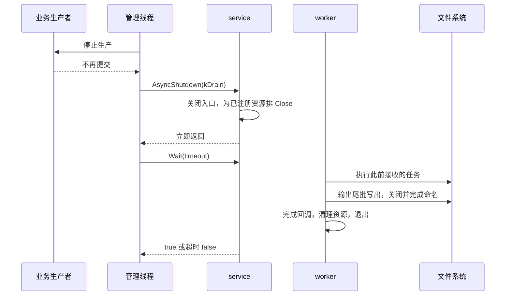
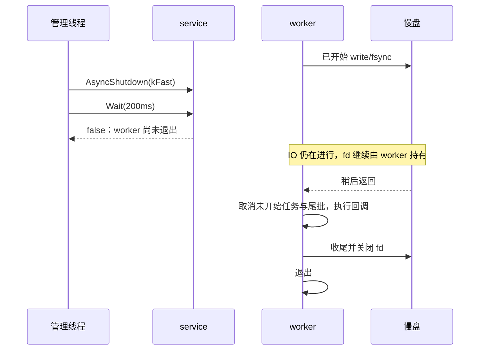

# 运行与排障

运行时首先分清“请求被拒绝”“后台执行失败”和“关闭取消”。它们对应不同处理方式，不能统一用同步写入兜底，否则会重新把磁盘延迟带回业务关键路径。

## Drain 与 Fast

| 操作 | Drain | Fast |
| --- | --- | --- |
| 接收新数据 | 立即停止目标对象/服务接收 | 同左 |
| 已开始的任务 | 继续到返回 | 仍继续，无法安全打断 syscall |
| 尚未开始的任务 | 依序执行 | 取消，完成结果为 `kCancelled` |
| 输出尾批 | 写出 | 丢弃并通知取消 |
| fd | 由 worker 收尾关闭 | 仍由 worker 收尾关闭 |
| 是否保证短时间完成 | 否 | 否，在途 IO 仍可能阻塞 |

单个 `AsyncClose` 只影响这个文件或输出流；`AsyncShutdown` 影响整个 service，包括其单次文件任务。对象只接收第一次 Close，不能先 Drain Close、再通过第二次 Fast Close 升级；服务级 shutdown 支持 Drain 升级 Fast。

### 正常关闭时序



Shutdown 自动收尾注册资源，业务无需为每个文件先排 Close。若之前已经接收 Close，不会重复排同一关闭任务。正常停机要先停止生产者，以便明确哪些数据已交出并避免继续产生拒绝。

### 有限等待不等于中断 IO



库不会从另一个线程强关 fd 来打断 IO，避免 fd 复用与未定义的生命周期竞态。文件门面析构只请求 Drain Close、不等待；service 析构请求 Fast，再按默认 200 ms 等待；该预算只约束 Wait，不能当作整个析构过程的硬实时上限。等待超时后，后台自持状态继续完成收尾，库内部不会因为门面消失而访问失效内存。

超时不代表任务已完成、已取消或线程已停止。业务回调依赖的外部对象仍须有效。进程直接退出、崩溃或动态库代码卸载之前没有确认 worker 退出，库不能保证写入完成。

## 排查路径

| 现象 | 可能原因 | 检查与处理 |
| --- | --- | --- |
| `MakeFile/MakeOutput` 返回 nullptr | 注册资源满额或服务已停机 | 查 `registered_resources`、`rejected_resources` 及 `last_error`；关闭回调返回才释放名额，不要忙循环创建 |
| `Async*` 返回 false，没有回调 | 服务停机、对象状态不允许、容量满、控制槽被占用 | 查 `rejected`、`pending_*`、文件状态及调用时序；拒绝原因不一定能仅从 `EAGAIN` 区分 |
| Open 返回 true，随后写入失败 | bool 只表示接收，实际 open 可能权限/路径失败 | 看 Open 完成的 `stage/error`；已排 Write 常报告 `kState` |
| Manual 一直没有文件内容或回调 | 记录留在尾批 | 提交 Flush/Sync 或 Drain Close；检查返回值 |
| Auto 比 200 ms 更晚刷新 | 慢 IO、压缩、清理或回调占用 worker | 查采集量、压缩级别、慢回调及文件系统延迟；考虑隔离 service |
| 文本记录粘在一起 | None 原样输出，或 delimiter 为空 | 检查模式与分隔配置；Auto/Manual 的非空 delimiter 跨批同样有效 |
| Flush 成功但未满足持久化要求 | Flush 不额外强制 fsync | 用 AsyncSync 并检查结果；父目录持久化仍另有边界 |
| 文件超过 max_file_bytes | 单批/文件头较大，轮转不拆批 | 减小批量或单记录大小；阈值不是硬上限 |
| 目录占用超过 max_total_bytes | 只统计匹配的已完成文件；活动文件、其他前缀及失败 .tmp 不计入 | 检查文件命名、活动输出和历史 .tmp，按业务运维策略处理 |
| 清理报错但记录回调成功 | 写出成功，之后扫描或删除失败 | 看 `kScan/kRemove` 和权限，避免重复写记录 |
| Fast 等待仍超时 | 已开始 IO 不可中断 | 保留回调资源，观察设备恢复；不要把 Wait(false) 当作停止 |
| 关闭后还有 .tmp | 写入、同步、收尾改名等失败，或进程非正常退出 | 查最近错误和设备状态；不要自动把所有 .tmp 当完整文件 |
| 错误计数大于预期 | 一批错误在逐记录与刷新结果中多次观察 | 按 stage、路径和时间关联，不按失败 syscall 次数理解 |

### 哪些错误会使对象失败

打开、普通写入、同步、压缩、轮转等失败可能使对象进入 `kFailed`，此后新数据请求被拒绝，仍允许关闭。已进入队列的后续请求可能以状态错误完成。

扫描和清理错误属于附加策略错误，不会直接把输出置为 Failed；Open 回调报告清理失败时，文件可能已经打开。Close 完成后状态为 `kClosed`，但关闭回调仍可能携带收尾错误。要联合判断 `state` 和 `FileResult`。

回调抛出的异常会记录 `kCallback`，不传播到其他线程；不要依赖异常替代业务错误处理。`last_error` 是最近错误的粘性快照，成功不清除，诊断时配合计数增量。

## 性能与资源取舍

| 调整项 | 带来的效果与代价 |
| --- | --- |
| 增大批量数量 | 通常减少写调用和压缩帧开销，但增加缓冲、单批大小和写出等待 |
| 减小刷新间隔 | 缩短空闲尾批延迟，但增加小批写入和压缩成本 |
| 提高压缩级别 | 可能减少编码字节，但增加同 worker CPU 时间与其他任务等待 |
| 减小 fsync 字节阈值 | 更频繁同步，也可能显著增加排队延迟；不是 dirty page 硬限制 |
| 增大 service 容量 | 容忍更长突发，代价是更多未完成输入和更长 Drain 时间 |
| 拆分 service | 隔离队列与额度，增加线程，仍共享设备吞吐和阻塞 |
| 缩短清理间隔 | 更及时尝试限制已完成文件，增加扫描和删除成本 |

容量应按突发持续时间和可接受丢弃策略确定，不是越大越好。Manual 模式尤其要设计明确刷新点；关键路径应快速处理 false，避免在原地忙循环重试。

## 构建与运行

在 `/sandbox/common` 仓库根目录执行：

```sh
bazel build //base/async_file:async_file \
  //base/async_file:async_file_output \
  //base/async_file:async_proto_file

bazel test //base/async_file:async_file_test --test_output=errors

bazel run //base/async_file:example -- /tmp/async-file-example
```

库基于 C++17/POSIX 文件操作，示例包含普通文件、连续 zstd 输出与 Proto 文本快照。示例退出码和 `failures` 检查接收及执行结果；它不是吞吐基准。

QNX 7.1 可使用仓库完整交叉构建配置：

```sh
bazel build //base/async_file:async_file \
  //base/async_file:async_file_output \
  //base/async_file:async_proto_file \
  --config=cross_compile_qnx_x86_aarch64
```

仅检查源码可编译性时，可以使用已有 SDK 和 Bazel 外部依赖目录：

```sh
bash base/async_file/tests/compile_qnx.sh \
  /path/to/qnx_sdp /path/to/bazel_external /tmp/async-file-qnx
```

该脚本对全部 11 个实现文件做 AArch64 编译，不下载 SDK，也不执行链接或实机测试，不能代替完整 Bazel 构建。接入公司线程/日志库后，还需已有 spdlog、JSON 源码及 Bazel 生成的 gflags 头：先构建 `@com_github_gflags_gflags//:gflags`，脚本默认从当前 `bazel-bin` 取头文件，第四参数可指定其他目标配置的 `bazel-bin`。

## 实现阶段的验证记录

以下为本库实现阶段的验证记录。格式兼容变更增加独立测试，具体范围见下文；初版平台验证不等同于对每次修改重新做过全部实机验收。

| 验证 | 结果与覆盖 |
| --- | --- |
| Linux Bazel 测试 | 31 个测试通过 |
| Linux 示例 | 执行成功，输出 `executed=10 failures=0`；Close 参与 executed，不能把它当提交总数 |
| ASan（含泄漏检查） | 相同 31 个测试通过 |
| UBSan | 相同 31 个测试通过 |
| 重复并发场景 | 并发提交、空闲定时刷新、关闭场景连续 100 轮通过 |
| QNX 7.1 完整 Bazel 构建 | 三个库及其依赖交叉构建通过 |
| QNX 7.1 / 8.0 编译检查 | 全部 11 个实现文件 AArch64 交叉编译通过 |
| TSan | 当前 GCC 工具链缺少 `libtsan_preinit.o`，链接失败，未运行，不计作通过 |
| QNX 实机 | 尚未验证 |

测试后端可注入短写、EINTR、磁盘满、同步/改名/关闭失败和 IO 阻塞，并检查容量计费、回调、轮转压缩、保留、Drain/Fast 与并发提交关闭等语义。它验证协议与失败处理，不等同于真实存储设备的耐久性或性能验收。

### 记录格式兼容变更的验证

- Linux Bazel：原有 31 个测试和新增 `output_format_test` 的 16 个用例全部通过。
- 新增 16 个格式用例通过 ASan（含泄漏）与 UBSan；示例运行 `executed=10 failures=0`。
- 文本和 zstd 共同检查固定内容：数量/定时分批、显式 Flush/Sync、CRLF/NUL 分隔符、空记录、原样二进制、每文件头和轮转，以及 perf_collector 表格与 CPU/Off-CPU 数据块。
- 额外运行 10 组旧 FileSink 实际拼接/压缩代码对照：解压后与固定期望及新库一致。只对日志和线程配置接桩，不用于评估线程调度和性能。
- QNX 7.1 / 8.0：重新编译全部 11 个实现文件通过；不等同于实机运行。

### 公共线程和日志接入的验证

Linux Bazel 48 个测试通过，新增检查 worker 回调读到的系统线程名为 `async_file_io`；原有记录格式用例继续通过。示例使用 `MLOG` 输出 `executed=10 failures=0`。携带真实公共线程/日志头及生成 gflags 头，对 QNX 7.1 / 8.0 全部实现文件重新编译通过；该检查不包含公共库依赖链接与实机运行。

### 建议的目标机验收

1. 使用目标工具链链接示例，在可写目录运行，确认退出码和统计没有失败。
2. 读回普通文本、二进制与 Proto，使用多帧 zstd 解码核对记录与每文件头。
3. 调小轮转阈值和保留上限，检查命名、超大批次行为、旧文件清理及活动文件保护。
4. 在受控慢盘条件下检查拒绝处理、Fast 有限等待与尾批取消，再用 Drain 检查完整收尾。
5. 按业务持久化要求验证 fsync、异常退出及重启后的文件消费规则。

这些是后续实机项目，交叉编译成功不表示它们已经完成。

## QNX 关闭语义与资源限额修复

QNX 7.1/8.0 的 `close()` 文档明确说明：`EINTR` 时 fd 仍然打开。因此保持所有权并重试，最终处理完成后才将拥有的 fd 置为 -1。
Linux 遇 `EINTR` 不重试，避免关闭已经被其他线程复用的 fd；非 EINTR 错误保持报告、不盲目重试。
显式关闭、原子替换、追加及异常栈展开使用同一关闭原语；RAII 路径不分配内存、不抛异常。
持续信号仍可能延长关闭耗时，Fast 也不能安全地中断在途系统调用。

新增 `close_semantics_test` 在 Linux 上模拟 QNX EINTR 保留 fd、Linux EINTR 后复用 fd、其他关闭错误及一次性写入异常清理。
这类测试证明平台策略及所有权流转，不能替代 QNX 实机信号测试。

注册上限默认 128；按同一 service 的并发未完成资源需求配置，而不是按文件历史总数配置。
未打开、失败、关闭排队中及关闭回调执行中的资源均计入；关闭回调若阻塞，即使 fd 已关闭也不能复用名额。
默认值会使过去无限创建资源的调用方收到 nullptr，接入时必须检查工厂返回值。

平台依据：[QNX 7.1 close()](https://www.qnx.com/developers/docs/7.1/com.qnx.doc.neutrino.lib_ref/topic/c/close.html)、[QNX 8.0 close()](https://www.qnx.com/developers/docs/8.0/com.qnx.doc.neutrino.lib_ref/topic/c/close.html)，均明确 EINTR 后描述符仍打开。

本轮关闭语义与资源上限修复验证：

- Linux Bazel 共 58 个测试通过：核心/故障/并发 38 个、记录格式 16 个、关闭语义 4 个。
- 本库全部 11 个实现文件及三个测试文件重新使用 ASan（含泄漏检查）和 UBSan 编译，58 个测试通过；公共线程、日志及第三方依赖复用 Bazel 产物，未全部重新插桩。
- 8 个并发、资源与生命周期用例连续运行 100 轮通过；逐请求核对回调次数，覆盖关闭竞争、并发注册、Drain 升级 Fast、故障/回调异常和析构超时后的共享回调。
- 示例运行 `executed=10 failures=0`；QNX 7.1/8.0 全部 11 个实现文件重新通过 AArch64 编译检查。
- 文档站 frontmatter 检查和构建通过；本轮未执行 TSan，QNX 实机信号/关闭测试仍待目标环境验收。
