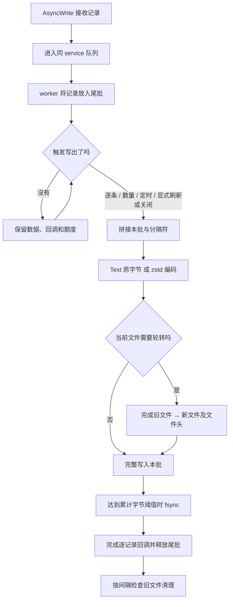
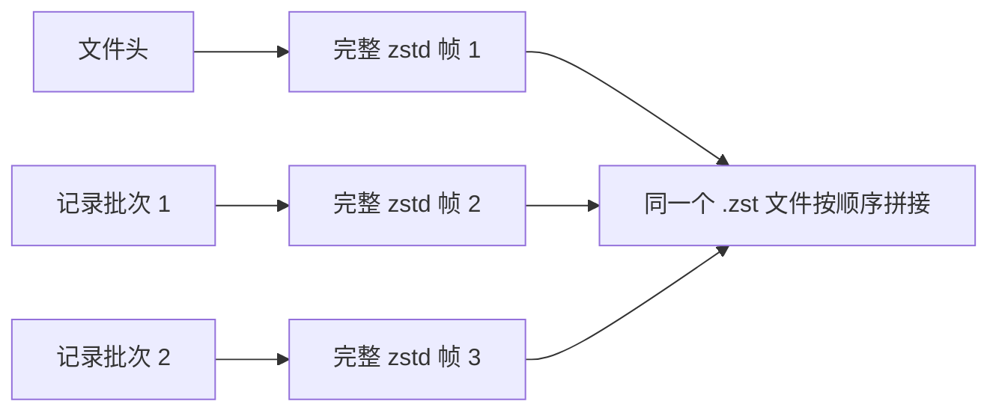
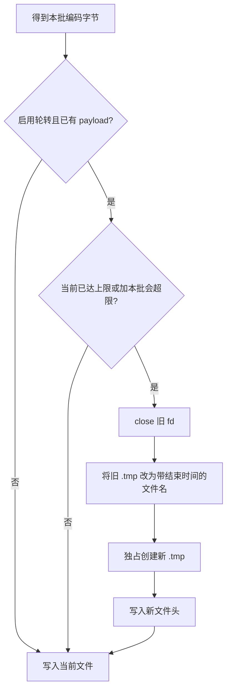
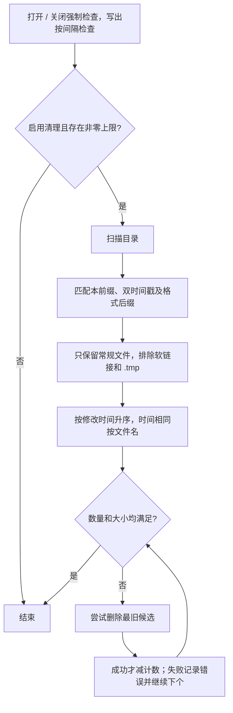

# 连续输出机制

`AsyncFileOutput` 面向传感器采集、诊断记录等不断产出数据的场景。业务只提交记录，输出对象组织批量、文件头、编码、轮转和清理。普通原始字节流可直接使用 `AsyncFile`，无需引入这些策略。

## 从一条记录到文件



图中每一步都在同一个 worker 上执行；编码、轮转和清理没有额外后台线程。记录回调表示本批写出结果，默认不表示每条记录都做过 fsync。

## 三种批量模式

| 模式 | 写出触发 | 适合场景 |
| --- | --- | --- |
| `kNone` | 每条记录执行时立即写出 | 已有完整帧/分隔的数据，或希望尽快可读 |
| `kAuto` | `batch_records` 达标，或第一条尾批等待达到 `flush_interval` | 一般连续采集，平衡 IO 次数和延迟 |
| `kManual` | `AsyncFlush`、`AsyncSync`、Drain Close/Shutdown | 业务有明确批次边界 |

Auto 的定时从**空尾批变为非空**时开始，不会被后续每条记录重新延后；数量写出后，新批重新计时。执行器空闲时也能定时唤醒，但慢 IO 或回调会延迟触发，200 ms 配置不是硬截止时间。

Manual 不会自动按数量或时间写出。尾批仍占容量，满后新记录返回 `false`；业务可使用独立控制槽提交 Flush/Sync/Close 来释放尾批。

## 分隔符的准确语义

Auto/Manual 在**同一文件的相邻记录之间**补分隔符，跨批次同样有效：前一条已经以完整 delimiter 结尾时不重复补；文件最后一条不强制补后缀。None 始终逐条原样输出，忽略 delimiter；delimiter 为空时也不分隔。

假设 `delimiter = "\n"`，以下均省略文件头：

| 输入与批次 | 实际输出 |
| --- | --- |
| 同批 `"A"`、`"B"` | `"A\nB"` |
| 同批 `"A\n"`、`"B"` | `"A\nB"` |
| Auto/Manual 两批分别为 `"A"` 和 `"B"` | `"A\nB"` |
| None 模式提交 `"A"`、`"B"` | `"AB"` |
| 任意分批，各条自带末尾换行 | 保留原有换行，不增加空行 |
| `"A"`、`"B"` 分别写入轮转前后两个文件 | 两文件分别为 `"A"`、`"B"`，新文件不加前导分隔符 |

旧 FileSink 只补同批分隔符，可能把不同批次的 `"A"`、`"B"` 写成 `"AB"`。新库保留旧库单批的记录格式，修复这种批次依赖；定时刷新、显式 Flush/Sync 不再改变同文件的记录边界。内部只需保存“上一条是否缺少分隔符”，在下一批前补充；轮转时重置，必要时重新压缩去掉前缀后的批次，文件头不参与该状态。

业务需要每条记录完整成行时，可以继续自带 `\n`；多行数据块和二进制记录沿用 None 原样输出，不拆字段、不增加包装。分隔符按完整字节后缀匹配，支持多字节及 NUL，但不能自动让任意二进制流可解析。

### 内容兼容的边界

相同业务记录和对应配置下，正常写出的文件经过必要解压后保持原有字段顺序、Tab/逗号/空格、时间戳、数值精度和记录内换行。zstd 仍为标准多帧；不要求压缩字节、帧划分、文件数量和轮转位置相同。轮转不拆记录或批次，消费端应按文件解析。

`tests/output_format_test.cc` 用固定期望字节验证 Tab 表格、CPU/Off-CPU 多行调用栈、原样二进制、分隔符、重复文件头和轮转。仍需业务正确处理拒绝/失败，并在正常停机时 Drain；未提供的外部解析脚本尚未逐一实跑。

## 文件头与压缩

`file_header` 在每个新文件创建后、任何记录之前写入，非空且未以 `\n` 结尾时自动补换行。轮转后会重复写，不能在 Open 后再改配置。



Text 模式写输入原字节；Zstd 模式把每个块编码成完整标准帧，文件由多个帧拼接组成。文件头也走相同编码流程。消费者应使用支持多帧的流式解码方式。

这是**先压缩块再写文件**，不是先写文本文件、轮转后再另起任务压缩整个文件。压缩级别越高通常占用越多 worker 时间，需要结合实际数据衡量吞吐与排队延迟。

## 大小轮转与时间命名

轮转按实际编码字节判断，包含文件头。只有当前文件已经有 payload，且本批将超过阈值（或当前已达到阈值）时，才先轮转再写本批。记录和批次不拆分，因此阈值是轮转目标，不是文件大小硬上限。



例如阈值 50 MiB，当前文件已有 49 MiB、下一批 3 MiB，会把这批放入新文件；若第一批自身有 60 MiB，则允许该文件超过阈值，下个批次到来时再轮转。文件头很大时也不会因还未写 payload 而无限空轮转。

默认格式示例，时间使用本地时间，精度到微秒：

```text
# 正在写入，Text/Zstd 均使用 .tmp
frames.log.20261020.123456.123456.tmp

# Text 正常完成
frames.log.20261020.123456.123456-20261020.123457.234567

# Zstd 正常完成
frames.log.20261020.123456.123456-20261020.123457.234567.zst
```

创建活动文件使用 `O_EXCL`，遇到微秒命名冲突会尝试下一个时间名；正常收尾添加结束时间。最终命名已有目标时会检查并报错；该检查不是跨进程原子防覆盖协议，因此相同目录和前缀仍应由单一输出流独占。

写入、同步、轮转等破坏输出完整性的错误使资源进入 `kFailed`，随后关闭时保留 `.tmp` 供排查。实现不通过截断旧文件自动恢复；消费者通常只读取带结束时间的已完成文件。

Fast 关闭会丢弃未写尾批，但已成功写出的部分在资源未失败时仍可能正常完成改名。因此“文件已完成命名”表示该文件收尾成功，不代表所有曾提交记录都保留；取消结果需单独观察。

## 刷新与 fsync

| 动作 | 尾批行为 | fsync 行为 |
| --- | --- | --- |
| 普通批次写出 | 写出本批 | 达 `sync_interval_bytes` 时执行 |
| `AsyncFlush` | 写出此前尾批 | 不额外强制，但仍遵循字节阈值 |
| `AsyncSync` | 先写尾批 | 随后明确 fsync；批次可能已因阈值做过一次 |
| Drain Close | 刷出尾批，再收尾 | 不额外承诺最终强制 fsync；写出仍遵循阈值 |
| Fast Close | 取消尾批 | 不为已丢弃数据执行写入 |

周期阈值按每个文件实际写入字节累计，文件头也计入，新文件重新计数。若停机前需要最终文件 fsync，应在停止生产者后接收 `AsyncSync`，再排 Close/Shutdown，并检查完成结果。该文件 fsync 不包含父目录 fsync。

## 旧文件清理

同时设置数量和总字节限制时，两项都要满足。默认虽然 `rolling_deletion=true`，但两项上限都是 0，因此不会删文件。



清理只处理当前 prefix 与当前格式的已完成文件，不触及活动 `.tmp`、其他前缀、软链接或不匹配的文件。数量和总字节也只计算这些候选，不包含活动文件，因此不是目录磁盘占用的硬限制。

`cleanup_interval` 控制写出时是否到了下次检查时间。它不是独立的空闲定时器：长时间没有写出，就不会仅因到了清理时间而单独扫描。打开和关闭会强制检查；0 表示每次写出检查。

删除失败的文件仍计入数量与字节，继续尝试其他旧文件。清理失败不把输出流置为 Failed：记录写回调可能成功，同时后台统计记录扫描/删除错误；Open、显式 Flush 也可能报告清理错误，但文件已打开或记录已写出。应结合 `state`、`stage` 和累计写入统计判断，不能见到清理错误就重写同批数据。
