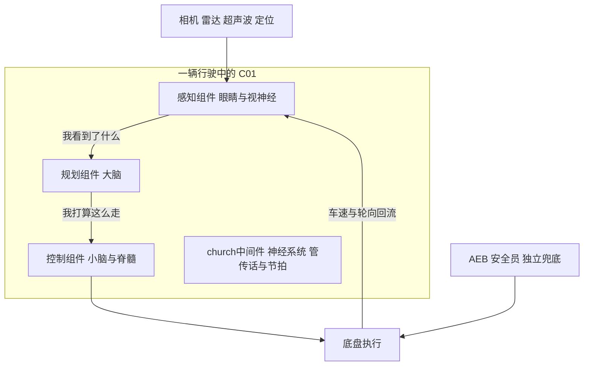
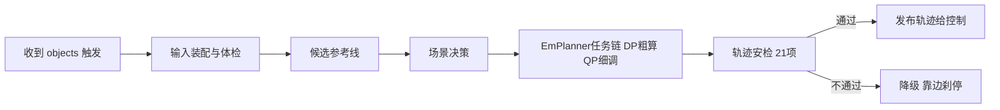

> **这份文档给谁看**：不需要 C++ 基础，不需要懂自动驾驶。只要你想知道"这台 C01 车的软件是怎么让车自己开的"，从这篇开始。
> **怎么用**：全文没有代码，只有故事、类比和三张图。读完约 20 分钟，之后你再翻其他 35 篇文档时，那些陌生的名词都会在这篇里出现过一次。
> **车型背景**：C01 车，搭载 NVIDIA Orin 芯片（型号名 orinx 平台），运行 L2 行车辅助 + AVP 自动泊车（合称 L2AVP）方案。
>
> **本篇概念速成块**（30 秒，读完再进正文不卡壳）：
> - **一套进程**：感知+规划同住 mainboard 一个进程（[**单进程 E2E**（公共 01 §3.4）](01%20进程启动与%20Church%20框架初始化链路（C01%20-%20orinx）.md)）——喊一声就到，不走邮局。
> - **一个节拍**：感知 10Hz 是全车心跳，规划没有自己的定时器，感知发一帧它跑一帧。
> - **两个班底**：行车用 [**Task 管线**（Planning/00 §2）](../Planning/00%20Planning%20模块架构总览.md)任务链，泊车换 [**OpenSpace 泊车**（Planning/子模块7 §1.2）](../Planning/02_核心子模块拆解/子模块7：mission_planner%20与%20open_space%20泊车规划子模块.md)班底。
> - **工牌制度**：[**tracker**（Perception/子模块3 §1）](../Perception/02_核心子模块拆解/子模块3：tracker%20多目标跟踪子模块.md)给每个目标发稳定 track_id，跨帧认人全靠它。
> - **发令枪**：感知最后才发 `/perception/objects`（[**FrameDone**（公共 02 §6.1）](02%20模块配置与%20Topic%20数据流拓扑（C01%20-%20orinx）.md)），枪响规划才开工。
> - **先粗后精**：[**DP**（Planning/子模块1 §3）](../Planning/02_核心子模块拆解/子模块1：planner%20与%20tasks%20决策规划任务管线.md)画草稿 → [**QP**（Planning/子模块1 §3）](../Planning/02_核心子模块拆解/子模块1：planner%20与%20tasks%20决策规划任务管线.md)誊写 → [**iLQR**（Planning/子模块1 §4.5）](../Planning/02_核心子模块拆解/子模块1：planner%20与%20tasks%20决策规划任务管线.md)精修。
> - **安全兜底**：轨迹校验不过就 [**降级 Fallback**（Planning/06 §2）](../Planning/06%20异常处理与降级机制.md)（打标签的温和刹停），AEB 独立于主流程直接踩刹车。

---

## 1. 一辆车的一天

**一句话结论**：从上电到泊车，整车的协作只有一句话——感知看、规划想、控制动，church 传话，AEB 兜底。

**清晨，上电。** 车身并没有立刻"醒来干活"。整车有一个状态机（叫 [**EM 状态机**（公共 01 §1.2）](01%20进程启动与%20Church%20框架初始化链路（C01%20-%20orinx）.md)，可以理解为整车的"作息表"），只有进入允许驾驶的状态（比如 kFullFunction、kDriving），软件才会被拉起。

**点名与开工。** 一个叫 [**DEM**（公共 01 §1.2）](01%20进程启动与%20Church%20框架初始化链路（C01%20-%20orinx）.md) 的守护进程（可以理解为车队队长）翻开 C01 车型的花名册（配置文件 `dem/c01-pt/perception.jsonnet`），启动一个叫 [**mainboard**（公共 01 §1.1）](01%20进程启动与%20Church%20框架初始化链路（C01%20-%20orinx）.md) 的主进程——这台车上[**感知和规划住在同一个进程里**（单进程 E2E，公共 01 §3.4）](01%20进程启动与%20Church%20框架初始化链路（C01%20-%20orinx）.md)，这是本架构最大的特点（行业里更常见的是各住各的、隔墙喊话）。队长还按花名册往这个进程里装了四个"器官"：感知、规划、数据回传（DataAgentRT，负责把数据传回云端）和一个地图推理小助手（lom_infer）。

**行驶中，每 0.1 秒一个循环。** 看一眼（感知）→ 想一下（规划）→ 动一动（控制）。车开得多快不重要，重要的是这个循环**永远不断**：10 次每秒。

**遇到危险时。** 除了主流程，车里还有一个独立的安全员叫 [**AEB**（Perception/子模块5）](../Perception/02_核心子模块拆解/子模块5：aeb%20感知侧子模块.md)，它不参与日常驾驶，只在关键时刻直接踩刹车——主流程就算卡住了，它也兜得住。

**到达停车场。** 整车切到泊车模式，环视相机接管主视野，车辆自动泊入车位。这背后感知和规划内部会换一套"泊车班底"（[**avp 泊车感知**（Perception/子模块6 §1）](../Perception/02_核心子模块拆解/子模块6：avp%20自动泊车感知子模块.md)、[**OpenSpace 泊车**（Planning/子模块7 §1.2）](../Planning/02_核心子模块拆解/子模块7：mission_planner%20与%20open_space%20泊车规划子模块.md)），但协作方式不变。

## 2. 五大器官：用人体类比理解架构

**一句话结论**：五大器官+两个配角就是全部角色表——后续每篇文档讲的都是他们内部怎么分工，类比的骨架不变。

| 人体器官 | 软件对应 | 它做什么（三句话版） |
|---|---|---|
| 眼睛 + 视神经 | [**感知 Perception**（Perception/00）](../Perception/00%20Perception%20模块架构总览.md) | 从相机和雷达的原始数据里认出：这是车、这是人、这是车道线、这是车位。不仅认出来，还要跨帧记住每一个目标。 |
| 大脑 | [**规划 Planning**（Planning/00）](../Planning/00%20Planning%20模块架构总览.md) | 拿到"我看到了什么"，决定"我接下来怎么走"：走哪条线、开多快、什么时候变道、前面堵了怎么办。 |
| 小脑与脊髓 | [**控制 CbwControl**（公共 05）](05%20端到端全链路时序与异常机制（C01%20-%20orinx）.md) | 把大脑那句"往左偏 5 度"翻译成毫秒级的方向盘/加减速指令，稳定、平顺、不抖。 |
| 神经系统 | [**church 中间件**（公共 01 §2）](01%20进程启动与%20Church%20框架初始化链路（C01%20-%20orinx）.md) | 让各器官之间用"频道"（Topic）说话，谁先说谁后听、消息怎么传、谁卡住了要报警，全是它管。 |
| 基因 / 出厂设置 | [**DEM 与配置文件**（公共 01 §1.2/§3）](01%20进程启动与%20Church%20框架初始化链路（C01%20-%20orinx）.md) | 决定这台车装哪些器官、每个器官接哪些线（订阅/发布什么消息）、用什么参数工作。换车型 = 换一套配置。 |

**两个容易忽略的配角**：
- [**tracker**（Perception/子模块3 §1）](../Perception/02_核心子模块拆解/子模块3：tracker%20多目标跟踪子模块.md)（跟踪）是感知里的"认人冠军"：相机每 0.1 秒拍一批新照片，它负责确认"这个新出现的车就是刚才那辆"，给每个目标发一张**工牌**（稳定的 track_id），这样下游才能谈论"那辆白车的轨迹"。
- [**farseer**（Perception/子模块4 §1）](../Perception/02_核心子模块拆解/子模块4：farseer%20子模块.md)（预测）是感知里的"读心术师"：它猜周围每辆车未来几秒会怎么走，让规划提前避让，而不是等别人变过来了才反应。

## 3. 一帧数据的一生（0.1 秒的旅程）

**一句话结论**：这 11 步是全书主线——等齐→认全→发工牌→读心→安检→交卷→想路→兜底→执行→闭环，后续每篇都在放大其中一步。

把 0.1 秒放大 100 倍，看一次完整的循环：

1. **采集**：12 路传感器同时工作——7 个前视相机、4 个环视相机、1 个激光雷达（此外毫米波、超声波、定位随时待命）。
2. **等齐合影**：不同传感器快慢不一，[**FrameSync 帧同步**（Perception/01 §2）](../Perception/01%20输入数据接入与预处理.md) 就像拍集体照的摄影师：不等所有人到位绝不按快门。等齐一帧才放行，如果处理跟不上，门口最多排 2 帧（[**在途帧背压**（Perception/01 §2.3）](../Perception/01%20输入数据接入与预处理.md)），再多的旧数据直接丢弃（宁可用新数据，不用陈旧数据）。
3. **一眼认全**：[**uni_model**（Perception/子模块1 §1）](../Perception/02_核心子模块拆解/子模块1：camera%20相机感知子模块.md)（统一神经网络）一口气从图像和点云里认出所有目标——不需要每种目标一个模型。（「神经网络推理」到底是怎么工作的？零基础解释见 [**AI 字典**](../../../正典阁/技术栈/AI/神经网络与推理引擎.md)）
4. **发工牌**：[**tracker**（Perception/子模块3 §1）](../Perception/02_核心子模块拆解/子模块3：tracker%20多目标跟踪子模块.md) 把这帧的目标和上一帧对上号，每个目标获得稳定编号。（这套「跨帧认人」的通用问题叫[**多目标跟踪 MOT**](../../../正典阁/技术栈/AI/多目标跟踪%20MOT.md)）
5. **读心**：[**farseer**（Perception/子模块4 §1）](../Perception/02_核心子模块拆解/子模块4：farseer%20子模块.md) 为每个他车生成未来几秒的候选轨迹。
6. **过安检**：感知内部的 [**aeb 过滤链**（Perception/子模块5 §4.1）](../Perception/02_核心子模块拆解/子模块5：aeb%20感知侧子模块.md)确认没有漏掉危险目标。
7. **交卷**：感知按**固定顺序**发布结果（这套机制叫 [**FrameDone**（公共 02 §6.1）](02%20模块配置与%20Topic%20数据流拓扑（C01%20-%20orinx）.md)）——先发 4 路辅助数据，**最后才发 `/perception/objects`**。这条"最后发布"是精心设计的：它就像发令枪，枪响时（规划被触发时）其他材料已经在规划桌上摆好了。
8. **想路**：规划先选[**参考线**（Planning/00 §3）](../Planning/00%20Planning%20模块架构总览.md)（相当于导航给的几条候选车道中心线），再在每条线上跑[**任务链**（Planning/00 §2）](../Planning/00%20Planning%20模块架构总览.md)：先用粗算法（[**DP**（Planning/子模块1 §3）](../Planning/02_核心子模块拆解/子模块1：planner%20与%20tasks%20决策规划任务管线.md)）快速找出大概可行的路，再用精算法（[**QP**（Planning/子模块1 §3）](../Planning/02_核心子模块拆解/子模块1：planner%20与%20tasks%20决策规划任务管线.md)）把它修得平滑舒适，必要时还会用更高级的算法（[**iLQR**（Planning/子模块1 §4.5）](../Planning/02_核心子模块拆解/子模块1：planner%20与%20tasks%20决策规划任务管线.md)）精修。（这三个算法的零基础解释与生活类比见 [**AI 字典**](../../../正典阁/技术栈/AI/00%20AI%20概念字典导航.md)：[DP](../../../正典阁/技术栈/AI/动态规划%20DP.md)、[QP](../../../正典阁/技术栈/AI/二次规划%20QP.md)、[iLQR](../../../正典阁/技术栈/AI/iLQR%20与%20LQR.md)）
9. **安检与兜底**：[**轨迹校验**（Planning/子模块4 §1）](../Planning/02_核心子模块拆解/子模块4：trajectory_checker%20轨迹校验子模块.md)（21 项检查）把关。不通过就[**降级**（Planning/06 §2）](../Planning/06%20异常处理与降级机制.md)：不是乱开，而是靠边刹停——安全永远优先于到达。
10. **执行**：轨迹交给控制，控制以 20ms 的节奏（每秒 50 次）微调方向盘和加减速。
11. **闭环**：车动起来了，新的传感器数据涌进来，车速轮向也回流给感知和规划——回到第 1 步。

## 4. 三张图看懂全局

**一句话结论**：三张图是整车/感知/规划三层的"地图"——后续每篇都是在其中一张上放大细节，读文档卡住时回来对照。

**图 1：整车协作（器官视角）**

**图 1 · 整车协作图（器官视角）**（EYE→BRAIN→HAND 是主链路，AEB 绕过主流程直连底盘，CAR→EYE 是闭环回流）

**读图提示**：① 主链路只有三级：看→想→动，中间件 N 管节拍不管内容；② AEB 没有经过 BRAIN——它独立兜底，主流程卡住也踩得下刹车；③ 最下面 CAR→EYE 的回流就是"闭环"二字的具体含义。

**图 2：感知流水线（一帧怎么被"看懂"）**

**图 2 · 感知流水线图（一帧怎么被"看懂"）**（B 是节拍闸门，G/H 是发布契约：最后一份才触发下游）

**读图提示**：① B（FrameSync）决定"什么时候开始算"，跟不上就丢旧帧；② D/E 是感知的"记忆"与"预判"，没有它们下游只能看到一帧孤立的画面；③ H 的 objects 是发令枪——它发出后规划才被唤醒。

**图 3：规划任务链（一条轨迹怎么被"想出来"）**

**图 3 · 规划任务链图（一条轨迹怎么被"想出来"）**（S 是分诊台，E 是核心求解，C 是安检门，FB 是兜底出口）

**读图提示**：① 从触发到发布一条链走完，就是规划的一帧；② E（EmPlanner 任务链）内部还有 DP→QP→iLQR 的先粗后精三段；③ C 不通过不是丢弃，而是走 FB 降级——安全优先于到达。

## 5. 词汇避坑表（前人踩过的坑）

**一句话结论**：这五个名词最容易读偏——先记住正确含义再读代码，能省下大半天排查时间。

| 名词 | 常见误会 | 实际是什么 |
|---|---|---|
| farseer | 以为是"占用栅格网络" | 是**他车轨迹预测**模块（模型优先、规则兜底） |
| mission_planner.cpp | 以为是任务规划入口 | **0 字节空文件**，死代码，别读 |
| control_component.cc | 以为控制逻辑在这 | 也是空文件，控制实际在 **CbwControlComponent** |
| t_perception 线程 | 以为它逐帧处理感知 | 图执行模式下**帧处理在图线程池**，组件线程只做调度 |
| /planner/context | 以为是规划的一条输入 | 是规划**自己的状态自留地**（上下文转储），不是外部输入（详见 [**Context**（Planning/05 §6）](../Planning/05%20Planning%20输出发布与控制指令生成.md)） |

## 6. 下一步去哪读

**一句话结论**：按身份选路线，别硬啃——入门读故事、新人读主线、深开发全读，术语卡壳随时回《00 架构总览》查表。

| 你是谁 | 建议路线 | 大约耗时 |
|---|---|---|
| 产品 / 测试 / 管理 | 本文 + [**00 架构总览**（§5 名词速查表）](00%20架构总览与学习指南（C01%20-%20orinx）.md) 的两张图 + [**06 问题清单**（§3 高风险项）](06%20代码索引与问题清单（C01%20-%20orinx）.md) | 1 小时 |
| 新人工程师 | 本文 → [**00 架构总览**](00%20架构总览与学习指南（C01%20-%20orinx）.md) → [**01 进程启动**](01%20进程启动与%20Church%20框架初始化链路（C01%20-%20orinx）.md) → [**02 Topic 拓扑**](02%20模块配置与%20Topic%20数据流拓扑（C01%20-%20orinx）.md) → [**Perception 主线**（00 总览起步）](../Perception/00%20Perception%20模块架构总览.md) → [**Planning 主线**（00 总览起步）](../Planning/00%20Planning%20模块架构总览.md) | 2~3 天 |
| 深度开发 | 全部 36 篇，配合各篇证据块读源码，07 索引随手查 | 1~2 周 |
| AI/算法名词卡壳 | 随查 [**AI 概念字典**](../../../正典阁/技术栈/AI/00%20AI%20概念字典导航.md)（23 个词条，四段式零基础讲解） | 即查即走 |

> 术语不懂随时翻《00 架构总览》§5 名词速查表；AI/算法名词（DP、QP、BEV、MOT 等）随查[**AI 概念字典**](../../../正典阁/技术栈/AI/00%20AI%20概念字典导航.md)；所有结论都有代码证据，位置在各篇的引用块里。

---

## 7. FAQ 与自测

**Q1：`/planner/context` 是规划从别人那里收到的输入吗？（新手最常见误解）**

不是。它是规划**自己的状态自留地**：每帧把自己的上下文（上帧选中轨迹等）发出去，再通过图内回边喂给下一帧——发布者和消费者都是规划自己（详见 [**Context**（Planning/05 §6）](../Planning/05%20Planning%20输出发布与控制指令生成.md)）。

**Q2：感知 10Hz，规划和控制也是固定 10Hz 吗？**

规划没有定时器，跟着感知走：感知发一帧它跑一帧（IMMEDIATE 触发），帧率≈感知帧率；控制更快，以 20ms（每秒 50 次）节奏微调。规划节拍的细节见 [**Planning/04**](../Planning/04%20线程调度与规划周期.md)。

**Q3：任务链里 DP、QP、iLQR 每帧都要全跑一遍吗？**

不是。任务链在运行时按配置开关组装：DP 草稿和 QP 誊写是基本盘，iLQR 只在必要时精修，决策类任务可裁剪（详见 [**EmPlanner 任务链**（Planning/子模块1）](../Planning/02_核心子模块拆解/子模块1：planner%20与%20tasks%20决策规划任务管线.md)）。

**Q4：AEB 刹车和规划的"降级"是一回事吗？**

不是。降级是规划**内部**的质量退化：仍出轨迹，只是打了 PATH/SPEED_FALLBACK 标签温和刹停（详见 [**降级 Fallback**（Planning/06 §2）](../Planning/06%20异常处理与降级机制.md)）；AEB 是规划之外的独立安全链路，自带感知输入，主流程卡住它也能踩刹车。

**自测**（先自己想，再看缩进答案）：

1. 感知为什么最后才发 `/perception/objects`？
    因为它是发令枪：规划被它触发，最后发布保证枪响时其他 4 路辅助数据已经在规划桌上摆好了。
2. 换一个车型（比如 C02），软件要重写吗？
    不用。换车型=换一套配置：DEM 花名册、jsonnet 通道声明、线程表都是按车型写的配置文件，器官代码不变。
3. 泊车模式和行车模式，感知和规划内部发生了什么变化？
    换班底：感知切到 avp 泊车班组（环视相机接管主视野），规划切到 OpenSpace 泊车规划——但两者的协作方式（看→想→动）不变。
