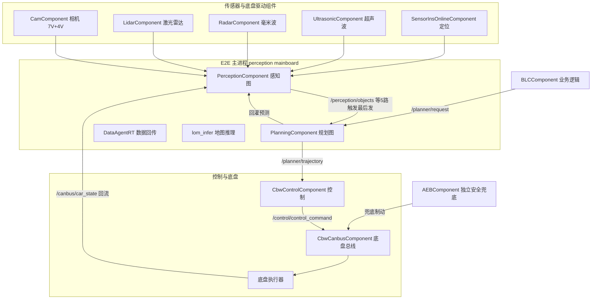

> **30 秒导读**：全套文档的地图：一张架构图、一张目录树、一张学习路径表，告诉你这套系统由什么组成、该按什么顺序学。
> **本篇回答**：这套架构长什么样？各部分怎么分工？我该按什么顺序读？
> **先修阅读**：《00 入门》新手故事篇（推荐但非必须，本篇可自足阅读）。

> **本篇概念速成块**（30 秒，读完再进正文不卡壳）：
> - **单进程 E2E**：感知+规划同住一个 mainboard 进程——两部门合租一间办公室，喊一声就到，不走邮局。
> - **church**：车端中间件三件套——管传话（Topic）、管节拍（Trigger）、管监控（WatchDog）。
> - **DEM / EM**：整车的作息表（EM 状态机）+ 照表点名的车队队长（DEM）——到点才开工，人倒了负责扶起来。
> - **FrameSync**：拍合影的摄影师——12 路传感器同一帧（100ms 一拍）到齐才放行。
> - **EmPlanner 任务链**：规划的主考官——先答路径题再答速度题，反复迭代到收敛。
> - **FrameDone**：交卷铃——感知每帧按固定顺序发 5 路输出，最后发的 /perception/objects 才是给规划的发令枪。


> **读者对象**：具备 C/C++ 基础、了解自动驾驶基本概念、不熟悉本仓库的开发者。  
> **仓库基准**：perception / planning / driver 检出于 `Stable_Master_4.0_new`；`/sandbox/platform/church` 无该分支，**框架代码基于其 dev_master**（差异已经项目组确认）。所有路径为工作区绝对路径。  
> **本文定位**：全套文档的入口。先读本文建立全局图景，再按 §4 学习路径进入各分册。

---

## 1. 项目背景与架构定位

**一句话结论**：C01 的架构选型是「单进程 E2E」——所有结论都从这里出发：延迟最低，耦合也最深。

本仓库是某自动驾驶公司车端（**orinx 平台**＝QNX + NVIDIA Drive Orin）的量产软件工作区。本文档集分析的目标车型为 **C01PT（C01）**，运行 **L2AVP** 方案（**L2** 行车辅助 + **AVP** 自动泊车，DEM 注入 `/task/task_type=L2_driving`）。

**核心架构形态：单进程端到端（E2E）**。与"感知、规划各自独立进程、经总线通信"的分布式架构不同，C01 把感知（Perception）与规划（Planning）两个业务组件装进**同一个 mainboard 进程**（`/sandbox/driver/config/dem/c01-pt/perception.jsonnet` 的 `module_conf` 同时装载两模块配置），同进程内组件经 church channel 直通通信（跨进程才走 iceoryx 共享内存）。

| 维度 | 单进程 E2E（本仓库 C01） | 典型分布式架构 |
|-|-|-|
| 模块边界 | 进程内组件 + graph 子图（边界清晰但共享进程资源） | 独立进程，故障域隔离 |
| 通信延迟 | 进程内 channel 直通，无序列化开销 | 跨进程/跨节点，有 IPC 开销 |
| 数据一致性 | 同进程共享线程池/时钟，帧同步简单 | 需跨节点时间对齐 |
| 部署耦合 | 感知崩溃会连带规划重启（RECOVERY_RESET） | 可单独重启 |

适用场景：算力集中在一块 Orin 平台、强调感知→规划低延迟闭环的 L2+/AVP 量产方案。

## 2. 整体架构图



**图 2-1 · C01 全库架构总览**（传感器驱动 → E2E 主进程 → 控制底盘）

**读图提示**：① 看进程边界：MB 框里四个组件同住 mainboard——这就是单进程 E2E 的本体；② 看触发链：PC→PL 的边上写着「触发最后发」——/perception/objects 是感知每帧最后发布的一路，它就是规划的发令枪；③ 看闭环：MCU→PC 的 /canbus/car_state 回流，让感知知道「我刚才看到的场景，车动起来之后变成了什么样」。

## 3. 核心目录结构

**一句话结论**：四个 git 仓库各司其职——driver 管启动与配置、platform/church 管框架、perception/planning 管业务；读代码先认仓库，再进目录。

```
/sandbox/                          多 git 仓库工作区
├── driver/                        启动与集成（分支 Stable_Master_4.0_new）
│   ├── integration/mainboard.cc   主进程入口 → church_main
│   ├── integration/components/    全部组件封装（perception/planning/cbw_control/cam/aeb…）
│   └── config/                    全部车端配置
│       ├── dem/c01-pt/            进程启动配置（jsonnet：二进制/参数/恢复策略）
│       ├── component/             组件通道配置（jsonnet）+ graph 定义（*.cfg）
│       ├── thread_config/C01/     线程调度策略（cpuset/优先级）
│       └── stream_config/C01/     church 流优先级
├── platform/church/               中间件框架（分支 dev_master，无 Stable_Master_4.0_new）
│   ├── mainboard/                 church_main / ChurchApp / 配置装配
│   ├── component/                 Component 基类 / 注册宏 / 触发器
│   ├── graph/                     GraphScheduler / FrameSync / FrameDone / WatchDog
│   ├── node/                      Node 与 iceoryx/intra 传输
│   └── scheduler/ task/ module/   DDL 调度 / 任务 / 上报
├── perception/                    感知仓库
│   ├── perception/                感知顶层：calculators/ triggers/ frame_context/ pipeline/ sensor/ church_component/
│   └── submodules/                算法子模块：camera/ lidar/ tracker/ farseer/ aeb/ avp/ perception_routing/ base/
├── planning/                      规划仓库（planning/ 下为全部业务代码）
│   ├── calculators/ adapter/ frame/  输入输出装配 / 历史adapter(onboard未启用) / 帧管理
│   ├── planner/ tasks/            规划器与任务管线（决策/路径/速度/iLQR）
│   ├── scene_decider/ scene_sets/ traffic_rules/ traffic_light_decider/  场景与规则
│   ├── reference_line_info/ continuous_object_prediction/ trajectory_checker/  参考线/预测/校验
│   └── planning_gflags/ config/ visualizer/ planning_debug/
├── proto_msg/                     全部 proto 消息定义
└── common/                        公共库（线程管理 ThreadManager、日志 spdlog/glog 等）
```

## 4. 学习路径（推荐阅读顺序）

**一句话结论**：按角色选线读，不必通读——产品走故事线、新人走主线、排障走索引线；全库 36 篇的入口都在本节。

**先按角色选线**（完整阶段表见下方；赶时间只走自己那条线即可）——

| 你的角色 | 最短路线 | 耗时参考 |
|-|-|-|
| 产品 / 测试 / 项目 | 《00 入门》故事篇 + 本文 §2 整体架构图与 §5 名词速查表 + 《06 问题清单》H1~H5 高风险项 | 约 1 小时 |
| 新人工程师 | 《00 入门》→ 01 进程启动 → 02 Topic 拓扑 → 感知主线（00 总览 → 01 输入 → 子模块1 camera → 子模块3 tracker → 子模块4 farseer → 04 线程）→ 规划主线（00 总览 → 子模块1 planner_tasks → 子模块4 轨迹校验 → 06 降级）→ 05 全链路时序 | 2~3 天 |
| 深度开发 / 排障 | 从 06 代码索引或各册 07 索引按文件名定位，配合各篇证据块读源码；时序与异常问题先看 05 篇的时序图 | 按需 |

**阶段0 前置知识**：C++（shared_ptr/lambda/模板）、**protobuf**、**bazel**、**jsonnet** 配置语言、mediapipe 图执行概念（Calculator/InputStream）。

| 阶段 | 阅读顺序 | 目标 |
|-|-|-|
| 1 框架 | 01_进程启动与 Church 框架初始化链路 → 02_模块配置与 Topic 数据流拓扑 | 搞清"进程怎么起来、数据怎么流动" |
| 2 感知 | Perception/00 总览 → 01 输入 → 子模块1 camera → 子模块2 lidar → 子模块3 tracker → 子模块4 farseer → 子模块5 aeb → 子模块6 avp → 子模块7 routing → 03/04 数据结构与线程 → 05 输出 → 06 异常 | 掌握感知全链路与算法子模块边界 |
| 3 规划 | Planning/00 总览 → 01 输入 → 子模块1 planner_tasks → 子模块2 scene → 子模块3 traffic_rules → 子模块5 参考线 → 子模块6 预测 → 子模块7 泊车 → 子模块4 轨迹校验 → 03/04 数据结构与周期 → 05 输出 → 06 降级 | 掌握规划主流程与降级体系 |
| 4 闭环 | 05_端到端全链路时序与异常机制 | 把两模块串成一条时间轴 |
| 随查 | 06_代码索引与问题清单、各册 07 索引 | 代码阅读时定位文件/函数 |

**重点模块**（面试/排查高频）：FrameSyncCalculator 帧同步与背压（感知入口）、uni_model 统一检测（camera/lidar 主体）、EmPlanner 任务链与 iLQR（规划核心）、TrajectoryChecker 与 PATH/SPEED_FALLBACK（安全降级）。  
**常见误区**：① farseer 是**轨迹预测**不是占用网络；② planning 的 `adapter/FactoryCenter` 是 sim/debug 遗产，onboard 不走；③ `mission_planner.cpp` 为 0 字节死代码；④ `control_component.cc` 为空文件，控制走 CbwControlComponent；⑤ t_perception/t_Planning 组件线程在 graphpipe 模式下不直接处理帧（帧处理在图执行线程池）。

## 5. 关键名词速查表（45 概念全导航）

**一句话结论**：全库 45 个核心概念一张表——每个概念只在讲解篇完整展开三栏卡片（是什么/类比/为什么这样设计/代码在哪里），其他篇一律加粗内链跳转；本表就是它们的总索引。

**AI/算法通用名词另见字典**：BEV、MOT、DP、QP、iLQR、NMS、IoU、卡尔曼等 AI/算法领域通用概念不占 E2E 概念卡体系，统一收在[**AI 概念字典**](../../../正典阁/技术栈/AI/00%20AI%20概念字典导航.md)（正典阁/技术栈/AI，四段式零基础词条，23 个）。

### 框架域（16）

| 概念 | 白话一句话 | 详见 |
|-|-|-|
| DEM | 车端的进程守护者：按车型花名册在指定整车状态下拉起/重启业务进程 | [公共 01 §1.2](01%20进程启动与%20Church%20框架初始化链路（C01%20-%20orinx）.md) |
| EM 状态机 | 整车功能状态机（kFullFunction/kDriving 等），进入允许驾驶状态软件才被拉起 | [公共 01 §1.2](01%20进程启动与%20Church%20框架初始化链路（C01%20-%20orinx）.md) |
| mainboard | 车端业务主进程二进制：感知/规划/数据回传/地图推理四个组件都装在它里面 | [公共 01 §1.1](01%20进程启动与%20Church%20框架初始化链路（C01%20-%20orinx）.md) |
| church | 车端中间件框架：组件化 + 图调度 + 消息传输三件套 | [公共 01 §2](01%20进程启动与%20Church%20框架初始化链路（C01%20-%20orinx）.md) |
| Component（组件） | 业务逻辑容器：框架按配置创建，实现 Initialize/Proc/Shutdown 生命周期 | [公共 01 §2.4](01%20进程启动与%20Church%20框架初始化链路（C01%20-%20orinx）.md) |
| ComponentRegistry | 编译期静态注册的「类名→工厂」表，框架按 class_name 查表实例化 | [公共 01 §2.3](01%20进程启动与%20Church%20框架初始化链路（C01%20-%20orinx）.md) |
| Calculator | mediapipe 图的最小计算单元：吃输入流、吐输出流 | [公共 01 §2.1](01%20进程启动与%20Church%20框架初始化链路（C01%20-%20orinx）.md) |
| graphpipe / CalculatorGraph | mediapipe 风格有向图执行引擎：把多个 calculator 接成流水线 | [公共 01 §2.1](01%20进程启动与%20Church%20框架初始化链路（C01%20-%20orinx）.md) |
| GraphScheduler / 调度器 | 把各组件的图合并成一张统一执行 | [公共 01 §3.3](01%20进程启动与%20Church%20框架初始化链路（C01%20-%20orinx）.md) |
| Trigger 触发器 | 组件什么时候干活的节奏器：门铃（数据到）/ 闹钟（定时）/ 拍合影（等齐） | [公共 01 §2](01%20进程启动与%20Church%20框架初始化链路（C01%20-%20orinx）.md) |
| Topic / Channel | 组件间按名字收发的消息频道；同进程直通、跨进程走共享内存 | [公共 02 §2](02%20模块配置与%20Topic%20数据流拓扑（C01%20-%20orinx）.md) |
| FrameDone | 感知图算完一帧后的发布动作：按固定顺序发 5 路输出，最后发 objects（发令枪） | [公共 02 §6.1](02%20模块配置与%20Topic%20数据流拓扑（C01%20-%20orinx）.md) |
| jsonnet | 带变量的配置模板：换车型只改几处变量 | [公共 01 §3.1](01%20进程启动与%20Church%20框架初始化链路（C01%20-%20orinx）.md) |
| protobuf | 跨语言序列化格式：所有车端消息的结构定义载体 | [公共 01 §3.2](01%20进程启动与%20Church%20框架初始化链路（C01%20-%20orinx）.md) |
| iceoryx / 共享内存 | 同机进程间零拷贝传输：大消息（图像/点云）不复制直接传 | [Perception/01 §3.2](../Perception/01%20输入数据接入与预处理.md) |
| WatchDog | 图执行看门狗：每秒查有无新帧，超 1 秒无帧打 WARN | [公共 01 §4.4](01%20进程启动与%20Church%20框架初始化链路（C01%20-%20orinx）.md) |

### 感知域（11）

| 概念 | 白话一句话 | 详见 |
|-|-|-|
| FrameSync 帧同步 | 等 12 路传感器同一帧的数据到齐才放行给算法（帧基 100ms） | [Perception/01 §2](../Perception/01%20输入数据接入与预处理.md) |
| 在途帧背压 | 最多允许 2 帧在途（kMaxFramesInFlight=2），再多的旧数据直接丢弃 | [Perception/01 §2.3](../Perception/01%20输入数据接入与预处理.md) |
| uni_model | 统一检测神经网络：一口气从图像+点云认出所有目标 | [Perception/子模块1 §1](../Perception/02_核心子模块拆解/子模块1：camera%20相机感知子模块.md) |
| tracker / track_id | 多目标跟踪：给每个目标发稳定工牌 | [Perception/子模块3 §1](../Perception/02_核心子模块拆解/子模块3：tracker%20多目标跟踪子模块.md) |
| farseer | 他车轨迹预测：猜旁边那辆车下一步要干啥 | [Perception/子模块4 §1](../Perception/02_核心子模块拆解/子模块4：farseer%20子模块.md) |
| aeb 过滤链 | 感知内部的安全过滤：确认没有漏报危险目标后才交给下游 | [Perception/子模块5 §4.1](../Perception/02_核心子模块拆解/子模块5：aeb%20感知侧子模块.md) |
| avp 泊车感知 | 泊车模式切换的感知班底：环视相机接管主视野、车位检测 | [Perception/子模块6 §1](../Perception/02_核心子模块拆解/子模块6：avp%20自动泊车感知子模块.md) |
| 标定 | 传感器安装位置/姿态参数：所有坐标换算的依据 | [Perception/01](../Perception/01%20输入数据接入与预处理.md) |
| 点云 | 激光雷达输出的三维点集合：一帧数十万带距离/反射率的点 | [Perception/01 §5.2](../Perception/01%20输入数据接入与预处理.md) |
| ObjectPtr 只读共享 | 帧内数据全部 shared_ptr const 只读共享，同一份 proto 下游共用不深拷贝 | [Perception/03](../Perception/03%20关键数据结构与内存管理.md) |
| OnboardMessage | 车端消息统一信封：topic + payload + 时间戳的包装 | [Perception/01 §5.1](../Perception/01%20输入数据接入与预处理.md) |

### 规划域（16）

| 概念 | 白话一句话 | 详见 |
|-|-|-|
| Frame（规划帧） | 单帧输入的容器与预处理：参考线/障碍物/交通灯的装配车间 | [Planning/00 §2](../Planning/00%20Planning%20模块架构总览.md) |
| Task 管线 | 300+ 规划任务按序执行的作业链 | [Planning/00 §2](../Planning/00%20Planning%20模块架构总览.md) |
| 参考线 | 规划的空间骨架：先定「沿哪条路走」再谈「怎么走」 | [Planning/00 §3](../Planning/00%20Planning%20模块架构总览.md) |
| ReferenceLineInfo | 单条参考线的全部工作产物：路径/速度/决策都挂在它上面 | [Planning/00 §2](../Planning/00%20Planning%20模块架构总览.md) |
| EmPlanner | 行车规划器框架：路径与速度迭代求解 | [Planning/00 §2](../Planning/00%20Planning%20模块架构总览.md) |
| DP / QP / iLQR | 轨迹优化三类求解器：先画草稿（DP）→ 誊写工整（QP）→ 逐字校对（iLQR） | [Planning/子模块1 §3](../Planning/02_核心子模块拆解/子模块1：planner%20与%20tasks%20决策规划任务管线.md)；[AI 字典](../../../正典阁/技术栈/AI/00%20AI%20概念字典导航.md) |
| ST 图 / SL 栅格 | 时间-路程图（速度规划）/ 路程-横向图（路径规划） | [Planning/子模块1](../Planning/02_核心子模块拆解/子模块1：planner%20与%20tasks%20决策规划任务管线.md) |
| 场景决策 | 先定性再解题：把当前局面归类后走对应逻辑 | [Planning/子模块2](../Planning/02_核心子模块拆解/子模块2：scene_decider%20与%20scene_sets%20场景决策子模块.md) |
| 交通规则决策 | 红灯/限速/人行道等规则约束的决策层 | [Planning/子模块3](../Planning/02_核心子模块拆解/子模块3：traffic_rules%20与%20traffic_light_decider%20交通规则子模块.md) |
| 轨迹校验 | TrajectoryChecker 21 项检查：可行性/安全性不过关就进降级 | [Planning/子模块4 §1](../Planning/02_核心子模块拆解/子模块4：trajectory_checker%20轨迹校验子模块.md) |
| 降级 Fallback | 规划算不出好轨迹时的保命策略：PATH/SPEED_FALLBACK 温和靠边刹停 | [Planning/06 §2](../Planning/06%20异常处理与降级机制.md) |
| 轨迹回灌 | 规划把轨迹发回感知预测：给自己报信，帮队友盯梢 | [公共 05 §3](05%20端到端全链路时序与异常机制（C01%20-%20orinx）.md) |
| OpenSpace 泊车 | 无结构场景（车位内）的规划：前进后退多段揉库 | [Planning/子模块7 §1.2](../Planning/02_核心子模块拆解/子模块7：mission_planner%20与%20open_space%20泊车规划子模块.md) |
| Context | 规划自己的状态自留地：/planner/context 是上下文转储不是输入 | [Planning/05 §6](../Planning/05%20Planning%20输出发布与控制指令生成.md) |

### 跨域（2）

| 概念 | 白话一句话 | 详见 |
|-|-|-|
| 单进程 E2E | 感知+规划同住 mainboard 一个进程，进程内直通通信 | [公共 01 §3.4](01%20进程启动与%20Church%20框架初始化链路（C01%20-%20orinx）.md) |
| kMaxFramesInFlight | 在途帧上限常量（值 2）：背压机制的具体参数 | [Perception/01 §2.3](../Perception/01%20输入数据接入与预处理.md) |

### 其他名词（未入概念清单，按需查阅）

| 名词 | 解释 |
|-|-|
| GraphManager | 感知图管理器（graph_api.cc），church 与独立进程两种形态共用 |
| RASMap / ras_map_plus | 感知实时语义地图 proto / map_engine 增强版 |
| AVP / AEB / BLC / CBW | 自动泊车 / 自动紧急制动 / 业务逻辑控制 / 线控底盘域 |
| HPI / VPA | 人机规划接口 / 车位状态特征（泊车触发） |
| ADCTrajectory | 规划输出轨迹 proto（`deeproute.planning.ADCTrajectory`） |
| task_type | 任务类型（本车型 L2_driving），DEM 注入 |
| cpuset / SCHED_RR | CPU 亲和集 / 轮转实时调度策略（线程表按线程名匹配） |

## 6. 分析说明（分支、车型、配置与假设差异）

**一句话结论**：所有结论基于实际检出代码逐条验证，先验假设不成立处全部显式标注——本套文档可以当「已核实的事实」读。

**分析范围**：分支 `Stable_Master_4.0_new`（perception/planning/driver 均已确认）；车型 C01PT（orinx，`/task/task_type=L2_driving`，感知模式 l2avp）；配置以 `driver/config/` 下 c01-pt/C01/C01-PT 目录为准，优先级高于通用配置。

**先验假设验证结论**：

1. "单进程 E2E，perception 与 planning 同进程"——**成立**（dem/c01-pt/perception.jsonnet 同一二进制装载两模块配置；thread_config 同一进程表定义 t_perception/t_Planning；详见 01 篇 §3.4）。
2. "church 中间件组织"——**成立**（mainboard + Component + GraphScheduler）。
3. "启动配置位于 /sandbox/driver"——**成立**（进程级在 config/dem/c01-pt，模块级在 config/component）。
4. perception/planning 根目录——**成立**。

**与先验/直觉不符的已证实差异**（详见 06 问题清单）：church 仓库无 Stable_Master_4.0_new 分支（用 dev_master）；tracker/farseer/base 三个 perception 子仓检出于 Stable_Master_3.2（repo 子仓管理差异）；`mission_planner.cpp`、`control_component.cc` 为 0 字节空文件；farseer 实为轨迹预测模块；`/planner/signals_request` 为无发布者死通道。

**标注约定**：全文"**推断"＝由配置/代码间接推出；"未验证"＝仓库内无直接证据；"差异**"＝与先验假设或阶段基线不符并附证据。

---

## 7. FAQ 与自测

**Q1（新手误解）：单进程 E2E 是不是把感知和规划的代码揉在一起了？**
A：没有。两个模块仍是独立仓库、独立组件、各自的 Calculator 图（§1 对比表第 1 行）；「单进程」只是部署形态——同住 mainboard、共享线程池、channel 直通。看到「单进程」不要理解成「单模块」，读代码时依然按模块边界走。

**Q2：本篇 §5 的 45 概念表、E2E 概念卡、AI 字典是什么关系？**
A：三层分工：本表是**总索引**（45 个项目概念 → 讲解篇位置）；E2E 各篇的三栏卡片是概念的**完整展开**（是什么/类比/为什么/代码在哪）；AI/算法领域通用名词（BEV、MOT、DP、QP、NMS 等）不入这套卡体系，统一收在[**AI 概念字典**](../../../正典阁/技术栈/AI/00%20AI%20概念字典导航.md)，E2E 正文首次出现处会加字典链接。三者相互链接、各管一段。

**Q3：church 仓库用 dev_master 分析，会不会和车端实际不符？**
A：经项目组确认接受（§6）。该仓库本身无 Stable_Master_4.0_new 分支，框架代码取 dev_master，涉及差异处已显式标注；业务仓库（perception/planning/driver）均为 Stable_Master_4.0_new 实测，不受影响。

**自测（能答上来才算读懂）**

1. 感知每帧最后发布哪一路 Topic？为什么它要最后发？
   （答：/perception/objects。它是规划的触发源（IMMEDIATE 策略，图 2-1 读图提示②），最后发保证规划醒来时本帧 5 路输出全部就绪；时序契约详见公共 02 §3 与公共 05。）
2. 「单进程 E2E」最大的代价是什么？
   （答：故障域合并——感知崩了规划陪葬，一起被 DEM 按 RECOVERY_RESET 重启（§1 对比表最后一行；机制见公共 01 §3.4）。）
3. 想快速定位「FrameSync 在哪个文件」，该走哪条学习线？
   （答：深度开发/排障线——从 06 代码索引或各册 07 索引按文件名定位（§4 表），或直接跳 Perception/01 §2 卡片的「🗂 代码在哪里」栏。）
