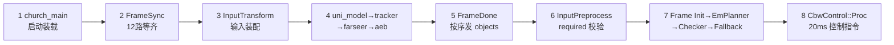

> **30 秒导读**：两样实用工具：找文件/函数的索引表，和按调用时序串起单帧 E2E 的函数链。
> **本篇回答**：这个功能的代码在哪个文件？单帧从启动到控制要经过哪些函数？动手前要避开哪些已知坑？
> **先修阅读**：无，随查随用。
>
> **本篇概念速成块**（30 秒，读完再进正文不卡壳）：
> - **随查索引**：本篇是工具书不是故事书——读代码前先来 §1 找路径，理时序先看 §2 调用链。
> - **两条主线**：文件索引按"域"组织（框架/Topic/感知/规划/控制），函数索引按"调用时序"组织。
> - **未验证标注**：全套文档凡带"差异标注/未验证"字样的结论都没在实车复核过——动手前必看。
> - **两个空文件**：mission_planner.cpp、control_component.cc 是空壳，别在里面找实现（见 [**00 入门 §5 词汇避坑表**](00%20入门：写给新手的%20E2E%20架构故事（C01%20-%20orinx）.md)）。
> - **分支差异**：platform/church 基于 dev_master（无 Stable_Master_4.0_new 分支），涉及 church 的行号可能有出入。

> **读者对象**：具备 C/C++ 基础、了解自动驾驶基本概念、不熟悉本仓库的开发者。  
> **仓库基准**：perception / planning / driver 检出于 `Stable_Master_4.0_new`；`/sandbox/platform/church` 无该分支，**框架条目基于其 dev_master**（差异已经项目组确认）。所有路径为工作区绝对路径。  
> **本文定位**：全套文档的**随查索引**。§1/§2 用于代码阅读定位；全套 36 篇中带"差异标注/未验证/死代码"字样的结论就地标注在各篇证据块旁，动手排查前建议先过 [**00 入门 §5 词汇避坑表**](00%20入门：写给新手的%20E2E%20架构故事（C01%20-%20orinx）.md)与本篇 §2 的调用时序。

---

## 1. 核心文件索引

**一句话结论**：文件索引按域分五段——先定位域，再查表找文件，关键符号列已给出可直接 grep 的函数名。

**怎么用这份索引（三步）**：① 先判断要找的功能属于哪个域（框架/Topic/感知/规划/控制），跳到对应小节；② 在表中找到目标文件与职责描述，确认它是不是你要的；③ 复制「关键符号」列的函数名到编辑器全局搜索（grep），直接跳到实现——符号名比行号可靠（行号会随分支漂移，见 §3 Q2）。若表中出现陌生算法名词（如匈牙利、QP），先翻[**AI 概念字典**](../../../正典阁/技术栈/AI/00%20AI%20概念字典导航.md)再读代码，事半功倍。

### 1.1 框架与启动（[**公共 01**](01%20进程启动与%20Church%20框架初始化链路（C01%20-%20orinx）.md)）

| 文件 | 职责 | 关键符号 |
|-|-|-|
| /sandbox/driver/integration/mainboard.cc | 主进程入口（仅一行） | `main → church_main` |
| /sandbox/platform/church/mainboard/church_main.cc | 11 步初始化序列 | `church_main()` |
| /sandbox/platform/church/mainboard/church_app.cc | 组件加载与调度启动 | `ChurchApp::Initialize / Run` |
| /sandbox/platform/church/common/arg_parser.cc | 命令行解析（-a/-m/-p/-c/-T） | `ParseSystemArguments` |
| /sandbox/platform/church/component/component.h | 组件基类与静态注册 | `Component / CHURCH_REGISTER_COMPONENT / ComponentRegistry` |
| /sandbox/platform/church/graph/ | 图执行引擎 | `GraphScheduler / FrameSyncCalculator / FrameDoneCalculator / WatchDog` |
| /sandbox/driver/config/dem/c01-pt/perception.jsonnet | E2E 主进程定义（单进程关键证据） | `module_conf`（4 个 jsonnet）/ `RECOVERY_RESET` |
| /sandbox/driver/config/thread_config/C01/perception.json | 线程调度表（t_perception/t_Planning） | `SCHED_RR / cpuset` |

### 1.2 Topic 配置与图定义（[**公共 02**](02%20模块配置与%20Topic%20数据流拓扑（C01%20-%20orinx）.md)）

| 文件 | 职责 |
|-|-|
| /sandbox/driver/config/component/perception_orin.jsonnet | 感知组件通道声明（orin 生效） |
| /sandbox/driver/config/component/planning.jsonnet | 规划组件通道声明（L16 `/planner/context` 在 `context_config`） |
| /sandbox/driver/config/component/perception_graph_l2avp_orin.cfg | 感知主图（FrameSync → 算法子图 → FrameDone OUTPUT:0\~4） |
| /sandbox/driver/config/component/planning_graph.cfg / planning_sub_graph.cfg | 规划主图（`max_queue_size: 15`，L36）/ 子图（5） |
| /sandbox/perception/perception/cfg/perception_orin_l2avp.cfg | C01 感知算法配置总入口（l2avp 模式） |

### 1.3 感知（[**Perception 目录各篇**](../Perception/00%20Perception%20模块架构总览.md)）

| 文件 | 职责 | 关键符号 / 行号 |
|-|-|-|
| /sandbox/perception/perception/church_component/perception_component.cc | 感知组件封装 | `GetPerceptionMode()`（cloud>task_type>默认） |
| /sandbox/perception/perception/graph_api.cc | 图管理器 | `CreateGraphManager / CompleteRegisterAndStart` |
| /sandbox/perception/perception/calculators/perception_input_transform_calculator.cc | 输入装配 | `kInShmpoolTopics`（12 路）/ `FindFirstMessage` |
| /sandbox/perception/perception/sensor/ros_wrapper.cpp | ROS 独立模式订阅（C01 车端不走） | `InitPcdSub` 等 → `AddInput` |
| /sandbox/perception/submodules/camera/ | 相机检测（uni_model 预处理+任务头） | 见子模块1 |
| /sandbox/perception/submodules/lidar/ | 激光雷达检测（heatmap 峰值解码） | 见子模块2 |
| /sandbox/perception/submodules/tracker/ | 多目标跟踪 | 匈牙利关联（见子模块3） |
| /sandbox/perception/submodules/farseer/ | 他车轨迹预测（模型优先、规则兜底） | 见子模块4 |
| /sandbox/perception/submodules/aeb/ | AEB 过滤链 | 见子模块5 |
| /sandbox/perception/submodules/avp/ | 泊车（BEV mighty → MightyFusion） | 见子模块6 |
| /sandbox/perception/submodules/perception_routing/ | 感知路由 | 见子模块7 |

### 1.4 规划（[**Planning 目录各篇**](../Planning/00%20Planning%20模块架构总览.md)）

| 文件 | 职责 | 关键符号 / 行号 |
|-|-|-|
| /sandbox/planning/planning/calculators/planning_input_preprocess_calculator.cc | 输入装配与校验 | `FindLastMessage("/perception/objects")`**L561**；`/planner/context` L163；ras_map L576 |
| /sandbox/planning/planning/planner/planner.cpp | 规划主流程 | `ProcessFrameInitStuff`；耗时打点 L271-275 |
| /sandbox/planning/planning/planner_manager.cpp | EmPlanner 任务链装配（内联工厂） | `CreateXxxTask` |
| /sandbox/planning/planning/frame/ | 帧管理与参考线初始化 | `Frame::Init`（QpSpline OSQP 平滑 ≤3 条） |
| /sandbox/planning/planning/tasks/ | 决策/路径/速度求解任务 | DpPath → DpSpeed → QpSpeed → iLQR（见子模块1） |
| /sandbox/planning/planning/scene_decider/ + scene_sets/ | 场景决策（14 检测器） | 见子模块2 |
| /sandbox/planning/planning/traffic_rules/ + traffic_light_decider/ | 交通规则与红绿灯 | 见子模块3 |
| /sandbox/planning/planning/trajectory_checker/ | 轨迹校验（21 项枚举，仅 EM_PLANNER） | 见子模块4 |
| /sandbox/planning/planning/reference_line_info/ | 参考线信息聚合 | 见子模块5 |
| /sandbox/planning/planning/continuous_object_prediction/ | 预测接入与交互（IBR） | 见子模块6 |
| /sandbox/planning/planning/calculators/planning_post_process_calculator.cc | 输出发布 | FrameDone OUTPUT:0\~12 |

### 1.5 控制与底盘（[**公共 05**](05%20端到端全链路时序与异常机制（C01%20-%20orinx）.md)）

| 文件 | 职责 | 关键符号 / 行号 |
|-|-|-|
| /sandbox/driver/integration/components/cbw_control_component.cc | 控制组件（C01 实际控制域） | 订阅 `/planner/trajectory` L49；发布 `/control/control_command` L71-72 |
| /sandbox/driver/config/component/cbw_control.jsonnet | 控制通道声明 | `expected_proc_duration_ms: 20` |
| /sandbox/driver/integration/components/cbw_canbus_component.cc | 底盘总线组件 | 下发 control_command / 上报 car_state |

## 2. 核心函数索引（按调用时序）

**一句话结论**：8 步调用链就是单帧 E2E 的骨架——感知四步、规划三步、控制一步，读代码顺着这条链走不会迷路。

**链里的 AI 名词对照**：第 4 步 uni_model 是[**神经网络推理**](../../../正典阁/技术栈/AI/神经网络与推理引擎.md)，tracker 的「匈牙利关联」是一种[**跨帧目标配对算法**](../../../正典阁/技术栈/AI/匈牙利算法.md)，farseer 做的是[**他车轨迹预测**](../../../正典阁/技术栈/AI/轨迹预测.md)；第 7 步 EmPlanner 任务链里的 DpPath/DpSpeed/QpSpeed/iLQR 对应字典的 [DP](../../../正典阁/技术栈/AI/动态规划%20DP.md)、[QP](../../../正典阁/技术栈/AI/二次规划%20QP.md) 与 [iLQR](../../../正典阁/技术栈/AI/iLQR%20与%20LQR.md)。

**图 2-1 · 单帧 E2E 调用时序（从启动到控制指令）**（§2 的 8 条索引与图中 8 个节点一一对应）

**读图提示**：① 节点 1 只在进程启动时发生一次，2~8 每帧循环；② 节点 5 是感知→规划的交接点（发令枪）；③ 节点 7 内含校验与降级两级兜底，细节见各讲解篇。

1. `church_main()` → `ChurchApp::Initialize`（LoadModule×4）→ `Run`（GRAPH 调度器 + `WaitForSignal`）——[**公共 01 §2.2**](01%20进程启动与%20Church%20框架初始化链路（C01%20-%20orinx）.md)。
2. `FrameSyncCalculator::Process`（100ms 基准对齐 12 路，`kMaxFramesInFlight=2` 背压）——[**Perception/04**](../Perception/04%20线程调度与运行机制.md)。
3. `PerceptionInputTransformCalculator::Process`（FindFirstMessage 装配 `PerceptionProcessInput`）——[**Perception/01**](../Perception/01%20输入数据接入与预处理.md)。
4. uni_model 检测 → tracker（匈牙利关联）→ farseer（预测）→ aeb 过滤——[**Perception 子模块 1~5**](../Perception/02_核心子模块拆解/子模块1：camera%20相机感知子模块.md)。
5. `FrameDoneCalculator`：感知 OUTPUT:0\~4，`/perception/objects` 最后发布（触发契约）；规划 OUTPUT:0\~12——[**公共 02 §3**](02%20模块配置与%20Topic%20数据流拓扑（C01%20-%20orinx）.md)。
6. `PlanningInputPreprocessCalculator::Process`（required 四件套缺失硬报错；`/perception/objects` 用 FindLastMessage 取最新帧）——[**Planning/01**](../Planning/01%20Planning%20输入数据接入与有效性校验.md)。
7. `Planning::ProcessFrameInitStuff`（规则+红绿灯→虚拟墙）→ `Frame::Init`（参考线）→ `EmPlanner` 任务链 → `TrajectoryChecker` → `FallBackPathSpeedSetting`（PATH/SPEED_FALLBACK）→ `PlanningPostProcessCalculator`——[**Planning/00 §2**](../Planning/00%20Planning%20模块架构总览.md)。
8. `CbwControlComponent::Proc`（pose 触发 20ms 预算）→ `/control/control_command`——[**公共 05 §2**](05%20端到端全链路时序与异常机制（C01%20-%20orinx）.md)。

---

## 3. FAQ 与自测

**Q1：按索引找到 mission_planner.cpp 却什么都没有，是索引错了吗？（新手最常见误解）**

不是。它是 **0 字节空文件**（死代码），control_component.cc 同理——真正的实现分别在 EmPlanner 任务链与 CbwControlComponent（详见 [**00 入门 §5 词汇避坑表**](00%20入门：写给新手的%20E2E%20架构故事（C01%20-%20orinx）.md)）。

**Q2：church 平台目录下的行号能直接信吗？**

不能全信：platform/church 无 Stable_Master_4.0_new 分支，本篇基于其 dev_master 检出，行号可能有出入——定位时以**符号名/函数名**为准，行号只作参考。

**Q3：索引指向的结论里带着"未验证"标注，能用吗？**

可以作为排查起点但不能当定论：先按 [**Perception/07 §5.4 静态验证清单**](../Perception/07%20Perception%20代码索引与学习指南.md) 或 bag 回放复核，再下结论。

**自测**（先自己想，再看缩进答案）：

1. 想看规划输入装配的 required 硬校验，应该打开哪个文件？
    planning_input_preprocess_calculator.cc（§1.4 第一行）；完整证据链与"整帧拒绝"语义见 Planning/01。
2. `/planner/trajectory` 的控制侧消费者代码在哪？
    cbw_control_component.cc L49 订阅、L71-72 发布控制指令（§1.5）；交互协议细节见公共 05。
3. 本篇的 8 步调用链中，哪一步只在进程启动时发生一次？
    第 1 步 church_main()（装载与初始化）；第 2~8 步是每帧循环。
