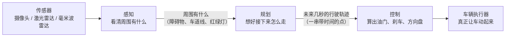

> **这一篇讲什么**：用最少的术语，把「端到端自动驾驶」这个词拆成三个具体角色，让你先有一张不会错的总图。
> **读完你能回答**：车上到底是谁在开车？感知、规划、控制各自管什么、不管什么？它们之间怎么传递信息？
> **前置知识**：会写代码即可。不需要任何自动驾驶、算法或汽车背景。

## 1. 一句话：自动驾驶就是「看 → 想 → 动」

**一句话结论**：把车想象成一个刚拿到驾照的新手司机——先用眼睛**看**清周围有什么，再用脑子**想**接下来几秒怎么走，最后用手脚**动**起来。端到端自动驾驶，就是把这三件事分别交给三个软件模块：**感知（Perception）**、**规划（Planning）**、**控制（Control）**。



**图 1-1 · 端到端三段式总图**（整篇文档只有这一张图需要你先记住）

**读图提示**：箭头上的文字是「上一步交给下一步的东西」。感知不关心方向盘转多少度，规划不关心图像有多少像素——每个角色只把**自己的结论**交给下一个角色。这种「各管一段、只交接结论」的设计，是整套架构能够被拆开理解、被独立替换的根本原因。

如果只记一句话，请记这句：

> **感知回答「周围有什么」，规划回答「接下来怎么走」，控制回答「手脚怎么动」。**

## 2. 三个角色：各自负责什么、不负责什么

很多初学者看架构文档会迷失，是因为把三个角色的职责混在一起。下面这张表把边界钉死：

| 角色 | 它回答的问题 | 它的输入 | 它的输出 | 它**不**负责的事 |
|-|-|-|-|-|
| 感知 | 我周围现在有什么？ | 摄像头图像、激光雷达点云、毫米波雷达目标、定位与地图 | 障碍物列表（每个障碍物的位置、速度、朝向、类别）、车道线、可行驶区域、红绿灯状态 | 不决定往哪走，不碰方向盘 |
| 规划 | 接下来几秒我应该怎么走？ | 感知给出的障碍物列表、地图与导航信息、车辆自身状态 | 一条**轨迹**：未来几秒内，每个时刻车应该在哪里、速度多少 | 不识别图像，不直接控制电机 |
| 控制 | 为了走这条轨迹，油门/刹车/方向盘各给多少？ | 规划给出的轨迹、车辆当前姿态与速度 | 油门开度、刹车压力、方向盘转角等控制指令 | 不关心障碍物是什么，只跟踪轨迹 |

### 2.1 为什么「看」和「想」必须分开

**一句话结论**：因为它们的**输出形式完全不同**——感知输出「世界是什么样」，规划输出「我打算怎么做」。混在一起，任何一方改动都会牵连另一方。

打个比方：导航软件（规划）不需要知道摄像头拍到了什么，它只需要知道「前方 100 米有车」。如果感知把「前方有车」这个结论交给规划，规划就可以专心研究「变道还是跟车」；哪天感知换了一个更强的模型，只要输出的结论格式不变，规划一行代码都不用改。

这就是软件工程里常说的**解耦**：两个模块之间只约定「交接什么」，不关心「对方内部怎么实现」。

### 2.2 为什么「想」和「动」也必须分开

规划思考的节奏是「一帧一帧」的（例如每 100 毫秒想一次，一次想未来几秒），而控制需要更频繁地微调（例如每 10 毫秒修正一次方向盘）。如果让规划直接控制电机，规划一次思考的延迟就会直接变成车辆的动作延迟，车会开得一顿一顿。

分开之后：规划可以慢一点、想得远一点；控制可以快一点、跟得紧一点。**思考的频率和执行的频率解耦**，这是所有实时控制系统的通用做法。

### 2.3 一张图里的「隐藏角色」

图 1-1 里没有画出来的，还有三类支撑角色，后面会有专门篇章：

- **传感器驱动**：把摄像头、激光雷达的原始数据变成软件能读的消息。它们不判断内容，只负责搬运。
- **定位与地图**：告诉车「我现在在哪条路上、朝哪个方向」。感知和规划都要用。
- **框架（Church）**：让上面这些模块能在一个进程里跑起来、互相发消息、按节拍调度。它相当于公司的行政系统——不直接做业务，但所有业务都靠它组织。

### 2.4 三条边界，一句话记住

如果把三个角色的职责压缩成三句话：

| 角色 | 一句话边界 | 越界的典型错误 |
|-|-|-|
| 看（感知） | 只描述世界，不改车 | 感知自己想「要不要刹车」 |
| 想（规划） | 只决定怎么走，不描述世界 | 规划自己去猜障碍物在哪 |
| 动（控制） | 只执行动作，不决定去哪 | 控制自己改路线躲障碍 |

越界的后果是责任不清：出了问题不知道是「看错了」「想错了」还是「动错了」。分层的价值就在于**每一层都能被单独验证**——给感知一段录包，它应该输出同样的障碍物；给规划一段障碍物清单，它应该输出同样的轨迹。

## 3. 它们怎么「说话」：topic 是什么

**一句话结论**：模块之间不直接调用对方的函数，而是把消息发到一个叫 **topic（话题）** 的公共频道上；谁关心这个话题，谁就订阅它。

### 3.1 生活类比：公告栏，而不是打电话

假设公司里有个公告栏：

- 感知把「本帧障碍物列表」贴在名为 `/perception/objects` 的公告栏上；
- 规划每天盯着这块公告栏，一看到新内容就开始工作；
- 控制盯着另一块叫 `/planner/trajectory` 的公告栏。

贴的人不需要知道谁在看，看的人也不需要知道谁贴的。这种「发布—订阅」的模式有三个好处：

1. **互不打扰**：感知挂掉时，规划只是收不到新消息，不会因为「调用感知函数失败」而崩溃。
2. **一对多**：同一份障碍物列表，规划在看，调试工具也在看，互不影响。
3. **可替换**：想换一个感知实现，只要它还往同一个 topic 发同样格式的消息，下游无感知。

### 3.2 topic 上跑的是什么

topic 里跑的不是随便的字符串，而是**结构化的消息**（本项目用 protobuf 定义格式）。你可以把它理解成一张格式固定的表格：障碍物列表这张表里，每一行是一个障碍物，列包括「编号、位置、速度、朝向、类别、置信度」。

> **概念：消息格式（proto）**
> 定义「这张表有哪些列、每列什么类型」的文件。发送方按格式填表，接收方按格式读表，双方不需要运行同一份代码。本项目的消息定义放在 `proto_msg` 仓库中。

### 3.3 谁决定「什么时候开始干活」

光有公告栏还不够：规划怎么知道「这一帧的障碍物已经贴完了，可以开始算了」？

答案是**触发（trigger）**：某个 topic 的新消息到达，会作为「上班铃」唤醒订阅它的模块。本项目中：

- 规划被 `/perception/objects` 触发——感知每发完一帧障碍物，规划立刻开始算这一帧；
- 控制被 `/localization/pose`（定位姿态）触发——按定位的节奏持续运行，同时读取最新的规划轨迹。

> 注意一个容易误解的点：**控制不是被轨迹触发的**。轨迹只是控制需要读取的「最新指令缓存」，控制自己的节拍由定位消息驱动。这一点在第 08 篇会详细展开。

## 4. 车上到底跑着几个程序

**一句话结论**：C01 车型上，感知、规划、数据代理、地图推理这四个模块跑在**同一个进程**里，由同一个可执行文件 `perception/bin/mainboard` 装载。

### 4.1 直接看启动配置

C01 的启动配置在 `driver/config/dem/c01-pt/perception.jsonnet`。它声明这个进程启动时要装载哪些模块配置（`module_conf`）：

```text
${DEEPROUTE_PATH}/perception/config/perception_orin.jsonnet
${DEEPROUTE_PATH}/planning/config/planning.jsonnet
${DEEPROUTE_PATH}/data-agent-rt/config/data_agent_rt.jsonnet
${DEEPROUTE_PATH}/map-engine/config/lock_on_road/lom_infer/config/lom_infer.jsonnet
```

四行配置，四个模块，一个进程。可执行文件本身只有一行代码——调用框架的 `church_main`，剩下的事情全部由配置驱动：

```cpp
int main(int argc, char** argv) {
  return deeproute::church::church_main(argc, argv);
}
```

### 4.2 单进程意味着什么

对初学者来说，先记住三个推论就够了：

1. **模块之间传消息不跨网络**：同一进程内通过共享内存和回调传递，延迟更低。
2. **一个模块崩溃可能拖垮全部**：所以框架有异常处理和降级机制（后续篇章）。
3. **「感知进程」「规划进程」是常见误称**：它们只是同一进程里的两个**组件**（component）。

> **概念：组件（component）**
> 框架里的一个业务模块包装。每个组件有自己的名字、触发条件、内部计算图和输入输出 topic。可以把它理解成「一个部门」：有部门职责（计算图）、上班铃声（触发）和对外接口（topic）。

## 5. 为什么这样分层：三个工程理由

**一句话结论**：分层不是为了好看，而是为了让「改动的影响范围」可控。

1. **可独立验证**：感知可以用录制的数据离线回放，不需要真车；规划可以喂假障碍物测试；控制可以做台架测试。
2. **可独立替换**：换感知模型不影响规划接口；换规划算法不影响控制协议。
3. **可定位问题**：车开得不好时，先看是「没看清」（感知）、「想错了」（规划）还是「没执行好」（控制）——三段式天然就是排查路径。

## 6. 三个常见误解

**误解一：端到端就是「一个大模型从摄像头直接输出方向盘」。**
不是。本项目的「端到端（E2E）」指的是**从传感器到车辆执行的完整链路**，链路上有感知、规划、控制多个模块，而不是学术意义上的「单一大神经网络」。文档里说的 E2E 架构，就是这个完整链路。

**误解二：感知就是摄像头。**
感知是**一整套处理流程**：摄像头、激光雷达、毫米波雷达的数据先对齐、预处理，再送进模型推理，最后经过跟踪、预测、后处理，才变成障碍物列表。摄像头只是最前端的传感器之一。

**误解三：规划就是导航地图。**
导航地图回答「从北京到上海走哪条高速」，粒度是公里级；这里的规划回答「未来 3 秒内每一刻我在哪」，粒度是厘米级，而且必须考虑周围每一辆车的动态。两者不是一回事。

### 6.1 常见问题 FAQ

| 问题 | 简答 |
|-|-|
| 端到端是不是「一个大模型从图像直接出方向盘」？ | 本项目不是。这里的「端到端」指**从传感器到执行器的完整链路**，内部仍分成感知、规划、控制三段，各有明确 topic 边界。 |
| 感知能不能直接给控制发指令？ | 不能。感知只发世界描述，控制只认轨迹。绕过规划会让安全责任无处安放。 |
| 控制为什么不能自己规划？ | 控制只看未来几十毫秒的局部误差，没有全局地图、障碍物和交规信息，做不了「往哪走」的决策。 |
| 一个模块坏了，车会怎样？ | 每一段都有兜底：感知丢失时规划降级减速，规划超时时控制沿用上一条轨迹并逐步停车，控制异常时退出接管。 |
| 「模块」和「组件」是一回事吗？ | 日常口语可混用；严格说，组件（component）是框架里的可装配单元，模块是更宽泛的说法。详见第 09 篇。 |

## 7. 本篇小结与下一篇

记住三件事：

1. 端到端 = **看（感知）→ 想（规划）→ 动（控制）**。
2. 三者通过 **topic + 触发** 交接，而不是互相调用函数。
3. C01 上它们跑在**同一个进程**里，由配置装载，不是四个独立程序。

下一篇《02 一帧全景：甘特图上的并行》会回答：这整套流程在 100 毫秒的「一帧」里，谁先跑、谁在等、哪里在并行。

## 8. 证据与延伸

| 结论 | 证据位置 |
|-|-|
| 单进程装载四个模块 | `driver/config/dem/c01-pt/perception.jsonnet`（`orin_flags.module_conf` 四行配置） |
| 进程入口只调用 church_main | `driver/integration/mainboard.cc` |
| 规划被 `/perception/objects` 触发、策略 IMMEDIATE | `driver/config/component/planning.jsonnet`（`trigger_channels` / `trigger_policy`） |
| 控制被 `/localization/pose` 触发、消费 `/planner/trajectory` | `driver/config/component/cbw_control.jsonnet` |
| topic 与消息格式定义 | `proto_msg` 仓库；感知输入输出清单见 `driver/config/component/perception_orin.jsonnet` |
