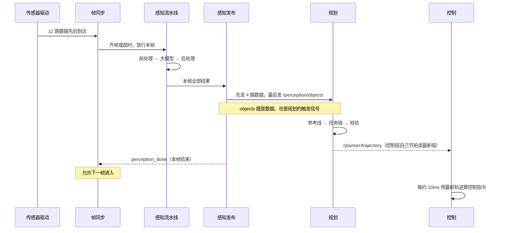

> **这一篇讲什么**：把「一帧」当作一部 100 毫秒的短片，用时间线（甘特图）看清每个组件在什么时间段干活、哪些在同时干活。
> **读完你能回答**：一帧里谁先跑、谁在等谁？感知和规划是串行还是并行？为什么控制看起来「不守规矩」？下一帧什么时候开始？
> **前置知识**：读完第 01 篇（知道感知/规划/控制三个角色和 topic 的概念）。

## 1. 什么叫「一帧」

**一句话结论**：一帧 = 系统处理一次传感器数据的一个**时间片**。C01 上这个时间片是 **100 毫秒**（也就是每秒 10 帧，10 Hz）。

### 1.1 为什么要有「帧」这个概念

摄像头每秒拍很多张照片，激光雷达每秒转很多圈。如果每来一个数据就单独处理一次，系统会被拆成无数碎片，根本没法对齐——摄像头看到「有车」的那一刻，激光雷达可能还没扫到那个位置。

所以工程上把时间切成固定的格子：**每 100 毫秒算一格，格子内到达的所有传感器数据算作同一时刻的世界**。这个格子就是一帧。

> **概念：帧（frame）与帧率（Hz）**
> 帧是处理的时间单位；帧率是每秒处理多少帧。10 Hz = 每 100 毫秒一帧。类比：电影 24 帧/秒，每帧是一张静止画面，连起来就成了连续动作。

### 1.2 100 毫秒这个数字从哪来

不是拍脑袋定的，而是写在传感器接入配置里的：12 路需要对齐的传感器（1 路激光雷达 + 11 路相机）都声明了 `frame_nano_base: 100000000`——即 100,000,000 纳秒 = 100 毫秒。

```text
# driver/config/component/perception_orin.jsonnet
{
  "name": "/sensors/lidar/combined_point_cloud_proto",
  "type": "framesync",
  "frame_nano_base": 100000000,   // 100ms，一帧的宽度
}
```

这 12 路传感器就是感知的「主料」；其他数据（毫米波雷达、定位、车辆状态、地图）以不同策略搭车进来，不参与 100 毫秒对齐。

## 2. 一张甘特图看全一帧

**一句话结论**：一帧内的主链路是**串行**的（后一步依赖前一步的结果），但每一段内部有大量**并行**；规划与控制则按不同节拍**并行**运行。

```mermaid
gantt
    title 一帧内的组件时间线（相对顺序示意，非实测耗时）
    dateFormat x
    axisFormat %L ms
    section 传感器（持续采集）
    12 路采集与对齐窗口      :s0, 0, 8
    下一帧采集（背靠背）      :s0b, 90, 10
    section 感知前处理
    拆包与共享内存解包        :s1, 0, 4
    四支线并行备料（GPU）     :s2, 4, 8
    section 感知大模型
    uni_model 一次推理        :s3, 12, 20
    section 感知后处理
    多模态对齐 + 跟踪 + 预测  :s4, 32, 12
    后处理五连 + 语义加工     :s5, 44, 8
    section 发布
    输出转换 + 按序发布       :s6, 52, 4
    section 规划（被感知触发）
    输入装配 + 参考线         :s7, 56, 6
    任务链求解（DP/QP/校验）  :s8, 62, 20
    section 控制（独立节拍）
    控制周期（每约 10ms 一次） :s9, 0, 100
```



**图 2-1 · 一帧甘特图**（横轴单位毫秒；色块长度只表达相对先后与重叠关系，不代表真实耗时）

**读图提示（最重要的一张图，请按三步读）**：

1. **看主链**：前处理 → 大模型 → 后处理 → 发布 → 规划，像接力赛一样一段接一段，这是**串行**部分。
2. **看重叠**：前处理里的四支线（激光雷达、相机、毫米波雷达、泊车）是同时干活的；控制和规划在时间上重叠——控制不等规划，它按自己的节拍持续运行。
3. **看边界**：100ms 处是下一帧的起点。感知在这一帧结束后才允许下一帧进入（见 §5），而控制始终连续运行。

> 为什么不用普通流程图画这张图？流程图只能表达「谁接谁」，表达不了「同时」和「多久」。甘特图有横轴时间，才能把并行度画出来。

## 3. 逐段解读：每一段在干什么、在等谁

### 3.1 传感器采集：12 路各自跑，帧同步负责「凑齐」

**一句话结论**：12 路传感器并不是同时整点送达，帧同步器（FrameSync）的任务是等它们到齐，或者等到超时，然后放行这一帧。

- 摄像头按自己的曝光节奏出图，激光雷达按自己的转速出点云，到达时间有先后。
- 每一路数据都带时间戳，帧同步器按 100ms 的格子把它们归到同一帧。
- 如果某一路迟迟不到（例如雨雾导致图像延迟），不能无限等——超时后就用已到的数据装配这一帧，保证系统不停摆。

> **概念：帧同步（FrameSync）**
> 把多路异步到达的传感器数据按时间格子凑成一帧的机制。类比：拍集体照，摄影师喊「3、2、1」，但总有人眨眼——等到最后一秒还没准备好，也只能按快门，不能一直等。

### 3.2 前处理：把原始数据变成模型能吃的形状

**一句话结论**：拆包、解共享内存、图像缩放与归一化、点云体素化——这些活由 GPU 和 CPU 并行完成，产出模型需要的张量。

这一段对应甘特图的 0~12ms。四条支线（详见第 04 篇）：

| 支线 | 输入 | 做什么 | 产出 |
|-|-|-|-|
| 激光雷达线 | 点云 | 滤波、体素化、骨干网络前处理 | 点云骨干输入 |
| 相机线 | 11 路图像 | 缩放、归一化、投影矩阵计算 | 模型图像张量与标定参数 |
| 毫米波雷达线 | 雷达目标 | 编码成 BEV 特征 | 雷达 BEV 特征 |
| 泊车线 | 环视相机 | 自由空间与车位预处理 | 泊车感知输入 |

### 3.3 感知大模型：全链最重的一段

**一句话结论**：`uni_model` 是全链路唯一的深度学习大模型推理节点，它把二十多路输入一次性吃进去，一次前向计算产出多任务结果。

这段对应甘特图的 12~32ms，是整个感知里最耗时的部分（真实耗时取决于芯片与模型，图中只是示意）。它的输入不用 50 路、也不是「一路摄像头一张图」——当前 C01 代码里命名输入是 22 路（`INFER_IN:0` 到 `INFER_IN:21`），包括点云、图像、雷达 BEV、位姿矩阵、历史特征、地图编码、路由编码等（第 05 篇逐一解释）。

### 3.4 感知后处理：把模型输出变成业务对象

**一句话结论**：模型输出的原始检测结果不能直接给规划用，要先对齐多模态结果、给每个目标发「跟踪编号」、预测他车未来轨迹，再做五道后处理和语义加工。

这段对应甘特图的 32~52ms，是**串行**的（每一步依赖上一步）：

```text
多模态对齐 → 跟踪（发 track_id）→ 预测（他车未来轨迹）→ 交互/红绿灯/事件/备份/合并 → 语义加工
```

### 3.5 发布：先发数据，最后发触发器

**一句话结论**：一帧的所有结果按固定顺序发布：其他 4 路数据先发，`/perception/objects` **最后发**——因为它同时是规划的「上班铃」。

这段对应甘特图的 52~56ms。代码里写得很直白：

```text
# perception_graph_l2avp_interleaving.cfg
# Keep this sequence to ensure the planning module receives the trigger
# topic (/perception/objects) after the other four input topics.
output_stream: "OUTPUT:0:perception__extra_objects"
output_stream: "OUTPUT:1:perception__ras_map"
output_stream: "OUTPUT:2:perception__ras_map_parking"
output_stream: "OUTPUT:3:perception__traffic_lights_status"
output_stream: "OUTPUT:4:perception__objects"   # 最后发，触发规划
```

> **概念：先数据后触发**
> 发布方先把「原料」都发出去，最后再发「开工资格」消息。这样下游被唤醒时，需要的输入已经在桌上，不会读到上一帧的旧数据。

### 3.6 规划：被感知触发，算完才发布

**一句话结论**：规划没有自己的定时器，`/perception/objects` 一到就开始算，算完立刻发布轨迹。

这段对应甘特图的 56~82ms。规划内部还要经过：输入装配 → 参考线生成 → 任务链求解（路径、速度、合成、校验）→ 后处理发布（第 07 篇展开）。代码里规划组件的预期处理时长预算是 **500ms**（`expected_proc_duration_ms: 500`），这是一个上限保护值，不是每帧实际耗时。

### 3.7 控制：唯一「不守帧」的角色

**一句话结论**：控制不等感知、也不等规划，它按定位消息的节奏（约 10 毫秒级）持续运行，每次都读取「最新的一帧轨迹」。

这段贯穿整个甘特图。控制组件的触发源是 `/localization/pose`，规则是 IMMEDIATE；`/planner/trajectory` 只是它读取的缓存输入（`cache_size: 1`，只保留最新一条）。所以：

- 规划这一帧算得慢，控制就用上一帧的轨迹继续开——**不会停下车等**；
- 规划算完发了新轨迹，控制下一个周期自然就用上新的。

> 这是「思考」和「执行」解耦的直接体现：规划是低频决策，控制是高频跟踪。

## 4. 触发链：这一帧是怎么被「点着」的

**一句话结论**：整条链由「数据到齐」点火，靠「先数据后触发」传递，最后由 `perception_done` 还给帧同步器，允许下一帧开始。



**图 2-2 · 一帧的触发时序**（实线是数据流，虚线回环是节拍信号）

**读图提示**：注意三件事——① `objects` 一条消息承担两个角色（数据 + 触发）；② 规划发布后并不会「叫醒」控制，控制一直在跑；③ `perception_done` 是帧与帧之间的交接棒。

## 5. 并行度：同一时刻能有几帧在路上

**一句话结论**：C01 当前配置下，感知同一时刻只允许 **1 帧**在流水线里（`kMaxFramesInFlight = 1`），所以帧与帧之间是**背靠背串行**，不是多帧重叠。

### 5.1 代码依据

```cpp
// platform/church/graph/calculators/frame_sync_calculator.cc
// only enable parallel for orinx related vehicles
constexpr int kMaxFramesInFlight = 1;
...
bool CanOutput() const {
  if (frames_in_flight_ >= kMaxFramesInFlight) return false;  // 已有帧在飞，不放行
  if (cached_trigger_ > 0) return true;                        // 有积压触发
  return frames_in_flight_ == 0;                               // 空闲则放行
}
```

> 注意：源码里的注释与 `#pragma message` 文字写的是「is 2」，但**实际生效的常量值是 1**。读代码要以常量值为准，这也是本系列强调「证据要看代码而不是看注释」的原因。

### 5.2 这对「并行度」意味着什么

- **帧内并行**：四条感知支线并行备料、GPU 推理与部分 CPU 处理重叠——有。
- **帧间并行**：没有。第 N 帧的 `perception_done` 没回来之前，第 N+1 帧不会被放行。
- **感知 vs 规划**：规划在感知发布后被触发，规划计算期间感知的下一帧可以开始（`perception_done` 已回）——所以**规划与下一帧感知是重叠的**，这也是甘特图里规划段可以跨过 100ms 边界的原因。
- **规划 vs 控制**：完全并行，各自节拍。

### 5.3 为什么不让多帧重叠

多帧重叠能提高吞吐，但会让延迟和资源竞争变复杂：两帧同时抢 GPU、后一帧可能比前一帧先算完、输出顺序错乱。当前选择「一帧一帧来」，用**确定性**换**吞吐**——对安全相关的系统，这是常见取舍。代码里也留了注释说这个值「should be configurable」，说明未来可能按车型调整。

## 6. 瓶颈在哪：三个数字

| 环节 | 代码里的量级 | 含义 |
|-|-|-|
| 感知帧周期 | 100ms（`frame_nano_base`） | 系统节拍，决定感知最快 10Hz |
| 规划处理预算 | 500ms（`expected_proc_duration_ms`） | 超时保护上限；正常远小于它 |
| 控制处理预算 | 20ms（`expected_proc_duration_ms`） | 控制周期量级，远快于规划 |

**一句话结论**：感知的**大模型推理**通常是整条链最重的一段；规划虽然单次更慢，但频率低且与控制并行，所以不直接拖慢车辆响应。

怎么判断瓶颈到底在哪一段？不要凭感觉，看两个信号：一是各组件的实际处理耗时（与配置里的 `expected_proc_duration_ms` 对照），二是「输入到齐」与「输出发布」之间的时间差。如果某个组件的实际耗时经常贴着预算，它就是瓶颈；如果耗时不高但帧周期被拉长，那瓶颈在「等待」——通常是某一帧同步输入迟到。

## 7. 四个常见误解

**误解一：一帧里所有模块都在同时跑。**
不是。感知主链是串行的（前处理→模型→后处理→发布），只有支线内部并行；规划必须等感知发布。

**误解二：控制跟着规划走，规划慢车就慢。**
不是。控制按定位节拍独立运行，规划慢时用上一帧轨迹兜底，车辆不会停下来等规划。

**误解三：帧率 10Hz 意味着所有环节都是 10Hz。**
不是。10Hz 是感知的对齐节拍；控制是 10ms 级（约 100Hz），规划是「事件驱动」（感知来一帧算一帧）。

**误解四：帧率越高越好。**
不是。帧率的分子是「一帧的处理时间」，分母是「传感器能提供的数据」。把节拍从 100ms 调到 50ms，如果大模型推理本身就要 60ms，结果只是让队列堆积、延迟变大、GPU 更热。提高帧率的前提是先把最慢的那一段压下来——这也是为什么调优要先看甘特图找瓶颈，再谈频率。

## 8. 本篇小结与下一篇

1. 一帧 = 100ms 的时间片，12 路主传感器按 100ms 对齐。
2. 感知主链串行，支线并行；规划被感知触发；控制独立节拍、与规划并行。
3. 同一时刻只有 1 帧在感知流水线里；规划可以跨过帧边界与下一帧感知重叠。
4. 瓶颈通常在大模型推理；规划有 500ms 预算保护，控制有 20ms 量级预算。

下一篇《03 数据流总览：topic 的一生》会把这张时间线换成「数据形态变化」的视角：从 driver 的输入 topic 出发，看它如何一步步变成输出 topic。

## 9. 证据与延伸

| 结论 | 证据位置 |
|-|-|
| 12 路主传感器 100ms 对齐 | `driver/config/component/perception_orin.jsonnet`（12 处 `frame_nano_base: 100000000`） |
| 感知主链节点与顺序 | `driver/config/component/perception_graph_l2avp_interleaving.cfg`；内层 `perception/perception/cfg/graphs/graph_l2avp.cfg` |
| 发布顺序（objects 最后） | `perception_graph_l2avp_interleaving.cfg` L149-155 注释与输出流定义 |
| 规划触发与预算 | `driver/config/component/planning.jsonnet`（`trigger_policy: IMMEDIATE`、`expected_proc_duration_ms: 500`） |
| 控制触发与预算 | `driver/config/component/cbw_control.jsonnet`（触发 `/localization/pose`、20ms、轨迹 `cache_size: 1`） |
| 单帧在飞上限 | `platform/church/graph/calculators/frame_sync_calculator.cc`（`kMaxFramesInFlight = 1`） |
