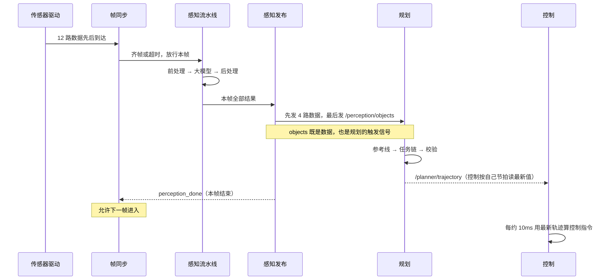

> **这一篇讲什么**：把「一帧」当作一部 100 毫秒的短片，用时间线（甘特图）看清每个组件在什么时间段干活、哪些在同时干活。
> **读完你能回答**：一帧里谁先跑、谁在等谁？感知和规划是串行还是并行？为什么控制看起来「不守规矩」？下一帧什么时候开始？
> **前置知识**：读完第 01 篇（知道感知/规划/控制三个角色和 topic 的概念）。

## 1. 什么叫「一帧」

**一句话结论**：一帧 = 系统处理一次传感器数据的一个**时间片**。C01 上这个时间片是 **100 毫秒**（也就是每秒 10 帧，10 Hz）。

### 1.1 为什么要有「帧」这个概念

摄像头每秒拍很多张照片，激光雷达每秒转很多圈。如果每来一个数据就单独处理一次，系统会被拆成无数碎片，根本没法对齐——摄像头看到「有车」的那一刻，激光雷达可能还没扫到那个位置。

所以工程上把时间切成固定的格子：**每 100 毫秒算一格，格子内到达的所有传感器数据算作同一时刻的世界**。这个格子就是一帧。

> **概念：帧（frame）与帧率（Hz）**
> 帧是处理的时间单位；帧率是每秒处理多少帧。10 Hz = 每 100 毫秒一帧。类比：电影 24 帧/秒，每帧是一张静止画面，连起来就成了连续动作。

### 1.2 100 毫秒这个数字从哪来

不是拍脑袋定的，而是写在传感器接入配置里的：12 路需要对齐的传感器（1 路激光雷达 + 11 路相机）都声明了 `frame_nano_base: 100000000`——即 100,000,000 纳秒 = 100 毫秒。

```text
# driver/config/component/perception_orin.jsonnet
{
  "name": "/sensors/lidar/combined_point_cloud_proto",
  "type": "framesync",
  "frame_nano_base": 100000000,   // 100ms，一帧的宽度
}
```

这 12 路传感器就是感知的「主料」；其他数据（毫米波雷达、定位、车辆状态、地图）以不同策略搭车进来，不参与 100 毫秒对齐。

## 2. 一张总图看全一帧

**一句话结论**：一帧内的主链路是**串行**的（后一步依赖前一步的结果），但每一段内部有大量**并行**；规划与控制则按不同节拍**并行**运行。

先看**总图**。它只画到「段」这一层，用来建立整体印象；每一段内部的细节，在 §3 各自的**分图**（图 2-2 ~ 图 2-6）里再展开，不必一次看完。

```mermaid
%%{init: {"gantt": {"barHeight": 26, "barGap": 12, "fontSize": 14, "sectionFontSize": 15, "leftPadding": 100, "rightPadding": 60, "topPadding": 45, "useMaxWidth": false, "useWidth": 1000, "tickInterval": "10millisecond"}}}%%
gantt
    title 图 2-1 · 一帧总图（0~112ms，相对顺序示意，非实测耗时）
    dateFormat x
    axisFormat %-L ms
    section 传感器与帧同步
    12 路采集 + 帧同步放行              :total0, 0, 2ms
    section 感知前处理
    拆包 + 解共享内存 + 物料清单         :total1, 2, 7ms
    五条备料支线并行                     :total2, 9, 13ms
    section 感知大模型
    雷达目标处理（不进模型，与推理并行）  :total3, 22, 12ms
    uni_model 一次前向（17 路输入）      :total4, 22, 18ms
    section 感知后处理
    多模态合并 + 跟踪 + 预测             :total5, 40, 20ms
    并行加工 + 输出汇总                  :total6, 60, 6ms
    section 感知发布
    组包 + 19 路发布（objects 压轴）     :total7, 66, 4ms
    section 规划（被 objects 触发）
    输入预处理 + 拼图                    :total8, 70, 5ms
    3 条参考线并行跑任务链               :total9, 75, 21ms
    请求 / 后处理 / 13 路发布            :total10, 96, 4ms
    section 下一帧感知（与规划尾部重叠）
    第 N+1 帧感知                       :total11, 100, 12ms
    section 控制（独立节拍，贯穿全帧）
    控制周期（约 10ms 一次）             :total12, 0, 100ms
```



**图 2-1 · 一帧总图**（横轴单位毫秒；色块长度只表达相对先后与重叠关系，不代表真实耗时）

> 图按 1000px 原始宽度绘制，不随正文栏缩水。正文栏窄于 1000px 时（笔记本、手机），在**图内左右拖动**即可看全——字不会变小。

**读图提示（先看总图看串并行，再按需看分图）**：

1. **看主链**：前处理 → 大模型 → 后处理 → 发布 → 规划，像接力赛一样一段接一段，这是**串行**部分。
2. **看重叠**：前处理里的五条备料支线同时开工；雷达目标处理与 `uni_model` 推理并行；规划内部 3 条参考线并行；控制从 0 到 100ms 一直在跑。
3. **看边界**：100ms 是下一帧的起点，而规划要在 100ms 才发布完轨迹——所以「第 N+1 帧感知」（100~112ms）和「规划」在尾部**重叠**，这是整条链里唯一的跨帧并行。

> 为什么不用普通流程图画这张图？流程图只能表达「谁接谁」，表达不了「同时」和「多久」。甘特图有横轴时间，才能把并行度画出来。

> **维护提示（写给改文档的人）**：本系列所有甘特图都用 `dateFormat x` + **带单位的时长**（`18ms`）。第三个字段若只写裸数字 `18`，mermaid 解析不出时长，条形宽度会变成 0，整张图就「什么都看不见」——这正是本页旧版甘特图失效的原因。
>
> 另两条固定写法：`useWidth: 1000` 把布局宽度钉住（不钉的话 mermaid 默认按整个浏览器窗口宽布局，图会被压进窄正文栏，字号缩到 5~7px）；`useMaxWidth: false` 让它按钉住的尺寸 1:1 渲染，超宽部分由图容器的横向滚动兜住。

## 3. 逐段解读：每一段在干什么、在等谁

### 3.1 传感器采集：12 路各自跑，帧同步负责「凑齐」

**一句话结论**：12 路传感器并不是同时整点送达，帧同步器（FrameSync）的任务是等它们到齐，或者等到超时，然后放行这一帧。

- 摄像头按自己的曝光节奏出图，激光雷达按自己的转速出点云，到达时间有先后。
- 每一路数据都带时间戳，帧同步器按 100ms 的格子把它们归到同一帧。
- 如果某一路迟迟不到（例如雨雾导致图像延迟），不能无限等——超时后就用已到的数据装配这一帧，保证系统不停摆。

对应图 2-1 的第 1 行（0~2ms 的帧同步放行）。采集本身是持续进行的，横跨整帧，所以图上只画「放行」这一刻。

> **概念：帧同步（FrameSync）**
> 把多路异步到达的传感器数据按时间格子凑成一帧的机制。类比：拍集体照，摄影师喊「3、2、1」，但总有人眨眼——等到最后一秒还没准备好，也只能按快门，不能一直等。

### 3.2 前处理：把原始数据变成模型能吃的形状

**一句话结论**：拆包、解共享内存、图像缩放与归一化、点云体素化——入口几步是串行的，之后五条备料支线**并行**开工，最后汇总成模型的 17 路输入。

这段对应图 2-1 的 2~22ms，放大后就是图 2-2：

```mermaid
%%{init: {"gantt": {"barHeight": 26, "barGap": 12, "fontSize": 14, "sectionFontSize": 15, "leftPadding": 100, "rightPadding": 60, "topPadding": 45, "useMaxWidth": false, "useWidth": 1000, "tickInterval": "2millisecond"}}}%%
gantt
    title 图 2-2 · 前处理内部（0~22ms，相对顺序示意）
    dateFormat x
    axisFormat %-L ms
    section 入口（串行三步）
    帧同步放行本帧                        :pre0, 0, 2ms
    解共享内存 + NV12 打包                :pre1, 2, 4ms
    IO 预处理 + 素材清单                  :pre2, 6, 3ms
    section 五条备料支线（并行开工）
    激光雷达线 体素化 + 骨干前处理         :pre3, 9, 9ms
    相机线 缩放 / 归一化 / 投影矩阵         :pre4, 9, 8ms
    泊车环视线 自由空间与车位预处理         :pre5, 9, 9ms
    地图路由线 路由编码 + 地图特征          :pre6, 9, 7ms
    AEB 融合线（旁路，不进模型）           :pre7, 9, 6ms
    section 汇总
    GatePassThrough 汇总 + 按槽位摆盘     :pre8, 18, 4ms
```



**图 2-2 · 前处理分图**（0~22ms）

**读图提示**：前三步是「拆快递」，必须一步步来；到第 9ms 才有五条条形同时起步，谁先好谁先放；最后 18~22ms 由 `GatePassThroughCalculator` 把相机数据过闸、凑齐 17 路交给大模型。

五条备料支线（详见第 04 篇）：

| 支线 | 输入 | 做什么 | 产出 |
|-|-|-|-|
| 激光雷达线（`LidarOccProcessSubgraph`） | 点云 | 体素化、骨干网络前处理 | `lidar_backbone_network_input`（`INFER_IN:0`） |
| 相机线（`CameraProcessSubgraphL2AVP`） | 11 路图像 | 缩放、归一化、投影矩阵计算 | `camera_preprocess_output_synced`（`INFER_IN:2`）与标定参数 |
| 泊车环视线（`AvpProcessSubgraphL2`） | 环视相机 | 自由空间与车位预处理 | `driving_avm_preprocess_out`（`INFER_IN:1`） |
| 地图路由线（`DdRoutingPreProcessCalculator`） | 导航路由与地图 | 路由编码、`sd_map` / `ras` 特征 | `ddrouting_model_input`（`INFER_IN:16`）等地图类输入 |
| AEB 融合线（`AebLightFusionProcessSubgraph`） | 激光雷达、跟踪预处理、环视 | AEB 目标融合，由 `aeb_simple_gate` 开关控制 | `aeb_parking_output` 等旁路结果，**不进模型** |

> **一条最容易画错的支线：毫米波雷达**。雷达并不在前处理里「编码成 BEV 特征喂模型」。`RadarProcessorCalculator` 只把 `radar_inputs` 整理成一帧雷达目标（`radar_frame_output`），**与大模型推理并行**跑，结果在 `MultiModalityPreprocessCalculator` 里与激光、相机的检测结果合并（见图 2-3、图 2-4）。所以模型的 17 路输入里没有任何雷达槽位。

### 3.3 感知大模型：全链最重的一段

**一句话结论**：`uni_model` 是全链路唯一的深度学习大模型推理节点，它把 17 路输入一次性吃进去，一次前向计算产出多任务结果；与此同时，雷达目标处理在另一条线程上并行。

这段对应图 2-1 的 22~40ms，是整个感知里最耗时的部分（真实耗时取决于芯片与模型，图中只是示意）。放大后就是图 2-3：

```mermaid
%%{init: {"gantt": {"barHeight": 26, "barGap": 12, "fontSize": 14, "sectionFontSize": 15, "leftPadding": 100, "rightPadding": 60, "topPadding": 45, "useMaxWidth": false, "useWidth": 1000, "tickInterval": "5millisecond"}}}%%
gantt
    title 图 2-3 · 大模型与雷达支线（20~42ms，相对顺序示意）
    dateFormat x
    axisFormat %-L ms
    section 输入凑齐
    17 路输入就位（含 back_edge 缓存）      :nn0, 20, 2ms
    section 前向计算（两条线程并行）
    uni_model 前向（nn_ 执行器 4 线程）      :nn1, 22, 18ms
    雷达目标处理 RadarProcessorCalculator    :nn2, 22, 12ms
    section 输出拆分
    按任务拆分 uni_model_output              :nn3, 40, 2ms
```



**图 2-3 · 大模型分图**（20~42ms）

**读图提示**：注意两条条形**同时起步**——`uni_model` 在 NN 执行器（4 线程）上跑，`RadarProcessorCalculator` 在普通计算器线程池（5 线程）里跑，互不排队。雷达那 12ms 先结束，它的结果就在旁边等着被后处理取走。

`uni_model` 的输入既不是旧资料说的 50 路，也不是「一路摄像头一张图」：当前 `perception/perception/cfg/graphs/graph_l2avp.cfg` 里声明的是 `INFER_IN:0` 到 `INFER_IN:16` 共 **17 路**（第 05 篇逐一解释）。按用途分六组：

| 分组 | 槽位 | 内容 |
|-|-|-|
| 点云与图像 | 0、1、2 | `lidar_backbone`、`driving_avm`、`camera_preprocess` |
| 几何标定 | 3、4、5、6、7、8 | `lidar2img`、`delta_pose`、`prev_pose_inv`、`extrinsic`、`norm_intrinsic`、`distort` |
| 历史记忆 | 9、15 | `prev_bev`、`prev_fpn`（都是 `back_edge`，来自上一帧） |
| 地图与路由 | 11、12、16 | `sd_map`、`ras_model_feature`、`ddrouting` |
| 自车状态 | 10 | `curr_frame_speed`（也是 `back_edge`） |
| 预测相关 | 13、14 | `mpp_position`、`mpp_valid` |

> 槽位编号会随车型/版本变化（QNX 版 cfg 的槽位就更多）。旧资料里的「50 路」「22 路」都要回到 cfg 核对，本文一律以当前仓库的 `graph_l2avp.cfg` 为准。

### 3.4 感知后处理：把模型输出变成业务对象

**一句话结论**：模型输出的原始检测结果不能直接给规划用，要先并上雷达目标、给每个目标发「跟踪编号」、预测他车未来轨迹，再做五道并行加工，最后汇总成一个业务对象。

这段对应图 2-1 的 40~66ms，放大后就是图 2-4：

```mermaid
%%{init: {"gantt": {"barHeight": 26, "barGap": 12, "fontSize": 14, "sectionFontSize": 15, "leftPadding": 100, "rightPadding": 60, "topPadding": 45, "useMaxWidth": false, "useWidth": 1000, "tickInterval": "5millisecond"}}}%%
gantt
    title 图 2-4 · 感知后处理（40~66ms，相对顺序示意）
    dateFormat x
    axisFormat %-L ms
    section 合并与跟踪
    多模态合并（激光 + 相机 + 雷达目标）      :post0, 40, 4ms
    perception_tracker 发 track_id           :post1, 44, 8ms
    泊车跟踪 PanoDetectionTracking（并行）     :post2, 44, 8ms
    section 预测
    PredictionProcessor 预测他车轨迹          :post3, 52, 8ms
    section 并行加工 + 汇总
    交互 / 事件 / 压缩 / 地图合并 / 备份      :post4, 60, 4ms
    PerceptionOutputProcess 汇总             :post5, 64, 2ms
```



**图 2-4 · 后处理分图**（40~66ms）

**读图提示**：这段的主干是「合并 → 跟踪 → 预测」，泊车跟踪是一条**并行**支线（泊车模式下走它，行车模式下走 `perception_tracker`）；到 60ms，交互、事件触发、结果压缩、地图合并、备份这五件事**同时**开工，因为它们读的都是同一份跟踪结果，彼此不依赖。

```text
多模态合并 → 跟踪（发 track_id）→ 预测（他车未来轨迹）→ 交互/事件/压缩/地图合并/备份 → 汇总
```

### 3.5 发布：先发数据，最后发触发器

**一句话结论**：19 路结果按固定顺序发布：规划要的 4 路数据先发，`/perception/objects` 作为第 5 路压轴发出——因为它同时是规划的「上班铃」；剩下 14 路不阻塞规划，随后发完。

这段对应图 2-1 的 66~70ms，和规划是前后脚衔接的，所以放在同一张图里（图 2-5）：

```mermaid
%%{init: {"gantt": {"barHeight": 26, "barGap": 12, "fontSize": 14, "sectionFontSize": 15, "leftPadding": 100, "rightPadding": 60, "topPadding": 45, "useMaxWidth": false, "useWidth": 1000, "tickInterval": "10millisecond"}}}%%
gantt
    title 图 2-5 · 发布与规划（66~112ms，跨过 100ms 帧边界）
    dateFormat x
    axisFormat %-L ms
    section 感知发布
    PerceptionIoPostprocessing 组包           :pub0, 66, 2ms
    4 路规划输入先行发布                       :pub1, 68, 1ms
    objects 压轴发布（触发规划）                :pub2, 69, 1ms
    perception_done 放行下一帧                 :pub3, 70, 1ms
    section 规划（被 objects 触发）
    输入预处理 + 拼图                          :pln0, 70, 5ms
    3 条参考线并行跑任务链                      :pln1, 75, 21ms
    请求 / 后处理 / 13 路发布                   :pln2, 96, 4ms
    section 下一帧感知（与规划尾部重叠）
    第 N+1 帧感知                               :next0, 100, 12ms
```



**图 2-5 · 发布与规划分图**（66~112ms）

**读图提示**：横轴跨过了 100ms 这条「帧边界」。注意两件事——① `perception_done` 在 70ms 就回给了帧同步器，所以下一帧在 100ms 准时开始，此时规划还没算完；② 100~112ms 里「下一帧感知」与「规划」是**重叠**的，这是整条链里唯一的跨帧并行。

代码里写得很直白：

```text
# perception_graph_l2avp_interleaving.cfg
# Keep this sequence to ensure the planning module receives the trigger
# topic (/perception/objects) after the other four input topics.
output_stream: "OUTPUT:0:perception__extra_objects"
output_stream: "OUTPUT:1:perception__ras_map"
output_stream: "OUTPUT:2:perception__ras_map_parking"
output_stream: "OUTPUT:3:perception__traffic_lights_status"
output_stream: "OUTPUT:4:perception__objects"   # 规划要的第 5 路，最后发，触发规划
# …… OUTPUT:5 ~ OUTPUT:18 共 14 路不阻塞规划，随后发完
output_stream: "ALL_OUTPUTS:perception_output_vector"
output_stream: "ASYNC_TRIGGER:perception_done"
```

> **概念：先数据后触发**
> 发布方先把「原料」都发出去，最后再发「开工资格」消息。这样下游被唤醒时，需要的输入已经在桌上，不会读到上一帧的旧数据。

### 3.6 规划：被感知触发，三条参考线并行求最优

**一句话结论**：规划没有自己的定时器，`/perception/objects` 一到就开始算；它同时对左/中/右 3 条参考线**并行**跑同一套任务链，最后挑一条能用的，算完立刻发布轨迹。

对应图 2-5 的右半段（70~100ms）。内部结构（`planning_sub_graph.cfg` + `em_planner.cpp`）：

| 阶段 | 节点 | 干什么 |
|-|-|-|
| 准备输入 | `PlanningInputPreprocessCalculator` | 收拾输入：本帧目标、定位、地图路由、上一帧决策状态 |
| 拼图 | `PlanningStitchMapCalculator` | 把全局地图/路由拼成规划能用的局部图 |
| 核心求解 | `PlanningCoreCalculator` | 对 **3 条参考线并行**跑任务链（见下） |
| 请求与后处理 | `PlanningRequestCalculator` → `PlanningPostProcessCalculator` | 组装响应、后处理、发布 13 路输出（`trajectory` 是第 0 路） |

每条参考线上的任务链顺序固定（`em_planner.cpp` 里 `tasks_stage_` 的压入顺序）：

```text
DpPath 路径 → QpPath 平滑 → DecisionMaking 决策 → ModelTrajectory 模型轨迹
→ DpSpeed 速度 → QpSpeed 速度平滑 → CombinePathSpeed 合成 → TrajectorySafety 校验
```

并行是这么实现的：`PlanOnReferenceLine` 遍历 3 条参考线，把每条线的求解函数 `Enqueue` 到线程池，然后 `WaitUntilWorkComplete()` 等它们全跑完；最后用 `ref_line_drivable_info[0..2]` 判断哪条线可用（`is_vpa_driving()` 时退化为串行）。

代码里规划组件的预期处理时长预算是 **500ms**（`expected_proc_duration_ms: 500`），这是一个上限保护值，不是每帧实际耗时。

### 3.7 控制：唯一「不守帧」的角色

**一句话结论**：控制不等感知、也不等规划，它按定位消息的节奏（约 10 毫秒级）持续运行，每次都读取「最新的一帧轨迹」。

这段贯穿整个甘特图，放大后就是图 2-6：

```mermaid
%%{init: {"gantt": {"barHeight": 26, "barGap": 12, "fontSize": 14, "sectionFontSize": 15, "leftPadding": 100, "rightPadding": 60, "topPadding": 45, "useMaxWidth": false, "useWidth": 1000, "tickInterval": "10millisecond"}}}%%
gantt
    title 图 2-6 · 控制节拍（0~102ms，相对顺序示意）
    dateFormat x
    axisFormat %-L ms
    section 触发源
    定位 pose 连续到达（约 10ms 一次）        :ctl0, 0, 100ms
    section 控制计算（只抽样画 4 次）
    第 1 次                                   :ctl1, 10, 4ms
    第 2 次                                   :ctl2, 30, 4ms
    第 3 次                                   :ctl3, 50, 4ms
    第 4 次                                   :ctl4, 70, 4ms
    section 轨迹缓存（cache_size 1）
    始终读最新一帧轨迹                        :ctl5, 0, 100ms
    规划新轨迹落地（约 100ms）                 :ctl6, 100, 2ms
    section 车况反馈
    车辆状态高频上报                           :ctl7, 0, 100ms
```



**图 2-6 · 控制分图**（0~102ms）

**读图提示**：那三条 100ms 的长条是「一直在」，下面四个方块只是**抽样**画了 4 次控制计算（真实频率约每 10ms 一次，画满会糊成一片）。看 100ms 处：规划的新轨迹这时才落地，控制的下一个周期（约 110ms）就会用上它——也就是说**这一帧的规划结果，最快也要到下一两个控制周期才影响方向盘**。

控制组件的触发源是 `/localization/pose`，规则是 IMMEDIATE；`/planner/trajectory` 只是它读取的缓存输入（`cache_size: 1`，只保留最新一条）。所以：

- 规划这一帧算得慢，控制就用上一帧的轨迹继续开——**不会停下车等**；
- 规划算完发了新轨迹，控制下一个周期自然就用上新的。

> 这是「思考」和「执行」解耦的直接体现：规划是低频决策，控制是高频跟踪。

## 4. 触发链：这一帧是怎么被「点着」的

**一句话结论**：整条链由「数据到齐」点火，靠「先数据后触发」传递，最后由 `perception_done` 还给帧同步器，允许下一帧开始。



**图 2-7 · 一帧的触发时序**（实线是数据流，虚线回环是节拍信号）

**读图提示**：注意三件事——① `objects` 一条消息承担两个角色（数据 + 触发）；② 规划发布后并不会「叫醒」控制，控制一直在跑；③ `perception_done` 是帧与帧之间的交接棒。

## 5. 并行度：同一时刻能有几帧在路上

**一句话结论**：C01 当前配置下，感知同一时刻只允许 **1 帧**在流水线里（`kMaxFramesInFlight = 1`），所以帧与帧之间是**背靠背串行**，不是多帧重叠。

### 5.1 代码依据

```cpp
// platform/church/graph/calculators/frame_sync_calculator.cc
// only enable parallel for orinx related vehicles
constexpr int kMaxFramesInFlight = 1;
...
bool CanOutput() const {
  if (frames_in_flight_ >= kMaxFramesInFlight) return false;  // 已有帧在飞，不放行
  if (cached_trigger_ > 0) return true;                        // 有积压触发
  return frames_in_flight_ == 0;                               // 空闲则放行
}
```

> 注意：源码里的注释与 `#pragma message` 文字写的是「is 2」，但**实际生效的常量值是 1**。读代码要以常量值为准，这也是本系列强调「证据要看代码而不是看注释」的原因。

### 5.2 这对「并行度」意味着什么

- **帧内并行**：五条备料支线并行开工、雷达目标处理与 `uni_model` 推理并行、后处理五道加工并行、规划内部 3 条参考线并行——有。
- **帧间并行**：没有。第 N 帧的 `perception_done` 没回来之前，第 N+1 帧不会被放行。
- **感知 vs 规划**：规划在感知发布后被触发，而 `perception_done` 在 70ms 就回了，所以规划计算期间下一帧感知已经开始（见图 2-5）——这就是**规划与下一帧感知重叠**、规划段可以跨过 100ms 边界的原因。
- **规划 vs 控制**：完全并行，各自节拍。

### 5.3 为什么不让多帧重叠

多帧重叠能提高吞吐，但会让延迟和资源竞争变复杂：两帧同时抢 GPU、后一帧可能比前一帧先算完、输出顺序错乱。当前选择「一帧一帧来」，用**确定性**换**吞吐**——对安全相关的系统，这是常见取舍。代码里也留了注释说这个值「should be configurable」，说明未来可能按车型调整。

## 6. 瓶颈在哪：三个数字

| 环节 | 代码里的量级 | 含义 |
|-|-|-|
| 感知帧周期 | 100ms（`frame_nano_base`） | 系统节拍，决定感知最快 10Hz |
| 规划处理预算 | 500ms（`expected_proc_duration_ms`） | 超时保护上限；正常远小于它 |
| 控制处理预算 | 20ms（`expected_proc_duration_ms`） | 控制周期量级，远快于规划 |

**一句话结论**：感知的**大模型推理**通常是整条链最重的一段；规划虽然单次更慢，但频率低且与控制并行，所以不直接拖慢车辆响应。

还有一个容易被忽略的细节：发布虽然一次发 19 路，但真正阻塞规划的只有 5 路（4 路数据 + `objects` 触发）——其余 14 路在规划已经开算之后才发完，它们不在规划的关键路径上。所以「发布慢」通常不等于「规划慢」，要看具体哪一路迟到。

怎么判断瓶颈到底在哪一段？不要凭感觉，看两个信号：一是各组件的实际处理耗时（与配置里的 `expected_proc_duration_ms` 对照），二是「输入到齐」与「输出发布」之间的时间差。如果某个组件的实际耗时经常贴着预算，它就是瓶颈；如果耗时不高但帧周期被拉长，那瓶颈在「等待」——通常是某一帧同步输入迟到。

## 7. 四个常见误解

**误解一：一帧里所有模块都在同时跑。**
不是。感知主链是串行的（前处理→模型→后处理→发布），并行只发生在段内部（五条备料支线、雷达与推理、后处理五道加工）；规划必须等感知发布。

**误解二：控制跟着规划走，规划慢车就慢。**
不是。控制按定位节拍独立运行，规划慢时用上一帧轨迹兜底，车辆不会停下来等规划。

**误解三：帧率 10Hz 意味着所有环节都是 10Hz。**
不是。10Hz 是感知的对齐节拍；控制是 10ms 级（约 100Hz），规划是「事件驱动」（感知来一帧算一帧）。

**误解四：帧率越高越好。**
不是。帧率的分子是「一帧的处理时间」，分母是「传感器能提供的数据」。把节拍从 100ms 调到 50ms，如果大模型推理本身就要 60ms，结果只是让队列堆积、延迟变大、GPU 更热。提高帧率的前提是先把最慢的那一段压下来——这也是为什么调优要先看甘特图找瓶颈，再谈频率。

## 8. 本篇小结与下一篇

1. 一帧 = 100ms 的时间片，12 路主传感器按 100ms 对齐。
2. 感知主链串行；并行全在段内：前处理五条备料支线、雷达与推理、后处理五道加工、规划 3 条参考线。
3. 同一时刻只有 1 帧在感知流水线里；但 `perception_done` 在 70ms 就放行了下一帧，所以规划尾部与下一帧感知重叠（100~112ms）。
4. 感知发 19 路，其中只有 5 路阻塞规划；规划有 500ms 预算保护，控制有 20ms 量级预算。
5. 瓶颈通常在大模型推理，判断方法是把实际耗时与 `expected_proc_duration_ms` 对比。

下一篇《03 数据流总览：topic 的一生》会把这张时间线换成「数据形态变化」的视角：从 driver 的输入 topic 出发，看它如何一步步变成输出 topic。

## 9. 证据与延伸

| 结论 | 证据位置 |
|-|-|
| 12 路主传感器 100ms 对齐 | `driver/config/component/perception_orin.jsonnet`（12 处 `frame_nano_base: 100000000`） |
| 外层图 7 个节点与线程数 | `driver/config/component/perception_graph_l2avp_interleaving.cfg`（`num_threads: 5`；NN 执行器 `num_threads: 4`） |
| 五条备料支线并行 | `perception/perception/cfg/graphs/graph_l2avp.cfg`（`LidarOccProcessSubgraph`、`CameraProcessSubgraphL2AVP`、`AvpProcessSubgraphL2`、`DdRoutingPreProcessCalculator`、`AebLightFusionProcessSubgraph` 之间无相互依赖） |
| 17 路模型输入与 `back_edge` | `graph_l2avp.cfg`（`INFER_IN:0`~`INFER_IN:16`；`back_edge` 为 2/3/4/5/9/10/15） |
| 雷达与推理并行、后处理合并 | `graph_l2avp.cfg`（`RadarProcessorCalculator`：`radar_inputs` → `radar_frame_output`；`MultiModalityPreprocessCalculator` 的 `RADAR` 输入） |
| 后处理节点顺序 | `graph_l2avp.cfg`（`MultiModalityPreprocessCalculator` → `PerceptionTrackerProcessCalculator` → `PredictionProcessorCalculator` → 交互/事件/压缩/备份 → `PerceptionOutputProcessCalculator`） |
| 19 路发布与输出向量 | `perception_graph_l2avp_interleaving.cfg` L148-173（`OUTPUT:0`~`OUTPUT:18`、`ALL_OUTPUTS:perception_output_vector`、`ASYNC_TRIGGER:perception_done`） |
| 发布顺序（objects 在 4 路之后） | 同上文件 L148-155 注释与输出流定义 |
| 规划触发与预算 | `driver/config/component/planning.jsonnet`（`trigger_policy: IMMEDIATE`、`expected_proc_duration_ms: 500`） |
| 规划 3 条参考线并行与任务链顺序 | `planning/planning/planner/em_planner.cpp`（`PlanOnReferenceLine` 的 `thread_pool_->Enqueue` + `WaitUntilWorkComplete`；`tasks_stage_` 压入顺序）；节点名见 `planning/planning/config/planning_sub_graph.cfg` |
| 规划 13 路输出 | `driver/config/component/planning_graph.cfg`（`OUTPUT:0:planner__trajectory` ~ `OUTPUT:12:planner__stop_objects`） |
| 控制触发与预算 | `driver/config/component/cbw_control.jsonnet`（触发 `/localization/pose`、20ms、轨迹 `cache_size: 1`） |
| 单帧在飞上限 | `platform/church/graph/calculators/frame_sync_calculator.cc`（`kMaxFramesInFlight = 1`） |
