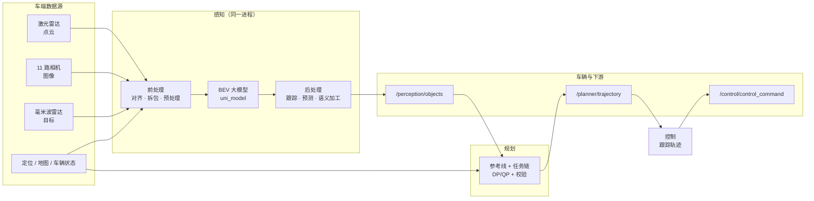

> **这一篇讲什么**：把第 01 篇的「三段式」和第 02 篇的「时间线」换成第三个视角——**数据形态**：一条消息从进入系统到变成车辆动作，中间被加工成了什么样子。
> **读完你能回答**：数据从哪些 topic 进来？每一段处理把数据变成了什么？最终从哪些 topic 出去？哪些 topic 是关键的「交接点」？
> **前置知识**：读完第 01、02 篇（三个角色、topic、一帧的概念）。

## 1. 先记住一张粗粒度流向图

**一句话结论**：整条数据流可以浓缩成 6 个处理环节和 3 个关键交接 topic。



**图 3-1 · 端到端数据流总览**（粗粒度：只画环节与关键交接 topic，不画内部节点）

**读图提示**：图中只有三个 topic 名字，它们是三段流水线的「交接单据」：

- `/perception/objects`：感知交给规划的**障碍物列表**；
- `/planner/trajectory`：规划交给控制的**未来轨迹**；
- `/control/control_command`：控制交给车辆执行器的**油门/刹车/转向指令**。

定位/地图/车辆状态是「公共原料」，被感知、规划、控制多处使用，所以图中单独画了一条线到规划。

## 2. 输入从哪来：driver 侧的 topic 清单

**一句话结论**：数据源全部由 driver 仓库里的组件配置声明。感知组件的输入清单是一份现成的「原料目录」，按装配策略分为四类。

### 2.1 四类装配策略，决定了数据「怎么等」

同样是从 driver 进来的 topic，为什么有的要等、有的不等？因为它们在 `input_channels` 里被标了不同的装配策略：

| 策略 | 含义 | 生活类比 |
|-|-|-|
| `framesync` | 参与 100ms 帧同步：同一帧内到齐才用 | 拍集体照，等人齐 |
| `near` | 取时间上最接近主传感器（点云）的那条 | 找离约定时间最近的一班车 |
| `all_new` | 用最新一条，不参与帧对齐 | 看最新一期报纸 |
| `optional` | 有就用，没有也不阻塞 | 配菜，没有也能开饭 |

这个分类直接决定了「上游断了一路，下游会不会停」：

- **framesync**：必须和同一帧的其他传感器一起到，少一路就等超时——摄像头图像、激光点云属于这类；
- **near**：取时间上最接近的那一条，不要求严格同帧——毫米波雷达目标属于这类；
- **all_new**：持续更新，每次只取最新值——地图、定位等持续更新的输入属于这类；
- **optional**：可有可无，没有也能跑——比如仿真回灌、可选调试输入。

看到「感知卡住不出结果」时，第一个该查的就是 framesync 那几路是不是少了一路。

### 2.2 感知的输入清单（按用途分组）

| 分组 | 代表 topic | 消息格式 | 策略 | 用途 |
|-|-|-|-|-|
| 主传感器（12 路） | `/sensors/lidar/combined_point_cloud_proto`、`/sensors/camera/camera_1~6_raw_data_proto`、`traffic_2`、`panoramic_1~4` | PointCloud2 / Image | framesync | 对齐成同一帧的「主料」 |
| 毫米波雷达 | `/sensors/radar/mrr`、`srr_1`、`srr_2`、`combined_objects` | Radar | optional / near | 补充目标距离与速度 |
| 定位 | `/localization/pose`、`/sensors/gnss/pose`、`lock_on_road`、`lock_on_map` | Ins / LockOnRoadResult | all_new / optional | 知道车在哪、把感知结果换到世界坐标 |
| 地图与路由 | `/map/ras_map_plus`、`/map/sd_horizon_map`、`/map/fusion_map`、`/map/local_routing_guidence_action` | 各类 Map proto | all_new / optional | 提供道路结构、路口、导航动作 |
| 车辆 | `/canbus/car_state`、`/blc/local_routing_info`、`/blc/operation_status` | VehicleState 等 | all_new / optional | 车速、档位、限速 |
| 业务请求 | `/planner/request`、`/planner/multi_requests`、`/perception/dtu_request` | PlanningRequest 等 | all_new / optional | 泊车、仿真等主动请求 |
| 回灌 | `/planner/trajectory` | ADCTrajectory | optional | 规划上一帧的轨迹，作为感知预测的先验（见第 06 篇） |
| 其他 | 超声波、VLA 输出、云端配置 | 各自 proto | all_new / optional | 特定功能 |

> 完整清单见 `driver/config/component/perception_orin.jsonnet` 的 `input_channels`。这里只列理解数据流所需的代表项；不要试图一次记住所有 topic，记住「分组的用途」即可。

### 2.3 规划与控制吃什么

规划组件的核心输入只有 8 路（`planning_graph.cfg` 的 `input_stream`）：

```text
/perception/objects            # 障碍物（required，同时是触发源）
/perception/extra_objects      # 额外障碍物
/perception/ras_map            # 感知构建的道路结构
/perception/ras_map_parking    # 泊车道路结构
/perception/traffic_lights_status  # 红绿灯（required）
/perception_magic_carpet/objects   # 特殊目标
/localization/local_map_link_data_event  # 局部地图链路事件
/planner/request + /planner/multi_requests  # 业务请求
```

另外还有 4 个 `required` 的「公共原料」：`/canbus/car_state`、`/map/ras_map_plus`（以及上面已列的红绿灯、objects）。缺了 required 输入，规划不会出结果——这是第 07 篇要讲的「输入有效性校验」。

控制组件的输入只有 4 路：

```text
/planner/trajectory   # 规划轨迹（optional，cache_size: 1，只留最新）
/canbus/car_state     # 车辆状态
/canbus/car_info      # 车辆参数
/localization/pose    # 定位姿态（同时是触发源）
```

## 3. 数据在感知里被加工成了什么

**一句话结论**：数据在感知里经历四次形态变化：**消息信封 → 物料清单 → 张量 → 业务对象**。

### 3.1 第一次变化：消息信封 → 物料清单

传感器驱动发来的每条消息都是一个「信封」（OnboardMessage）：信封上盖着三个时间戳，里面装着 proto 数据。帧同步器把 12 路信封凑成一捆，拆包器再按 topic 把它们分门别类，装进一张**物料清单**（`PerceptionProcessInput`）。

> **概念：共享内存与零拷贝**
> 图像和点云的数据量很大（一张图几 MB，一帧点云几十 MB）。如果每次都把数据复制一遍，CPU 和内存都吃不消。共享内存的做法是：数据只放一份在公共区域，消息里只传「柜子号」，用的人按号去取。这就叫「零拷贝」——不复制，只传地址。

### 3.2 第二次变化：物料清单 → 张量

各支线把物料加工成模型能吃的**张量**（Tensor）：图像缩放、归一化、点云体素化、雷达编码。张量可以理解为「多维数组」，是 GPU 最擅长计算的数据形状。

> **概念：张量（Tensor）**
> 标量是一个数，向量是一行数，矩阵是一张表，张量是更高维的「数块」。例如一批图像可以表示成 `[批次, 通道, 高, 宽]` 的四维张量。深度学习框架的输入输出都是张量。

### 3.3 第三次变化：张量 → 模型输出

`uni_model` 做一次前向推理，输出多任务结果：障碍物检测、占据栅格、车道线、红绿灯状态、历史特征等。这些结果还是「模型语言」——热力图、检测框、特征图。

### 3.4 第四次变化：模型输出 → 业务对象

后处理把「模型语言」翻译成「业务语言」：给每个目标分配跟踪编号（track_id）、预测他车未来轨迹、合并多模态结果、过滤不可见区域，最终组装成 `PerceptionObstacles`——一张规划能直接读的障碍物列表。

| 形态 | 典型载体 | 谁生产 | 谁消费 |
|-|-|-|-|
| 消息信封 | OnboardMessage | 传感器驱动 | 帧同步器 |
| 物料清单 | PerceptionProcessInput | 拆包器 | 各感知支线 |
| 张量 | Tensor / GPU 显存 | 前处理 | uni_model |
| 模型输出 | 检测框 / 热力图 / 特征图 | uni_model | 后处理 |
| 业务对象 | PerceptionObstacles | 后处理 | 规划、AEB、调试工具 |

## 4. 感知输出 20 路，规划只取其中几路

**一句话结论**：感知发布 20 路 topic，但规划的核心输入只有 5 路感知结果——其余是给 AEB、可视化、仿真、监控等下游用的。

| 感知输出 topic | 消费者 | 说明 |
|-|-|-|
| `/perception/objects` | 规划（触发）、AEB、录制 | 主障碍物列表，最重要的交接点 |
| `/perception/extra_objects` | 规划 | 额外目标（如低置信度、特殊类别） |
| `/perception/ras_map`、`/perception/ras_map_parking` | 规划 | 感知构建的道路结构（行驶/泊车） |
| `/perception/traffic_lights_status` | 规划（required） | 红绿灯状态 |
| `/perception_magic_carpet/objects` | 规划（optional） | 特殊目标 |
| `/perception_aeb/objects` | AEB 组件 | 紧急制动专用目标列表 |
| `/perception/obstacle3d_nn`、`/perception/proposal_objects` | 调试/训练 | 模型原始输出 |
| `/perception/camera_obstacle`、`camera_quality`、`camera_info` | 诊断/可视化 | 相机相关状态 |
| `/common/modulestatus`、`/common/module_events` | 监控 | 模块健康状态 |
| 其余（dtu_response、avm_viz、ras_map_nn 等） | 仿真/泊车/可视化 | 功能专用 |

## 5. 规划的输出：13 路里只有 1 路是「主产品」

**一句话结论**：规划发布 13 路 topic，其中 `/planner/trajectory` 是给控制的主产品，其余是调试、事件、上下文记忆和辅助请求。

| 规划输出 | 用途 |
|-|-|
| `/planner/trajectory` | **主产品**：未来几秒的轨迹，控制消费 |
| `/planner/debug_info`、`/visualizer/command_rp` | 调试与可视化 |
| `/planner/response`、`/planner/multi_responses` | 对业务请求的应答 |
| `/planner/event` | 规划事件（如「前方施工，需接管」） |
| `/planner/context`、`/planner/context_compressed` | 规划自己的上帧记忆（回灌下一帧） |
| `/safety/request` | 向安全模块发请求 |
| `/planner/stop_objects` | 需要停车等待的目标 |
| `/common/cancel_trigger_request` | 取消触发请求 |
| `/planner/signals_request` | 红绿灯检测请求（当前代码中无发布者） |

> 注意一个细节：规划的 13 路输出里，**轨迹是第 0 路、最先发布**（`OUTPUT:0:planner__trajectory`）。这与感知「objects 最后发布」的设计相反——因为轨迹是控制最关心的主产品，越早发越好。

## 6. 控制：把轨迹翻译成车辆动作

**一句话结论**：控制读取最新轨迹与车辆状态，按自己的节拍算出油门、刹车、转向指令，发给车辆执行器。

```text
输入：/planner/trajectory（最新一帧）+ /canbus/car_state + /canbus/car_info + /localization/pose
  ↓ 跟踪控制算法（后续篇章展开）
输出：/control/control_command（油门/刹车/转向）+ /control/debug_info + /control/context
```

> **概念：轨迹（trajectory）**
> 不是「一条线」，而是一张**带时间戳的行程表**：未来几秒内，每个时刻（例如每隔 100ms）车辆应该处于什么位置、什么速度、什么朝向。控制拿到这张表，就知道「现在这一刻该用多大油门去追赶表上的第一个点」。

## 7. 数据形态总结：一条数据的「一生」

| 阶段 | 数据长什么样 | 交接方式 |
|-|-|-|
| 采集 | 图像像素、点云坐标、雷达回波 | 传感器驱动 → topic |
| 对齐 | 12 路信封按 100ms 分桶 | 帧同步器 → 物料清单 |
| 预处理 | 张量（GPU 显存） | 计算图内部 stream |
| 推理 | 特征图、检测框、热力图 | 计算图内部 stream |
| 后处理 | 障碍物对象（带 track_id、预测轨迹） | `/perception/objects` |
| 规划 | 轨迹（带时间戳的位姿+速度序列） | `/planner/trajectory` |
| 控制 | 油门/刹车/转向数值 | `/control/control_command` |
| 执行 | 电压/电流/液压 | CAN 总线 → 执行器 |

### 7.1 三个关键交接点：只需记住三个名字

一条数据从传感器到执行器，会经过几十个 topic。小白不需要全记，只需记住三个「交接点」，因为它们是三个大角色的边界：

| 交接点 | 从谁到谁 | 里面是什么 | 为什么关键 |
|-|-|-|-|
| `/perception/objects` | 感知 → 规划 | 带 track_id 与预测轨迹的障碍物清单 | 规划的启动信号，也是感知对外的「总交付物」 |
| `/planner/trajectory` | 规划 → 控制 | 未来几秒的轨迹点（位置/朝向/速度/加速度） | 控制唯一认的「计划」，也是规划的总交付物 |
| `/control/control_command` | 控制 → 执行器 | 方向盘转角、纵向加速度等 | 软件与机械的边界，再往后就是物理世界 |

把这三个名字记牢，任何链路图都能看懂大致骨架：**感知负责产出 objects，规划负责把 objects 变成 trajectory，控制负责把 trajectory 变成 control_command**。其他 topic 都是围绕这三份主产品服务的配角。

> **一个重要的契约细节**：topic 名字和消息类型就是模块之间的「合同」。只要合同不变，内部实现怎么改都可以——这也是为什么本套文档反复强调「以代码为准」：代码会变，但边界上的 topic 名字往往能活很久。

### 7.3 现象反推：看到什么，先查哪一段

初学者在车上遇到问题时，最难的是「不知道从哪下手」。下面这张表把常见现象映射回数据流的环节，可以先建立直觉：

| 看到的现象 | 最可能卡在哪一段 | 该看什么 |
|-|-|-|
| 感知完全不输出、周期被拉长 | 帧同步等待（少一路 framesync 输入） | 12 路主传感器是否都在发数据 |
| 感知出结果但障碍物在「抖」 | 感知后处理（跟踪/预测） | track_id 是否频繁新建 |
| 规划不输出、日志报输入缺失 | 感知的 objects / 红绿灯（required 输入） | 这两个 topic 是否在发 |
| 规输出有轨迹但车不动 | 控制到执行器这一段 | `/control/control_command` 是否在发、是否被限幅 |
| 车能动但行驶忽快忽慢 | 轨迹的时间维度（速度规划） | 轨迹点的 v/a 是否跳变 |

这张表的用法是「先定位环节，再看数值」。现象对应的永远是某一份交接产物不对，而不是某个函数写错了——这是数据流视角最实用的一点。

## 8. 四个常见误解

**误解一：所有感知输出规划都要用。**
不是。规划只消费其中 5 路左右；其余输出是给 AEB、调试、仿真、监控的。数据流图上画一条 `/perception/objects` 就够了。

**误解二：控制直接读感知的障碍物。**
不是。控制只读规划轨迹和车辆状态。障碍物对控制是不可见的——这也是「分层解耦」的体现。

**误解三：规划轨迹是「一条几何曲线」。**
不只是。轨迹的核心是**时间维度**：同一个位置，早到和晚到对应不同的速度要求。没有时间戳的曲线，控制无法跟踪。

**误解四：图像和点云是一起到的。**
不保证。它们各自由驱动发布，帧同步器只负责按 100ms 分桶对齐；桶内某一路迟到就要等超时。所以「传感器都在出数据」不等于「感知能拿到一帧完整数据」，还要看它们是否落在同一个时间桶里。

## 9. 本篇小结与下一篇

1. 数据流 = 6 个环节 + 3 个交接 topic（objects / trajectory / control_command）。
2. 数据形态经历：信封 → 物料清单 → 张量 → 业务对象 → 轨迹 → 控制指令。
3. 感知输出 20 路、规划输出 13 路，但真正的主产品各只有 1 路。
4. 规划只吃感知的 5 路左右结果；控制只吃轨迹与车辆状态。

下一篇《04 前处理：从传感器原始数据到模型输入》进入第一个环节的内部，看 12 路数据如何被对齐、拆包、变成张量。

## 10. 证据与延伸

| 结论 | 证据位置 |
|-|-|
| 感知输入清单与装配策略 | `driver/config/component/perception_orin.jsonnet`（`input_channels`，含 framesync/near/all_new/optional） |
| 感知输出 20 路 | `driver/config/component/perception_orin.jsonnet`（`output_channels`） |
| 规划输入 8 路 stream | `driver/config/component/planning_graph.cfg`（`input_stream`） |
| 规划输出 13 路、轨迹为 OUTPUT:0 | `driver/config/component/planning_graph.cfg`（`planning_frame_done_node`） |
| 控制输入输出 | `driver/config/component/cbw_control.jsonnet` |
| 共享内存与拆包 | `perception/calculators/perception_input_transform_calculator.cc` |
