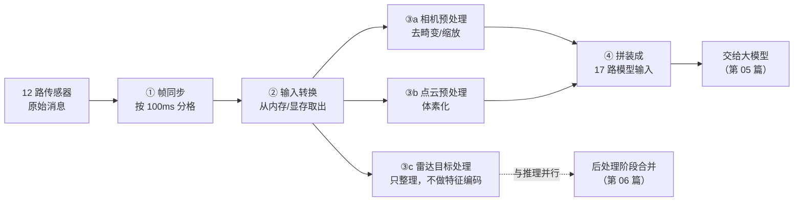

> **这一篇讲什么**：感知大模型再强，也不能直接吃「一堆格式各异的原始传感器数据」。这一篇讲中间那道工序——前处理，看它如何把 12 路传感器数据整理成模型能咽下去的一批输入。
> **读完你能回答**：什么是帧同步？为什么要 100ms 对齐？共享内存和零拷贝是什么？图像、点云、毫米波雷达各自要怎么「洗」一遍？模型到底收到几样东西？
> **前置知识**：读完第 01~03 篇（三个角色、一帧、topic 流向）。不需要任何图像处理或深度学习基础。

## 1. 前处理到底在解决什么问题

**一句话结论**：前处理就是「备菜」——把 12 路传感器各自格式不同、时间不同步、体积巨大的原始数据，对齐到同一个 100ms 时间格，再从共享内存搬到显存，最后切成模型能一口吃下的张量。

先看一个生活场景。你要给一桌客人做一道大菜，客人送来的食材是：一整头没处理的猪（激光雷达点云）、六盒没拆封的相机胶卷（前视相机）、四盒鱼眼监控录像（环视相机）、两盒交通灯特写照片（交通灯相机）、还有一份毫米波雷达的探测清单。

你不能把整头猪直接端上桌。你需要：

1. **对齐时间**：所有食材必须是同一批采购的，不能猪肉是早上的、鱼是昨天的。
2. **拆包装**：把胶卷冲洗出来，把猪分解成肉块。
3. **按菜谱加工**：肉切片、菜切丝、鱼去刺，每种食材处理方式不同。
4. **摆盘**：按菜谱要求的顺序和形状摆好，厨师（模型）伸手就能拿。

前处理就是干这四件事。

| 备菜动作 | 对应前处理步骤 | 直白解释 |
|-|-|-|
| 对齐时间 | **帧同步**（FrameSync） | 把 12 路数据按 100ms 切成一个个「时间格」，同一格的数据算一帧 |
| 拆包装 | **输入转换**（Input Transform） | 从共享内存/显存里把原始字节取出，变成程序能读的对象 |
| 按菜谱加工 | **各传感器专用预处理** | 图像去畸变+缩放、点云体素化；雷达只整理目标清单，不做特征编码 |
| 摆盘 | **拼装模型输入** | 把处理结果按固定顺序放到 17 个输入槽位里 |



*图 4-1 前处理流水线：四道工序，先对齐、再取出、再分别加工、最后摆盘*

**读图提示**：① 和 ② 是全局工序，所有传感器都要过；③ 是分叉的，图像和点云各自处理，而雷达只整理目标不编码特征，走虚线绕到后处理去合并；④ 之后数据就统一了，模型不再关心它原来是什么传感器。

## 2. 第一步：帧同步——把时间轴切成 100ms 的格子

**一句话结论**：帧同步不要求所有传感器「同时」采集，只要求它们的数据落进同一个 100ms 的时间格里，就算同一帧。

### 2.1 为什么要切格子

车上 12 路传感器的采集节奏完全不一样：

- 相机每秒 30 帧左右，大约每 33ms 来一张
- 激光雷达每秒 10 圈，大约每 100ms 来一帧
- 交通灯相机可能更慢

如果感知系统拿到「第 3 张相机图」和「第 1 帧点云」就去做融合，那就像用今天的天气预报配昨天的路况——位置全对不上。所以必须有一个统一的「时间标签」。

本项目的做法非常简单粗暴而且可靠：**用一个固定长度的时间片把时间轴切开，每一片叫做一帧（frame）**。

- 时间片长度 = `frame_nano_base` = **100000000 纳秒** = **100ms**
- 帧编号 frame_id = 消息时间戳 ÷ 100ms（整除）

也就是说：时间戳 12.30 秒的数据，帧号是 123；时间戳 12.39 秒的数据，帧号也是 123——它们属于同一帧。而 12.40 秒的数据，帧号变成 124，进入下一帧。

```mermaid
%%{init: {"gantt": {"barHeight": 26, "barGap": 12, "fontSize": 14, "sectionFontSize": 15, "leftPadding": 100, "rightPadding": 60, "topPadding": 45, "useMaxWidth": false, "useWidth": 1000, "tickInterval": "20millisecond"}}}%%
gantt
    title 图 4-2 帧同步：不同频率的传感器落进同一批 100ms 时间格（示意图，非实测）
    dateFormat x
    axisFormat %-L ms
    section 相机 camera_1~6
    c1 第 1 张           :a1, 0, 33ms
    c2 第 2 张           :a2, 33, 33ms
    c3 第 3 张           :a3, 66, 34ms
    section 交通灯 traffic_2
    t1 第 1 张           :b1, 10, 50ms
    section 激光雷达 lidar
    l1 一帧点云          :c1x, 0, 100ms
    section 环视 panoramic
    p1 第 1 张           :d1, 5, 33ms
    section 同步结果
    帧 0（0~100ms）      :e1, 0, 100ms
    帧 1（100~200ms）    :e2, 100, 100ms
```



*图 4-2 帧同步的时间含义：每一帧是一个 100ms 的「抽屉」，各路传感器在同一抽屉里的数据被一起处理*

**读图提示**：注意相机在一帧里可能来了 3 张，但同步器只认「落在这个抽屉里的」，通常会取最接近抽屉起点的那一张，或者按配置挑一张。抽屉的边界是硬性的，这保证了 frame_id 一定不会错位。

### 2.2 谁来做这件事

在感知组件的最外层图里，第一个节点就是干这个的：

```text
node {
  calculator: "FrameSyncCalculator"   # 帧同步器
  # 12 路 FRAMESYNC 输入 + 超时 + 触发
}
```

它接收 12 路带 `frame_nano_base: 100000000` 配置的输入 topic：

| 类别 | 路数 | topic 举例 |
|-|-|-|
| 激光雷达 | 1 | `/sensors/lidar/combined_point_cloud_proto` |
| 前视相机 | 6 | `/sensors/camera/camera_1_raw_data_proto` … `camera_6` |
| 交通灯相机 | 2 | `/sensors/camera/traffic_2_raw_data_proto` 等 |
| 环视相机 | 4 | `/sensors/camera/panoramic_1_raw_data_proto` … `panoramic_4` |

> **术语：framesync 输入**。配置里每一路输入都有一个 `strategy`（策略）字段。写上 `FRAMESYNC` 就表示「这一路要参与帧同步」；写上别的策略（比如 `NEAR`、`ALL_NEW`、`OPTIONAL`）就表示不走同步，直接取最新值。第 03 篇的表里已经列过这四种策略。

### 2.3 帧同步不是「等到齐」

小白最容易产生的误解是：帧同步 = 等 12 路全部到齐再往下走。真实情况是这样：

- 有一个**超时机制**（`TIMEOUT:perception_framesync_timeout`）。如果某一路迟迟不来，超时后也会放行，避免整个系统卡死。
- 有一个**在飞帧数上限**（`kMaxFramesInFlight`，本项目实际是 **1**）。意思是同一时刻只允许一帧在处理，新的一帧必须等旧的走完才能进来。这解释了第 02 篇里「感知是帧间串行」的结论。

所以帧同步的本质是：**用时间格定义「同一帧」，用超时和上限保证不卡死、不堆积**。

## 3. 第二步：输入转换——从共享内存里把数据「拿出来」

**一句话结论**：车载数据体积巨大（一帧点云几十 MB、一帧图像几 MB），如果每次都在进程间拷贝，CPU 会被拖垮；所以数据放在共享内存/显存里，接收方只拿「地址」不拿「内容」。

### 3.1 什么是共享内存

**白话**：共享内存是两块程序都能读写的同一块物理内存。A 程序把数据写进去，B 程序直接去读，中间不需要「复制一份给对方」。

**生活类比**：不是把整锅汤端到邻居家（拷贝），而是在两家之间开一扇门，邻居直接过来盛（共享）。汤还是那锅汤，只有一份。

**在本项目的落点**：`church/node/shm/shm_pool.h` 提供了共享内存池；激光雷达点云 topic `/sensors/lidar/combined_point_cloud_proto` 就是走共享内存的。前处理里专门有函数 `ReadPointCloudMayFromShareMemory` 负责「从共享内存读点云」，读失败会打 WARN 日志。

### 3.2 什么是零拷贝

**白话**：零拷贝不是真的「一次都不拷」，而是**避免不必要的整块复制**。只做必须的那一次格式转换，其余环节都传指针/地址。

**生活类比**：你搬家时把书装箱（一次搬运），之后每个房间要用书都从箱子里取，而不是每换一个房间就把全部书重新装箱一遍。

**在本项目的落点**：相机原始数据是 NV12 格式的裸图（Y 平面 + UV 平面）。前处理会把它包装成 `ImageWrapper`，Y 和 UV 两块内存用 `CreateSubBuffer` 切成子缓冲区——也就是**同一块显存的两种视图**，没有复制图像内容。代码里 `EnsureDeviceMemory` 负责把数据搬到 GPU 显存，`SyncStream` 负责等待 GPU 拷贝完成。

> **为什么要搬到显存**：图像预处理（去畸变、缩放）和神经网络推理都在 GPU 上做。数据留在 CPU 内存里，GPU 每次都要重新搬，效率极低。所以前处理阶段就要把图像放进显存。

### 3.3 输入转换还做了哪些事

除了拿数据，`PerceptionInputTransformCalculator` 这个节点还负责：

1. **算出这一帧的 frame_id**：从 12 路里的任意一路拿到时间戳，按 100ms 除，得到帧号。
2. **激活帧上下文**：`PerceptionFrameContextManager::ActivateFrameContext(frame_id)`——为本帧准备一块「记事板」，后面各环节往里写中间结果。
3. **收集非同步输入**：定位（`/localization/lock_on_road`、`/sensors/gnss/pose`）、地图路由（`/map/routing/internal/response`）、融合地图（`/map/fusion_map`）等，这些不需要帧同步，取最新值即可。
4. **组装 `PerceptionProcessInput`**：把所有素材打包成一个大结构体，交给内层图处理。

> **术语：PerceptionProcessInput**。可以理解为「本帧的备菜清单」——里面放着点云指针、各相机图像指针、位姿、地图信息等。它是前处理的输出、也是内层图的输入。

## 4. 第三步：各传感器专用预处理

**一句话结论**：相机去畸变+缩放、激光雷达切体素，目标都是变成「规整的多维数组（张量）」；而毫米波雷达不走这套——它只把目标点整理成一帧目标清单，不进模型，留给后处理去合并。

### 4.1 什么是张量

**白话**：张量就是多维数组。一张灰度图是二维数组（高×宽），一张彩色图是三维数组（高×宽×3 通道），一批彩色图是四维数组（批×高×宽×3 通道）。神经网络的输入输出全是张量。

**生活类比**：Excel 表格是二维张量；一叠同样格式的 Excel 表格就是三维张量。

**在本项目的落点**：模型输入槽位里，图像类是四维张量，点云特征是固定形状的体素张量，几何标定类则是几个小矩阵。

### 4.2 相机：去畸变、缩放、归一化

相机镜头是广角/鱼眼，拍出来的图有畸变（直线变弯）。模型训练时见的是「拉直后」的图，所以推理时也要先拉直。

紧接着是缩放：原始图可能是 1920×1080，模型只需要 960×540 甚至更小。缩放既省算力，也统一了尺寸。最后是归一化——把像素值从 0~255 映射到模型习惯的范围（比如 0~1 或减均值除方差）。

> **术语：归一化（Normalization）**。把不同量纲的数据拉到统一尺度。像素 0~255、速度 0~120km/h、坐标 -1000~1000 米，直接喂给网络会让数值大的维度「压过」数值小的维度。归一化后每个维度都在相近范围，网络才好学。类比：做菜时把所有调料都换算成「勺」，而不是克、毫升、两混用。

相机预处理不是简单一次 resize，它还要输出**相机内参、外参、畸变系数**（都以 GPU 矩阵形式准备好），因为后面 BEV 投影要用它们把图像像素「投射」到地面。

### 4.3 激光雷达：点云变体素

点云是「一堆三维点」，每个点有 x/y/z/反射强度。点的数量每帧都在变（几万到几十万），神经网络不喜欢变长输入，所以要把它变成固定形状。

做法是**体素化**：把周围空间切成一格一格的小立方体（体素），每个体素里统计有多少点、平均强度多少，得到一个固定尺寸的三维网格。

**生活类比**：把一整片沙滩按 1 米×1 米划格子，每格记录「有几粒沙、多粗」，而不是把每粒沙的坐标都列出来。

### 4.4 毫米波雷达：不进模型，只整理目标

毫米波雷达输出的是一份「目标清单」（距离、角度、速度）。它**不参与**模型输入：`RadarProcessorCalculator` 只把这份清单整理成整洁的一帧雷达目标（`radar_inputs` → `radar_frame_output`），与大模型推理**同时跑**，最后在 `MultiModalityPreprocessCalculator` 里与激光、相机的检测结果合并（第 06 篇）。

> **为什么很多资料会写成「编码成 BEV 特征」**：业界确实有不少方案把雷达点铺成俯视网格再喂网络，本项目不是这种。判断依据只有一条——看 `graph_l2avp.cfg` 里 `uni_model` 的 `INFER_IN` 列表里有没有雷达字段：没有。所以雷达是在模型之后才「汇合」的。

### 4.5 各类传感器加工方式对照

| 传感器 | 原始形态 | 加工方式 | 产出形态 | 为什么这么做 |
|-|-|-|-|-|
| 相机（11 路） | NV12 裸图（几 MB/张） | 搬显存 → 去畸变 → 缩放 → 归一化 | 四维张量 + 内参/外参矩阵 | 模型只认固定尺寸的规整张量 |
| 激光雷达（1 路） | 三维点云（几十 MB/帧） | 共享内存读取 → 体素化 | 固定形状体素特征 | 点数量不固定，必须离散化 |
| 毫米波雷达 | 稀疏目标点 | 只整理目标清单，不做特征编码 | 雷达目标帧 | 不走模型，与推理并行，留给后处理融合 |

## 5. 第四步：摆盘——17 路模型输入

**一句话结论**：前处理的终点是把所有素材按固定编号放进模型的 17 个输入槽位，编号乱了模型就会「读错菜谱」。

内层图里 `uni_model` 节点（`NNInternalCalculator`）声明了 `INFER_IN:0` 到 `INFER_IN:16` 共 **17 路**输入。按用途分六组，就非常好记：

| 分组 | 槽位 | 内容（`INFER_IN` 流名） | 白话解释 |
|-|-|-|-|
| 点云与图像 | 0、1、2 | `lidar_backbone_network_input`、`driving_avm_preprocess_out`、`camera_preprocess_output_synced_gate_pass_through` | 点云骨干输入、环视 AVM 图、相机图 |
| 几何标定 | 3、4、5、6、7、8 | `lidar2img_output_synced`、`delta_pose`、`identity_4x4_matrix`、`extrinsic_output`、`norm_intrinsic_output`、`distort_coeff_output` | 点云投影关系、自车位移、内外参与畸变 |
| 历史记忆 | 9、15 | `feature_map_output_historical`、`mono_fpn_feature_map_output_historical` | 上一帧 BEV 特征与 FPN 特征 |
| 地图与路由 | 11、12、16 | `sd_map_preprocessed`、`ras_model_feature_processed`、`ddrouting_model_input` | 导航地图、路面结构、路由编码 |
| 自车状态 | 10 | `curr_frame_speed` | 本帧车速 |
| 预测相关 | 13、14 | `mpp_position_network_input`、`mpp_valid_network_input` | 轨迹预测的位置与有效位 |

其中 7 路标了 `back_edge: true`（2、3、4、5、9、10、15），意思是「数据来自上一帧的缓存」而不是上游节点，下一节展开。

> **常见误解**：很多旧资料说「50 路输入」，本仓库早前也写过「22 路」。以当前代码为准，`uni_model` 声明的是 **`INFER_IN:0`~`INFER_IN:16` 共 17 路**。数字会随车型/版本变化（QNX 版 cfg 槽位更多），读文档时永远以 cfg 为准。这也是为什么本套文档强调「证据位置」。
>
> 另外注意：这张表里**没有雷达，也没有交通灯**。雷达要到大模型之后才合进来（§4.4）；交通灯是模型输出侧的任务，不是输入。

### 5.1 为什么要有「上一帧」输入

注意槽位 9（`prev_bev_feats`）和 15（`prev_fpn`）：模型不仅看当前帧，还看上一帧提炼出的特征。这就像你看电影，不是每帧都从零理解，而是带着「前一秒发生了什么」的记忆。这让模型对遮挡、远处小目标更稳。

这也解释了一个现象：**第一帧总是最不准的**——没有历史可参考。

## 6. 前处理的产出：交接给大模型的清单

前处理做完，交给大模型的东西可以列成一张清单：

| 产出 | 是什么 | 谁用 |
|-|-|-|
| `PerceptionProcessInput` | 本帧所有原始素材的打包 | 内层图入口 |
| 12 路相机 `ImageWrapper` | 已在显存的图像 + 元信息 | 相机预处理子图 |
| 点云指针 | 共享内存里的原始点云 | Lidar 处理子图 |
| 内参/外参/畸变矩阵 | GPU 上的换算表 | BEV 投影 |
| `lidar2img` | 点云投影到图像的对应关系 | 图像与点云融合 |
| `delta_pose` / `speed` | 车相对上一帧的位移、速度 | 时序对齐、BEV 特征变换 |
| 17 路张量 | 模型的正式口粮 | `uni_model` |

## 7. 四个常见误解

**误解一：前处理只是「格式转换」，不重要。**
实际上前处理决定了模型输入的质量。帧对错了、畸变没去、归一化参数错了，模型再强也输出垃圾。业内常说「garbage in, garbage out」。

**误解二：帧同步就是等到所有传感器都到齐。**
不是。是「落进同一个 100ms 时间格」，配超时兜底。否则一路相机坏了，整个感知就停了。

**误解三：零拷贝就是完全不拷贝。**
不是。必须的格式转换（比如 NV12 搬到显存）省不掉，省掉的是「同一份数据被反复整块复制」。

**误解四：毫米波雷达的结果会送进大模型。**
不是。雷达只整理目标帧，与推理并行跑，模型之后才合并。判断一个「雷达进模型」的说法对不对，就去看 `INFER_IN` 列表里有没有雷达字段。

## 8. 小结

- 前处理 = 备菜：对齐时间 → 拆包装 → 分别加工 → 摆盘。
- 帧同步用 100ms 时间格定义「同一帧」，帧号 = 时间戳 ÷ 100ms，配超时和在飞帧上限。
- 共享内存让大数据只存一份；零拷贝是「只做必要的转换」，图像最终要进显存。
- 传感器各有各的加工：相机去畸变+缩放+归一化、点云体素化；雷达只整理目标，不进模型。
- 终点是 17 路带编号的模型输入（`INFER_IN:0`~`INFER_IN:16`），编号与含义必须严格对应。

下一篇《05 感知大模型：一次 BEV 推理看懂世界》进入最核心的一段：这 17 路输入如何被一次前向推理，变成对周围世界的统一描述。

## 9. 证据与延伸

| 结论 | 证据位置 |
|-|-|
| 12 路 framesync 输入与 `frame_nano_base=100000000` | `driver/config/component/perception_orin.jsonnet`（`input_channels`） |
| FrameSync 计算器与超时配置 | `driver/config/component/perception_graph_l2avp_interleaving.cfg`（`perception_assemble`） |
| 在飞帧上限实际为 1 | `platform/church/graph/calculators/frame_sync_calculator.cc`（`kMaxFramesInFlight`） |
| 帧号 = 时间戳 ÷ `nano_base` | `perception/perception/calculators/perception_input_transform_calculator.cc`（`GetFrameidByNanoBase`） |
| 点云从共享内存读取 | 同上（`ReadPointCloudMayFromShareMemory`、`shm_pool.h`） |
| 图像 NV12 分包与显存拷贝 | 同上（`EnsureDeviceMemory`、`CreateSubBuffer`、`WrapNV12`） |
| 17 路 `INFER_IN` 槽位 | `perception/perception/cfg/graphs/graph_l2avp.cfg`（`uni_model` 节点，`INFER_IN:0`~`INFER_IN:16`） |
| 7 路 `back_edge` 回边 | 同上（`input_stream_info` 中 2/3/4/5/9/10/15） |
| 雷达不进模型、后处理才合并 | 同上（`RadarProcessorCalculator` → `radar_frame_output`；`MultiModalityPreprocessCalculator` 的 `RADAR` 输入） |
| 前处理各节点接线 | 同上（`PerceptionIoPreprocessing`、`PerceptionInputProcessCalculator`、`CameraProcessSubgraphL2AVP`） |
