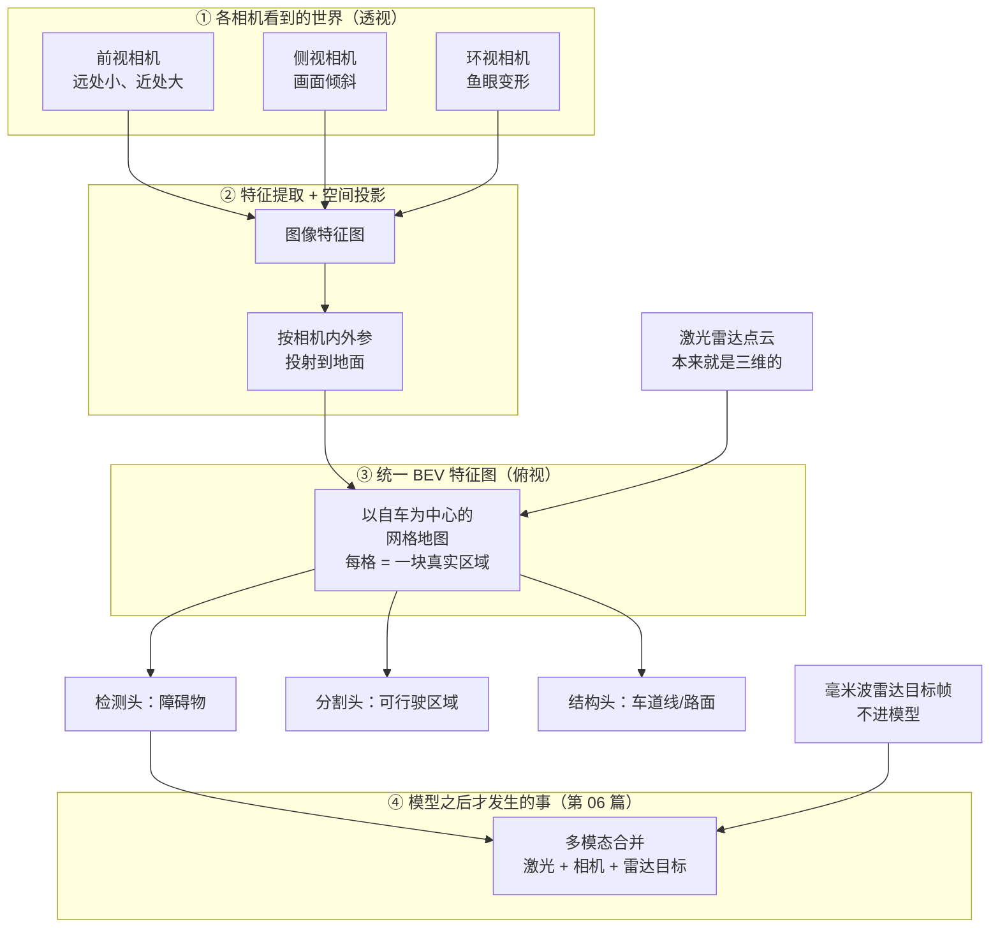
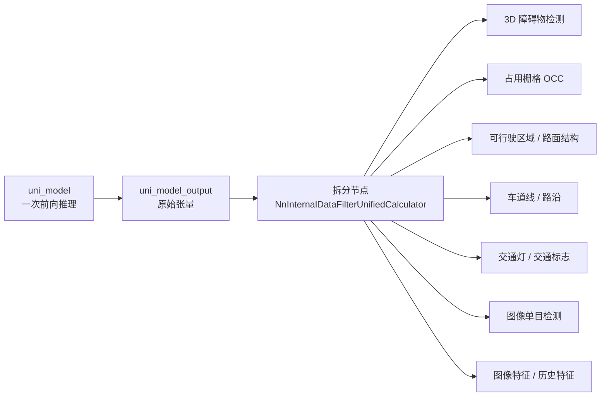

> **这一篇讲什么**：整条链路里最「黑盒」的一段——感知大模型。它到底吃什么、算出什么、为什么非要 BEV 视角、为什么是「一次推理出多个结果」。
> **读完你能回答**：什么是 BEV？为什么不用相机原图直接检测？backbone/neck/head 是什么？17 路输入怎么用？一个模型怎么同时干好几件事？
> **前置知识**：读完第 04 篇（前处理如何准备 17 路输入）。不需要神经网络基础，本篇会把所有术语拆成白话。

## 1. 感知大模型的位置和职责

**一句话结论**：感知大模型是「看」的核心——它把 12 路传感器的信息压缩成一张以自车为中心的鸟瞰地图，并在这张地图上一次算出所有需要的东西：障碍物、可行驶区域、路面结构、交通灯状态。

第 01 篇说过三个角色：看、想、动。看的部分又分成三段：


前处理负责把数据整理成模型能吃的 17 路输入；大模型负责「看一眼，说出周围有什么」；后处理负责把这些原始说法整理成规划能用的障碍物清单。

**为什么这段叫「大模型」**：它的参数量、计算量在整条链路里最大，单帧推理就要占用 GPU 的主要算力。对比之下，规划和控制基本在 CPU 上跑，计算量小得多。

## 2. 为什么一定要 BEV：把「透视照片」变成「俯视地图」

**一句话结论**：因为只有俯视视角能让所有传感器、所有时刻的数据落在同一个坐标系里，模型才能做真正的融合和时序记忆。

### 2.1 相机原图的问题

相机拍出来的是一张透视照片：近处的东西大，远处的东西小，越远越挤在一起。如果直接在这张图上检测障碍物，会遇到三个麻烦：

1. **距离不可直接读**：照片上两个一样大的车，可能在 10 米，也可能在 50 米。
2. **多相机拼不起来**：6 个前视相机各自一张图，同一个物体可能在两张图里各出现一次，怎么合并？
3. **视角依赖**：车一转弯，所有像素位置全变，模型很难积累「我刚才看到过什么」。

### 2.2 BEV 的解法

**BEV（Bird's Eye View，鸟瞰图）**：想象在车顶正上方放一台相机垂直往下拍，拍到的就是 BEV。在这张图上：

- 每个格子对应地面上一块固定的真实区域（比如 0.5 米 × 0.5 米）
- 距离可以直接用格子数换算
- 不管车怎么转，世界坐标系是稳定的
- 相机和激光雷达都能投影到同一张图上，直接叠加；毫米波雷达不参与 BEV，它的目标帧在模型之后才合并

**生活类比**：看监控录像（透视）vs 看停车场的平面图（俯视）。找车位时你肯定看平面图，因为平面图上「我的车在哪、空位在哪、通道在哪」一目了然。



*图 5-1 BEV 视角示意：把相机的透视画面和激光雷达的三维点「摊平」到同一张以自车为中心的俯视地图上；毫米波雷达不参与这张图，它在模型之后才合并进来*

**读图提示**：中间那张 BEV 特征图是全篇的核心——它不是给人看的图片，而是一个数值网格（张量）。所有下游任务都在这个网格上做。注意右下角那个「④」框：雷达目标走的是它，不是 BEV。

### 2.3 BEV 带来的三个好处

| 好处 | 白话解释 |
|-|-|
| 多传感器可融合 | 相机、激光雷达的数据都能投影到同一张图，直接叠加（雷达目标则在模型之后合并） |
| 距离直接可读 | 每格对应固定米数，检测框直接带真实尺寸和位置 |
| 时序可对齐 | 车往前走 1 米，上一帧的 BEV 图平移 1 米就能和当前帧对上 |

第三条是「记忆」的基础。第 04 篇提到模型有 `prev_bev_feats`（上一帧 BEV 特征）输入——正是因为 BEV 在空间上稳定，上一帧的特征才能通过自车位移（`delta_pose`）变换后直接复用，让模型知道「刚被大车挡住的远处，一秒前有什么」。

## 3. 模型内部三段：backbone、neck、head

**一句话结论**：所有现代感知网络都可以拆成「提特征（backbone）→ 融合特征（neck）→ 出结果（head）」三段。

**生活类比**：做菜时先洗切（backbone 把原始素材变成半成品），再下锅调味混合（neck 把各种半成品融合），最后装盘成一道菜（head 输出具体结果）。

| 组成 | 作用 | 在本项目的落点 |
|-|-|-|
| backbone（主干） | 从原始图像/点云里逐层提取特征，从「像素」变成「语义」 | `lidar_backbone`、图像特征提取部分 |
| neck（颈部） | 把不同来源、不同尺度的特征融合成统一的 BEV 特征图 | 多模态融合、`prev_bev_feats` 时序融合 |
| head（检测头） | 在融合特征上接若干小网络，各自输出一种结果 | 检测头、分割头、车道线头、交通灯头等 |

**为什么要分这么多头（多任务）**：因为很多任务共享同一份底层理解。既然后背的算力已经花在「看懂这张 BEV 图」上了，加几个轻量头分别输出检测、分割、车道线，比训练五六个独立模型划算得多。

## 4. 一次推理到底发生了什么

**一句话结论**：17 路输入进入同一个神经网络实例，执行一次前向计算，输出一大块原始张量，再由后续节点拆分给不同任务。

### 4.1 入口：uni_model 节点

内层图里最关键的一个节点：

```text
node {
  name: "uni_model"
  calculator: "NNInternalCalculator"
  input_stream: "INFER_IN:0:lidar_backbone_network_input"
  ...
  input_stream: "INFER_IN:16:ddrouting_model_input"
  output_stream: "INFER_OUT:uni_model_output"
  input_side_packet: "CONFIG:0:uni_model_nn_param_path"
  output_side_packet: "NN_INSTANCE:nn_instance_uni_model"
}
```

逐行翻译：

- `NNInternalCalculator`：Church 框架里「跑一次神经网络」的计算器，它不关心网络内容，只负责按配置加载模型、喂数据、取输出。
- `INFER_IN:0~16`：17 个输入槽位，顺序固定，模型内部按编号取数据。（雷达不在这 17 路里）
- `INFER_OUT:uni_model_output`：**所有任务的输出都在这一个 blob 里**，不是每个任务一个 topic。
- `NN_INSTANCE`：模型实例。同一时刻一个实例只能跑一次推理，这是「一次推理」的字面含义。

> **术语：nn_param**。模型参数文件的配置描述（网络结构、权重路径、输入输出形状）。由 `uni_model_nn_param_path` 指定，运行时从部署目录加载，不在代码仓库里。

### 4.2 back_edge：为什么很多输入标了「回边」

配置里有大量 `back_edge: true`：

```text
input_stream_info { tag_index: "INFER_IN:2"   back_edge: true }  # imgs（相机图）
input_stream_info { tag_index: "INFER_IN:3"   back_edge: true }  # lidar2img
input_stream_info { tag_index: "INFER_IN:4"   back_edge: true }  # delta_pose
input_stream_info { tag_index: "INFER_IN:5"   back_edge: true }  # prev_pose_inv
input_stream_info { tag_index: "INFER_IN:9"   back_edge: true }  # prev_bev_feats
input_stream_info { tag_index: "INFER_IN:10"  back_edge: true }  # curr_frame_speed
input_stream_info { tag_index: "INFER_IN:15"  back_edge: true }  # prev_fpn_feats
```

**白话**：回边（back edge）就是「这条数据来自上一帧的自己」。它不是从上游节点流过来的，而是模型上一次推理的输出被缓存下来、这一帧再喂回去。

**生活类比**：你一边走一边回忆刚才看到的景象。回忆不是新景象，但没有它你就不知道「刚才那辆停在路边的车现在应该在哪」。

这解释了为什么感知输出里有一路 `frame_context`（帧上下文）——它保存跨帧的记忆状态。

### 4.3 推理本身

真正跑网络的那一步在 GPU 上完成。配置里给神经网络分配了独立的执行器线程池（名字前缀 `nn_`，4 个线程），和普通计算器的 5 个线程分开，避免互相抢占。

对小白来说只需记住三点：

1. 推理是**同步阻塞**的：这一帧的推理不结束，下一帧进不来（配合第 04 篇的在飞帧上限 = 1）。
2. 推理是**整批一次**的：17 路输入凑齐后一次性送进网络，不是一路一路喂。
3. 推理结果是**原始张量**：还没变成「障碍物列表」，那一步留到第 06 篇。

## 5. 一个模型，多种输出

**一句话结论**：`uni_model_output` 是一大块原始数据，紧接着的拆分节点把它切成许多任务的原始结果，再交给各自的后处理。



*图 5-2 多任务输出：一次推理产生一大块原始结果，拆分后并行进入各自的加工线*

**读图提示**：注意箭头都是从同一次推理出来的。这不是「跑了七个模型」，而是「一个模型有七个头」。

### 5.1 主要任务清单

| 任务 | 输出什么 | 白话解释 | 谁用 |
|-|-|-|-|
| 3D 障碍物检测 | 每个障碍物的位置、尺寸、朝向、类别、置信度 | 「那里有辆大卡车，长 8 米，朝东」 | 跟踪、预测、融合（第 06 篇） |
| 占用栅格（OCC） | 三维空间每格「被占用概率」 | 「这块空气里有东西，但说不清是什么」 | 兜底异形障碍物 |
| 可行驶区域 | 哪片地面车能走 | 「前面是草地，不能开」 | 规划、泊车 |
| 路面结构 / 车道线 | 车道线、路沿、路口形状 | 「这条车道往左弯」 | 规划参考线 |
| 交通灯 / 标志 | 灯色、箭头、标志类型 | 「前方红灯」 | 规划、控制 |
| 单目相机任务 | 图像视角下的目标、车道 | 补充近距离细节 | 融合 |
| 相机质量/遮挡 | 每个相机是否被泥遮挡 | 「这个相机瞎了，别信它」 | 降级策略 |

> **术语：OCC（Occupancy，占用栅格）**。把空间切成小格子，每个格子标「有没有东西」。它不关心那东西是什么，因此能发现训练集里没见过的异形障碍物（比如掉落的货物、施工围栏）。这是一种「保底」能力：检测头漏了，OCC 还在。

### 5.2 为什么要在 BEV 上做多任务

因为多任务共享同一份 BEV 特征，各任务结果天然一致：检测头说「那里有车」，分割头说「那里是可行驶区域」，两个结论基于同一张图，不会互相打脸。如果是五个独立模型各看各的，很容易出现「一个说有车、一个说能走」的矛盾。

## 6. 主干之外还有哪些模型

**一句话结论**：`uni_model` 是主干，但整条感知链路里还有若干专用小模型，按需启动、各管一件事。

| 小模型 | 干什么 | 为什么单独做 |
|-|-|-|
| 图像质量模型 | 判断相机是否被遮挡/失焦 | 需要在原图上做，且要极快 |
| 闸机检测模型 | 识别收费站闸机 | 场景极窄，单独训练更准 |
| 泊车相关模型 | 车位检测、泊车场景理解 | AVP 泊车功能专用，行车时不需要 |
| 魔法地毯（magic_carpet） | 可通行区域预测 | 与行车规划解耦，独立输出 topic |

> **小白可以不纠结**：读第一遍时只需记住「主干一个、辅以小模型」，具体小模型清单在细节篇再展开。

## 7. 三个常见误解

**误解一：大模型是端到端，直接输出轨迹。**
不是。感知大模型只输出「世界是什么样的」（障碍物、可行驶区域等），轨迹由第 07 篇的规划模块算。感知和规划之间有明确的 topic 边界。

**误解二：BEV 就是一张俯视照片。**
不是照片，是数值网格（张量）。它不给人看，给网络看。可视化工具会把它画成彩色图，那只是便于人理解。

**误解三：一次推理 = 只输出一种结果。**
不是。一次推理输出一大块张量，里面含着多个任务的原始结果，拆分后各自加工。所谓「多任务学习」，省的是特征提取的算力。

## 8. 小结

- 感知大模型 = 看：把 12 路传感器信息压成一张以自车为中心的 BEV 特征图，再一次算出多种结果。
- BEV 解决了「距离不可读、多相机拼不起来、视角不稳定」三个问题，也是时序记忆的基础。
- 网络分 backbone（提特征）、neck（融合）、head（出结果）三段；多任务共享同一份特征。
- 入口是 `uni_model` 节点，17 路输入、1 个输出 blob；7 路回边输入提供「上一帧的记忆」。
- 推理是同步阻塞的，一帧一帧串行，主算力在 GPU。
- 输出是原始张量，还不是障碍物清单——那是下一篇的事。

下一篇《06 后处理：从模型输出到障碍物列表》讲：这堆原始张量如何被拆开、跟踪出 `track_id`、预测出未来轨迹，最后整理成规划能直接用的 `/perception/objects`。

## 9. 证据与延伸

| 结论 | 证据位置 |
|-|-|
| `uni_model` 节点与 17 路 `INFER_IN` | `perception/perception/cfg/graphs/graph_l2avp.cfg`（`name: "uni_model"`，`INFER_IN:0`~`INFER_IN:16`） |
| 回边输入（`back_edge`） | 同上（`input_stream_info` 共 7 处：2/3/4/5/9/10/15） |
| 拆分输出的节点 | 同上（`uni_model_spliter_image_backbone_output`，`NnInternalDataFilterUnifiedCalculator`） |
| 雷达与推理并行、后处理才合并 | 同上（`RadarProcessorCalculator` → `radar_frame_output`；`MultiModalityPreprocessCalculator` 的 `RADAR` 输入） |
| 图像/点云/泊车三支线预处理子图 | 同上（`CameraProcessSubgraphL2AVP`、`LidarOccProcessSubgraph`、`AvpProcessSubgraphL2`） |
| NN 独立执行器线程（4 线程、`nn_` 前缀） | `driver/config/component/perception_graph_l2avp_interleaving.cfg`（`executor nn_internal_designated`） |
| 单帧在飞上限（推理串行） | `platform/church/graph/calculators/frame_sync_calculator.cc`（`kMaxFramesInFlight`） |
