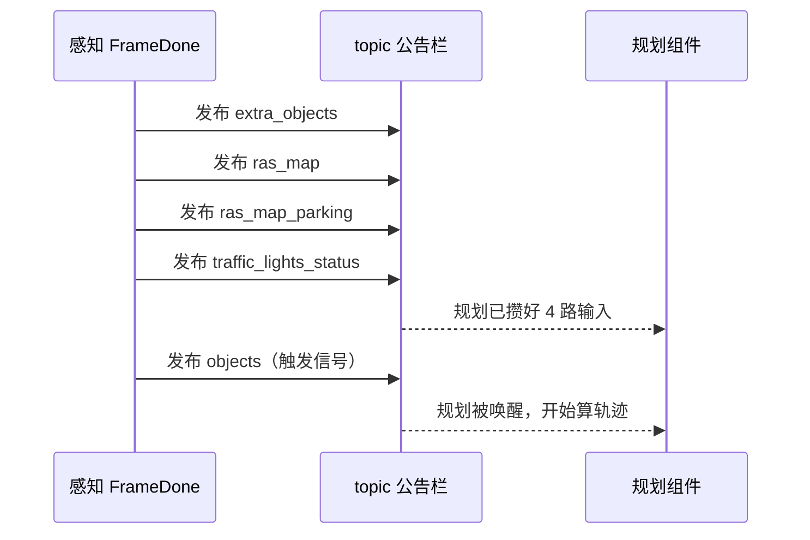

> **这一篇讲什么**：第 05 篇结尾，模型吐出一大块原始张量。这一篇讲它怎么被整理成一份「规划看得懂、用得放心」的障碍物清单。
> **读完你能回答**：为什么模型输出不能直接用？track_id 是什么、为什么必须有？谁在预测别人未来怎么走？多传感器重复检测怎么合并？最后发布成什么 topic、按什么顺序发？
> **前置知识**：读完第 05 篇（BEV 一次推理）。不需要跟踪、预测算法基础。

## 1. 原始输出为什么不能直接用

**一句话结论**：因为原始输出是「这一帧、这个视角看到的碎片」，缺身份、缺时间连续性、缺一致性，直接给规划会算出一条反复横跳的轨迹。

把模型输出直接交给规划，会出现四类问题：

| 问题 | 具体表现 | 后果 |
|-|-|-|
| 没有身份 | 每帧只给「这里有辆车」，不知道是不是上一帧那辆 | 规划无法判断「它是不是一直挡在我前面」 |
| 重复检测 | 同一辆车被相机和激光雷达各报一次 | 规划以为有两辆车挤在一起 |
| 单帧抖动 | 检测框位置每帧跳几厘米甚至几十厘米 | 速度估计发抖，规划频繁修正 |
| 没有意图 | 只知道车现在在哪，不知道它下一秒往哪开 | 规划无法预判加塞、横穿 |

后处理就是逐条解决这四个问题。


*图 6-1 后处理五连：对齐 → 跟踪 → 预测 → 融合整理 → 打包发布*

**读图提示**：这五步顺序不能乱。没有 ID 就没法预测（预测是「对某辆车的未来」建模），没有预测就没法给规划一个稳定的世界。

## 2. 跟踪：给每个障碍物一个身份证

**一句话结论**：跟踪就是把「这一帧的一堆框」和「上一帧的一堆框」对上号，对上的沿用旧 ID，对不上的发新 ID。

### 2.1 track_id 是什么

**白话**：track_id 是一串数字，代表「这是同一辆车」。第 100 帧的 3 号障碍物和第 101 帧的 3 号障碍物是同一个物体，即使它移动了、被短暂遮挡了。

**生活类比**：看球赛时，解说员说「7 号球员带球」。7 号就是 track_id——你不需要靠位置去猜「这个人还是刚才那个人」，号码直接告诉你答案。

**为什么必须有**：规划要算「前车会不会突然刹车」「旁边车道那辆车是不是一直想并线」。这些判断都建立在「同一个对象的时间序列」上。没有 ID，每帧都是全新世界，规划只能做瞬时决策，开起来像新手。

### 2.2 跟踪的两个核心动作

| 动作 | 白话解释 | 类比 |
|-|-|-|
| 匹配（association） | 把这一帧的检测框和上一帧已跟踪的目标配对，看谁和谁最像 | 玩连连看：位置、大小、速度最接近的连起来 |
| 滤波（filtering） | 用历史轨迹平滑掉单帧抖动，同时估计速度 | 手机地图的定位平滑：不显示你的手抖，只显示你的走向 |

匹配时会综合位置、尺寸、朝向、速度、类别等相似度；滤波常用卡尔曼滤波（Kalman Filter）——一种「根据历史预测当前位置，再用当前观测修正」的算法。

> **术语：卡尔曼滤波**。想象你闭眼走路，靠感觉估计自己走了 3 米（预测），睁眼看到实际走了 3.2 米（观测），于是把估计修正成 3.1 米。每一步都这样「预测 + 修正」，结果比单靠感觉或单靠眼睛都准。

### 2.3 跟踪的难处在哪

- **遮挡**：前车被大货车挡住 1 秒，跟踪器要「记住」它还在，而不是让它消失。
- **ID 切换（switch）**：两辆车交错时不要把 ID 弄反。
- **新生与消亡**：新出现的障碍物要发新 ID，驶出视野的要及时移除，否则清单越来越长。

在本项目里，这一环由 `perception_tracker` 节点（`PerceptionTrackerProcessCalculator`）负责。

## 3. 预测：猜别人未来几秒怎么走

**一句话结论**：预测给每个跟踪目标算出一条或多条未来轨迹，让规划能提前避让，而不是等对方动了才反应。

### 3.1 为什么规划需要别人的未来

假设你在跟车。如果只看前车当前的位置，那么它刹车时你才开始减速——太晚。如果你知道它「未来 3 秒可能减速到 0」，你就可以提前松油门。

**生活类比**：过马路时你不是看车现在在哪，而是看它的速度和方向，判断「它会不会撞到我」。这就是人脑的预测。

### 3.2 预测输出什么

对每个被跟踪的障碍物，预测模块给出未来若干秒（通常 3~8 秒）的轨迹点序列，可能带一个概率。轨迹点通常包含：

- 时间（相对当前帧的偏移，比如 0.5s、1.0s）
- 位置（x, y）
- 朝向、速度（可选）

**为什么可能给多条**：人开车意图不确定（可能直行，也可能突然变道）。很多预测算法会输出多条候选轨迹，每条带一个概率，让规划自己权衡风险。本项目里预测结果的类型是 `deeproute::prediction::Trajectory`，规划侧会直接读取使用。

### 3.3 预测的三种典型方法（了解即可）

| 方法 | 思路 | 优点 | 缺点 |
|-|-|-|-|
| 恒速/恒转向外推 | 假设保持当前运动状态 | 简单、极快 | 转弯、加塞完全预测不到 |
| 基于车道/地图规则 | 沿车道中心线往前推 | 结构化道路很准 | 无地图区域失效 |
| 神经网络预测 | 学习大量真实驾驶数据 | 能学到复杂意图 | 算力高、可解释性差 |

实际系统通常是「多条路线混合 + 按场景选用」。

## 4. 融合与整理：把多路结果合成一份清单

**一句话结论**：相机、激光雷达、毫米波雷达各自看到的东西要合并、去重、互补，再补齐「说不清是什么」的障碍，最终形成一份不重不漏的清单。

### 4.1 为什么要融合

| 传感器 | 强项 | 弱项 |
|-|-|-|
| 相机 | 认类别（车/人/锥桶）、读交通灯 | 测距精度一般，受光照影响 |
| 激光雷达 | 测距测形状准 | 远处点稀疏，类别难分 |
| 毫米波雷达 | 测速度准，雨雾穿透好 | 分辨率低，容易有杂波 |

融合就是「谁擅长什么就用谁的」。本项目在多模态预处理（`MultiModalityPreprocessCalculator`）阶段就把三路结果放在一起。

### 4.2 去重与补漏

- **去重**：同一辆车被两个传感器各报一次，融合后应该只剩一个目标（否则规划会看到「两辆车重叠」）。
- **补漏**：检测头漏掉的异形障碍（掉落货物、施工围栏），用占用栅格（OCC）补上，作为「未知类障碍物」。
- **分流**：不同用途的清单分开输出。比如紧急制动（AEB）需要更灵敏、更低延迟的一份清单，所以有独立的 `perception_aeb/objects`。

> **术语：AEB（Autonomous Emergency Braking，自动紧急制动）**。最后一道安全兜底：判断马上要撞了就直接刹车，不经过规划的完整决策流程。它需要自己的、更保守的障碍物清单。

### 4.3 其他支线的整理

后处理不只为障碍物服务，还有几条并行支线：

| 支线 | 整理什么 | 输出 |
|-|-|-|
| 交通灯 | 灯色、箭头、对应车道 | `/perception/traffic_lights_status` |
| 路面结构 | 车道线、路沿、路口（`RasMapMergeCalculator`） | `/perception/ras_map` |
| 泊车地图 | 车位、可泊区域 | `/perception/ras_map_parking` |
| 相机质量 | 哪个相机被遮挡/失焦（`CameraQualityFilterCalculator`） | `/perception/camera_quality` |
| 交互与事件 | 他车意图交互、触发事件（`PerceptionOutputInteractionCalculator`、`PerceptionTriggerEventsCalculator`） | `/perception/module_events` 等 |
| 备份与合并 | 结果备份、跨帧合并（`PerceptionOutputBackupCalculator`、`ResultFrameMergeCalculator`） | 内部使用 |

## 5. 打包与发布：为什么 objects 最后发

**一句话结论**：所有结果打包后，感知按固定顺序发布，故意把 `/perception/objects` 放在最后一位，因为它是规划的触发信号。

### 5.1 打包

`PerceptionOutputProcessCalculator` 把上面所有支线的结果组装成要发布的 topic 集合；`PerceptionIoPostprocessing` 做最后的输出整理（例如共享内存、序列化）；最外层的 `perception_frame_done`（`FrameDoneCalculator`）负责逐条发布。

### 5.2 发布顺序是有讲究的

最外层图的发布配置大意如下：

```text
OUTPUT:0  extra_objects
OUTPUT:1  ras_map
OUTPUT:2  ras_map_parking
OUTPUT:3  traffic_lights_status
OUTPUT:4  objects          # 最后发，触发规划
OUTPUT:5~18  其余输出
```

配置里留了一行注释，直译是：**保持这个顺序，确保规划模块在其他四个输入 topic 之后才收到触发 topic `/perception/objects`**。

**为什么**：规划组件是「被 `/perception/objects` 触发」的（第 03 篇讲过装配策略）。如果 objects 先发，规划可能立刻醒来，但它的其他输入（ras_map、traffic_lights_status 等）还没更新，就会用上一帧的旧地图做决策。把 objects 放最后，等于说「所有材料都放好了，开饭」。



*图 6-2 发布顺序与触发：objects 作为「最后一块拼图」，同时充当规划的启动信号*

**读图提示**：注意规划不是在收到第一路数据时启动的，而是在收到 objects 时才启动。这是本项目一个容易被忽略但非常关键的设计。

## 6. 障碍物清单长什么样

一份 `/perception/objects` 里，每个障碍物大致包含这些信息：

| 字段 | 白话解释 | 规划怎么用 |
|-|-|-|
| track_id | 身份证号 | 判断是不是同一个对象 |
| 位置（x, y） | 相对自车的坐标 | 算距离、算是否在路径上 |
| 尺寸（长宽高） | 占多大空间 | 算安全间距、判断能否绕过 |
| 朝向（heading） | 车头朝哪 | 判断它是同向、对向还是横穿 |
| 速度 | 现在多快、往哪走 | 算碰撞时间（TTC） |
| 类别 | 车/人/骑行者/锥桶/未知 | 决定保守程度（人要比锥桶更小心） |
| 置信度 | 系统有多确定 | 低置信度目标降权处理 |
| 预测轨迹 | 未来几秒可能在哪 | 提前避让、选安全轨迹 |

> **小白提示**：不需要记住字段名，只要理解「清单里每个对象都带着身份、位置、形状、运动状态、类别、未来」。规划看到的就是这些。

## 7. 三个常见误解

**误解一：后处理只是「格式转换」，不影响安全。**
恰恰相反。跟踪丢 ID、预测漏掉加塞、去重失败，都会直接导致规划误判。后处理是感知可信度的守门人。

**误解二：感知输出越多越好。**
不是。输出太多低置信度目标会让规划过度保守、频繁刹车。所以有置信度过滤、相机质量降级、AEB 独立清单等机制。

**误解三：规划一收到感知结果就立刻算。**
不是被「任意一路感知输出」触发，而是被 `/perception/objects` 触发，且感知故意把它放在最后发布，保证其他输入已经就绪。

## 8. 小结

- 模型原始输出缺身份、缺连续性、有重复、无意图，必须后处理。
- 跟踪解决「是不是同一辆车」：匹配 + 滤波，产出 `track_id`。
- 预测解决「它要去哪」：给出未来若干秒轨迹，可能多条带概率。
- 融合解决「多传感器怎么合」：去重、补漏（OCC）、按用途分流（AEB 独立清单）。
- 打包后按固定顺序发布，`/perception/objects` 最后发，并充当规划的触发信号。
- 最终清单里每个对象都带身份、位置、尺寸、朝向、速度、类别、置信度和预测轨迹。

下一篇《07 规划模型：从障碍物到安全轨迹》进入「想」的部分：拿到这份清单后，规划怎么算出一条安全、舒适、合规的轨迹。

## 9. 证据与延伸

| 结论 | 证据位置 |
|-|-|
| 跟踪节点与输入输出 | `perception/perception/cfg/graphs/graph_l2avp.cfg`（`perception_tracker`，`PerceptionTrackerProcessCalculator`） |
| 预测节点 | 同上（`PredictionProcessorCalculator`） |
| 多模态结果对齐 | 同上（`MultiModalityPreprocessCalculator`） |
| 融合与整理各支线节点 | 同上（`RasMapMergeCalculator`、`CameraQualityFilterCalculator`、`PerceptionOutputInteractionCalculator`、`PerceptionOutputBackupCalculator`、`ResultFrameMergeCalculator`） |
| 输出打包与发布 | 同上（`PerceptionOutputProcessCalculator`、`PerceptionIoPostprocessing`、`TriggerNextFrameCalculator`） |
| objects 最后发布及原因注释 | `driver/config/component/perception_graph_l2avp_interleaving.cfg`（`perception_frame_done` 的 `OUTPUT:0~4` 与注释） |
| 规划被 `/perception/objects` 触发 | `driver/config/component/planning.jsonnet`（`trigger_channels`） |
| 规划侧读取预测轨迹 | `planning/planning/common/obstacle/path_obstacle.h`（`trajectory_awared_prediction`） |
