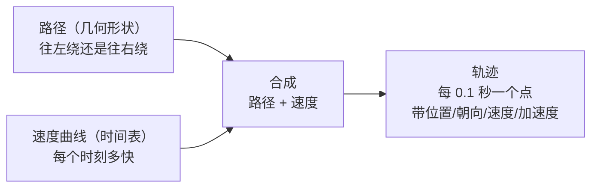
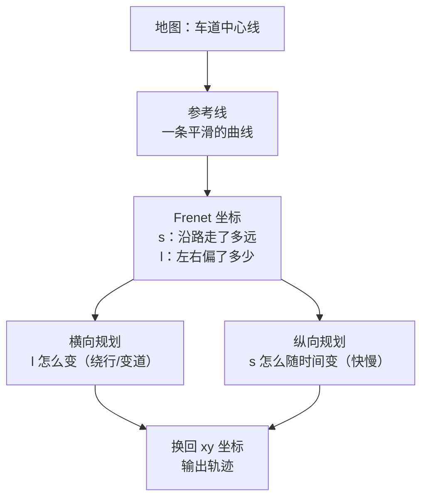
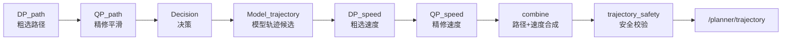

> **这一篇讲什么**：三个角色里的「想」。拿到感知的障碍物清单和地图后，规划如何算出一条既安全又舒适、还符合交规的轨迹。
> **读完你能回答**：轨迹到底是什么、由哪些点组成？参考线和 Frenet 坐标是什么？DP 和 QP 分别在做什么？路径和速度为什么要分开规划？算崩了怎么办？规划为什么比控制慢得多？
> **前置知识**：读完第 06 篇（障碍物清单）。需要一点初中数学（坐标、斜率），不需要最优化理论基础。

## 1. 规划在图上的位置与任务

**一句话结论**：规划 = 在「不能撞、要舒服、要合规」的约束下，从当前状态出发，找一条未来几秒的可行路径，并给每个时刻配上速度。

### 1.1 输入与输出

| 方向 | 内容 |
|-|-|
| 输入 | 障碍物清单（`/perception/objects`）、可行驶区域、路面结构、交通灯状态、自车状态（`/canbus/car_state`）、定位（位姿）、地图与导航路由 |
| 输出 | 一条轨迹（`/planner/trajectory`），以及调试信息、决策结果、响应状态等 12 路辅助输出 |

### 1.2 轨迹到底是什么

**白话**：轨迹 = 「未来几秒内，每一时刻我在哪、朝向多少、速度多少、加速度多少」的一串点。

每个轨迹点大致包含：

| 字段 | 含义 | 白话 |
|-|-|-|
| x, y, z | 位置 | 在哪 |
| theta | 朝向角 | 车头指哪个方向 |
| kappa | 曲率 | 方向盘要打多少 |
| v | 速度 | 这一刻多快 |
| a | 加速度 | 这一刻在加速还是刹车 |
| relative_time | 相对当前时刻的时间 | 这是第几秒的点 |
| s | 沿参考线的里程 | 沿路走了多远 |

> **注意**：轨迹不是「一条线」，而是「一条线 + 时间表」。同样的几何路径，配上不同的速度曲线，就是完全不同的驾驶行为（慢慢开 vs 冲过去）。

*图 7-1 轨迹 = 路径 × 速度：几何形状决定「走哪」，速度曲线决定「多快」*

**读图提示**：这正是下面要讲的「路径规划和速度规划分开做」的原因——两个问题相对独立，拆开算更简单也更快。

## 2. 参考线与 Frenet 坐标：把弯路拉直

**一句话结论**：规划不直接在 xy 平面上找点，而是先选一条「参考线」（通常来自地图车道中心线），用「沿路多远 + 偏离多少」两个数来描述位置，这样弯路就变成了直路。

### 2.1 为什么要参考线

在弯道上用 xy 坐标描述「往左偏 2 米」很麻烦，因为方向一直在变。换成「沿路 s 米，向左 l 米」就非常自然：

- 沿路方向叫 **s**（纵向，longitudinal）
- 垂直路方向叫 **l**（横向，lateral）
- 这套坐标叫 **Frenet 坐标系**（以参考线为基准的曲线坐标）

**生活类比**：高铁上描述座位位置，你会说「第 8 排靠窗」，而不是报经纬度。参考线就是那节车厢的排号系统。

*图 7-2 参考线与 Frenet 坐标：把二维的「往哪走」拆成一维的「左右偏多少」和一维的「前后走多快」*

**读图提示**：分解之后，横向和纵向可以各自独立求解，这就是 EM 规划器「路径 + 速度」分离设计的根源。

### 2.2 参考线从哪来

本项目里有专门的参考线提供者（`ReferenceLineProvider`），输入是地图、导航路由和自车定位，输出若干条候选参考线（当前车道、相邻车道、路口转向等）。规划会为每条候选参考线各算一次，最后挑最好的一条。

## 3. 任务链：规划不是一次算完，而是一串任务接力

**一句话结论**：规划内部是一条任务链，路径先粗选再精修、速度先粗选再精修、然后合成、最后安全检查；每个阶段都可以失败并降级。

### 3.1 任务链顺序

规划器源码里明确写下了任务顺序（注释原文：`DpPath -> QpPath -> ModelTrajectoryGenerator -> DpSpeed -> QpSpeed`）：

*图 7-3 规划任务链：六个优化/生成阶段 + 合成 + 校验*

**读图提示**：注意每个阶段是否可以启用由配置控制（`enable_*` 开关），所以不同车型、不同场景跑的任务可能不一样。名字里的 DP/QP 是两类最优化方法，下面用白话解释。

### 3.2 DP：先粗选一条「大致能走」的路

**DP（Dynamic Programming，动态规划）**：把问题切成很多小步，每一步在所有可能选择里挑一个代价最小的，逐步递推到终点。

在路径规划里，它把「横向偏移」离散成一格一格（比如每 0.5 米一个选项），在障碍物之间找一条代价最低的通道。

**生活类比**：走迷宫时，你先用眼睛扫一遍，找一条大致通的路线（可能不是最优），这就是 DP。

**优点**：能处理复杂障碍、不会陷入局部最优死胡同；**缺点**：结果是一格一格的，不够平滑，方向盘会一顿一顿。

### 3.3 QP：把粗选结果「磨平」

**QP（Quadratic Programming，二次规划）**：在满足一堆约束的前提下，最小化一个二次型代价函数。

在路径规划里，它的目标是「离 DP 给的粗路径尽量近，同时曲率尽量小、曲率变化尽量平滑」，约束是「不能撞障碍物、不能出道路边界」。

**生活类比**：你已经有了一条大致路线，现在拿橡皮筋把它绷紧、把折角磨圆，让它开起来舒服。这就是 QP。

**为什么需要两步**：只用 DP 太抖，只用 QP 容易卡在局部最优或找不到可行解。DP 给 QP 一个好起点，QP 给 DP 一个好外观——这是 EM 规划器的经典组合。

### 3.4 路径和速度分开算

| 规划 | 决定什么 | 主要约束 |
|-|-|-|
| 路径（path） | 走哪条线（左右） | 不撞障碍物、不出边界、曲率可执行 |
| 速度（speed） | 每个时刻多快 | 不超速、不撞前车、加减速舒适、红灯要停 |

两者都走「DP 粗选 → QP 精修」的套路，只是把横向 l 换成纵向 s（时间维度）。最后简单相乘——把路径上的点和时间表对应起来——就得到完整轨迹。

### 3.5 决策与模型轨迹

- **决策（Decision）**：决定行为意图，比如「跟车」「绕行」「变道」「让行」「停车」。决策输出会约束后面的优化，比如决定绕行，路径规划就只在障碍物某一侧找解。
- **模型轨迹（Model_trajectory）**：任务链里还有一个由模型生成轨迹候选的阶段。可以理解为「学习型规划器给出的建议方案」，它和几何优化结果一起参与后续的合成与选择。

> **小白提示**：不必纠结哪个阶段一定生效——它们是可配置开关。重要的是理解「粗选 → 精修 → 合成 → 校验」这条骨架。

### 3.6 失败与降级：plan B 是设计的一部分

规划必须假设「任何一步都可能算不出可行解」。源码里有明确的兜底逻辑：

- 如果 DP 路径失败，就跳过 QP 路径（源码：`dp path failed, skip qp path`），直接进入 fallback。
- 系统里维护一条**备份路径（backup path）**，一旦主路径不可用，就用备份路径保证车不会失控。
- 还有 `path_fallback` / `speed_fallback` 两个标志位，贯穿任务链传递失败状态。

**生活类比**：登山前先规划路线，但包里一定带急救包和撤退路线。规划器的「撤退路线」就是 backup path 和 fallback。

### 3.7 走一遍：前车慢行时规划在想什么

用一个具体场景把任务链串起来。前方 30 米有一辆慢车，感知给出它当前的位置与预测轨迹，规划每一帧都要回答四个问题：

| 顺序 | 问题 | 对应阶段 |
|-|-|-|
| 1 | 它未来几秒会去哪、会不会挡住我 | 读预测轨迹，在参考线上做碰撞检查 |
| 2 | 我该「跟车」还是「绕行」 | 决策：比较两侧空间与代价，做出选择 |
| 3 | 具体走哪条线、每个时刻多快 | 路径走 DP 粗选 + QP 精修；速度同理 |
| 4 | 这条轨迹安全吗 | 合成后做安全校验，不过则降级或重算 |

这四问的顺序就是任务链的顺序，只是源码里每一步都展开成了多个优化任务与大量约束。读代码时可以拿这个场景当「地图」：看到哪个任务，就问它回答了上面哪个问题。

## 4. 约束从哪来：安全、舒适、合规

**一句话结论**：规划的每条约束都能对应到现实中的一条交规或一个乘坐体验要求。

| 约束 | 来源 | 违反的后果 |
|-|-|-|
| 不与障碍物碰撞 | 感知清单 + 预测轨迹 | 事故 |
| 不超出道路边界 | 地图 + 可行驶区域 | 冲出路面 |
| 曲率不超过车辆能力 | 车辆运动学 | 方向盘打不过来 |
| 加速度/加加速度在舒适区间 | 乘坐体验 | 乘客晕车、货物移位 |
| 不超过限速、遵守交通灯 | 地图 + 感知交通灯 | 违章、事故 |
| 留足安全距离 | 速度与制动能力 | 前车急刹时追尾 |

注意「加加速度（jerk）」这个指标：它是加速度的变化率。刹车踩得猛，jerk 就大。规划会把 jerk 限制在一个范围内，这就是为什么好的自动驾驶刹车是「缓缓加力」而不是「一脚到底」。

## 5. 输出：13 路结果，轨迹是第一位

**一句话结论**：规划算完后按固定顺序发布 13 路 topic，其中轨迹是第 0 位——因为它最重要，也因为它要尽快送到控制。

| 输出 | 内容 |
|-|-|
| `/planner/trajectory`（OUTPUT:0） | 最终轨迹，控制直接消费 |
| `/planner/debug_info` | 调试信息（各阶段耗时、代价、候选） |
| `/planner/response`、`multi_responses` | 对外请求的响应 |
| `/planner/event` | 事件（如「无法避让，请求接管」） |
| `/planner/semantic_info` | 语义化决策描述 |
| `/planner/context` | 跨帧上下文记忆 |
| `/planner/stop_objects` 等 | 需要停车的目标等辅助信息 |

> **术语：context（上下文）**。规划也会记忆——比如「我 3 秒前决定要变道」，这个意图要跨帧保留，否则每帧都重新决策会来回摇摆。这类状态存在 context 里。

### 5.1 为什么规划的时间预算是 500ms

配置里规划组件的 `expected_proc_duration_ms` 是 **500** 毫秒。这不是说每帧都要算 500ms，而是「调度器认为这个组件最长可能占用 500ms」，超过就会报警甚至被判定超时。

对比控制组件的 **20ms** 预算，差了一个数量级。原因很简单：规划要解优化问题（可能迭代很多轮），控制只是算一个反馈公式（第 08 篇讲）。

## 6. 三个常见误解

**误解一：规划就是「找一条不撞的路」。**
不只是。还要舒适（限制加速度、jerk）、合规（限速、红绿灯）、可执行（曲率、方向盘转角限制），并且要给出时间表（速度）。

**误解二：规划每次都是从零开始算。**
不是。有参考线（地图给的）、有备份路径、有跨帧 context、有上一次的轨迹。规划大量工作是「在上一次的基础上调整」，而不是重新发明。

**误解三：规划算不出来车就完了。**
不是。有 fallback、backup path、停车兜底等多层保护。规划器的设计假设就是「随时可能失败」。

## 7. 小结

- 规划 = 约束下的轨迹生成：不能撞、要舒服、要合规、要可执行。
- 轨迹 = 路径（几何）+ 速度（时间表），每个点带位置、朝向、曲率、速度、加速度、时间。
- 参考线把弯路拉直，Frenet 坐标把二维问题拆成「左右」和「快慢」两个一维问题。
- 任务链：DP 粗选 → QP 精修（路径与速度各来一遍）→ 决策 → 模型轨迹 → 合成 → 安全校验。
- 失败有降级：跳过 QP、backup path、fallback、停车。
- 输出 13 路 topic，轨迹第一位；时间预算 500ms，比控制慢一个数量级。

下一篇《08 控制与执行：从轨迹到方向盘转角》讲「动」：轨迹点如何变成油门、刹车和方向盘指令，以及为什么控制是被定位触发的、而不是被轨迹触发。

## 8. 证据与延伸

| 结论 | 证据位置 |
|-|-|
| 任务顺序 `DpPath -> QpPath -> ModelTrajectoryGenerator -> DpSpeed -> QpSpeed` | `planning/planning/planner/em_planner.cpp`（`CreateDpPathOptimizationTask` 附近的注释与建链代码） |
| 任务阶段枚举 | 同上（`enum TaskStageCode`：`eDpPath`、`eQpPath`、`eModelTrajectory`、`eDpSpeed`、`eQpSpeed`、`eCombinePathSpeed`、`eTrajectorySafety`） |
| DP 失败跳过 QP 的降级 | 同上（`RunTasksStage` 中 `dp path failed, skip qp path`） |
| 备份路径与 fallback 标志 | 同上（`backup_path`、`path_fallback`、`speed_fallback`） |
| 参考线提供者 | `planning/planning/reference_line_info/reference_line_provider.h`（`class ReferenceLineProvider`） |
| 轨迹点字段（x/y/theta/kappa/v/a/relative_time） | `planning/planning/calculators/planning_post_process_calculator.cc`（`ADCTrajectory` 哈希计算涉及字段） |
| 规划子图五节点 | `planning/planning/config/planning_sub_graph.cfg`（InputPreprocess → StitchMap → PlanningCore → RequestCalculator → PostProcess） |
| 规划 13 路输出、轨迹为 OUTPUT:0 | `driver/config/component/planning_graph.cfg`（`planning_frame_done_node`） |
| 500ms 时间预算与触发 topic | `driver/config/component/planning.jsonnet`（`expected_proc_duration_ms`、`trigger_channels`） |
