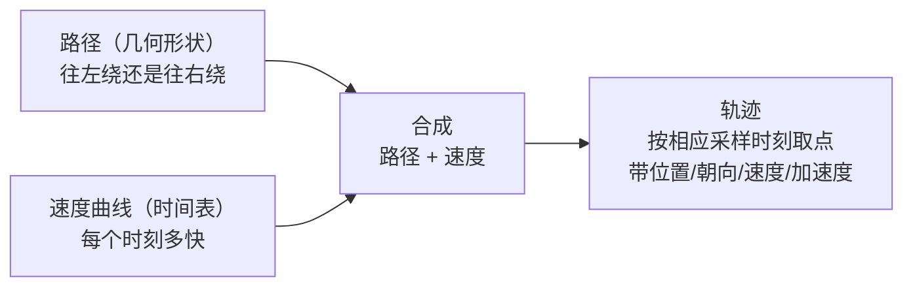
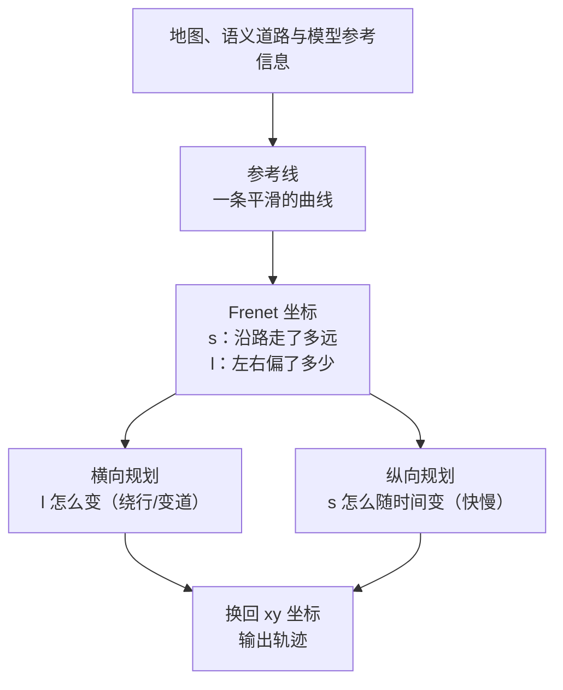
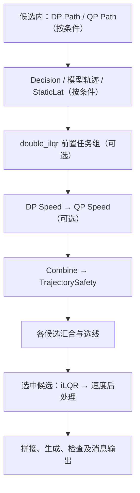

> **这一篇讲什么**：三个角色里的「想」。拿到感知的障碍物清单和地图后，规划如何算出一条既安全又舒适、还符合交规的轨迹。
> **读完你能回答**：轨迹到底是什么、由哪些点组成？参考线和 Frenet 坐标是什么？DP 和 QP 分别在做什么？路径和速度为什么要分开规划？算崩了怎么办？规划为什么比控制慢得多？
> **前置知识**：读完第 06 篇（障碍物清单）。需要一点初中数学（坐标、斜率），不需要最优化理论基础。

> **继续深入**：[Planning 架构拆解 · 导读](./Planning/index.md)提供 15 篇详解和 2 篇附录，从输入缓存、Frame、模型候选一路讲到 iLQR、输出与泊车。本篇保留主干视角；以下流程按 2026-11-10 核对的代码修订。

## 1. 规划在图上的位置与任务

**一句话结论**：规划 = 在「不能撞、要舒服、要合规」的约束下，从当前状态出发，找一条未来几秒的可行路径，并给每个时刻配上速度。

### 1.1 输入与输出

| 方向 | 内容 |
|-|-|
| 输入 | 障碍物与模型候选（`/perception/objects`）、可行驶区域、路面结构、交通灯状态、自车状态（`/canbus/car_state`）、定位（位姿）、地图与导航路由 |
| 输出 | 一条轨迹（`/planner/trajectory`），以及调试信息、决策结果、响应状态等；外层 graph 配置 13 个 OUTPUT 槽，每帧不一定全部有消息 |

### 1.2 轨迹到底是什么

**白话**：轨迹 = 「未来几秒内，每一时刻我在哪、朝向多少、速度多少、加速度多少」的一串点。

每个轨迹点大致包含：

| 字段 | 含义 | 白话 |
|-|-|-|
| x, y, z | 位置 | 在哪 |
| theta | 朝向角 | 车头指哪个方向 |
| kappa | 曲率 | 路径弯曲程度，与转角的关系由车辆模型决定 |
| v | 速度 | 这一刻多快 |
| a | 加速度 | 这一刻在加速还是刹车 |
| relative_time | 相对轨迹时间基准的时间 | 该点对应哪个时刻，基准需核对消息定义 |
| s | 相应路径上的累计距离 | 不应不加区分地等同于道路参考线的 s |

> **注意**：轨迹不是「一条线」，而是「一条线 + 时间表」。同样的几何路径，配上不同的速度曲线，就是完全不同的驾驶行为（慢慢开 vs 冲过去）。

*图 7-1 轨迹结合路径与时间表：用 P(s(t)) 表示位置关系，几何形状决定「走哪」，纵向序列决定「何时到哪」*

**读图提示**：这正是下面要讲的「路径规划和速度规划分开做」的原因——拆开有助于降低问题复杂度，但曲率、速度和动态对象会使两者耦合，后续仍需协调。

## 2. 参考线与 Frenet 坐标：把弯路拉直

**一句话结论**：参考线是一条供衡量沿路位置与横向偏移的基准曲线。部分任务使用它建立 Frenet 坐标，其他优化也会使用 XY 状态；它不必等于车道中心，也不是最终执行路径。

### 2.1 为什么要参考线

在弯道上用 xy 坐标描述「往左偏 2 米」很麻烦，因为方向一直在变。换成「沿路 s 米，向左 l 米」就非常自然：

- 沿路方向叫 **s**（纵向，longitudinal）
- 垂直路方向叫 **l**（横向，lateral）
- 这套坐标叫 **Frenet 坐标系**（以参考线为基准的曲线坐标）

**生活类比**：高铁上描述座位位置，你会说「第 8 排靠窗」，而不是报经纬度。参考线就是那节车厢的排号系统。

*图 7-2 参考线与 Frenet 坐标：把二维的「往哪走」拆成一维的「左右偏多少」和一维的「前后走多快」*

**读图提示**：参考线有助于分解横向与纵向问题；它们在求解阶段仍受速度、曲率和动态障碍等关系耦合。

### 2.2 参考线从哪来

本项目有 `ReferenceLineProvider`，也有结合语义道路与模型匹配信息的参考线构造分支。Frame 将候选整理成 `ReferenceLineInfo`，其中不只有曲线，还包括对象、决策、路径和速度等。每个可用候选执行相应任务，再汇合选择。详见 [Planning 导读](./Planning/index.md)的第 02、07 篇。

## 3. 任务链：规划不是一次算完，而是一串任务接力

**一句话结论**：行车规划按配置组织传统与模型任务：候选分别计算，汇合并选线后还有 iLQR、速度处理、轨迹拼接与检查。失败处理依赖具体任务和可用备份。

### 3.1 任务链顺序

`EmPlanner` 的可执行建链条件比旧注释更完整。图中“可选”表示由配置决定是否创建；即使任务已创建，Execute 也可能根据状态跳过。模型候选在 Frame 预处理阶段已参与处理，并非到 ModelTrajectoryGenerator 才开始。

*图 7-3 · 候选任务与汇合后处理。当前 DP Speed 构造条件是 true；这不代表每次必定完整执行 DP 搜索。*

**读图提示**：DP Path 在关闭模型路径、或开启模型路径且 use_dp_path 时创建；QP Path 的实际条件是关闭模型路径且开启 QP 路径。完整条件、任务顺序和失败分支见 Planning 细节篇第 11 篇。

### 3.2 DP：先粗选一条「大致能走」的路

**DP（Dynamic Programming，动态规划）**：把问题离散为若干层，比较从前驱到当前节点的累计代价，并回溯得到较优方案；不是每一步只做眼前最优的贪心选择。

在路径规划里，它把「横向偏移」离散成一格一格（比如每 0.5 米一个选项），在障碍物之间找一条代价最低的通道。

**生活类比**：走迷宫时，你先用眼睛扫一遍，找一条大致通的路线（可能不是最优），这就是 DP。

**适用性与局限**：能在离散候选和连接中搜索较优方案，但采样、连接和代价限制了可行性及最优性的范围，仍可能无解；粗解也需要后续处理，不能直接等同于实际方向盘运动。

### 3.3 QP：把粗选结果「磨平」

**QP（Quadratic Programming，二次规划）**：在满足一堆约束的前提下，最小化一个二次型代价函数。

在路径规划里，它的目标是「离 DP 给的粗路径尽量近，同时曲率尽量小、曲率变化尽量平滑」，约束是「不能撞障碍物、不能出道路边界」。

**生活类比**：你已经有了一条大致路线，现在拿橡皮筋把它绷紧、把折角磨圆，让它开起来舒服。这就是 QP。

**为什么需要两步**：DP 提供离散骨架，QP 可在构造出的边界内求平滑方案。凸 QP 本身不应笼统描述成“容易卡局部最优”；真实避障的非凸选择、前序边界及可行性需要另外处理。当前代码也并非每种模式都启用这组任务。

### 3.4 路径和速度分开算

| 规划 | 决定什么 | 主要约束 |
|-|-|-|
| 路径（path） | 走哪条线（左右） | 不撞障碍物、不出边界、曲率可执行 |
| 速度（speed） | 每个时刻多快 | 不超速、不撞前车、加减速舒适、红灯要停 |

传统组合可以分别用 DP/QP 处理路径与速度，模型模式还会提供相应数据。路径搜索常看 SL，速度搜索常看 ST。合成时按 s(t) 查询路径 P(s)，并组织运动字段；不是两个数组简单相乘。

### 3.5 决策与模型轨迹

- **决策（Decision）**：决定行为意图，比如「跟车」「绕行」「变道」「让行」「停车」。决策输出会约束后面的优化，比如决定绕行，路径规划就只在障碍物某一侧找解。
- **模型轨迹（Model_trajectory）**：模型先给出多模态建议，Frame 中进行匹配和候选处理，ModelTrajectoryGenerator 再把相关方案整理为任务链使用的数据；之后仍有选线和数值优化。

> **小白提示**：不必纠结哪个阶段一定生效——它们是可配置开关。先理解「候选准备 → 各候选任务 → 汇合选择 → 最终优化与收尾」的骨架，再核对所用配置。

### 3.6 失败与降级：plan B 是设计的一部分

规划必须假设「任何一步都可能算不出可行解」。源码里有明确的兜底逻辑：

- DP 路径失败时，可能使用有效 backup；否则设置 fallback 标志，相关 QP 路径也可能跳过。
- 代码存在 **backup path** 及路径/速度 fallback 分支，但备份不保证始终有效，fallback 也可能失败。车辆最终响应还取决于外层状态与控制处理。
- 还有 `path_fallback` / `speed_fallback` 两个标志位，贯穿任务链传递失败状态。

**生活类比**：登山前先规划路线，但包里一定带急救包和撤退路线。规划器的「撤退路线」就是 backup path 和 fallback。

### 3.7 走一遍：前车慢行时规划在想什么

用一个具体场景把任务链串起来。前方 30 米有一辆慢车，感知给出它当前的位置与预测轨迹，规划每一帧都要回答四个问题：

| 顺序 | 问题 | 对应阶段 |
|-|-|-|
| 1 | 它未来几秒会去哪、会不会挡住我 | 读预测轨迹，在参考线上做碰撞检查 |
| 2 | 我该「跟车」还是「绕行」 | 决策：比较两侧空间与代价，做出选择 |
| 3 | 具体走哪条线、每个时刻多快 | 按配置使用模型/传统任务并继续 iLQR 优化 |
| 4 | 这条轨迹安全吗 | 查看任务安全处理、求解状态、总控检查与具体失败处理 |

这是理解问题的逻辑顺序，不是源码逐函数的调用顺序；规则、候选处理和检查分布在多处。读代码时可以拿这个场景当「地图」：看到哪个任务，就问它回答了上面哪个问题。

## 4. 约束从哪来：安全、舒适、合规

**一句话结论**：规划的每条约束都能对应到现实中的一条交规或一个乘坐体验要求。

| 约束 | 来源 | 违反的后果 |
|-|-|-|
| 不与障碍物碰撞 | 感知清单 + 预测轨迹 | 事故 |
| 不超出道路边界 | 地图 + 可行驶区域 | 冲出路面 |
| 曲率不超过车辆能力 | 车辆运动学 | 方向盘打不过来 |
| 加速度/加加速度在舒适区间 | 乘坐体验 | 乘客晕车、货物移位 |
| 不超过限速、遵守交通灯 | 地图 + 感知交通灯 | 违章、事故 |
| 留足安全距离 | 速度与制动能力 | 前车急刹时追尾 |

注意「加加速度（jerk）」这个指标：它是加速度的变化率。刹车踩得猛，jerk 就大。规划会把 jerk 限制在一个范围内，这就是为什么好的自动驾驶刹车是「缓缓加力」而不是「一脚到底」。

## 5. 输出：轨迹、辅助状态与框架分发

**一句话结论**：外层 graph 配置 13 个输出槽，其中 `/planner/trajectory` 映射到 OUTPUT:0。编号描述槽映射，不能单独证明发布优先级或订阅方接收顺序；每帧也不保证每个槽都有消息。

| 输出 | 内容 |
|-|-|
| `/planner/trajectory`（OUTPUT:0） | 最终轨迹，控制直接消费 |
| `/planner/debug_info` | 调试信息（各阶段耗时、代价、候选） |
| `/planner/response`、`multi_responses` | 对外请求的响应 |
| `/planner/event` | 事件（如「无法避让，请求接管」） |
| `/planner/semantic_info` | 语义化决策描述 |
| `/planner/context` | 跨帧上下文记忆 |
| `/planner/stop_objects` 等 | 需要停车的目标等辅助信息 |

> **术语：context（上下文）**。规划也会记忆——比如「我 3 秒前决定要变道」，这个意图要跨帧保留，否则每帧都重新决策会来回摇摆。这类状态存在 context 里。

### 5.1 怎样理解配置中的 500ms

`expected_proc_duration_ms` 配置为 500 毫秒，是组件的预期处理时长参数。它不是实测单帧时长，也不是 2 Hz 运行周期；仅凭该配置不能完整推断框架的超时告警语义。

规划和控制都可能包含优化求解，不能用“控制只是一个反馈公式”解释两者耗时差异。比较实际性能，应对齐输入年龄、算法 wall time、发布间隔、线程工作与等待；详见 Planning 附录 B。

## 6. 三个常见误解

**误解一：规划就是「找一条不撞的路」。**
不只是。还要舒适（限制加速度、jerk）、合规（限速、红绿灯）、可执行（曲率、方向盘转角限制），并且要给出时间表（速度）。

**误解二：规划每次都是从零开始算。**
不是。有参考线和模型建议、可能有备份路径、有跨帧 context、有上一次的轨迹。规划大量工作是「在上一次的基础上调整」，而不是重新发明。

**误解三：规划算不出来车就完了。**
系统有 fallback、backup 及异常处理机制，但具体可用性与最终车辆响应依赖条件。不能仅凭这些机制存在，就承诺任何失败都能安全停车。

## 7. 小结

- 规划 = 约束下的轨迹生成：不能撞、要舒服、要合规、要可执行。
- 轨迹 = 路径（几何）+ 速度（时间表），每个点带位置、朝向、曲率、速度、加速度、时间。
- 参考线把弯路拉直，Frenet 坐标把二维问题拆成「左右」和「快慢」两个一维问题。
- 候选中按配置执行传统/模型任务，汇合选线后还有 iLQR、速度处理和轨迹收尾。
- 失败分支包括跳过某些任务、使用有效 backup 和 fallback；需要继续核对最终状态与消息。
- 外层配置 13 个输出槽；500ms 是预期处理时长参数，槽编号和配置值不等于实测调度/性能结论。

下一篇《08 控制与执行：从轨迹到方向盘转角》讲「动」：轨迹点如何变成油门、刹车和方向盘指令，以及为什么控制是被定位触发的、而不是被轨迹触发。

## 8. 证据与延伸

| 结论 | 证据位置 |
|-|-|
| 真实任务条件、顺序与选线后处理 | `planning/planning/planner/em_planner.cpp`（构造函数可执行表达式、PlanOnReferenceLine、RunTasksStage）；固定提交链接见 [Planning 导读](./Planning/index.md)第 11、12 篇 |
| 任务阶段枚举 | 同上（`enum TaskStageCode`：`eDpPath`、`eQpPath`、`eModelTrajectory`、`eDpSpeed`、`eQpSpeed`、`eCombinePathSpeed`、`eTrajectorySafety`） |
| DP 失败跳过 QP 的降级 | 同上（`RunTasksStage` 中 `dp path failed, skip qp path`） |
| 备份路径与 fallback 标志 | 同上（`backup_path`、`path_fallback`、`speed_fallback`） |
| 参考线提供者 | `planning/planning/reference_line_info/reference_line_provider.h`（`class ReferenceLineProvider`） |
| 轨迹点字段（x/y/theta/kappa/v/a/relative_time） | `planning/planning/calculators/planning_post_process_calculator.cc`（`ADCTrajectory` 哈希计算涉及字段） |
| 规划子图五节点 | `planning/planning/config/planning_sub_graph.cfg`（主链 InputPreprocess → StitchMap → PlanningCore → PostProcess；RequestCalculator 为请求支路） |
| 规划 13 路输出、轨迹为 OUTPUT:0 | `driver/config/component/planning_graph.cfg`（`planning_frame_done_node`） |
| 预期处理时长参数与触发 topic | `driver/config/component/planning.jsonnet`（`expected_proc_duration_ms`、`trigger_channels`） |
