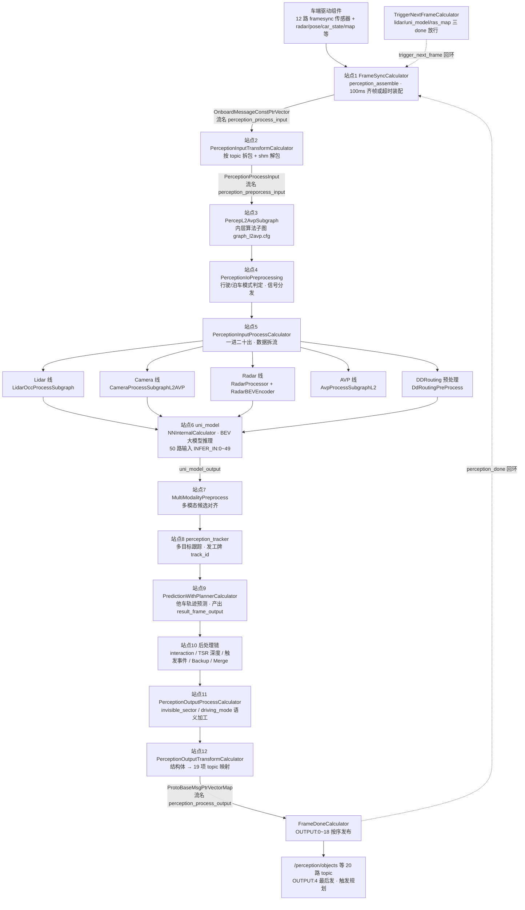
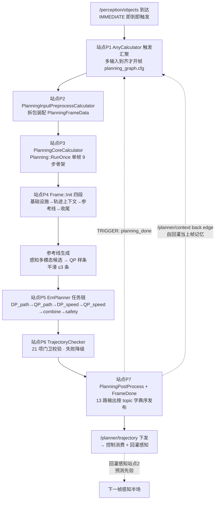
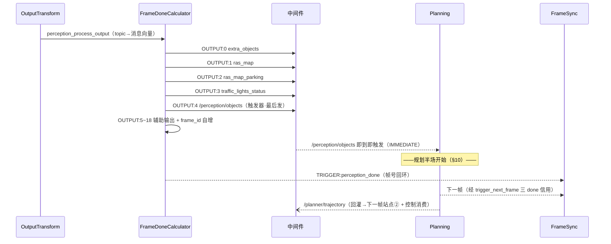
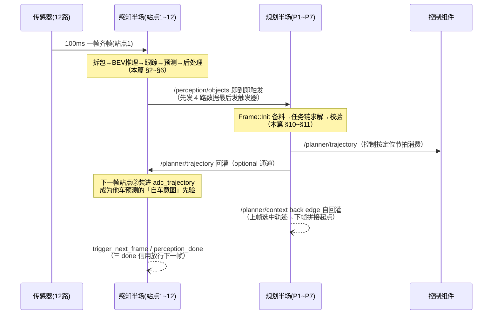

> **30 秒导读**：把一帧数据当一位「客人」，走完感知与规划两个车间的全部流水线——**感知半场 12 站**（从传感器齐帧到 `/perception/objects` 发布），**规划半场 7 步**（从被触发到 `/planner/trajectory` 下发），最后两条回灌闭环把两个车间焊成一个循环。
> **本篇回答**：一帧从传感器到 `/planner/trajectory` 总共经历哪些站点？感知和规划的衔接点在哪？数据在哪个组件里待多久、又回到哪里？
> **先修阅读**：本篇是 [**Perception/00 总览**](Perception/00%20Perception%20模块架构总览.md) §3 与 [**Planning/00 总览**](Planning/00%20Planning%20模块架构总览.md) §3 两条流程图的「逐站放大合篇」——输入细节见 [**Perception/01**](Perception/01%20输入数据接入与预处理.md)、输出细节见 [**Perception/05**](Perception/05%20输出发布与中间件交互.md) 与 [**Planning/05**](Planning/05%20Planning%20输出发布与控制指令生成.md)，本篇负责把它们串成一条完整的线。

> **本篇概念速成块**（30 秒，读完再进正文不卡壳）：
> - **两个半场**：感知半场是「外层图进料—出料 + 内层算法子图推理」；规划半场是「触发汇聚—帧初始化—任务链求解—校验发布」——两个半场靠 `/perception/objects`（触发）与 `/planner/trajectory`（回灌）两点焊接。
> - **FrameSync**：拍合影的摄影师——12 路同一帧（100ms 一拍）到齐才放行（完整卡片见 [**FrameSync 帧同步**（Perception/01 §2）](Perception/01%20输入数据接入与预处理.md)）。
> - **uni_model**：感知半场的「重头脑」——BEV 大模型推理节点一口气吃 50 路输入，吐出多任务输出（完整卡片见 [**uni_model**（Perception 子模块1 §1）](Perception/02_核心子模块拆解/子模块1：camera%20相机感知子模块.md)）。
> - **IMMEDIATE 触发**：规划没有定时器——`/perception/objects` 即到即触发，规划节拍完全跟随感知（见 [**Planning/04 §2.1**](Planning/04%20线程调度与规划周期.md)）。
> - **EmPlanner 任务链**：规划半场的流水线——DP 粗算路径→QP 精修→DP/QP 算速度→合成→安检，逐任务接力（完整卡片见 [**EmPlanner**（Planning/00 §2）](Planning/00%20Planning%20模块架构总览.md)）。
> - **trajectory_checker**：发布前的最后一道门卫——21 项硬校验不过关就不下发（见 [**轨迹校验**（Planning 子模块4 §1）](Planning/02_核心子模块拆解/子模块4：trajectory_checker%20轨迹校验子模块.md)）。
> - **先数据后触发**：两个半场共用同一条发布纪律——OUTPUT 先发数据、最后发触发器，下游被唤醒时料已在桌上（完整卡片见 [**FrameDone**（公共 02 §6.1）](00_公共基础文档/02%20模块配置与%20Topic%20数据流拓扑（C01%20-%20orinx）.md)）。
> - **两条回灌**：`/planner/trajectory` 回灌感知当预测先验，`/planner/context` 经 back edge 自回灌当规划自己的上帧记忆——闭环不只是「感知→规划」单向流。

> 所属系列：C01车型E2E架构拆解 · 全链路通识篇（本文位于 E2E 根目录，是 Perception/Planning 两个系列的合篇）  
> 读者：想完整看懂「一帧数据从传感器到控制指令怎么流动」的开发者  
> 前置阅读：Perception 00 总览 / Planning 00 总览（本篇与两者互补：总览给各自地图，本篇给跨组件全链串联）  
> 分支基线：perception/planning/driver 为 Stable_Master_4.0_new；platform/church 为 dev_master（涉及 church 框架处存在分支差异）

---

## 1. 一帧总览：感知半场 12 站 + 规划半场 7 步

**一句话结论**：一帧的生命 = 感知半场（外层图 4 站 + 内层子图 8 站 + 两条节拍回环）→ `/perception/objects` 即到即触发 → 规划半场（触发汇聚→帧初始化→任务链→校验→发布）→ `/planner/trajectory` 下发并回灌——感知与规划在同一进程内以「乒乓」方式接力。

### 1.1 感知半场全景（12 站 + 两条回环）

**图 1-1 · 感知一帧生命周期全景（12 站 + 两条回环）**（实线是数据流，虚线是帧间节拍信号）

**读图提示**：① 认准两级的分界——站点 1~3 与站点 12 是外层图节点，站点 4~11 全部住在内层算法子图 `PercepL2AvpSubgraph` 里；② 站点 6 的 uni_model 是全链唯一的大模型推理节点，四条并行线都是为它备料或消化它的输出；③ 两条虚线回环（trigger_next_frame、perception_done）不是数据，是「上一帧干完了吗」的节拍信号，详见 §9；④ 每条边的「流名」就是 cfg 文件里的 input_stream/output_stream 字符串，拿着它可以在 cfg 里全文检索定位。

### 1.2 规划半场全景（从触发到下发，7 步）

**图 1-2 · 规划半场全景（P1~P7 站 + 两条回灌）**（实线是数据流，虚线是回环——`planning_done` 解锁下一帧，`/planner/context` 是规划自己的上帧记忆，`/planner/trajectory` 是给感知与控制的交付物）

**读图提示**：① 站点 P1~P2、P7 是外层图节点（planning_graph.cfg），P3~P6 全部住在规划核心子图内——结构与感知的两级图完全同构；② P3 的 RunOnce 是骨架、P4 的 Frame::Init 是备料、P5 的任务链是真正解题，三段合起来才是一帧规划；③ 两条虚线回环性质不同——`planning_done` 是节拍信号（类似感知的 perception_done），`/planner/context` 是**数据**回灌（上帧轨迹从这里进下一帧）；④ 右下角的回灌线把感知半场和规划半场焊成闭环——这是 §12 的主角。

各站点的「证据坐标」一览：

| 站点 | 节点（calculator） | 证据位置 |
|-|-|-|
| 1 齐帧 | FrameSyncCalculator（节点名 perception_assemble） | 外层图 cfg L62-94；机制见 [**FrameSync**（Perception/01 §2）](Perception/01%20输入数据接入与预处理.md) |
| 2 拆包 | PerceptionInputTransformCalculator | 外层图 cfg L104-109；见 [Perception/01 §3](Perception/01%20输入数据接入与预处理.md) |
| 3 子图 | PercepL2AvpSubgraph（gen_subgraph 生成） | 外层图 cfg L112-117；见 [Perception/00 §1](Perception/00%20Perception%20模块架构总览.md) |
| 4 分发 | PerceptionIoPreprocessing | graph_l2avp.cfg L40-52 |
| 5 拆流 | PerceptionInputProcessCalculator | graph_l2avp.cfg L134-166 |
| 6 BEV 推理 | uni_model（NNInternalCalculator） | graph_l2avp.cfg L594-648 |
| 7 多模态对齐 | MultiModalityPreprocessCalculator | graph_l2avp.cfg L892-908 |
| 8 跟踪 | perception_tracker（PerceptionTrackerProcessCalculator） | graph_l2avp.cfg L912-928 |
| 9 预测 | PredictionWithPlannerCalculator | graph_l2avp.cfg L969-985 |
| 10 后处理 | Interaction/TrafficSignDepth/TriggerEvents/Backup/Merge | graph_l2avp.cfg L1007-1114 |
| 11 语义加工 | PerceptionOutputProcessCalculator | graph_l2avp.cfg L1118-1183；见 [Perception/05 §2.1](Perception/05%20输出发布与中间件交互.md) |
| 12 发布 | OutputTransform + FrameDoneCalculator | 外层图 cfg L124-129 + L133-161；见 [Perception/05 §3](Perception/05%20输出发布与中间件交互.md) |
| P1 触发汇聚 | AnyCalculator（多输入到齐） | planning_graph.cfg（planning_core_node 输入汇聚）；见 [**Planning/04 §2**](Planning/04%20线程调度与规划周期.md) |
| P2 输入预处理 | PlanningInputPreprocessCalculator | planning_input_preprocess_calculator.cc；见 [**Planning/01**](Planning/01%20Planning%20输入数据接入与有效性校验.md) |
| P3 单帧骨架 | PlanningCoreCalculator → Planning::RunOnce | planning_core.cpp L1330~1500；见 [**Planning/07 §3**](Planning/07%20Planning%20代码索引与学习指南.md) |
| P4 帧初始化 | Frame::Init 四段 | frame_lifecycle.cpp L4479~4507；见 [**Planning/03**](Planning/03%20关键数据结构与参数配置.md) |
| P5 任务链 | EmPlanner::RunTasksStage | em_planner.cpp L587~734；见 [**任务管线**（Planning 子模块1）](Planning/02_核心子模块拆解/子模块1：planner%20与%20tasks%20决策规划任务管线.md) |
| P6 门卫校验 | Planning::RunTrajectoryChecker → TrajectoryChecker | planning_trajectory_process.cpp L2529；见 [**轨迹校验**（Planning 子模块4）](Planning/02_核心子模块拆解/子模块4：trajectory_checker%20轨迹校验子模块.md) |
| P7 组装发布 | PlanningPostProcessCalculator + FrameDoneCalculator | planning_post_process_calculator.cc；见 [**Planning/05**](Planning/05%20Planning%20输出发布与控制指令生成.md) |

---

## 2. 站点①② 进料：输入什么、什么格式、装到哪

**一句话结论**：进料口吃「12 路 framesync 齐帧包 + 若干搭车通道」，每条消息是带三个时间戳的 OnboardMessage 信封，拆包后全部装进 PerceptionProcessInput 这张物料清单。

### 2.1 一帧的输入清单（topic → 格式 → 装配策略）

| Topic | 消息格式（proto） | 装配策略 | 一帧里的角色 |
|-|-|-|-|
| /sensors/lidar/combined_point_cloud_proto | deeproute.drivers.PointCloud2 | framesync（100ms 分桶） | 主点云，12 路之一 |
| /sensors/camera/camera_1~6、traffic_2、panoramic_1~4 \_raw_data_proto | deeproute.drivers.Image | framesync | 11 路相机原图 |
| /sensors/radar/combined_objects | deeproute.drivers.radar.Radar | near（对齐点云取最近） | 雷达目标列表 |
| /localization/pose | deeproute.drivers.gnss.Ins | all_new | 定位姿态 |
| /canbus/car_state | deeproute.common.VehicleState | all_new | 车辆状态 |
| /map/ras_map_plus | deeproute.map.RASMapPlus | all_new | 轻量地图底图 |
| /sensors/ultrasonic/combined_ultrasonic | deeproute.drivers.ultrasonic.Ultrasonic | all_new | 超声波 |
| /planner/trajectory | deeproute.planning.ADCTrajectory | optional | **规划轨迹回灌**（预测先验，§12 详解） |
| /planner/request、/planner/multi_requests | planning.interface.PlanningRequest(s) | all_new / optional | 泊车业务请求 |
| /perception/dtu_request | deeproute.perception.PerceptionRequest | all_new | DTU 仿真请求 |
| /map/sd_horizon_map、/map/fusion_map、/localization/lock_on_road 等 | 各自 proto | optional | 辅助地图/定位 |

（证据：/sandbox/driver/config/component/perception_orin.jsonnet input_channels 声明，[Perception/00 §5.1](Perception/00%20Perception%20模块架构总览.md) 有完整通道表；「12 路 framesync = 点云 1 + 相机 11」见 [Perception/01 §1.1](Perception/01%20输入数据接入与预处理.md)。）

### 2.2 数据在站点①②的形态变化

- **进站前**：每条消息是 [**OnboardMessage**](Perception/01%20输入数据接入与预处理.md)（统一信封：header 三时间戳 + proto payload + topic）；站点①齐帧后打包成 `OnboardMessageConstPtrVector`——一帧一个包，包内全部只读共享指针（流名 `perception_process_input`）。
- **站点②拆包**：`TransformInputMsgsToProcessInput` 按 topic 用 `FindFirstMessage` 定位各路消息；点云与 11 路原图走 [**共享内存零拷贝**](Perception/01%20输入数据接入与预处理.md)（proto 的 data 字段只是「柜子号」，现场解包换真身，图像直接换出 CUDA 地址）。
- **出站**：所有数据装进 `PerceptionProcessInput`（流名 `perception_preporcess_input`，注意这是 cfg 里的原生拼写）。物料清单字段：`frame_id、point_cloud、raw_images/compressed_images、radar、ins_poses、vehicle_states、gnss_pose、lock_on_road、sd_map、routing_guide_action、fusion_sd_map、blc_speed_limit_info、ras_map_plus、ultrasonics、dtu_requests、planning_requests、adc_trajectory` 等（证据：perception_input_transform_calculator.cc L297-315 日志即清单，[Perception/01 §3.3](Perception/01%20输入数据接入与预处理.md)）。

---

## 3. 站点③④⑤ 子图分发与前处理：一对多的拆流

**一句话结论**：子图前两站做「分诊」——IoPreprocessing 判定行驶/泊车模式并发信号，InputProcess 把一个输入包拆成二十多路专业流，谁上岗看模式闸门。

### 3.1 PerceptionIoPreprocessing（分发信号）

输入只有一条 `ALL_INPUTS:perception_preporcess_input`（graph_l2avp.cfg L40-52），输出是全子图共用的「信号面板」：`DRIVING_MODE`（行驶模式，决定哪些线激活）、`RESET_SIGNAL_INPUT / RESET_AVP_INPUT`（模式切换复位）、`PREDICTION_SHARED_DATA`（预测共享数据句柄）、`DTU_RESPONSE`、`IS_HIGHWAY_SIGNAL / IS_NCA_SIGNAL`（高速/NCA 场景标记）、`MODEL_DRIVING_STYLE_ID`、`VEHICLE_STATE`，以及汇总流 `ALL_OUTPUTS:perception_input_frame`。

### 3.2 PerceptionInputProcessCalculator（一进二十出）

输入 `perception_input_frame`，输出按「用途」拆流（graph_l2avp.cfg L134-166）：

| 分组 | 输出流 | 内容 |
|-|-|-|
| 传感器 | LIDAR:lidar_inputs、CAMERA:camera_inputs、AVP:avp_inputs、RADAR:radar_inputs、RADAR_BEV_INPUT:radar_bev_input、MIGHTY_LIDAR:mighty_lidar_inputs | 各算法线的原始料 |
| 时间基准 | LIDAR_TS / DRIVING_LIDAR_TS / CAMERA_TS | 各线自己的「帧钟」 |
| 定位 | GNSS_POSE、SENS2GLOBAL、SENSING_INTERNAL_POSE、LOCK_ON_ROAD、LOCK_ON_MAP | 位姿与坐标换算依据（见 [**标定**（Perception 子模块1 §5）](Perception/02_核心子模块拆解/子模块1：camera%20相机感知子模块.md)） |
| 地图/路由 | ROUTING_GUIDE_ACTION、FUSION_SD_MAP、MAP_SERVER、SD_MAP | 供 Camera 线编码与 tracker 参考 |
| 车辆 | VEHICLE_STATE（经 IoPreprocessing）、BLC_SPEED_LIMIT_INFO、BLC_OPERATION_STATUS | 车速/限速/操作状态 |
| 请求/回灌 | TRAFFIC_LIGHT、PLANNING_REQUEST | 红绿灯与泊车请求 |
| 跳过分支 | SKIP_OBJECT:empty_result_frame、SKIP_RASMAP:empty_rasmap_result、LANE3D_INFER_SKIPED、SKIP_TRAFFIC:empty_traffic_result | **空结果流**：模式或开关判定本帧不跑某线时，用空消息保持下游时序 |

### 3.3 行驶/泊车闸门与四条并行线

`driving_gate / parking_gate`（DrivingParkingGateCalculator）按 DRIVING_MODE 把流路由到对应班次（graph_l2avp.cfg L191-238）。并行线各自消化输入：

- **Lidar 线**（LidarOccProcessSubgraph）：`lidar_inputs → lidar_process_output`（占用栅格/检测前处理，另产出 `lidar_detection_preprocess_output` 供 uni_model 的点云骨干输入、`lidar_grid_map_static_objects`、`obstacle3d_nn_sampled`）。点云细节见 [**点云**（Perception/01 §5.2）](Perception/01%20输入数据接入与预处理.md)。
- **Camera 线**（CameraProcessSubgraphL2AVP）：11 路图 + 地图/路由 + 标定参数 → GPU 预处理与投影矩阵（`camera_preprocess_output_synced_unimodel`、`lidar2img_output_synced`、内外参/畸变系数），并产出历史特征缓存（`feature_map_output_historical` 等）与交通灯/mono 任务后处理结果（cfg L316-439，[**uni_model**（Perception 子模块1 §1）](Perception/02_核心子模块拆解/子模块1：camera%20相机感知子模块.md)）。
- **Radar 线**：`RadarProcessorCalculator`（radar_inputs → radar_frame_output）+ `RadarBEVEncoderCalculator`（radar_bev_input → **radar_bev_feat**，雷达早期融合的 BEV 特征，cfg L872-889）。
- **AVP 线**（AvpProcessSubgraphL2）：环视相机 + mighty 激光 → 自由空间/车位检测/障碍物融合 11 路输出（cfg L457-527，[**avp 泊车感知**（Perception 子模块6 §1）](Perception/02_核心子模块拆解/子模块6：avp%20自动泊车感知子模块.md)）。

---

## 4. 站点⑥ BEV 大模型 uni_model：一帧的「重头脑」

**一句话结论**：uni_model 是全链唯一的大模型推理节点——50 路输入（INFER_IN:0~49）一次吃齐「此刻的传感器 + 过去的历史 + 要去的路线」，一次吐出多任务输出。

### 4.1 50 路输入按类分组（cfg L598-647，注释即语义）

| 输入类别 | 代表流（INFER_IN 序号） | 说明 |
|-|-|-|
| 点云 | 0:lidar_backbone_network_input | Lidar 线检测前处理的点云骨干输入（filter_pc/idx_info） |
| 雷达 BEV | 1:radar_bev_feat | 雷达早期融合 BEV 特征（RadarBEVEncoderCalculator 产出） |
| 相机图像 | 2:imgs、3:hd_imgs、14~18:pp_* 系列 | GPU 预处理后的主相机组与 pp 任务图像 |
| 几何/标定 | 4:lidar2img、5:delta_pose、6:prev_pose_inv、7~9:extrinsic/intrinsic/distort | 投影与位姿换算矩阵 |
| **时序历史** | 10:prev_bev_feats、11~13:tl_history_*、19:pp_prev_bev_feats、24:prev_fpn_feats、46:history_condition_in | **上一帧留下的记忆**——BEV 时序与红绿灯历史 |
| 地图编码 | 20:sdmap_encode、26/27:sdmap 图像 [1,1,200,400] | SD 地图栅格编码 |
| **路由先验** | 25:ddrouting_model_input、29~32:routing_sample_*/split_link_* | [**DDRouting**](Perception/02_核心子模块拆解/子模块7：perception_routing%20子模块.md)：导航路由编码张量 |
| 导航动作 | 33~41:segment_info/main_action/step_* 等 | 路由引导动作序列（如 [1,1] 动作量） |
| 驾驶状态 | 42:map_info、43:mandatory_lane_change_info、44:traffic_light_feature [1,50,54]、46~49 | 强制换道/红绿灯特征/历史条件/泊车指令/驾驶风格 |

**30 秒最小例子**（前方路口红灯这一帧）：11 路相机原图与点云在 Camera/Lidar 线完成 GPU 预处理 → `camera_preprocess_output_synced_unimodel` 经 `GatePassThroughCalculator` 闸门进入 INFER_IN:2；RadarBEVEncoder 把雷达目标编码成 `radar_bev_feat` 进 INFER_IN:1；DDRouting 把「沿当前路直行、下个路口左转」编码成张量进 INFER_IN:25~41；上一帧输出的 BEV 特征 `prev_bev_feats` 与历史状态 `history_condition_in` 分别在 INFER_IN:10/46 归位——50 路到齐，NNInternalCalculator 启动推理，输出 `uni_model_output`。

### 4.2 输出与三个「分流器」

`INFER_OUT:uni_model_output` 一份输出、三路消化（cfg L819-863）：

- `NnInternalDataFilterUnifiedCalculator` ×3 分别滤出 **history_condition_current**（本帧历史状态）、**image_backbone_network_output**、**pp_backbone_network_output**；
- 其中 history_condition_current 经 `HistoryConditionStateFeedbackCalculator` 变成下一帧的 `history_condition_in`——**跨帧状态回环**，这就是 50 路输入里「时序历史」的来源；
- uni_model_output 同时供给 Camera 线（任务后处理）与站点⑨预测（MODEL_OUTPUT 直连）。
- 启动信号由 `NNInternalStartSingalCalculator` 统一发令（cfg L762-816），保证 50 路备齐才推帧。

**新手提示**：`radar_bev_feat` 与 uni_model 的 BEV 是两码事——前者是雷达线的「特征编码器」产物（小张量，给大模型当配料），后者是 uni_model 自己的鸟瞰特征空间（大张量，跨帧缓存）。名字像，层级不同。BEV 这个概念本身见 [**AI 字典·BEV 鸟瞰图表示**](../../正典阁/技术栈/AI/BEV%20鸟瞰图表示.md)。

---

## 5. 站点⑦⑧⑨ 跟踪与预测：从「张量」回到「目标」

**一句话结论**：多模态对齐把各线候选摆上同一张桌，tracker 给目标发工牌，PredictionWithPlannerCalculator 站在「自车打算怎么走」的先验上预测他车——产出 result_frame_output。

1. **站点⑦ 多模态对齐**（MultiModalityPreprocessCalculator，cfg L892-908）：吃 `radar_frame_output + lidar_process_output + mono_task_postprocess_output`，吐 `PREPROCESS:preprocess_output`（对齐后的候选集）与 `DONE_SIGNAL:multi_modality_done_signal`。
2. **站点⑧ 跟踪**（PerceptionTrackerProcessCalculator，cfg L912-928）：吃 `lidar_process_output + preprocess_output + sd_map_input`，吐 `INTER:0:tracking_frame_output`（带 [**track_id 工牌**](Perception/02_核心子模块拆解/子模块3：tracker%20多目标跟踪子模块.md) 的目标列表）与 `INTER:1:tracking_preprocess_output`（转供 AEB 线）；环视线 `PanoDetectionTrackingCalculator` 同步跟踪泊车目标（cfg L931-940）。跟踪机制见 [**tracker / track_id**（Perception 子模块3 §1）](Perception/02_核心子模块拆解/子模块3：tracker%20多目标跟踪子模块.md)。
3. **站点⑨ 预测**（PredictionWithPlannerCalculator，cfg L969-985）：吃 `tracking_frame_output + pano_detection_tracker_output_parking + uni_model_output + lane3d_nn_sampled + prediction_shared_data`，吐三路——`L2_RESULT:result_frame_output`（**主结果帧**：检测+跟踪+预测一体）、`AVP_RESULT:pano_detection_prediction_output`（回灌 AVP 线）、`DONE_SIGNAL:prediciton_done_signal`（预测完成信号）。

**名字里的「Planner」是什么？** 不是规划器——是**规划轨迹先验**：规划上一周期输出的 `/planner/trajectory`（ADCTrajectory）在站点②装进 `process_input.adc_trajectory`（[Perception/05 §5.2](Perception/05%20输出发布与中间件交互.md)），经子图内 [**轨迹回灌**](00_公共基础文档/05%20端到端全链路时序与异常机制（C01%20-%20orinx）.md) 链路成为他车预测的「自车意图」输入——感知据此回答「我这么走，旁边那辆车会怎么反应」。他车未来轨迹是怎么从模型里算出来的，见 [**AI 字典·轨迹预测**](../../正典阁/技术栈/AI/轨迹预测.md)；farseer 大模型预测方案是另一条演进线（[**farseer**（Perception 子模块4 §1）](Perception/02_核心子模块拆解/子模块4：farseer%20子模块.md)），未编排在当前 L2AVP 图中（[Perception/00 FAQ Q3](Perception/00%20Perception%20模块架构总览.md)）。

**并行支线·AEB**：`aeb_simple_gate`（开关闸）→ `AebLightFusionProcessSubgraph`（吃 lidar/mighty/aeb 预处理，cfg L284-303）→ `aeb_fusion_process_output`，最终由 `PerceptionAndStatusResultSyncCalculator` 与主结果对时序（cfg L1030-1037）。过滤链机制见 [**aeb 过滤链**（Perception 子模块5 §4.1）](Perception/02_核心子模块拆解/子模块5：aeb%20感知侧子模块.md)。

---

## 6. 站点⑩⑪ 融合与后处理：从「结果」到「可交付」

**一句话结论**：后处理五连——交互修正、TSR 深度、触发事件、兜底备份、双模式合并，最后 OutputProcess 打上「给规划的隐式协议」。

| 步骤 | 节点 | 输入 → 输出 | 干什么 |
|-|-|-|-|
| 1 交互修正 | PerceptionOutputInteractionCalculator（cfg L1007-1016） | ras_map_output_driving + result_frame_output_driving → interaction 后两路 + REMOVE_IDS | 障碍物与 RasMap 联动修正（被过滤目标的 id 同步下发） |
| 2 TSR 深度 | TrafficSignDepthCalculator（cfg L1095-1103） | 交通标志结果 + lidar/camera → traffic_output_with_tsr_depth | 用点云深度修正交通标志框 |
| 3 触发事件 | PerceptionTriggerEventsCalculator（cfg L1019-1027） | 修正后的地图+目标 → 触发事件 | 锥桶误检/停止线不一致等业务检测（triggers/ 目录） |
| 4 兜底备份 | PerceptionOutputBackupCalculator（cfg L1040-1075） | BACKUP_DRIVING:0~6 / BACKUP_PARKING:0~4 → backup 系列 | 某路真实结果缺席时用兜底数据保持交付 |
| 5 双模式合并 | RasMapMergeCalculator + ResultFrameMergeCalculator（cfg L1079-1093） | 行驶+泊车两组 → ras_map_final_output / result_frame_final_output | 行驶/泊车结果按模式择一合并 |
| 6 质量过滤 | CameraQualityFilterCalculator（cfg L1106-1114） | 目标结果 + 相机质量 → filter 后输出 | 相机异常时过滤低置信目标 |
| 7 语义加工 | PerceptionOutputProcessCalculator（cfg L1118-1183） | FINAL_* 系列 → PerceptionProcessOutput 各成员 | 打 [**invisible_sector**](Perception/05%20输出发布与中间件交互.md)/curr_driving_mode/影子模式过滤（[Perception/05 §2.1](Perception/05%20输出发布与中间件交互.md)） |

全帧数据只读共享贯穿始终——帧内谁都不深拷贝（[**ObjectPtr 只读共享**（Perception/03 §4.1）](Perception/03%20关键数据结构与内存管理.md)）。

---

## 7. 站点⑫ 感知发布：最终输出什么、发给谁

**一句话结论**：子图产物经 OutputTransform 映射成 topic 表，FrameDone 按 OUTPUT:0~18 次序发布——先发规划的 4 路输入，最后发触发器 /perception/objects。

**图 7-1 · 帧尾发布时序（先数据后触发 → 规划唤醒 → 回灌闭环）**（实线按序发布，虚线为节拍与回灌；注意图中的分区——`/perception/objects` 即到即触发后进入本篇 §10 的规划半场）

**读图提示**：① OUTPUT:0~4 次序是给规划的时序契约——cfg L150-151 注释原文「Keep this sequence to ensure the planning module receives the trigger topic after the other four input topics」；② 流名→topic 的桥接由 GraphScheduler 观察输出流后 `PublishWithHeader(channel.name())` 完成（[Perception/05 §3](Perception/05%20输出发布与中间件交互.md)）；③ 发布的 20 路 topic 全表见 [Perception/05 §1.2](Perception/05%20输出发布与中间件交互.md)。

最终输出三类主结果：`PerceptionObstacles`（障碍物主结果 objects/extra_objects）、`RASMap`（局部地图 ras_map/ras_map_parking）、`TrafficLightResponse`（红绿灯）——即 [**base::Object**](Perception/02_核心子模块拆解/子模块8：base%20公共基础库子模块.md) 全链加工后的最终交付物。

---

## 8. 感知半场的节拍：三道闸与两条回环

**一句话结论**：一帧能走完全程，要过三道闸——帧状态机（在途帧 < 2）、子图三 done（lidar/uni_model/ras_map）、预测完成信号；两条回环把「上一帧干完了」的信用送回起点。

| 闸门 | 位置 | 规则 | 证据 |
|-|-|-|-|
| ① 在途帧上限 | FrameSyncCalculator 内 FrameStateMachine | 最多 2 帧并行在途（kMaxFramesInFlight=2），无信用不成帧 | frame_sync_calculator.cc L57-68，[**在途帧背压**（Perception/01 §2.3）](Perception/01%20输入数据接入与预处理.md) |
| ② 子图三 done | TriggerNextFrameCalculator（子图末站，cfg L1194-1201） | DRIVING 模式需 `UNI_MODEL_DONE + LIDAR_DONE + RASMAP_DONE` 三路完成，才向 FrameSync 的 TRIGGER 流放行下一帧 | trigger_next_frame_calculator.cc L109-125 |
| ③ 预测完成门 | GatePassThroughCalculator（cfg L557-568） | `camera_preprocess_output_synced_unimodel` 要等 `prediciton_done_signal`（上一帧预测完成，back_edge 回边）才放行进 uni_model | graph_l2avp.cfg L562-565 |

两条回环（图 1-1 虚线）：`trigger_next_frame`（子图→FrameSync 的 TRIGGER 输入）与 `perception_done`（FrameDone→FrameSync 的 FINISHED 输入）共同构成帧级节拍闭环——闸门不放大流量，只放行「上一帧确实走完了」的新帧。基准节拍 100ms（frame_nano_base），理论 10Hz，实际频率是算法耗时与闸门共同决定的结果（无显式频率常量）。

---

## 9. 感知数据流总表（拿流名查 cfg 的速查表）

**一句话结论**：主干 17 条流贯穿全链——每条给出生产者、消费者与内容格式，调试时按流名在 cfg 里全文检索即可定位上下游。

| 流名（cfg 原文） | 生产者 | 消费者 | 内容/格式 |
|-|-|-|-|
| perception_process_input | FrameSyncCalculator | InputTransform | 一帧消息包 `OnboardMessageConstPtrVector` |
| perception_preporcess_input | InputTransform | IoPreprocessing | 物料清单结构体 `PerceptionProcessInput` |
| perception_input_frame | IoPreprocessing | InputProcess | 分发后的同一包（含模式信号） |
| lidar_inputs / camera_inputs / radar_inputs / avp_inputs / radar_bev_input / mighty_lidar_inputs | InputProcess | 四条并行线 | 各线原始料（PointCloud2 / Image / Radar / Ultrasonic 指针） |
| camera_preprocess_output_synced_unimodel | Camera 线 | GatePassThrough → uni_model | GPU 预处理后图像（CUDA 地址） |
| radar_bev_feat | RadarBEVEncoderCalculator | uni_model INFER_IN:1 | 雷达 BEV 特征张量 |
| ddrouting_model_input | DdRoutingPreProcessCalculator | uni_model INFER_IN:25 | 路由编码张量（[**DDRouting**](Perception/02_核心子模块拆解/子模块7：perception_routing%20子模块.md)） |
| feature_map_output_historical | Camera 线 | uni_model INFER_IN:10 | 上一帧 BEV 特征（跨帧缓存） |
| history_condition_in | HistoryConditionStateFeedbackCalculator | uni_model INFER_IN:46 | 跨帧历史状态（本帧算完回灌下一帧） |
| uni_model_output | uni_model（NNInternalCalculator） | 3 spliter / Camera 线 / Prediction | NN 多任务输出张量集 |
| lidar_process_output | LidarOccProcessSubgraph | MultiModality / tracker / AEB | Lidar 占用栅格与检测前处理结果 |
| preprocess_output | MultiModalityPreprocessCalculator | perception_tracker | 对齐后的多模态候选集 |
| tracking_frame_output | perception_tracker | PredictionWithPlannerCalculator | 带 track_id 的目标列表（base::Object） |
| result_frame_output | PredictionWithPlannerCalculator | Interaction → Backup → Merge | 主结果帧 ResultFrame（检测+跟踪+预测） |
| ras_map_output | Camera 线 / DrivingParkingRasmapUpdate | Interaction → RasMapMerge | 行驶局部地图 RASMap |
| ras_map_final_output / result_frame_final_output | RasMapMerge / ResultFrameMerge | OutputProcess | 按模式合并后的最终结果 |
| perception_output_frame | IoPostprocessing（汇总） | OutputTransform | `PerceptionProcessOutput` 结构体 |
| perception_process_output | OutputTransform | FrameDoneCalculator | `ProtoBaseMsgPtrVectorMap`（topic→消息向量） |
| trigger_next_frame / perception_done | TriggerNextFrame / FrameDone | FrameSyncCalculator | 帧间节拍信号（非数据流） |

---

## 10. 规划半场开场：/perception/objects 到达之后

**一句话结论**：`/perception/objects` 即到即触发（规划没有定时器），AnyCalculator 汇聚多路输入后开帧，Frame::Init 四段备料——基础设施、上帧记忆、参考线、速度收尾，全部完成后才轮到任务链解题。

### 10.1 站点 P1~P2：触发与进料

- **P1 触发汇聚**：planning_graph.cfg 里 `planning_core_node` 的多条输入流（/perception/objects 主触发、/planner/trajectory 回灌、/localization/pose、地图通道等）经 AnyCalculator 汇聚——**任何一条到齐一帧所需输入即开帧**。规划组件**没有定时器**，节拍完全跟随感知（[**Planning/04 §2.1**](Planning/04%20线程调度与规划周期.md)：IMMEDIATE 触发模式，无固定 10Hz）。
- **P2 输入预处理**：`PlanningInputPreprocessCalculator` 按 topic 拆包装配 `PlanningFrameData`（感知障碍物/定位/地图/回灌轨迹分门别类，见 [**Planning/01 §1**](Planning/01%20Planning%20输入数据接入与有效性校验.md)）；输入有效性校验（`ValidateAndPreprocessInputs`）在 RunOnce 内第一站执行，无效帧直接带错误码退出。

**与感知半场的对比**：感知的进料要过「12 路齐帧」的合影闸门（FrameSync），规划的进料是「主触发消息即到即开工」——感知等传感器，规划等感知。

### 10.2 站点 P4：Frame::Init 四段备料

> 文件路径：/sandbox/planning/planning/frame/frame_lifecycle.cpp L4479~4507

Frame::Init 拆成四段（[**Planning/03 §2**](Planning/03%20关键数据结构与参数配置.md)）：

| 段 | 干什么 | 关键产物 |
|-|-|-|
| 1 InitCoreInfrastructure | 基础设施：规则注册（traffic_decider）、检查器构造（trajectory_checker）等进程级一次性对象的就绪确认 | 可用的规则/校验器 |
| 2 ProcessTrajectoryAndContext | 上帧记忆装载：从 FrameContext（back edge 自回灌）取 `last_selected_trajectory` 等做拼接起点 | 带历史的 FrameContext |
| 3 CreateAndProcessReferenceLines | **参考线生成**（下详）+ 障碍物投影 + 场景检测 + 红绿灯判定（ReflineInfoProcess 一站串起 [**场景检测**（Planning 子模块2）](Planning/02_核心子模块拆解/子模块2：scene_decider%20与%20scene_sets%20场景决策子模块.md) 与 [**交通规则**（Planning 子模块3）](Planning/02_核心子模块拆解/子模块3：traffic_rules%20与%20traffic_light_decider%20交通规则子模块.md)） | ≤3 条 ReferenceLineInfo（含虚拟墙/场景标签） |
| 4 GenerateSpeedDataAndFinalize | 速度数据初始化与收尾，帧就绪 | 可进入任务链的 Frame |

**参考线生成（站点 P4 内最重的一步）**：C01 行车任务的参考线候选来自**感知的多模态车道概率**（`model_based_decision`，与 §5 的轨迹预测同源——模型对「自车可能在哪条车道」的多种猜测），再经 QP 样条平滑（plan_worker 线程池按段并行）产出至多 3 条参考线（left/middle/right 互指拓扑）；平滑失败整帧回退上帧参考线（[**参考线子模块**（Planning 子模块5 §4）](Planning/02_核心子模块拆解/子模块5：reference_line_info%20参考线子模块.md)）。QP 样条平滑的数学原理见 [**AI 字典·样条与曲线拟合**](../../正典阁/技术栈/AI/样条与曲线拟合.md) 与 [**AI 字典·二次规划 QP**](../../正典阁/技术栈/AI/二次规划%20QP.md)。

**这里的「红绿灯判定」值得点一句**：TrafficLightDecider 在帧初始化阶段就把「红灯该停」翻译成虚拟墙挂到参考线上（[**Planning 子模块3 §3.2**](Planning/02_核心子模块拆解/子模块3：traffic_rules%20与%20traffic_light_decider%20交通规则子模块.md)）——所以任务链解题时，红绿灯已经变成了「参考线上的一堵墙」，求解器无需特判。

### 10.3 规划半场 mermaid 备查

图 1-2（§1.2）即规划半场全景；与感知半场（图 1-1）对照读，两级图结构完全同构——外层管触发与发布，内层管算法。

---

## 11. 规划半场核心：RunOnce 骨架、任务链与发布

**一句话结论**：RunOnce 九步骨架串起「校验→规划→安检→事件→调试」，真正的解题在 EmPlanner 任务链——DP 粗算、QP 精修、合成轨迹，最后 21 项门卫校验不过关就不发布。

### 11.1 站点 P3：单帧 9 步骨架

> 文件路径：/sandbox/planning/planning/planning_core.cpp `Planning::RunOnce`（L1330~1500 附近）

骨架口诀「Validate→Plan→Checker→Event→Debug」（[**Planning/07 §3 步骤 3**](Planning/07%20Planning%20代码索引与学习指南.md)）：

1. 输入校验与预处理（无效帧带错误码退出）；
2. Frame::Init 四段备料（§10.2）；
3. 规划器选择（EM_PLANNER 行车 / open_space 泊车）；
4. EmPlanner 任务链执行（下节）；
5. 轨迹校验 trajectory_checker；
6. 异常事件映射（校验失败→PLANNING_* Event）；
7. 失败降级处置（清轨迹点/保档位）；
8. debug 组装；
9. 输出交接给 PlanningPostProcessCalculator。

### 11.2 站点 P5：EmPlanner 任务链逐站

> 文件路径：/sandbox/planning/planning/planner/em_planner.cpp L260~339（装配）、L587~734（执行）

任务顺序 = 构造函数 push_back 顺序（jsonnet 开关裁剪，[**任务管线**（Planning 子模块1 §2.2）](Planning/02_核心子模块拆解/子模块1：planner%20与%20tasks%20决策规划任务管线.md)）：

| # | 任务 | 干什么（一句话） |
|-|-|-|
| 1 | DP_path | **动态规划粗解路径**：在 SL 格子上全局扫出一条避障的粗糙路径 |
| 2 | QP_path | **二次规划精修路径**：以 DP 结果为初值，样条化并光滑化，贴参考线、避约束 |
| 3 | DecisionMaking | 端到端决策任务（按开关启用）：对目标做超车/让行/停的定性 |
| 4 | （VPA 系列） | 模型速度初始化/意图识别（enable_model_speed 开关） |
| 5 | DP_speed | ST 图上动态规划粗解速度（哪里该让、哪里该停） |
| 6 | QP_speed | 二次规划精修速度曲线 |
| 7 | combine_path_speed | 路径+速度合成完整轨迹 |
| 8 | trajectory_safety | 轨迹安全代价校验（任务链内的代价型安检） |

另有 **iLQR**（模型级打磨：把合成轨迹用车辆动力学再优化一遍，只对选中参考线跑，plan_worker 池 fan-out）与 model_trajectory（模型输出轨迹解码）按配置插入链中。三种优化算法的完整原理见字典：[**动态规划 DP**](../../正典阁/技术栈/AI/动态规划%20DP.md)、[**二次规划 QP**](../../正典阁/技术栈/AI/二次规划%20QP.md)、[**iLQR 与 LQR**](../../正典阁/技术栈/AI/iLQR%20与%20LQR.md)——「先粗算再精修最后模型级打磨」的分工与 EM 交替逼近思想（[**期望最大化 EM**](../../正典阁/技术栈/AI/期望最大化%20EM.md)）在 [**EmPlanner 概念卡**（Planning/00 §2）](Planning/00%20Planning%20模块架构总览.md)有展开。

**任务链失败的三级降级**：任一任务失败按 [**三级路径降级**（Planning/06 §2）](Planning/06%20异常处理与降级机制.md) 处理——ACC 备份路径（PATH_FALLBACK）/ SPEED_FALLBACK 刹停 profile / 本帧放弃——轨迹会带 `trajectory_type` 标签下发，控制侧可读。

### 11.3 站点 P6：21 项门卫校验

`Planning::RunTrajectoryChecker` → `TrajectoryChecker::RunChecker`（planning_trajectory_process.cpp L2529；[**轨迹校验**（Planning 子模块4 §3）](Planning/02_核心子模块拆解/子模块4：trajectory_checker%20轨迹校验子模块.md)）：

- **critical 项**失败即终止（点数不足/规划失败/时戳失配/可控性超限）——轨迹点被清空，不会带病发布；
- **non-critical 项**跑完收集全部原因（静止物/动态物碰撞、出车道、车道线碰撞）——`checker_failed + brake_acc` 随轨迹下发供控制降级；
- 唯一会**改写**轨迹的是 SafetyChecker（NOA-AEB：碰撞时原地替换制动曲线并点亮双闪）；
- 检查器自身故障（枚举 101）强制放行——「宁放行、不自毙」。

### 11.4 站点 P7：13 路输出与回灌

- `PlanningPostProcessCalculator` 组装 `topic → 消息` 映射（键名即最终 topic，条件发布，唯一无条件发布的是 `/planner/context`）；`FrameDoneCalculator` 按 topic 字典序逐流发布 13 条输出（[**Planning/05 §2~3**](Planning/05%20Planning%20输出发布与控制指令生成.md)）。
- 主输出 **`/planner/trajectory`** 两路去向：① 中间件 → CbwControlComponent（控制由 /localization/pose 触发消费，轨迹是 optional 输入）；② **回灌感知**（下一帧站点②装进 `process_input.adc_trajectory` 当预测先验，§12）。
- `/planner/context` 是规划自己的「交接班记录」：既是输出通道，又是图内 **back edge 自回灌**——下一帧站点 P4 第 2 段从这里取 `last_selected_trajectory` 拼接起点（[**Context 卡片**（Planning/05 §6）](Planning/05%20Planning%20输出发布与控制指令生成.md)）。
- `TRIGGER:planning_done` 打回规划图入口解锁下一帧——与感知的 perception_done 同性质。

---

## 12. 全帧闭环：感知与规划的节拍、回灌与延迟

**一句话结论**：感知与规划以「乒乓」方式接力——感知发布唤醒规划、规划跑完发布轨迹并回灌感知；整条链上有四条回环（两条感知节拍 + planning_done + context 自回灌）和一条跨组件回灌（/planner/trajectory），端到端延迟是「感知 100ms 节拍内的处理耗时 + 规划处理耗时」的串联。

### 12.1 全帧时序（一次完整的乒乓）

**图 12-1 · 感知-规划全帧乒乓时序**（实线是数据流，`--)` 是回环；两条 Note 标出本篇两个半场的边界）

### 12.2 四条回环与一条跨组件回灌

| 回环 | 从哪到哪 | 性质 | 作用 |
|-|-|-|-|
| trigger_next_frame | 感知子图末站 → FrameSync | 节拍信号 | 三 done 信用放行下一感知帧（§8） |
| perception_done | 感知 FrameDone → FrameSync | 节拍信号 | 帧号回执，构成感知帧级闭环（§8） |
| planning_done | 规划 FrameDone → 规划图入口 | 节拍信号 | 解锁下一规划帧（§11.4） |
| /planner/context | 规划输出 → 规划图入口 | **数据** back edge | 上帧记忆：last_selected_trajectory 等（§11.4） |
| /planner/trajectory | 规划 → 感知 | **数据**回灌（optional） | 预测先验：他车预测参考「自车打算怎么走」（§5） |

**对比感知的跨帧记忆**：感知的「上一帧」活在 uni_model 的 BEV 特征缓存与 history_condition 回环里（§4），规划的「上一帧」活在 FrameContext back edge 里——两个组件各自维护自己的跨帧记忆，中间只靠 `/planner/trajectory` 这一条跨组件通道交换「意图」。

### 12.3 端到端延迟的构成

一帧「从传感器曝光到轨迹下发」的延迟 ≈ 感知半场耗时（齐帧等待 0~100ms + 算法耗时）+ 规划半场耗时（Frame::Init 备料 + 任务链求解 + 校验，毫秒级；泊车异步规划另计，几十到百毫秒，见 [**Planning 子模块7**](Planning/02_核心子模块拆解/子模块7：mission_planner%20与%20open_space%20泊车规划子模块.md)）。两个组件间**没有额外的排队延迟**——同进程 church 图内 shared_ptr 直传，`/perception/objects` 发布即触发。排查延迟问题时，感知侧看「time cost of scene sets」等逐节点打点（§9 各流的逐站耗时），规划侧看 `/planner/trajectory` 里的 `latency_stats` 字段（[**Planning/07 §5**](Planning/07%20Planning%20代码索引与学习指南.md)）。

---

## 13. FAQ 与自测

**FAQ**

**Q1（新手常见误解）：感知图里有个 PredictionWithPlannerCalculator，所以感知内部还跑了一个规划器？**
没有规划器。名字里的 Planner 指「规划轨迹先验」——规划输出的 /planner/trajectory 回灌进来（optional 通道），供预测他车轨迹时参考「自车打算怎么走」（§5）；真正的规划在 [**单进程 E2E**](00_公共基础文档/01%20进程启动与%20Church%20框架初始化链路（C01%20-%20orinx）.md) 同进程的 Planning 组件里，由 /perception/objects 触发（§10）。

**Q2：一帧的输入是「12 路」还是「20 多路」？**
两个口径都对：12 路指 framesync 参与齐帧的传感器（点云 1 + 相机 11），决定「这一帧存不存在」；20 多路指 jsonnet 声明的全部订阅通道——radar/pose/car_state/map 等走 all_new/near/optional 策略「搭车」进包，不参与齐帧裁决（§2.1，[Perception/01 §1.1](Perception/01%20输入数据接入与预处理.md)）。

**Q3：uni_model 的 50 路输入没备齐会怎样？**
不会推帧。NNInternalStartSingalCalculator 统一发令，50 路到齐才启动推理（§4.2）；某条配料流缺席时该帧停在闸门前，等配料或被超时/背压机制接管——宁可不出也不吃半成品。

**Q4：为什么站点⑥的 BEV 推理要吃「上一帧的特征」（prev_bev_feats / history_condition_in）？**
时序平滑与记忆。单帧检测在遮挡/模糊时会抖，跨帧特征让模型「记得上一瞬间的世界」，红绿灯历史特征还能记住短时丢失的灯态（§4.1 时序历史类）；这些跨帧状态由 HistoryConditionStateFeedbackCalculator 在帧间搬运（§4.2）。

**Q5：规划是被谁触发的？它有自己的固定周期吗？**
没有固定周期——规划组件无定时器，`/perception/objects` 以 IMMEDIATE 模式即到即触发（§10.1）。所谓「规划 10Hz」只是感知节拍的间接结果，实际频率跟随感知实际帧率；「expected_proc_duration_ms=500」只是处理超时上报阈值，不是周期（[**Planning/04 §2**](Planning/04%20线程调度与规划周期.md)）。

**Q6：感知和规划在同一帧里怎么衔接？会出现「感知在跑第 N 帧、规划还在跑第 N-1 帧」吗？**
衔接点是即到即触发：感知 OUTPUT:4 一发布，规划当帧立即开跑（同进程 shared_ptr 直传，无排队）。规划处理耗时叠加在感知下一帧到来之前——若规划偶尔偏慢，感知的帧状态机（在途帧上限 2）保证感知不无限积压；规划侧则按帧串行处理，`planning_done` 打回入口才解锁下一帧（§12.1/§12.2）。跨组件的时序契约细节见 [**公共 05**](00_公共基础文档/05%20端到端全链路时序与异常机制（C01%20-%20orinx）.md)。

**自测（能答上来才算读懂）**

1. 从 uni_model_output 到 /perception/objects 发布，中间必经哪些节点？
    （答：3 个 spliter 分流 → MultiModalityPreprocess → perception_tracker → PredictionWithPlannerCalculator → Interaction/Backup/Merge 后处理 → OutputProcess 语义加工 → OutputTransform 映射 → FrameDone 按序发布，OUTPUT:4 最后发（§4.2、§5、§6、§7）。）
2. 从 /perception/objects 到 /planner/trajectory，规划半场必经哪些站？
    （答：AnyCalculator 触发汇聚 → 输入预处理拆包 → RunOnce 骨架内 Frame::Init 四段备料（参考线生成+场景+红绿灯）→ EmPlanner 任务链（DP_path→QP_path→…→trajectory_safety）→ trajectory_checker 21 项门卫 → PlanningPostProcess 组装 → FrameDone 发布 13 路输出（§10、§11）。）
3. 一帧「空跑」时（某线被判跳过），下游时序怎么保证？
    （答：InputProcess 产出 SKIP 系列空结果流（empty_result_frame 等），下游节点照常消费、时序不断（§3.2 跳过分支）；OutputBackup 在真实结果缺席时用兜底数据补位（§6 第 4 步）。）
4. 全链有哪几条「回灌」，各自回灌什么？
    （答：五条——trigger_next_frame 与 perception_done 是感知节拍信号；planning_done 是规划节拍信号；/planner/context 是规划数据自回灌（上帧记忆）；/planner/trajectory 是跨组件数据回灌（感知预测先验）。前四条同组件内，最后一条跨组件（§12.2）。）

## 附：本文档引用文件清单

- /sandbox/driver/config/component/perception_orin.jsonnet
- /sandbox/driver/config/component/perception_graph_l2avp_orin.cfg
- /sandbox/perception/perception/cfg/graphs/graph_l2avp.cfg
- /sandbox/driver/config/component/planning.jsonnet
- /sandbox/driver/config/component/planning_graph.cfg
- /sandbox/planning/planning/planning_core.cpp
- /sandbox/planning/planning/planner/em_planner.cpp
- /sandbox/planning/planning/frame/frame_lifecycle.cpp
- /sandbox/platform/church/graph/calculators/frame_sync_calculator.cc
- /sandbox/platform/church/graph/calculators/frame_done_calculator.cc
- /sandbox/perception/perception/calculators/perception_input_transform_calculator.cc
- /sandbox/perception/perception/calculators/perception_output_process_calculator.cc
- /sandbox/perception/perception/calculators/perception_output_transform_calculator.cc
- /sandbox/perception/perception/calculators/trigger_next_frame_calculator.cc
- /sandbox/perception/perception/church_component/perception_component_api.h

（完，约 7.5 千字）
