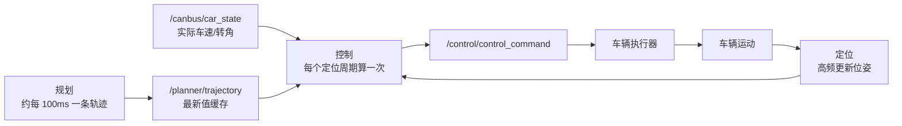
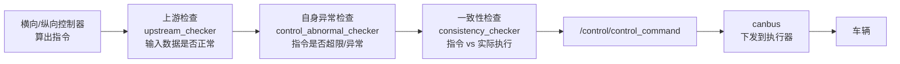
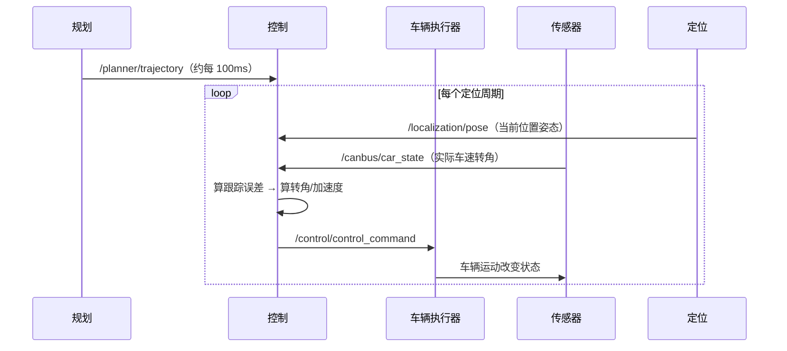

> **这一篇讲什么**：三个角色里的「动」。规划给了一条「未来几秒我在哪、多快」的轨迹，控制要把它翻译成车辆真正听得懂的语言：方向盘打多少度、油门给多少、刹车踩多深。
> **读完你能回答**：控制为什么比规划快一个数量级？为什么控制不是被轨迹触发？横向控制和纵向控制各在算什么？指令下发前有哪些安全检查？闭环到底闭的是什么？
> **前置知识**：读完第 07 篇（轨迹是什么）。不需要控制理论，所有术语都会用白话解释。

## 1. 控制的任务：把「打算」变成「动作」

**一句话结论**：控制是一个高频的反馈计算器——每个周期读一次「我在哪、我该在哪」，算出一个能让车更靠近目标轨迹的动作，立刻下发给执行器。

### 1.1 输入与输出

| 方向 | 内容 | 说明 |
|-|-|-|
| 输入 | `/planner/trajectory` | 规划给的轨迹（最新一份，缓存 1 条） |
| 输入 | `/localization/pose` | 自车当前位置、姿态、速度 |
| 输入 | `/canbus/car_state` | 车辆实际状态（车速、转角、挡位等） |
| 输入 | `/canbus/car_info` | 车辆参数与配置 |
| 输出 | `/control/control_command` | 方向盘转角、纵向加速度等执行指令 |
| 输出 | `/control/debug_info`、`/control/context` | 调试与跨帧状态 |

> **注意 `cache_size: 1`**：控制对轨迹只保留最新的一份。因为轨迹是「计划」，越新越准；旧轨迹没有保存价值，反而会误导。

### 1.2 指令里到底有什么

| 字段 | 含义 | 白话 |
|-|-|-|
| 方向盘转角 | 前轮（或方向盘）要打到多少度 | 往左还是往右、打多少 |
| 纵向加速度 | 加速为正、减速为负 | 踩油门还是踩刹车、踩多深 |
| 挡位/使能等 | 前进/倒车、控制是否接管 | 车该往前还是往后 |

控制内部还会把转角拆成**前馈 + 反馈**两部分：前馈负责「照着弯道的曲率预先打方向」，反馈负责「发现偏了赶紧修正」。这跟人开车一样：看到弯就先打方向（前馈），发现车头偏了再补一点（反馈）。

## 2. 为什么控制是被定位触发的

**一句话结论**：因为控制是闭环反馈，它的节拍由「我多久能知道自己在哪」决定，而不是由「规划多久给我一条新轨迹」决定。

这是小白最容易困惑的一点：明明控制消费的是轨迹，为什么触发它的却是 `/localization/pose`？

*图 8-1 规划-控制-车辆闭环：控制每个定位周期都算一次，用最新轨迹 + 最新状态*

**读图提示**：轨迹在图上是一个「缓存」，不是一个「事件」。控制不等新轨迹，它按自己的节奏跑；有新轨迹就用新的，没有就继续用上一条（轨迹覆盖未来几秒，够用）。

**为什么这样设计更安全**：

1. **控制频率必须高于规划**。规划 100ms 一条，如果控制也 100ms 才动一次，遇到突发情况反应太慢。
2. **闭环需要最新状态**。控制每一拍都要知道「我现在到底在哪、多快」，这个信息来自定位和 canbus，比轨迹重要。
3. **解耦**。规划偶尔超时或算不出来，控制仍能按上一条轨迹继续跑（并逐步减速兜底），不会因为一个模块卡住就全车失控。

## 3. 横向控制：把轨迹变成方向盘角度

**一句话结论**：横向控制解决「怎么沿着这条线开」，用车辆模型预测「打这个角度车会怎么走」，选择让跟踪误差最小的转角。

### 3.1 三种典型做法

| 方法 | 思路 | 类比 |
|-|-|-|
| 纯跟踪（Pure Pursuit） | 在轨迹前方取一个预瞄点，算一个圆弧去追它 | 盯着前方 10 米那个点开过去 |
| MPC（模型预测控制） | 用车辆模型预测未来若干步，选一组转角让整体误差最小 | 下棋时往后想几步 |
| iLQR（迭代线性二次调节） | 通过多次迭代逐步优化控制序列 | 反复微调，直到动作序列最优 |

本项目里横向控制实现了多种可选控制器（MPC、iLQR 等），按车型和场景配置选用；此外还有「保持上一次指令」「方向盘回正」「原地转向」「零转角」等特殊控制器，用于异常或特殊工况。

> **术语：MPC（Model Predictive Control，模型预测控制）**。它的核心是「预测 + 滚动优化」：每一步用车辆模型往后预测 1~2 秒，找一组最优动作，但只执行第一个动作；下一拍重新预测、重新优化。就像开车时不断小幅修正方向，而不是一次打死后一直不动。

### 3.2 需要车辆模型

控制必须知道「打 10 度方向，车会以多大半径转弯」。所以里面有车辆模型：

| 模型 | 描述什么 | 用途 |
|-|-|-|
| 运动学模型 | 只考虑几何关系（速度、轴距、转角） | 低速、泊车 |
| 二自由度动力学模型 | 考虑轮胎侧偏、横摆角速度 | 中高速 |

> **术语：二自由度（2DOF）车辆模型**。把整车简化为「横向位移 + 横摆角」两个自由度，用轮胎侧偏刚度描述车对转向的响应。它是横向控制最常用的模型，比完整多体动力学模型简单得多，但在正常驾驶工况下足够准。

### 3.3 转角不是想打多少就打多少

真实车辆有物理限制：

- **最大转角**：方向盘打死就是极限，前轮转角也有限。
- **转角速率**：方向盘不能瞬间从 0 打到 90 度，电机和机械结构有速度上限。
- **执行器一致性**：指令说打 5 度，实际可能只打到 3 度（路面阻力、标定误差）。

所以控制内部会做**限幅**与**速率限制**，并对「指令与实际执行的偏差」做监控（一致性检查 `consistency_checker`）。源码里能看到诸如「转角超限」「转角速率超限」的检查与告警。

## 4. 纵向控制：把轨迹变成油门与刹车

**一句话结论**：纵向控制解决「该多快」，本质是跟踪轨迹里给定的速度/加速度，同时受舒适性和安全距离约束。

### 4.1 纵向控制要跟什么

规划的轨迹里每个点已经有速度 v 和加速度 a。纵向控制要做的是：

1. 根据当前车速与目标速度的差，算出需要的加速度。
2. 把加速度翻译成驱动扭矩或制动压力（不同车型执行器接口不同）。
3. 限制加速度变化率（jerk），避免乘客前后猛晃。

本项目纵向控制同样实现了 MPC / NMPC 等控制器，并有专门的状态机处理「起步、跟车、停车、驻车」等状态切换。

> **术语：NMPC（Nonlinear MPC，非线性模型预测控制）**。普通 MPC 用线性模型近似，NMPC 直接用非线性模型，计算更重但对低速、大转向等非线性工况更准。

### 4.2 纵向控制的安全底线

| 检查 | 作用 |
|-|-|
| 加速度限幅 | 不超过车辆能力与舒适上限 |
| 与前车距离监控 | 距离过近时强制减速（AEB 相关的独立链路） |
| 执行器一致性 | 指令加速度与实际减速度偏差过大要报警 |
| 挡位与使能校验 | 挡位不对、控制未使能时拒绝下发 |

## 5. 下发之前：三层检查

**一句话结论**：控制指令不是算完就发，要经过上游检查、自身异常检查、一致性检查三道闸门。

*图 8-2 指令下发前的三道闸门：任一环节发现异常，就会降级、限幅或退出控制*

**读图提示**：这三层检查的存在，说明「控制软件出错」并不是唯一风险，输入数据错误、执行器不听话同样是必须防的。

## 6. 闭环：控制真正闭的是什么环

**一句话结论**：控制闭的环是「期望状态 → 实际状态 → 误差 → 修正指令」，一圈通常在几十毫秒内完成。

把整条链路串起来看：

**读图提示**：注意 loop 里没有规划——规划在环外，控制与车辆、定位、canbus 构成内环。这就是「控制频率高于规划」的结构性原因。

### 6.1 为什么控制的时间预算是 20ms

配置里控制组件的 `expected_proc_duration_ms` 是 **20 毫秒**，规划是 **500 毫秒**：

| 模块 | 预算 | 主要计算 |
|-|-|-|
| 规划 | 500ms | 参考线生成、DP/QP 多次优化迭代、多候选比较 |
| 控制 | 20ms | 一次模型预测或一次反馈公式、限幅、检查 |

控制能这么快，是因为它每拍只解一个小规模的局部问题，而且有明确的实时性要求：车在 100km/h 时，20ms 就前进 0.55 米，延迟越大越危险。

### 6.2 指令离开控制之后

`/control/control_command` 里是软件能表达的最底层语言：转角、加速度。接下来的翻译工作交给 canbus 与执行器：

1. **canbus** 把转角换算成方向盘角度或转向力矩，把加速度换算成驱动扭矩或制动压力；
2. **执行器**（转向电机、驱动电机、液压制动）把电信号变成机械动作；
3. **车辆**因此改变运动状态，又被传感器与定位重新测到——闭环回到起点。

> **小白提示**：不用记具体换算公式。只需理解「控制只负责算软件指令，硬件翻译与执行是另一层的事」，这也解释了为什么控制与 canbus 的接口异常会直接表现为车「不听话」。

### 6.3 闭环断开时，三种典型表现

闭环的任何一段断掉，都会表现为「车不听使唤」，但三种断法的现象不同，可以直接帮你定位：

| 断开的位置 | 现象 | 先看什么 |
|-|-|-|
| 定位断了 | 控制不再被触发，指令停在旧值 | `/localization/pose` 是否在发 |
| 轨迹断了 | 继续吃上一条旧轨迹，越晚越不准 | 轨迹时间戳是否变新 |
| 反馈断了（车况不回） | 控制仍在算，但不知道实际执行结果 | `/canbus/car_state` 是否在更新 |

这也解释了为什么控制组件把轨迹标为 `optional`——它宁愿用旧轨迹继续跟踪，也不愿因为等新轨迹而停掉控制。

## 7. 三个常见误解

**误解一：控制是被新轨迹触发的。**
不是。控制被 `/localization/pose` 触发，轨迹只是「最新值缓存」。这是为了保证控制频率不依赖规划频率。

**误解二：控制就是照着轨迹的每个点开。**
不是逐点死跟，而是用模型预测/反馈控制去逼近，同时受转角、转角速率、加速度、jerk 等物理与舒适约束。

**误解三：指令发出去车就一定照做。**
不一定。执行器有延迟、有误差、有力学限制，所以要做一致性检查，发现「指令与实际不符」就报警或降级。

## 8. 小结

- 控制 = 高频反馈：每拍读位姿与车况，算出转角与加速度，下发执行器。
- 控制被 `/localization/pose` 触发，轨迹是 `cache_size: 1` 的最新值——闭环节拍由定位决定。
- 横向控制用纯跟踪/MPC/iLQR + 车辆模型（运动学、二自由度动力学），转角要限幅、限速率。
- 纵向控制跟踪速度与加速度，处理起步/跟车/停车状态，限制 jerk。
- 下发前过三道闸门：上游检查、异常检查、一致性检查。
- 控制预算 20ms，规划 500ms，差一个数量级，因为一个解局部小问题、一个解全局优化问题。

到这里，「看 → 想 → 动」三段就闭环了。下一篇《09 框架底座：Church 如何组织这一切》往回退一步，看这些组件、图、节点、topic 到底是被什么机制组织起来、如何在单进程里跑起来的。

## 9. 证据与延伸

| 结论 | 证据位置 |
|-|-|
| 控制被 `/localization/pose` 触发，轨迹为 optional 缓存 | `driver/config/component/cbw_control.jsonnet`（`trigger_channels`、`input_channels`） |
| 控制 20ms 预算、3 路输出 | 同上（`expected_proc_duration_ms`、`output_channels`） |
| 横向控制器族（MPC/iLQR/回正/原地转向等） | `control-by-wire/controller/controller/`（`lat_controller_mpc.*`、`lat_controller_ilqr.*`、`lat_controller_steer_centering.*`、`lat_controller_turn_in_place.*`） |
| 纵向控制器族（MPC/NMPC） | 同上（`lon_controller_mpc.*`、`lon_controller_nmpc.*`） |
| 车辆模型（运动学、二自由度动力学） | `control-by-wire/controller/model/`（`lat_kinematic_dynamic_model.*`、`lat_2dof_dynamic_model.*`） |
| 转角限幅与速率限制、前馈/反馈分量 | `control-by-wire/manager/control_manager.cpp`（`steer_angle_limit`、`steer_rate_limit`、`pre_steer_angle_ff/fb`） |
| 三层检查器 | `control-by-wire/controller/`（`upstream_checker/`、`control_abnormal_checker/`、`consistency_checker/`） |
| 规划预算 500ms 对照 | `driver/config/component/planning.jsonnet`（`expected_proc_duration_ms`） |
