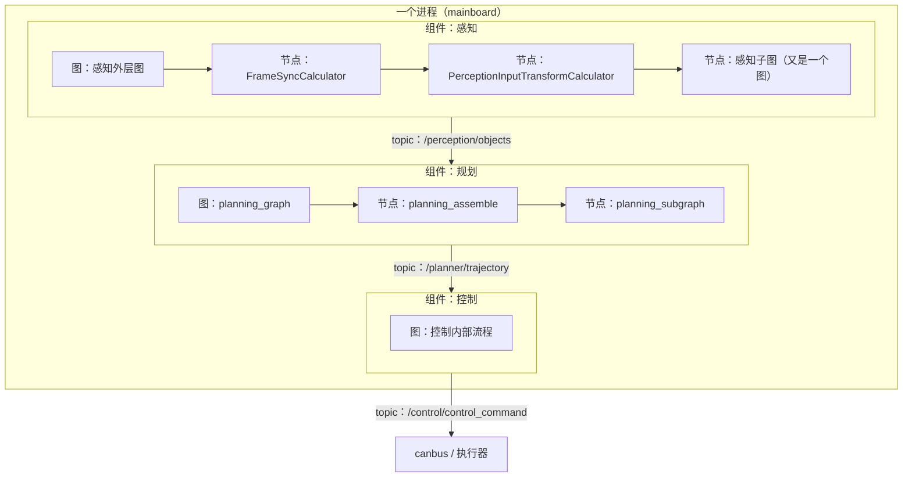
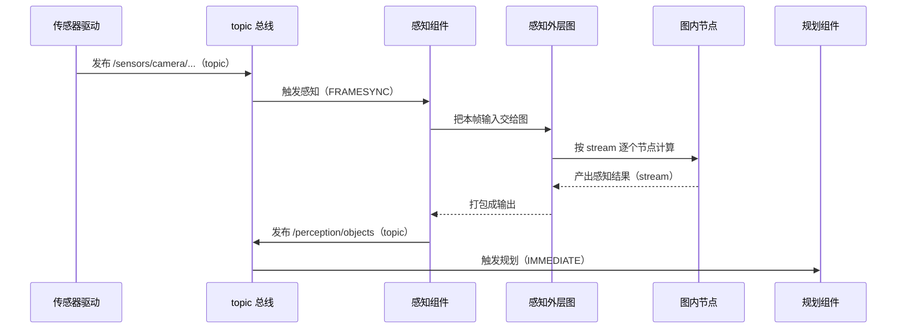

> **这一篇讲什么**：前面八篇一直在提「组件」「图」「topic」「节点」，这一篇把它们一次性讲清楚：这些词分别是什么、谁包含谁、数据在哪一层流动、为什么感知和规划能跑在同一个进程里。
> **读完你能回答**：component、graph、node、stream、topic 五个概念怎么区分？配置里的 `OUTPUT:0`、`back_edge`、`side_packet` 是什么意思？一个进程怎么装下多个组件？单进程有什么好处和代价？
> **前置知识**：读完第 01~08 篇。这是一篇「回收伏笔」的框架篇，不涉及具体算法。

## 1. 五个概念，一次分清

**一句话结论**：**组件**是进程里的功能单元，**topic** 是组件之间的公告栏，**图**是组件内部的计算流水线，**节点（计算器）**是流水线上的工位，**流（stream）**是工位之间传的半成品。

这五个概念容易混，先用一张表钉死：

| 概念 | 英文 | 层级 | 一句话 | 类比 |
|-|-|-|-|-|
| 组件 | component | 进程级 | 一个能独立启停、有输入输出的功能单元（感知、规划、控制各是一个） | 一家工厂 |
| topic | topic / channel | 组件间 | 组件之间传递消息的命名通道 | 工厂之间的物流专线 |
| 图 | graph | 组件内 | 组件内部由若干计算器连成的有向图 | 工厂里的流水线布局图 |
| 节点 | node / calculator | 图内 | 图上的一个工位，负责一步计算 | 流水线上的一个工位 |
| 流 | stream | 图内 | 工位之间传递的数据（带 tag 名） | 工位之间的传送带 |



*图 9-1 五个概念的包含关系：进程装组件，组件装图，图装节点，节点之间用 stream，组件之间用 topic*

**读图提示**：注意实线箭头在组件内部表示包含/连接，跨组件的虚线才是 topic。**topic 只出现在组件边界上**——这是区分 topic 和 stream 的最简单办法。

## 2. 组件（component）：进程里的功能单元

**一句话结论**：一个组件 = 一份配置 + 一个触发规则 + 一组输入 topic + 一组输出 topic + 一段业务逻辑。

### 2.1 组件的配置长什么样

以控制组件为例（节选并翻译）：

```text
class_name: 'CbwControlComponent'      # 用哪个 C++ 类实现
name: 'CbwControl'                     # 组件名
task: {
  name: 't_CbwControl'
  expected_proc_duration_ms: 20        # 预期每帧处理 20ms（调度依据）
  trigger_channels: ['/localization/pose']   # 被谁触发
  trigger_policy: 'IMMEDIATE'          # 触发策略
  input_channels: [ ... ]              # 读哪些 topic
  output_channels: [ ... ]             # 写哪些 topic
}
```

这份配置就决定了一个组件的全部「对外契约」：它听谁的、读什么、写什么、能花多久。

### 2.2 四种触发策略

组件不会自己乱跑，必须有触发源。框架提供多种触发方式：

| 触发方式 | 含义 | 谁在用 |
|-|-|-|
| IMMEDIATE | 收到触发 topic 就立刻跑 | 规划（被 `/perception/objects` 触发）、控制（被 `/localization/pose` 触发） |
| FRAMESYNC | 多路数据按时间格对齐后再跑 | 感知（12 路传感器同步） |
| PERIODIC | 定时跑，与数据无关 | 定时任务（如状态上报） |
| NO_TRIGGER | 不靠触发，自己决定何时处理 | 特殊组件 |

> **注意**：触发 topic 不一定是「主要输入」。控制被 `/localization/pose` 触发，但它算的是轨迹跟踪——触发源只是「节拍器」，不一定是「主角数据」。

### 2.3 组件之间怎么传数据

组件之间只通过 topic 通信，互相不知道对方存在。这带来两个好处：

- **可替换**：感知换成另一套实现，只要 topic 名字和消息格式不变，规划不用改。
- **可单测**：录一段 topic 数据回放，就能离线跑规划。

## 3. topic：组件之间的公告栏

**一句话结论**：topic 是一个有名字的消息通道，发布者往里写，订阅者从里面读，双方不直接见面。

### 3.1 topic 里传什么

传的是 **protobuf 消息**（一种跨语言的结构化数据格式）。比如 `/perception/objects` 传的是障碍物列表，`/planner/trajectory` 传的是轨迹，`/control/control_command` 传的是控制指令。

> **术语：protobuf**。可以理解为「带类型的、可跨语言的结构体定义」。定义一次消息结构，C++、Python 都能生成对应的类来读写。它的二进制格式比 JSON 紧凑得多，适合车载高频传输。

### 3.2 topic 的三种传输方式

框架里定义了多种通道类型，最常见两种：

| 通道类型 | 适用场景 | 原理 |
|-|-|-|
| `INTRA_PROCESS` | 同一进程内 | 直接在进程内传递，几乎零开销 |
| `ICEORYX` | 跨进程 | 基于共享内存的进程间通信，避免大块拷贝 |

这正是第 04 篇讲的「共享内存 / 零拷贝」在框架层的实现：同一进程用 INTRA，跨进程用 ICEORYX 共享内存。

### 3.3 topic 的缓存

订阅者可以选择缓存策略：只留最新一条（`cache_size: 1`，控制读轨迹就是这种），或者缓存一个队列（`max_queue_size`，感知/规划内部队列是 15）。

> **为什么要有队列**：如果下游处理慢，上游不断发，没有队列就会丢数据；队列满了则按策略丢最旧的。这是「不堆积、不卡死」的工程妥协。

### 3.4 一个 topic 只能有一个发布者

车载系统里有一个隐含规矩：**同一个 topic 通常只允许一个组件发布**。因为如果有两个发布者，订阅者收到的数据会时快时慢、时新时旧，排查起来极其困难。「谁生产、谁负责」是 topic 设计的底线。

如果确实需要多个来源（比如仿真回灌与实车数据切换），做法是「同一时刻只启用一个发布者」，而不是两个一起发。看到某路 topic 数据乱跳时，第一反应应该是查「是不是有两个进程在发」。

## 4. 图（graph）：组件内部的计算流水线

**一句话结论**：组件内部不是一个大函数，而是一张由计算器节点连成的有向图，配置文件写清楚「谁接谁」。

### 4.1 一个节点长什么样

```text
node {
  name: "perception_assemble"
  calculator: "FrameSyncCalculator"
  input_stream:  "FRAMESYNC:0:lidar_input"
  input_stream:  "FRAMESYNC:1:camera_1_input"
  output_stream: "ALL_OUTPUTS:sync_output"
  input_side_packet: "CONFIG:0:some_config"
}
```

拆开看几个关键词：

| 关键词 | 含义 | 类比 |
|-|-|-|
| `calculator` | 这个节点用哪个计算器类实现 | 工位工种 |
| `input_stream` / `output_stream` | 输入/输出的流，带 tag 名 | 传送带接口 |
| `FRAMESYNC:0:xxx` | tag 名 + 序号 + 实际流名 | 接口编号 |
| `input_side_packet` | 配置类数据，只在启动时读一次 | 工位旁边的说明书 |
| `back_edge` | 这条输入来自「上一帧的自己」 | 工件回流 |

### 4.2 tag 与编号：`OUTPUT:0` 是什么

在感知的发布节点里能看到：

```text
OUTPUT:0  extra_objects
OUTPUT:1  ras_map
OUTPUT:4  objects
```

这里的 `OUTPUT` 是 tag（一组同类输出的名字），`0/1/4` 是序号。**序号就是顺序**——框架按序号依次发布，这就是第 06 篇「objects 最后发」的实现方式。

### 4.3 子图：图里可以套图

一个节点可以是一个计算器，也可以是一个**子图**。比如感知外层图里的 `PercepL2AvpInterleavingSubgraph` 节点，展开就是第 04~06 篇讲的那张 34 节点内层图。

**为什么要套**：外层图关心「和外界怎么交互」，内层图关心「内部怎么算」。分层让配置可读、可复用。

### 4.4 配置即代码

所有这些图都写在 `.cfg` 文件里，不是硬编码在 C++ 里。改流程常常只需要改配置，不用重新编译——这也是为什么本套文档反复强调「证据在 cfg 里」。

## 5. node（基础设施层）：共享内存与传输

**一句话结论**：Church 里的 `node` 目录不只是「节点」，更是底层通信与共享内存的基础设施：消息池、共享内存池、iceoryx 传输、进程内传输。

| 模块 | 作用 |
|-|-|
| `node/shm/shm_pool.h` | 共享内存池（第 04 篇点云就是从这里读的） |
| `node/intra_*` | 进程内传输 |
| `node/iceoryx_*` | 跨进程共享内存传输 |
| `node/onboard_message.h` | 消息的统一封装（带 topic、时间戳、payload） |

> **术语提醒**：文档里说「节点」时通常指图里的 calculator（业务节点）；说「node 目录」时指的是这套基础设施。上下文不同，含义不同。

## 6. 一个进程装下所有组件

**一句话结论**：C01 车型的配置里，感知、规划、数据代理、模型推理四个组件被写在同一个 `module_conf` 里，由同一个 `mainboard` 二进制装载，跑在一个进程中。

### 6.1 证据

```text
# driver/config/dem/c01-pt/perception.jsonnet
binary_path: ${DEEPROUTE_PATH}/perception/bin/mainboard
orin_flags.module_conf:
  perception_orin.jsonnet
  planning.jsonnet
  data_agent_rt.jsonnet
  lom_infer.jsonnet
```

而 `driver/integration/mainboard.cc` 只有几行，核心就是调用 `church_main`——所有车型的启动入口都是同一个框架入口。

### 6.2 单进程的好处

| 好处 | 解释 |
|-|-|
| 零拷贝 | 感知结果给规划，同进程内走 INTRA 通道，几乎无开销 |
| 时钟统一 | 所有组件用同一个时钟，帧号、时间戳天然一致 |
| 延迟可控 | 少一次进程间调度，端到端延迟更稳 |
| 调试方便 | 一份日志、一个进程，问题定位简单 |

### 6.3 单进程的代价

| 代价 | 解释 | 缓解手段 |
|-|-|-|
| 单点故障 | 进程崩了，感知规划一起没 | 异常监控、看门狗、快速重启 |
| 资源竞争 | 感知吃满 GPU/CPU，规划可能被饿着 | 独立线程池、NN 专用执行器、DDL 调度 |
| 内存占用高 | 所有模块的模型、缓存都在这一个进程里 | 按车型裁剪组件（module_conf 可不同） |

> **术语：看门狗（watchdog）**。定时检查「组件还活着吗、还在按时出结果吗」，超时就报警或重启。Church 里有 `graph/watch_dog.h`。

### 6.4 组件是怎么被装载的

配置文件到组件跑起来，中间只有四步：

| 步骤 | 发生什么 | 你能在哪看到 |
|-|-|-|
| 1. 读配置 | mainboard 读取 `module_conf` 里列出的 jsonnet 文件 | `driver/config/dem/c01-pt/perception.jsonnet` |
| 2. 创建实例 | 框架按 `class_name` 找到对应的 C++ 类，创建组件对象 | `platform/church/component/component.cc` |
| 3. 初始化 | 组件读自己的输入/输出 topic、触发规则、时间预算 | `Component::Initialize` |
| 4. 启动 | 注册触发回调，等第一帧数据到达 | `Component::Startup` 与各类 trigger |

四步里最容易出问题的是第 3 步：topic 名字拼错、消息类型不匹配、必需输入没人发布，都会在初始化阶段报错。所以排障时先看**组件有没有成功启动**，再看**触发有没有来**，最后才看**算法算得对不对**。

### 6.5 框架到底替开发者做了哪些事

写业务代码的人不需要自己开线程、不需要自己写共享内存、不需要自己算调度时机——这些都被框架接走了：

| 开发者只写 | 框架负责 |
|-|-|
| 一个继承自 `Component` 的类 | 进程装配、生命周期、信号处理 |
| 若干 calculator 节点与它们的连线 | 图执行顺序、线程池、背压 |
| 节点的 `Process()` 与输出声明 | 消息序列化、传输、缓存、跨帧回流 |

这解释了为什么新模块接入很快：接入成本主要是「想清楚输入输出是什么」，而不是「搭一套并发与通信基础设施」。代价是框架的出问题会全局可见——所以看门狗、耗时监控、队列长度这些基础设施指标，比单个算法的日志更早暴露问题。

## 7. 一次数据穿过五层

把前面的概念串起来，看一帧数据从进入到离开，到底穿了哪些层：



**读图提示**：注意「topic → 图 → 节点 → stream → 图 → topic」这个往返。topic 是组件的外交语言，stream 是组件的内部语言。

## 8. 三个常见误解

**误解一：topic 和 stream 是一回事。**
不是。topic 跨组件，stream 在组件内部。同一个数据在组件内叫 stream，出了组件边界才叫 topic。

**误解二：一个进程只能跑一个组件。**
不是。C01 的配置就是四个组件装进一个 mainboard 进程。组件是逻辑单元，进程是操作系统单元，两者不是一对一。

**误解三：框架只是「胶水」，不影响性能。**
恰恰相反。传输方式（INTRA/ICEORYX）、队列长度、线程池大小、调度策略直接决定端到端延迟。框架是性能的主战场之一。

## 9. 小结

- 五概念：组件（进程级功能单元）、topic（组件间公告栏）、图（组件内流水线）、节点（图内工位）、流（工位间传的数据）。
- 组件配置决定它的触发方式、输入输出 topic 和时间预算；触发方式有 IMMEDIATE、FRAMESYNC、PERIODIC、NO_TRIGGER。
- topic 传 protobuf 消息；同进程走 INTRA_PROCESS，跨进程走 ICEORYX 共享内存；缓存可以是「最新一条」或队列。
- 图由节点（calculator）连成，支持 tag 编号（`OUTPUT:0` 即发布顺序）、`back_edge`（上一帧回流）、`side_packet`（配置）、子图（图套图）。
- C01 用同一个 mainboard 进程装载感知、规划、数据代理、模型推理四个组件，换来零拷贝、统一时钟、低延迟，代价是单点故障与资源竞争，用监控、看门狗、独立线程池缓解。

下一篇《10 概念地图与源码导读》把全套术语做成索引表，并给出一张「想改某个行为该看哪个目录」的源码地图。

## 10. 证据与延伸

| 结论 | 证据位置 |
|-|-|
| 组件基类与初始化 | `platform/church/component/component.h`（`class Component`、`Initialize`） |
| 四种触发实现 | `platform/church/component/`（`immediate_trigger`、`framesync_trigger`、`periodic_trigger`、`notrigger_trigger`） |
| 通道类型定义 | `platform/church/proto/channel_type.proto`（`INTRA_PROCESS`、`ICEORYX`） |
| 共享内存与传输基础设施 | `platform/church/node/`（`shm/`、`intra_transport_impl.*`、`iceoryx_transport_impl.*`） |
| 图与计算器框架 | `platform/church/graph/calculator_framework.h`、`graph/calculators/` |
| 调度器与任务 | `platform/church/scheduler/`（`scheduler_ddl.*`、`task_timer.*`） |
| 看门狗 | `platform/church/graph/watch_dog.h` |
| 单进程装载四个组件 | `driver/config/dem/c01-pt/perception.jsonnet`（`orin_flags.module_conf`） |
| 统一入口 | `driver/integration/mainboard.cc`（调用 `church_main`） |
| `OUTPUT:0~4` 发布顺序 | `driver/config/component/perception_graph_l2avp_interleaving.cfg` |
| 触发策略实例 | `driver/config/component/planning.jsonnet`、`cbw_control.jsonnet`（`trigger_channels`、`trigger_policy`） |
