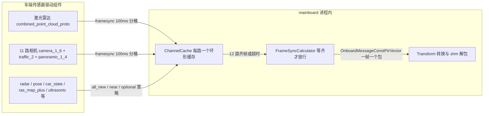

> **30 秒导读**：感知的"进料口"：12 路传感器数据怎么等齐、怎么装成一帧、点云怎么不拷贝直接用。
> **本篇回答**：12 路数据怎么对齐？数据怎么装进一帧？为什么点云可以零拷贝？
> **先修阅读**：《00 入门》§3 步骤 1~2；机制细节可参考《02 Topic 拓扑》§2。

> **本篇概念速成块**（30 秒，读完再进正文不卡壳）：
> - **FrameSync**：拍合影的摄影师——12 路传感器同一帧（100ms 一拍）到齐才放行给算法。
> - **frame_id**：帧号——时间戳按 100ms 向下取整分桶，同桶即"同一瞬间"。
> - **ChannelCache**：每条输入通道的环形缓冲——数据先落袋，同步时反查。
> - **共享内存零拷贝**：大消息（点云/原图）跨进程只传"柜子号"，取货直接去共享内存拿。
> - **OnboardMessage**：统一快递箱——不管什么传感器消息，都用同一个信封（header＋payload＋topic＋时间戳）装。


> 所属专项：C01 车型 E2E 架构拆解（子 Agent3-1：Perception 通用机制）  
> 上游阅读：《00_Perception 模块架构总览》§3/§6。  
> 名词：**OnboardMessage**（church 框架消息信封：header + proto payload + topic/时间戳元信息）；**ChannelCache**（每条输入通道的环形缓存）；**frame_id**（`时间戳 / frame_nano_base` 得到的帧号，本链路基准 100ms）。

---

## 1. 输入通道全景

**一句话结论**：感知的进料口有两层——订阅由 jsonnet 声明（不是手写代码），同步由 FrameSyncCalculator 统一裁决；12 路 framesync 参与齐帧，其余通道按 all_new/near/optional 各自的策略搭车。

**为什么输入接入值得单独一讲**：感知要同时处理十几种传感器，而它们的到达时间、消息大小、可靠程度千差万别——图像点云是 MB 级大件，pose 是几十字节的小件；相机每 100ms 一拍，雷达可能偶尔断流。把「谁等谁、谁搭谁的车、大件怎么传」这些策略集中在进料口统一处理，后面的算法才能假装「数据总是齐的、时刻是对准的」。理解本篇，你就能回答「这一帧为什么缺了一路相机」和「点云为什么传得这么快」这两类问题。

### 1.1 church 模式（C01 车端实际形态）

订阅不是手写的，而是由 jsonnet `input_channels` 声明，church 框架按声明注册订阅、建 ChannelCache，并将消息按 `stream` 名喂入外层图输入流。

> 文件路径：/sandbox/driver/config/component/perception_orin.jsonnet  
> 核心逻辑：
> 
> ```jsonnet
> "input_channels": [
>     { "name": "/sensors/lidar/combined_point_cloud_proto",
>       "msg_type": "deeproute.drivers.PointCloud2",
>       "type": "framesync", "frame_nano_base": 100000000,
>       "stream": "sensors__lidar__combined_point_cloud_proto" },
>     { "name": "/sensors/camera/camera_1_raw_data_proto",
>       "msg_type": "deeproute.drivers.Image",
>       "type": "framesync", "frame_nano_base": 100000000,
>       "stream": "sensors__camera__camera_1_raw_data_proto" },
>     // camera_2~6、traffic_2、panoramic_1~4 同为 framesync
>     { "name": "/sensors/radar/combined_objects", ..., "type": "near",
>       "near_topic": "/sensors/lidar/combined_point_cloud_proto" },
>     { "name": "/localization/pose", ..., "type": "all_new" },
>     { "name": "/canbus/car_state", ..., "type": "all_new" },
>     { "name": "/map/ras_map_plus", ..., "type": "all_new" },
>     { "name": "/perception/dtu_request", ..., "type": "all_new",
>       "stream": "perception__dtu_request" },
>     { "name": "/sensors/ultrasonic/combined_ultrasonic", ..., "type": "all_new" },
>     { "name": "/planner/trajectory", ..., "type": "optional" },
>     ...
> ]
> ```
> 
> 逻辑说明：`type` 字段决定装配策略——`framesync`（12 路：点云 1 + 相机 11）参与按 frame_id 全同步；`all_new`（本次同步窗内到达的全部新消息都会进装配结果）；`optional`（有新消息才带上）；`near`（取与 near_topic 消息时间戳最近的一条）。外层图 `perception_graph_l2avp_orin.cfg` 首节点把 12 路声明为 `FRAMESYNC:0..11`，另有 `INPUT:0:perception__dtu_request`、`INPUT:1:planner__request` 两条直通流（L64-78）。

订阅注册与消息入图由 GraphScheduler 完成：有 `stream` 的通道注册为图输入流的观察者回灌，无 stream 的通道走 `RegisterAllTopicsObserverThatNotSetStream`（/sandbox/platform/church/graph/graph_scheduler.cc L154-155、L377-400）。

**图 1-1 · 12 路输入从哪来**（jsonnet 声明 → 频道缓存 → 图输入流）



**读图提示**：三条边的类型就是 §1.1 证据里的 `type` 字段——`framesync`（12 路，参与齐帧）、`all_new/near/optional`（搭车通道，各按策略取）；FrameSync 的裁决规则见 §2。

### 1.2 ROS 独立模式（对照，C01 车端不使用）

ROS 模式由 `RosWrapper` 显式订阅，回调统一 `perception_pipeline.AddInput(...)`。

> 文件路径：/sandbox/perception/perception/sensor/ros_wrapper.cpp  
> 函数名：RosWrapper::RegisterSubPubFunc()  
> 核心逻辑：
> 
> ```cpp
> InitCameraSub(topic_info, perception_pipeline);   // camera/pano raw+compressed
> InitPcdSub(topic_info, perception_pipeline);      // /sensors/lidar/combined_point_cloud_proto
> InitPoseSub(topic_info, perception_pipeline);     // /localization/pose (Ins)
> InitPoseSimSub(topic_info, perception_pipeline);  // /ddl/logsim/car_state
> InitRadarSub(topic_info, perception_pipeline);    // radar_topics (Radar)
> InitRasmapSub(topic_info, perception_pipeline);   // /map/ras_map_plus (RASMapPlus)
> InitSdMapSub(topic_info, perception_pipeline);    // /map/sd_horizon_map
> InitRasModelFeatureSub(...);                      // /map_engine/ras_feature
> InitUltrasonicSub(topic_info, perception_pipeline);// /sensors/ultrasonic/combined_ultrasonic
> InitAdcTrajectorySub(topic_info, perception_pipeline); // /planner/trajectory (prediction)
> ticker_sub_ = [&perception_pipeline] { perception_pipeline.AddInput(Ticket()); };
> ```
> 
> 逻辑说明：订阅内容来自感知 cfg 的 `perception_topic`（/sandbox/perception/perception/cfg/perception_orin_l2avp.cfg L5-37）。L2 任务额外订阅 `/bird_eye_view_raw_proto`（AVM）、`/perception/dtu_request`、`/planner/request`（L92-97）。发布由 `InitPubInfo` 注册 19 个 topic（L400-422，常量定义在 /sandbox/perception/perception/util/perception_topic.h L6-26）。

### 1.3 两形态对照表

| 维度 | church（C01 车端） | ROS 独立进程 |
|-|-|-|
| 订阅来源 | jsonnet input_channels 声明 → GraphScheduler 注册 | ros_wrapper 手写 Subscribe（topic 来自感知 cfg） |
| 帧同步 | FrameSyncCalculator（平台/church 仓） | SensorDataSync + 100Hz Ticket 心跳（perception/pipeline/sensor_data_sync.cc） |
| 数据传递 | OnboardMessageConstPtrVector → PerceptionProcessInput | AddInput(variant) → SensorDataSync 按帧聚合 → TryGetPerceptionInput |
| 触发节拍 | FRAMESYNC 数据驱动 + 超时定时器 | 100Hz tick（kTickClockFrequencyInHz=100，ros_wrapper.cpp L50、L60-73） |
| 共享内存解包 | PerceptionInputTransformCalculator 内 ShmPool | 同一 Transform 不在链路上；图像/点云直接经 ROS 回调传入 |

---

## 2. FrameSyncCalculator 帧同步机制

**一句话结论**：正常路径是最严格的"12 路全同步"；等不齐就超时降级（缺通道成帧不阻塞）；处理不过来就在途帧限流 2 帧丢旧保新。

> **📘 概念｜FrameSync 帧同步**
> **是什么**：12 路传感器的数据到达时间天然参差，而感知需要"同一瞬间"的完整世界快照。FrameSync 以 100ms 为一拍给每条消息算帧号（frame_id＝时间戳按 100ms 向下取整分桶），**12 路都存在同一帧号的消息才成帧**（§2.2）；超过 100ms（FRAME_SYNC_TIMEOUT）凑不齐就走超时装配，允许缺通道（§2.3）。
> **类比**：拍集体照的摄影师——以 100ms 为一拍，等所有约定数据到位才按快门；超时则用残缺数据拍（TIMEOUT 装配），但绝不混用前后两拍的素材。
> **🎯 为什么这样设计**：跨传感器融合（点云＋图像）要求时间对齐，否则目标位置对不上；而"永远等齐"会让一条断流的传感器绑死整条链路——所以用"全同步优先、超时降级、在途限流（kMaxFramesInFlight=2，宁丢旧帧不阻塞主线）"三级策略兼顾准确性与可用性。
> **🗂 代码在哪里**：`platform/church/graph/calculators/frame_sync_calculator.cc`（图算子版，感知外层图节点名 `perception_assemble`）；同族组件触发器版 `FrameSyncTrigger` 不在本链路。它与《公共 01》的 [**Trigger 触发器**](../00_公共基础文档/01%20进程启动与%20Church%20框架初始化链路（C01%20-%20orinx）.md) 中 FRAMESYNC 策略是同一机制的图算子形态。

位置：/sandbox/platform/church/graph/calculators/frame_sync_calculator.cc（church 框架通用算子，感知外层图节点名 `perception_assemble`）。同族实现还有组件触发器版 `FrameSyncTrigger`（/sandbox/platform/church/component/framesync_trigger.h），本链路使用图算子版。

### 2.1 输入与基准

- 12 路 FRAMESYNC + 2 路 INPUT + TIMEOUT 流 + 两条 back_edge（TRIGGER=trigger_next_frame、FINISHED=perception_done），见 /sandbox/driver/config/component/perception_graph_l2avp_orin.cfg L60-102。
- 帧号计算：`frame_id = GetFrameidByNanoBase(源时间戳, frame_nano_base=100ms, offset=0)`，即把时间戳按 100ms 向下取整分桶（/sandbox/platform/church/cache/frame_sync_helper.cc L17-21、L70-75；jsonnet 中每路 `frame_nano_base: 100000000`）。
- 超时参数：`FRAME_SYNC_TIMEOUT` side packet 由 GraphScheduler 从 `task().frame_sync_timeout()` 注入（/sandbox/platform/church/graph/graph_scheduler.cc L525-528）；代码内兜底默认 100ms（frame_sync_calculator.cc L620 `timeout_nanosec = 100000000u`）。

### 2.2 全同步装配（AssembleFullNewestFrame）

> 文件路径：/sandbox/platform/church/cache/frame_sync_helper.cc  
> 函数名：FrameSyncHelper::AssembleFullNewestFrame()  
> 核心逻辑：
> 
> ```cpp
> for (; buffer_indexes[0] >= buffer_start_indexes[0]; --buffer_indexes[0]) {
>   const auto& pivot_msg = channel_caches_[0]->GetByIndex(buffer_indexes[0]);
>   uint64_t pivot_frame_id = GetFrameidByNanoBase(...);
>   if (pivot_frame_id <= frame_id_state_.generated_id) return false; // 已装配过
>   size_t counter = 1;
>   for (size_t i = 1; i < channel_number; ++i) {        // 其余通道反向搜索
>     for (; buffer_indexes[i] >= buffer_start_indexes[i]; --buffer_indexes[i]) {
>       uint64_t frame_id = GetFrameidByNanoBase(...);
>       if (frame_id == pivot_frame_id) { ++counter; break; }
>       else if (frame_id > pivot_frame_id) continue;    // 跳过更新的帧
>       else break;                                       // 落后于 pivot，等下一轮
>     }
>     if (buffer_indexes[i] < buffer_start_indexes[i]) return false; // 该通道缺此帧
>   }
>   if (counter >= channel_number) {                     // 12 路全部命中同一 frame_id
>     generated_frames.emplace_back(channel_caches_[i]->GetByIndex(buffer_indexes[i])); ...
>     frame_id_state_.generated_id = pivot_frame_id;  return true;
>   }
> }
> ```
> 
> 逻辑说明：以任一通道（通道 0）为 pivot，要求**12 路都存在相同 frame_id 的消息**才成帧；`generated_id` 记录已装配的最大帧号，天然去重。任一路没到齐则不成帧并进入 2.3 的超时流程——即**正常路径是"最严格的全同步"**。

### 2.3 超时装配与丢帧策略

> 文件路径：/sandbox/platform/church/graph/calculators/frame_sync_calculator.cc  
> 函数名：FrameSyncCalculator::Process() / SetupNextTimeoutTimers() / TimeoutAssemble()  
> 核心逻辑：
> 
> ```cpp
> // 全同步失败后，为“每帧最早到达的那条消息”设置超时定时器
> std::vector<...> first_msg_of_frames =
>     frame_sync_context_.helper.GetAllFirstReceivedMessageOfFrames(...);   // L415-420
> ...
> uint64_t timeout_nano = frame_sync_context_.timeout_nanosec - msg_receive_time_diff;
> frame_sync_context_.timeout_frame_map.Add(frame_id, now_nano + timeout_nano, canceled);
> setup_timer_callback_(timeout_stream_, frame_id, timeout_nano / 1000u, [..] {
>     timeout_frame_id_ = frame_id; timeout_canceled_ = canceled; });       // L444-452
> 
> // 定时器到期（TIMEOUT 流回灌回调）后尝试超时装配
> if (frame_state_machine_.CanOutput() && !cc->Inputs().Tag(kTimeoutTag).Value().IsEmpty()) {
>   update_timeout_meta_callback();
>   bool assemble_ret = TimeoutAssemble(timeout_frame_id_, timeout_canceled_, generated_input);
>   ... // 成功则同样发出 OnboardMessageConstPtrVector                            // L300-322
> }
> ```
> 
> 逻辑说明（超时/丢帧策略完整链条）：
> 
> 1. **超时条件**：某 frame_id 自其首条消息到达起，超过 `frame_sync_timeout`（默认 100ms）仍没有凑齐 12 路，则触发超时装配。
> 2. **超时装配**：`AssembleSpecificFrame(timeout_next_frameid)`——各通道只要求**存在该帧号的消息**即可（frame_sync_helper.cc L269-321 `found_one` 判定，缺的通道直接不带），因此缺相机的帧会以"缺通道"形式继续处理，**缺帧不阻塞、但算法侧数据不齐**。
> 3. **跳帧保护**：`ShouldDrop` 与 `timeout_frame_map`（容量 100 的 TimeoutFrameMap）丢弃过期定时器；已装配到更大 frame_id 时跳过（frame_sync_calculator.cc L479-488 `higher_frame_processed`/`ignored_by_timeout_map`）。
> 4. **背压与并行度**：`FrameStateMachine` 限制在途帧数——C01PT 属 `DR_VEHICLE_C01_PT` 编译宏，`kMaxFramesInFlight=2`（L57-68）；有 TRIGGER 信用或无在途帧才允许输出（L132-143）。
> 5. **可用即取消**：管线刚恢复可用（`become_available_to_output`）时 `CancelAllTimeoutTimers()` 清空全部超时定时器，避免陈旧帧再触发（L279-282）。
> 6. **非 framesync 通道装配**：`AssembleNonFramesyncInputs`——`/sensors/radar/combined_objects` 硬编码走 NEAR（对齐点云时间戳取最近，点云缺失时退化为按 frame_id\*100ms 取最近，L507-510、L531-589）；ALL_NEW 用 `ConsumeOld` 取走全部积压；REQUIRED 取最新；OPTIONAL 有新才取（L510-527）。

> 推断：radar 的 NEAR 兜底逻辑（按 frame_id\*frame_nano_base 找最近）即基线所述"frame_nano_base=100ms"在框架侧的旁证（config 缺省时硬编码 100000000，L570-573）。

---

## 3. PerceptionInputTransformCalculator 数据转换

**一句话结论**：这一步是"拆快递"——按 topic 从 FrameSync 的消息包里定位各路数据，点云与 11 路原图顺手从共享内存取出真身，最后装进一个 PerceptionProcessInput 交给算法。

**拆完快递之后数据去哪了**：解包后的图像（拿到 CUDA 设备内存地址）与点云会被送入算法子图做 GPU 预处理——缩放、[**归一化**](../../../正典阁/技术栈/AI/归一化.md)、格式转换、[**采样与插值**](../../../正典阁/技术栈/AI/采样与插值.md)对齐到模型输入网格等（这些名词的零基础解释都在字典里，GPU 喂料的整体逻辑见 [**CUDA 与 GPU 预处理**](../../../正典阁/技术栈/AI/CUDA%20与%20GPU%20预处理.md)），细节见《子模块1 camera》§2。

位置：/sandbox/perception/perception/calculators/perception_input_transform_calculator.cc。外层图节点 `perception_input_transform`，输入 `perception_process_input`（FrameSync 输出的消息向量），输出 `perception_preporcess_input`（`shared_ptr<PerceptionProcessInput>`）。

### 3.1 FindFirstMessage 定位消息

> 文件路径：/sandbox/perception/perception/calculators/perception_input_transform_calculator.cc  
> 函数名：PerceptionInputTransformCalculator::TransformInputMsgsToProcessInput()  
> 核心逻辑：
> 
> ```cpp
> process_input.frame_id = frameid;                 // CalculateFrameId：硬编码 /100ms
> auto& frame_context_manager = PerceptionFrameContextManager::GetInstance();
> frame_context_manager.ActivateFrameContext(process_input.frame_id);
> 
> auto onboard_msg = FindFirstMessage(input_msgs, "/sensors/lidar/combined_point_cloud_proto");
> if (onboard_msg) {
>   auto lidar_ptr = ReadPointCloudMayFromShareMemory(onboard_msg->payload(), read_pool_,
>                                                     shm_blocks_, topic_name);
>   if (lidar_ptr) process_input.point_cloud = lidar_ptr;
> }
> ...
> // 相机：先压缩图（kCompressedCameraNames 11 路），再原图（kRawCameraNames 11 路）
> for (const auto& topic_name : kRawCameraNames) {
>   onboard_msg = FindFirstMessage(input_msgs, topic_name);
>   if (onboard_msg) {
>     auto img_ptr = ReadImageMayFromShareMemory(onboard_msg->payload(), ...);
>     if (img_ptr) process_input.raw_images.emplace_back(img_ptr);
>   }
> }
> // 雷达仅 /sensors/radar/combined_objects（注释确认 confirmed with @haoxiangli）
> // pose / car_state / ultrasonic：FindFirstAndLastMessageIndex 取区间内全部
> ```
> 
> 逻辑说明：`FindFirstMessage/FindFirstAndLastMessageIndex`（church::cache 提供）按 topic 在本帧消息向量中定位；frame_id 复用与 FrameSync 相同的 100ms 规则（`GetFrameidByNanoBase(msg->GetSourceTimestampOrDataplaneTimestamp(), 100000000, 0)`，L126-135）。

### 3.2 kInShmpoolTopics 与共享内存读取

> **📘 概念｜共享内存零拷贝（shm pool）**
> **是什么**：点云和 11 路原图是车端最大的消息（单帧点云可达 MB 级、原图更大）。跨进程传它们时，proto 的 `data` 字段只装一个"柜子号"（shm 槽位编号），真实数据躺在共享内存里；消费端用 `ShmPool::AcquireReadabledBlock(topic, index, shm_msg_seq)` 按柜子号直接取地址，连同 `shm_msg_seq` 防止读到复用中的旧柜。
> **类比**：大件快递不搬运包裹本体——快递单上只写"3 号仓 B 柜"，收件人自己去仓里取；序列号就是防拿错防拿旧的取货凭证。
> **🎯 为什么这样设计**：每帧 100ms 传几十 MB，常规序列化＋拷贝的 CPU 和延迟都吃不消；共享内存零拷贝让发送方只拷一次（写进 shm），之后所有读者直接映射同一块物理内存（图像还直接给 CUDA 地址，GPU 免二次上传）。
> **🗂 代码在哪里**：本节证据块 `ReadPointCloudMayFromShareMemory` / `kInShmpoolTopics`（12 路 shm 通道清单）。

> 文件路径：/sandbox/perception/perception/calculators/perception_input_transform_calculator.cc  
> 核心逻辑：
> 
> ```cpp
> constexpr std::array&lt;std::string_view, 12> kInShmpoolTopics = {
>     "/sensors/lidar/combined_point_cloud_proto",
>     "/sensors/camera/camera_1_raw_data_proto", ..., // camera_2~6、traffic_2、panoramic_1~4
> };
> ...
> absl::Status Open(CalculatorContext* cc) override {
>   for (auto& topic : kInShmpoolTopics) read_pool_.AddSegment(std::string(topic));
>   ...
> }
> 
> std::shared_ptr&lt;const deeproute::drivers::PointCloud2>
> ReadPointCloudMayFromShareMemory(...) {
>   if (msg_out->data_storage() == deeproute::drivers::PointCloud2::DATA_STORAGE_SHM) {
>     auto pkg_data = msg_out->data();                  // 生产者把 shm 槽位号编码进 data 字段
>     uint32_t index = std::stoi(pkg_data);
>     auto read_block = read_pool_.AcquireReadabledBlock(topic_name, index, msg_out->shm_msg_seq());
>     if (read_block == nullptr) { MLOG(WARN) << "read from shm failed..."; return nullptr; }
>     msg_ptr_shared->set_data(std::to_string(`reinterpret_cast<intptr_t>`(read_block->data())));
>     msg_ptr_shared->set_data_storage(deeproute::drivers::PointCloud2::DATA_STORAGE_POINTER);
>     shm_blocks_.emplace_back(std::move(read_block));  // 持有引用防止提前释放
>   }
>   return msg_out;
> }
> ```
> 
> 逻辑说明：**点云与 11 路原图走 shm pool**：跨进程传输时 proto 的 `data` 字段只承载 shm 槽位编号字符串，消费端用 `ShmPool::AcquireReadabledBlock(topic, index, shm_msg_seq)` 拿到真实数据地址（点云取 `read_block->data()`，图像取 `read_block->cuda_data()` 以便 GPU 直接使用，L147-190、L194-233）。`shm_blocks_` 在每帧 `TransformInputMsgsToProcessInput` 开头 `clear()`（L382），块生命周期由 shared_ptr 延续到算法读完后释放。图像侧判据是 `data().size() < 64` 视为 shm 编码（L154-158）。

### 3.3 PerceptionProcessInput 组装清单

Transform 末尾的日志即结构清单（L297-315）：`point_cloud、compressed_images、raw_images、aroundview_compressed/raw、ras_model_feature、vehicle_states、ins_poses、gnss_pose、lock_on_road、sd_map、routing_guide_action、fusion_sd_map、blc_speed_limit_info` 等；另含 `dtu_requests`（区间全取）、`planning_requests`（队列缓存防瞬态请求丢失，L662-682）、`adc_trajectory`（/planner/trajectory 回灌，L780-787）、`ultrasonics`、`ras_map_plus` 等。结构定义见 /sandbox/perception/perception/church_component/perception_component_api.h（Input 各成员注释 topic）。

DTU 应答支路：仿真模式（env `SIM_DDL_DISABLE_SAFETY_STRATEGY=true`）下 DTU_REPS 流先发响应包，非仿真模式用 `SetNextTimestampBound` 通知下游本帧无 DTU 应答（L317-332）。真实 DTU RESPONSE 生产者另有外层图节点 `PerceptionDtuResponseCalculator`，不经等待感知处理直接经 `dtu_response_publish_handle` 发布（/sandbox/perception/perception/calculators/perception_dtu_response_calculator.cc L52-71；handler 在 PerceptionComponent::Init 注入，perception_component.cc L236-244）。

---

## 4. 时间同步与有效性校验

**这一节回答的问题**：数据「装齐了」不等于「能用」——时间戳可不可信、缺数据的帧下游知不知道、定位准不准，都是装配之后、推理之前要过的一道关。本节列出链路上实际的五道检查与兜底，它们共同保证「下游拿到的每一帧，其数据质量都是显式可知的」。

1. **同帧对齐即同步**：church 链路无独立"软时间同步"步骤，一致性由 FrameSync 的 frame_id 分桶保证（§2.2）；消息时间戳统一取 `GetSourceTimestampOrDataplaneTimestamp()`（源时间戳缺失时退化用数据面时间戳，OnboardMessage 接口见 /sandbox/platform/church/node/onboard_message.h L44-48）。
2. **超时即降级**：见 §2.3，100ms 内未齐帧走 `AssembleSpecificFrame`，允许缺通道。
3. **帧内数据完整性标注**：算法子图通过 `PerceptionSharedData::MarkFrameIdWithIncompleteCameraData` 标记相机数据不全的帧，输出阶段 `IsFrameIdWithIncompleteCameraData(frame_id)` 为真时给 `/perception/objects` 附加空 `invisible_sector` 通知下游（/sandbox/perception/perception/calculators/perception_output_process_calculator.cc L754-763；标记接口 /sandbox/perception/perception/pipeline/perception_shared_data.h L102-104）。
4. **定位外推有效性**：`PerceptionSharedData` 提供 `InsertPose/EvaluatePose(timestamp, pose)`、`EvaluateVehicleState` 等按时间戳查询接口（perception_shared_data.h L106-114）——**推断**由 lidar/相机子图在推理前按目标时间戳插值取位姿；`EvaluatePose` 内部实现本文未展开（未验证其容差阈值）。
5. **过期时间戳防护**：算法子图内 `TimestampContextManager::IsExpiredTimestamp` 拦截迟到的上下文（trigger_next_frame_calculator.cc L68-73）。

---

## 5. 输入数据结构详解

### 5.1 OnboardMessageConstPtrVector

> **📘 概念｜OnboardMessage（车端消息统一信封）**
> **是什么**：车端所有消息的统一包装：header（源/数据面/单调接收三个时间戳）＋ payload（具体 proto：Image/PointCloud2/…）＋ topic 元信息。FrameSync 的输出包 `OnboardMessageConstPtrVector` 就是"一帧所有传感消息的集合"，包内每条都是只读共享指针。
> **类比**：统一快递箱——不管寄的是相机图还是点云，外箱规格一致（三个时间戳＋单号 topic），分拣系统（FrameSync/Transform）才能用同一套流程处理。
> **🎯 为什么这样设计**：框架层（同步、缓存、监控）只认信封不认内容，才能对全部 24 个输入通道用统一逻辑；三个时间戳分工明确——源时间戳管同步、数据面时间戳兜底、单调接收时间管超时定时器（不受系统时钟跳变影响）。
> **🗂 代码在哪里**：本节证据块（onboard_message.h 接口清单）。

> 文件路径：/sandbox/platform/church/graph/calculators/frame_sync_calculator.cc（L24-26）与 /sandbox/platform/church/node/onboard_message.h  
> 核心逻辑：
> 
> ```cpp
> using OnboardMessageConstPtr = std::shared_ptr&lt;const OnboardMessage>;
> using OnboardMessageConstPtrVector = std::vector&lt;OnboardMessageConstPtr>;
> // OnboardMessage 关键接口：
> std::shared_ptr&lt;const ProtoBaseMsg> payload() const;   // 具体 proto（Image/PointCloud2/...）
> const std::string& topic() const;                      // 来源 topic
> uint64_t GetSourceTimestamp() const;                   // header 源时间戳
> uint64_t GetDataplaneTimestamp() const;                // 数据面时间戳
> uint64_t GetSourceTimestampOrDataplaneTimestamp() const;// 帧同步/帧号统一使用
> uint64_t GetMonoReceiveTimestamp() const;              // 单调接收时间（超时定时器用）
> ```
> 
> 逻辑说明：FrameSync 输出包就是这个向量（`OUTPUT:perception_process_input`，`Set<OnboardMessageConstPtrVector>`，frame_sync_calculator.cc L166），一个包 = 一帧传感数据集合。乱序复位通知通过 `SetBreakingOrderNotifier` 挂在 ChannelCache 上（L354-362，见 §6）。

### 5.2 deeproute.drivers.PointCloud2（点云）

> **📘 概念｜点云**
> **是什么**：激光雷达一帧输出的三维点集合（数十万点，每点带距离/反射率），proto 里主体就是字节流 `data`——本篇重点在它怎么被传（shm）与怎么被定位（topic），字段细节如下。
> **类比**：立体喷砂——往空间里喷一把带刻度的沙，每个沙粒记着"我离雷达多远、表面什么样"。
> **🎯 为什么与图像互补**：图像看纹理认不出距离，点云直接量出三维轮廓；融合两者才能又认得准又量得准（融合在 uni_model，见《子模块1/2》）。
> **🗂 代码在哪里**：本节字段表；proto 源文件未在本篇取证（见附录清单）。

Transform 代码中使用的关键字段（perception_input_transform_calculator.cc L199-231）：

- `data`：正常模式为点云字节流；跨进程 shm 模式为槽位号字符串（`DATA_STORAGE_SHM`）。
- `data_storage`：枚举 `DATA_STORAGE_SHM` / `DATA_STORAGE_POINTER`，消费端解包后改写为 POINTER。
- `shm_msg_seq`：shm 槽位的消息序号，防止读到复用中的旧块。
- （header 时间戳经 `GetSourceTimestampOrDataplaneTimestamp()` 间接使用。）  
Proto 完整字段未逐一展开（proto 文件：drivers/pointcloud2.pb.h 生成物，源 .proto 未在本文取证——未验证全部字段）。

### 5.3 deeproute.drivers.Image（相机原图）

Transform 代码中使用的关键字段（L147-190）：

- `data`：正常为像素字节流；shm 模式为槽位号字符串（`<64` 字节判定）。
- `shm_msg_seq`：同上。
- 解包后 `set_data(read_ptr_s)` 把 CUDA 设备内存地址写回 data，供后续 GPU 预处理零拷贝使用。  
相机名到 topic 的映射由感知 cfg `target_cameras_in_order`/`camera_topic_prefix`/`camera_topic_suffix` 决定（perception_orin_l2avp.cfg L13-18：traffic_2、camera_1\~6、panoramic_1 为主相机组，`pano_occ_cameras` 另含 panoramic_2\~4）。

---

## 6. 丢帧/乱序处理

**为什么丢帧策略值得一张表**：感知链路上「数据不完美」是常态而非异常——传感器抖动、通道断流、消息乱序随时可能发生。下表九种场景各有各的处理方式，共同哲学是「残缺好过停摆」：宁可带着标注过的残缺数据继续算，也不让链路停下来；而真正破坏「时间单调」假设的乱序，则整体复位重新同步，绝不带病继续。

| 场景 | 机制 | 证据 |
|-|-|-|
| 12 路未齐（<100ms） | 不成帧，等待；同时为新帧登记超时定时器 | frame_sync_calculator.cc L405-408（失败即 SetupNextTimeoutTimers） |
| 12 路未齐（≥100ms） | 超时装配：`AssembleSpecificFrame` 允许缺通道成帧，缺的数据不补 | frame_sync_helper.cc L269-321（`found_one` 即可） |
| 更高帧已装配 | 丢弃该帧的超时定时器（higher_frame_processed） | frame_sync_calculator.cc L479-488 |
| 通道乱序（breaking order） | ChannelCache 通知 FrameSync 复位：`helper.Reset()` + `timeout_frame_map.Reset()`，全量重新同步 | frame_sync_calculator.cc L354-362（SetBreakingOrderNotifier）；helper.Reset 清 generated_id 并 Flush 缓存（frame_sync_helper.cc L198-205） |
| 在途帧过多 | FrameStateMachine 限流 kMaxFramesInFlight=2（C01PT），无信用不成帧 | frame_sync_calculator.cc L119-148、L57-68 |
| 管线恢复可用 | 取消所有未触发超时定时器 | frame_sync_calculator.cc L279-282 |
| ROS 模式 pose 乱序 | 丢弃乱序 pose；回退超 1s（跨 bag 循环回放）则重置缓存 | sensor_data_sync.cc L56-115（kResetThresholdMicroSec=1'000'000，注释明确 church 模式乱序消息由框架直接丢弃） |
| 算法侧迟到数据 | TimestampContextManager::IsExpiredTimestamp 拦截 | trigger_next_frame_calculator.cc L67-73 |
| 相机数据不全的帧 | 输出附加空 invisible_sector 字段告知规划 | perception_output_process_calculator.cc L754-763 |

---

## 7. FAQ 与自测

**Q1：为什么正常路径要 12 路全同步，等不齐又允许超时降级？两种策略不矛盾吗？**
A：不矛盾，是"准确性优先、可用性兜底"的两级设计。跨传感器融合（点云＋图像）要求时间对齐，混用前后两拍（100ms）的素材会导致目标位置对不上，所以正常路径取最严格的全同步（§2.2）；但"永远等齐"会让一条断流的传感器绑死整条链路，所以超过 100ms 就降级为"有几路算几路"的超时装配，缺的通道不补（§2.3），链路绝不阻塞。数据不齐的帧算法侧心里有数——相机不全的帧会被标注，输出时附加空 invisible_sector 告知规划（§4 第 3 条）。

**Q2：为什么点云和 11 路原图走共享内存，pose / car_state 这些小消息不走？**
A：成本收益不对称。点云单帧 MB 级、原图更大，每 100ms 一帧，常规序列化＋拷贝的 CPU 与延迟都吃不消（§3.2 卡片）；而 pose、car_state 这类小消息拷贝开销可以忽略，走常规消息传输反而简单可靠。所以 `kInShmpoolTopics` 固定 12 路（点云＋11 路相机），其余通道照常拷贝。

**Q3：frame_id 按 100ms 向下取整分桶，消息时间戳恰好落在桶边界附近怎么办？**
A：所有通道用同一把尺子分桶（`GetFrameidByNanoBase`，§2.1），同一瞬间产生的消息天然落进同一桶，不存在"各桶各算"的对不齐问题；桶边界附近的毫秒级抖动只会让消息换到相邻帧——那种帧要么等超时装配兜底，要么由下一帧补齐。真正的异常是通道乱序（时间戳倒退），由 breaking order 通知整体复位重新同步（§6 表格）。

**自测（能答上来才算读懂）**

1. 12 路 framesync 里缺了一路相机，这一帧还能往下走吗？算法侧怎么知道数据不齐？
   （答：能，走超时装配——`AssembleSpecificFrame` 只要求该帧号"存在消息"即可，缺的通道直接不带（§2.3）；同时该帧被 `MarkFrameIdWithIncompleteCameraData` 标注，输出阶段给 `/perception/objects` 附加空 `invisible_sector` 告知下游（§4 第 3 条）。）
2. FrameSync 输出包里的每条消息为什么是 const 共享指针？
   （答：一帧是"同一瞬间的世界快照"，装配完成后谁都不该改——const 指针让所有下游共用同一份 proto，免深拷贝也免被篡改（§5.1 证据 `using OnboardMessageConstPtr = std::shared_ptr<const OnboardMessage>`）。）

## 附：本文档引用文件清单

- /sandbox/driver/config/component/perception_orin.jsonnet
- /sandbox/driver/config/component/perception_graph_l2avp_orin.cfg
- /sandbox/perception/perception/cfg/perception_orin_l2avp.cfg
- /sandbox/platform/church/graph/calculators/frame_sync_calculator.cc
- /sandbox/platform/church/cache/frame_sync_helper.cc
- /sandbox/platform/church/graph/graph_scheduler.cc
- /sandbox/platform/church/node/onboard_message.h
- /sandbox/platform/church/component/framesync_trigger.h
- /sandbox/perception/perception/calculators/perception_input_transform_calculator.cc
- /sandbox/perception/perception/calculators/perception_dtu_response_calculator.cc
- /sandbox/perception/perception/calculators/trigger_next_frame_calculator.cc
- /sandbox/perception/perception/calculators/perception_output_process_calculator.cc
- /sandbox/perception/perception/pipeline/perception_shared_data.h
- /sandbox/perception/perception/pipeline/sensor_data_sync.cc
- /sandbox/perception/perception/pipeline/perception_pipeline.h
- /sandbox/perception/perception/sensor/ros_wrapper.cpp
- /sandbox/perception/perception/main.cpp
- /sandbox/perception/perception/util/perception_topic.h
- /sandbox/driver/integration/components/perception_component.cc
