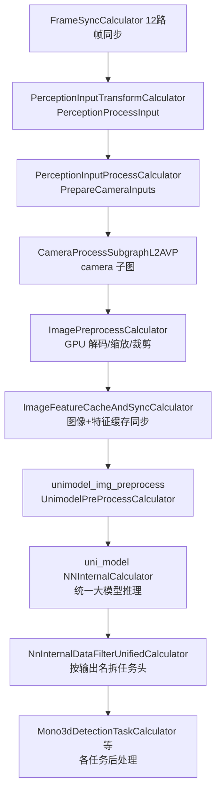
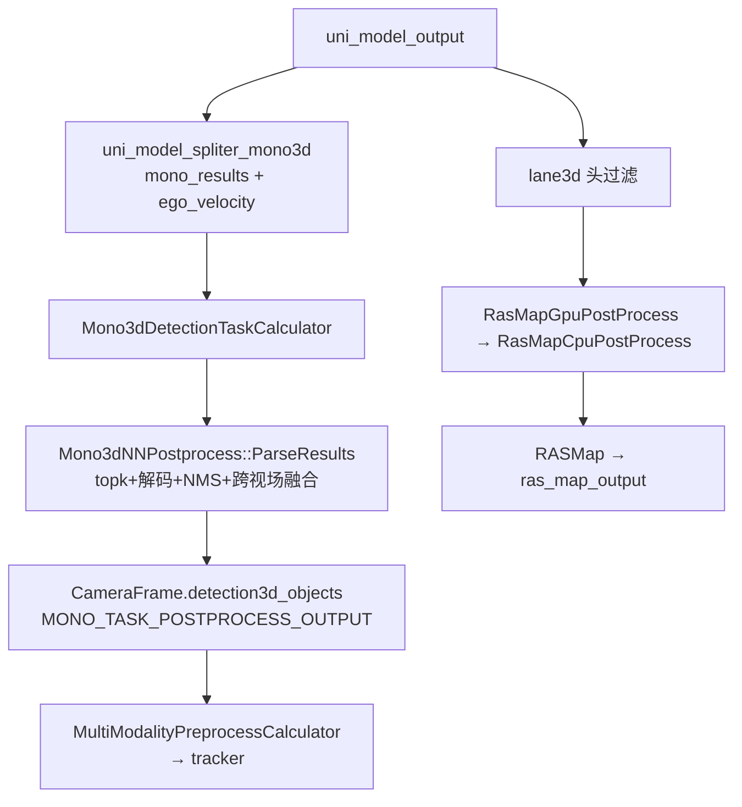

> **30 秒导读**：相机检测子模块：一套统一模型（uni_model）怎么同时认出车、人、车道线等所有目标。
> **本篇回答**：图像进来先做什么？模型怎么一次认全？检测结果长什么样？
> **先修阅读**：《00 入门》§3 步骤 3；《Perception 01 输入》。

> **本篇概念速成块**（30 秒，读完再进正文不卡壳）：
> - **camera 子模块**：相机的「洗照片车间」——C01 上它**不自带检测模型**，负责把图像洗干净（GPU 预处理）再解读大模型的化验单（任务头后处理，§1.3 重要结论）。
> - **uni_model**：统一检测大模型——一次前向认出车/人/车道线/红绿灯所有目标（完整卡片见 §1.3）。
> - **任务头拆分**：一个大模型的输出按名字分家——Filter 节点按 name_filter 把各任务头的张量分发给各自的后处理（§3.4）。
> - **GPU 批量预处理**：同分辨率的相机图合成一个 batch 一次算完，缺图的补零不破坏队形（§3.2）。
> - **时序特征缓存**：把上一帧 uni_model 的特征留下与本帧图像对齐——时序 BEV 的「记忆力」来源（§3.3）。
> - **标定**：内参/外参/畸变/lidar2img 四套几何参数，传感器坐标换算的依据（完整卡片见 §5.1）。


> 代码根目录：`/sandbox/perception/submodules/camera`（约 338 个源文件）  
> 分支说明：perception 及其 submodules 位于 `Stable_Master_4.0_new`（当前检出即该分支）；平台层 platform/church 位于 `dev_master`，本文不涉及平台层差异。  
> 本文所有结论均给出代码证据；无法给出证据的推断处标"推断"。

## 1. 子模块定位与职责

**一句话结论**：camera 是独立构建的算法仓，但在 C01 L2AVP 里它的角色是「预处理+后处理」——检测本体已上交给统一大模型 uni_model，自己专精图像工程与任务头解读。

**为什么 camera 的角色值得先说清**：目录名叫 camera，容易以为检测模型也在这里——实际上 C01 把「认目标」这件事上交给了统一大模型 uni_model，camera 仓专精两件事：把图像「洗干净」喂给模型（GPU 预处理），把模型输出的「原始数字」翻译成结构化目标（任务头后处理）。分清「模型在哪、后处理在哪」，读代码时才不会在两仓之间迷路。

### 1.1 代码仓库结构

camera 是一个独立构建的 C++/CUDA 算法仓（自带 `CMakeLists.txt`、`BUILD.bazel`、`WORKSPACE`），以子模块形式集成进 perception 主仓，核心代码位于 `camera/` 目录下：

```
camera/
├── common/          # 数学工具、匈牙利匹配器、裁剪参数等公共件
├── modules/         # 算法模块（业务核心）
│   ├── base_interface/   # base_detector.h（检测器基类接口）
│   ├── bev_det/          # BEV 检测后处理
│   ├── camera_all/       # 2D 全量检测任务
│   ├── magic_carpet/     # MagicCarpet 任务
│   ├── ras_map/          # 车道线/道路结构（RAS Map）模块
│   ├── scene/            # 场景分类（L2AVP 图中已注释停用）
│   ├── sdmap/            # SD 地图任务
│   ├── tracker/          # 相机侧跟踪（HMA 等）
│   └── traffic/          # 交通灯/交通牌检测（YOLOX/mono3d 后处理）
├── onboard/
│   ├── calculators/ # graphpipe 计算节点（L2AVP 子图的实际执行者）
│   └── processor/   # 纯算法 processor（被 calculator 调用）
└── postprocess_service/
```

### 1.2 在 C01 L2AVP 中的调用点（已验证）

C01（orinx 平台）感知主图 `perception_graph_l2avp_orin.cfg` 中，感知核心子图由 `PercepL2AvpSubgraph` 承载；该子图定义在 `/sandbox/perception/perception/cfg/graphs/onnx/graph_l2avp.cfg`，其中 **camera 子图以节点 `CameraProcessSubgraphL2AVP` 被显式调用**（第 320 行）：

> 文件路径：/sandbox/perception/perception/cfg/graphs/onnx/graph_l2avp.cfg  
> 节点：perception_subgraph 内
> 
> ```cfg
> node {
>   calculator: "CameraProcessSubgraphL2AVP"
>   input_stream: "CAMERA_INPUTS:camera_inputs"
>   input_stream: "UNI_MODEL_OUTPUT:uni_model_output"
>   ...
>   output_stream: "MONO_TASK_POSTPROCESS_OUTPUT:mono_task_postprocess_output"
>   output_stream: "TRAFFIC_TASK_POSTPROCESS_OUTPUT:traffic_task_postprocess_output"
>   output_stream: "RAS_MAP_OUTPUT_WITH_MARK:ras_map_output"
>   output_stream: "SAMPLED_LANE_NN:lane3d_nn_sampled"
>   output_stream: "camera_preprocess_output_synced"
>   ...
> }
> ```

`CameraProcessSubgraphL2AVP` 的子图定义文件即 camera 子模块内的 `/sandbox/perception/submodules/camera/camera/onboard/calculators/subgraph_config/camera_sub_graph_l2avp.cfg`，其 `BUILD.bazel` 第 26 行注册：`register_name = "CameraProcessSubgraphL2AVP"`。**这就是 camera 子模块被主图调用的确切通路**。

### 1.3 职责划分（重要结论）

C01 L2AVP 的相机 3D 检测**不再由 camera 仓内的独立检测模型完成，而是复用统一大模型 uni_model 的视觉部分**（NNInternalCalculator 节点，输入含 `imgs`，见 graph_l2avp.cfg 第 209\~243 行）。camera 子模块在链路中的职责为：

1. **图像 GPU 预处理**：解码/缩放/裁剪/归一化，产出 uni_model 的 `imgs` 输入；
2. **BEV 几何输入准备**：`lidar2img`、内参/外参/畸变系数、pose 转置与逆矩阵（时序 BEV 用）；
3. **任务头后处理**：从 uni_model 输出中过滤各任务头（`NnInternalDataFilterUnifiedCalculator` 按 `name_filter` 拆分），再解码为结构化目标；
4. **周边感知任务**：交通灯/交通牌/红绿灯形状、相机质量检测、MagicCarpet、BarrierGate、2D 全量检测（camera_all）。

2D 检测（camera_all）与单目 3D（mono3d）分别有独立推理节点（`camera_all_2d` 用 `camera_all_nn_param_path`）。

> **📘 概念｜uni_model（统一检测大模型）**
> **是什么**：感知的「一条龙 NN」——单个深度学习模型同时吃 8 路行车相机图像（+点云/雷达特征，BEV 融合），一口气输出 3D 目标框（mono 头）、车道线/道路结构（lane3d/roadmask 头）、交通灯状态（traffic 头）、自车速度（ego_velocity）等所有任务头的原始张量。它与「每种目标一个小模型」的老方案的区别：一次前向推理摊薄 GPU 开销，各任务共享同一套 BEV 特征，跨任务信息互补。注意边界：uni_model 只负责「出原始张量」，把张量解码成 3D 框/车道线是 camera 子模块的任务头后处理（§3.4/§4.1）。
> **类比与角色映射**：uni_model 是「全科体检医生」——以前眼科/放射科/内科各看各的片子（每种目标一个模型），现在一位全科医生一次看遍所有片子，直接开出全部化验单（各任务头原始输出）；camera 子模块是「化验单解读员」（把原始数字翻译成「3 米外有个锥桶」）；推理本体＝NNInternalCalculator 节点（graph_l2avp.cfg L209~243，输入 imgs）；分诊窗口＝NnInternalDataFilterUnifiedCalculator（按 name_filter 拆头）。
> **🎯 为什么这样设计**：Orin 上 NN 推理是最贵的资源，单模型多任务把多次前向合成一次；共享 BEV 特征让单目看不准的目标能被车道线/点云特征补全；任务头拆分让算法同学只改自己头的后处理，不碰推理本体。
> **🗂 代码在哪里**：推理节点 NNInternalCalculator（perception/cfg/graphs/onnx/graph_l2avp.cfg L209~243）；拆头 calculator 在 camera/onboard/calculators/；拆头配置证据见本篇 §3.4。
>
> **30 秒最小例子**：8 路图像经 GPU 预处理变成归一化张量 imgs，连同相机内参/位姿喂给 uni_model；0.1s 内它吐出一堆带名字的张量：mono_results（3D 框草稿）、smtc_*（车道线）、pred_tlstatus（红绿灯）。Filter 节点按名字把 mono_results 分给 mono3d 后处理、smtc_* 分给 RASMap 后处理、pred_tlstatus 分给交通灯任务——同一个模型输出，三路各取所需。

## 2. 核心类结构与成员变量

**一句话结论**：两条主线——onboard/calculators 是图节点（壳），onboard/processor 与 modules 是纯算法（芯）；ImagePreProcessor 握着全部 GPU 预处理资源（CUDA 流/去畸变查找表/裁剪参数）。

### 2.1 主要类清单

| 类/Calculator | 文件 | 职责 |
|-|-|-|
| `PerceptionInputProcessCalculator`（上层，非本仓） | `/sandbox/perception/perception/calculators/perception_input_process_calculator.cc` | 从 `PerceptionProcessInput` 拆出 `camera_inputs` |
| `TrafficAlgoProcessInputWrapper` | `/sandbox/perception/submodules/base/camera/traffic_processor_base.h` L27 | 图像帧容器（ImageMap variant） |
| `ImagePreprocessCalculator` | `camera/onboard/calculators/image_preprocess_calculator.cc` | graphpipe 节点：调 GPU 预处理 |
| `ImagePreProcessor` | `camera/onboard/processor/image_pre_processor.h` L45 | 图像批量预处理核心（CUDA） |
| `ImageFeatureCacheAndSyncCalculator` | `camera/onboard/calculators/image_feature_cache_and_sync_calculator.cc` | 特征/图像缓存与帧同步 |
| `Mono3dDetectionTaskCalculator` | `camera/onboard/calculators/mono3d_det_task_calculator.cc` | uni_model mono 头后处理节点 |
| `Mono3dNNPostprocess` / `SingleMono3dNNPostprocess` | `camera/modules/traffic/traffic_detection_task/mono3d_nn_postprocess/` | mono3d 解码+NMS |
| `DetectProcess` | `camera/onboard/processor/detect_processor.h` L19 | YOLOX 2D 检测后处理封装（traffic 用） |
| `CameraFrame` | `/sandbox/perception/submodules/base/camera/camera_frame.h` L31 | 相机帧结果容器 |
| `RasMapGpuPostProcess`/`RasMapCpuPostProcess` | `camera/onboard/calculators/ras_map_gpu_post_process_calculator.cc` 等 | 车道线头→RASMap |

### 2.2 关键成员举例

`ImagePreProcessor`（image_pre_processor.h L96\~132）：

```cpp
private:
  std::vector<std::pair<std::string, std::string>> cameras_to_source_cameras_;
  std::vector<std::string> camera_names_;                 // 参与预处理的相机列表
  std::map<std::string, std::string, std::greater<std::string>>
      imitation_cam_to_source_cam_;                       // "traffic_2_crop"->"traffic_2" 仿真裁剪相机
  std::map<std::string, CroppedImageParam> cropped_image_params_;  // 裁剪参数(内参变换用)
  std::unordered_map<std::string, float*> undist_mapx_;   // 去畸变查找表
  std::unordered_map<std::string, float*> undist_mapy_;
  cudaStream_t stream_ = nullptr;
  ImagePreProcessorOut nodes_;                            // 输出节点(node=主模型, traffic_node=traffic)
  std::unordered_map<std::string, deeproute::base::ImageProcessParam>
      image_preprocess_params_;                           // 每相机的尺寸/布局/归一化参数
  std::unordered_map<int, BatchImageParamsCachePtr> batch_image_params_;  // 按目标分辨率分批
```

常量 `T2C_CAMERA_NAME = "traffic_2_crop"`、`T2C_SOURCE_NAME = "traffic_2"`（image_pre_processor.h L42\~43）表明 traffic_2 会被额外裁剪出一路"虚拟相机"参与 mono3d。

## 3. 核心处理流程与函数调用链

**一句话结论**：图像之旅＝拆箱（frame_id 建 map）→ 洗照片（GPU 合批预处理）→ 对齐（特征/图像缓存同步）→ 会诊（uni_model 推理）→ 分诊（按名拆头）→ 解读（各任务后处理）；§3.5 的第二张图就是「分诊后」的两条支线。

**「洗照片」洗的是什么**：GPU 批量预处理包含四道工序——解码（压缩图还原成像素）、缩放/裁剪（对齐模型输入尺寸）、去畸变（拉直鱼眼）、[**归一化**](../../../../正典阁/技术栈/AI/归一化.md)（把 0~255 像素值换算成模型期望的数值范围）。这些工序全部在 GPU 上以 CUDA kernel 完成（整体逻辑见 [**CUDA 与 GPU 预处理**](../../../../正典阁/技术栈/AI/CUDA%20与%20GPU%20预处理.md)），产出的是规整的 [**张量**](../../../../正典阁/技术栈/AI/张量%20Tensor.md) imgs。

### 3.1 从 FrameSync 到 camera 子图



**图 3-1 · 图像从帧同步到任务后处理的完整链路**（A→J 自上而下，H 是唯一一次 NN 大模型推理）

**读图提示**：① E→F 之间是「洗照片」与「对齐」两步——F 节点拿到的不只是本帧图像，还有上一帧回传的特征（时序 BEV 的记忆，§3.3）；② H 只出现一次：8 路图一次前向，这就是 uni_model 省算力的图示；③ I 节点拆头后 J 是多个并行后处理（mono3d/车道线/交通灯各自独立）。

`camera_inputs` 的构造（上层 perception 主仓，已验证）：

> 文件路径：/sandbox/perception/perception/calculators/perception_input_process_calculator.cc  
> 函数名：PerceptionInputProcessCalculator::PrepareCameraInputs()  
> 核心逻辑：
> 
> ```cpp
> // 优先使用 raw 图像，否则使用压缩图
> if (!input->raw_images.empty()) {
>   std::unordered_map&lt;std::string, std::shared_ptr&lt;const ::deeproute::drivers::Image>> raw_frames;
>   for (const auto& img : input->raw_images) {
>     const auto& image_name = img->header().frame_id();
>     if (std::find(target_cameras_in_order_.begin(),
>                   target_cameras_in_order_.end(),
>                   image_name) != target_cameras_in_order_.end()) {
>       raw_frames.emplace(image_name, img);
>     }
>   }
>   camera_inputs.image_frames = raw_frames;
> }
> ```
> 
> 逻辑说明：以 `header().frame_id()`（相机名 camera_1\~6/traffic_2/panoramic_1\~4）为 key 装进 map，包成 `TrafficAlgoProcessInputWrapper` 后由 graph 流 `camera_inputs` 送入 camera 子图。

### 3.2 GPU 批量预处理

> 文件路径：/sandbox/perception/submodules/camera/camera/onboard/processor/image_pre_processor.cc  
> 函数名：ImagePreProcessor::Process&lt;T>()  
> 核心逻辑：
> 
> ```cpp
> // 按相机名取图，分配到主输出 node 或 traffic 输出 traffic_node
> uint8_t* out = (absl::EndsWith(param.camera_name, kTrafficCameraSuffix))
>                  ? (`reinterpret_cast<uchar*>`(nodes_.traffic_node.data_ptr) +
>                     (traffic_camera_index++) * param.output_size)
>                  : (`reinterpret_cast<uchar*>`(nodes_.node.data_ptr) +
>                     (normal_camera_index++) * param.output_size);
> uint8_t* input = nullptr;
> ResolveImageToDeviceInput(image, param, &input, stream_);   // 图像搬运到 GPU(含解码)
> ...
> if (::deeproute::base::fusion_preprocess::UpdateBatchImagePreProcessFusionParam(
>         cache->batch_image_preprocess_params_, cache->inputs,
>         cache->outputs, cache->output_zero_flags)) {
>   ::deeproute::base::fusion_preprocess::BatchPreprocessImage(
>       cache->batch_image_preprocess_params_, stream_);       // 融合 CUDA kernel 批处理
> }
> ```
> 
> 逻辑说明：同目标分辨率（`dst_shape`）的相机合入一个 batch，一次性执行解码/缩放/裁剪/归一化；缺图相机 `output_zero_flag=true` 由 kernel 置零，保证 batch 拓扑不变。

`ImagePreprocessCalculator::Process` 随后把 pose 转置矩阵、pose 逆矩阵、`lidar2img`、内参/外参/畸变系数全部封装为 `NNInternalDataType` 推给下游（image_preprocess_calculator.cc L413\~481）。

### 3.3 时序缓存与帧同步

`ImageFeatureCacheAndSyncCalculator` 用 `SyncSetInputStreamHandler` 把"本帧图像预处理结果"与"上一帧 uni_model 回传的特征"（`NEED_CACHE:image_backbone_network_output`、`fpn_stride16_nn_internal_output`）对齐后输出 `camera_preprocess_output_synced`（camera_sub_graph_l2avp.cfg L136\~181）。这是 uni_model 时序 BEV（prev_bev_feats）能拿到历史特征的关键。

### 3.4 推理与任务头拆分

uni_model 输出 `uni_model_output` 后，camera 子图内用多个 `NnInternalDataFilterUnifiedCalculator` 按 `name_filter` 拆头（camera_sub_graph_l2avp.cfg）：

- `traffic_head_filter`：`pred_tlstatus`/`tl_flatten_bboxes`/`hma_flatten_bboxes` 等（L267\~306）；
- `uni_model_spliter_mono3d_network_output`：`mono_results`、`ego_velocity`（L557\~570）；
- `uni_model_spliter_fusion_lane3d_network_output`：`smtc_*`/`roadmask_*`/`refline_*`/`e2e_*` 等车道线/道路头（L495\~543）。

### 3.5 mono3d 与 RASMap 后处理



**图 3-2 · uni_model 输出的两条后处理支线**（左：mono3d 目标；右：车道线 RASMap）

**读图提示**：① 左支线终点 E（CameraFrame）会流入 MultiModalityPreprocessCalculator 与 lidar/radar 装配后交 tracker（§5.3 去向）；② 右支线 RASMap 最终发布为 /perception/ras_map——规划收到的轻量地图从这里来；③ 两支线共用同一个 uni_model_output 源（节点 H）。

## 4. 核心算法入口与关键逻辑

**一句话结论**：后处理三板斧——topk 选候选→按张量布局解码（深度/朝向/坐标系三步换算）→NMS 去重；跨视场再融合一次防重复。

**三板斧的名词解释**：topk 是「按[**置信度**](../../../../正典阁/技术栈/AI/置信度.md)分数只留前 K 个候选」，省得对几万个网格逐一解码；NMS（[**非极大值抑制**](../../../../正典阁/技术栈/AI/NMS%20非极大值抑制.md)）是「同一目标被相邻网格各报一次时，只留分最高的那个」；解码（ComputeBox）把张量数字换算成真实世界的 3D 框——深度/朝向/坐标系三步换算的细节见 §4.1 证据。

### 4.1 mono3d 解码（模型输出→3D 框）

> 文件路径：/sandbox/perception/submodules/camera/camera/modules/traffic/traffic_detection_task/mono3d_nn_postprocess/single_mono3d_nn_postprocess.cpp  
> 函数名：SingleMono3dNNPostprocess::ParseResults()  
> 核心逻辑：
> 
> ```cpp
> // 1) 按分数取 topk（score 存于每个输出槽第 9 维）
> for (int i = 0; i < feat_size_[0] * feat_size_[1]; i++) {
>   output_data_scores.emplace_back(output_data_[i * code_size_ + 9]);  // 9 for score
> }
> auto topk_indices = TopKIndices(output_data_scores, topk_);
> // 2) 逐候选解码
> for (uint32_t topk_idx = 0; topk_idx < topk_indices.size(); topk_idx++) {
>   ComputeBox(topk_indices[topk_idx], &candidates, history_offset);
> }
> // 3) 按类别做 2D NMS（锥桶走专用 NMS）
> for (size_t i = 0; i < candidates.size(); i++) {
>   if (i == kConeCategoryIndex) {
>     nms2d_auxiliary_cone(&candidates.at(i), nms_thresh_[i], topk_,
>                          auxiliary_cone_nms_thresh_);
>   } else {
>     nms2d(&candidates.at(i), nms_thresh_[i], topk_);
>   }
>   ...  // IsBelievable 分数/距离过滤后转 base::Object
> }
> ```
> 
> 逻辑说明：输出张量布局为每格 `code_size_` 个通道，`[9]`=分数、`[10]`=类别、`[0..8]`=框/位姿/速度分量；`ComputeBox` 内完成深度因子缩放（`ScaleDepth(depth_factor_)`，`depth_factor_ = intrinsic_(1,1)/cropped_height_`，L298）、`LocalYawToGlobalYaw`、`ConvertToObject`（相机系→车体系）。

类别映射（L317\~327）：`{SMALLMOT, BIGMOT, PEDESTRIAN, CYCLIST, TRAFFIC_CONE}`。

### 4.2 跨视场结果融合（traffic_2 vs traffic_2_crop 去重）

> 文件路径：/sandbox/perception/submodules/camera/camera/modules/traffic/traffic_detection_task/mono3d_nn_postprocess/mono3d_nn_postprocess.cpp  
> 函数名：Mono3dNNPostprocess::FuseMono3dResult()  
> 核心逻辑：
> 
> ```cpp
> // traffic_2 与 traffic_2_crop 的同类目标，若投影框交叠超过该类 NMS 阈值则删补充视场目标
> float o = w * h /
>           std::min(area_in_camera_view[preferred_camera_name][i],
>                    area_in_camera_view[supplementary_camera_name][j]);
> if (o > nms_thresh_[camera_objects[preferred_camera_name][i]->type]) {
>   camera_view_skip[supplementary_camera_name][j] = true;
> }
> ```
> 
> 逻辑说明：以 `traffic_2` 为主视场、`traffic_2_crop` 为补充视场（L121\~123 显式写明），用"交集面积 / 较小框面积"做软化 IoU 去重，未剔除的按视场顺序合并进 `camera_frame_ptr->detection3d_objects`。主入口 `Mono3dDetectionTaskCalculator::Process` 调 `mono3d_nn_postprocess_->ParseResults(&nn_output_ptrs, camera_frame_ptr.get(), history_offset_)`（mono3d_det_task_calculator.cc L211）。

### 4.3 GPU 预处理与标定参数注入（见 3.2 节证据）

### 4.4 图像质量检测

`CameraQualityPreprocessCalculator` 从 `camera_preprocess_output_synced` 取图，`camera_quality_nn`（NNInternalCalculator）推理，`QualityNNPostprocessCalculator` 输出 `camera_quality_output`（camera_sub_graph_l2avp.cfg L184\~229），最终经 `PerceptionOutputProcessCalculator` 发布为 `perception__camera_quality`。

## 5. 输入输出数据结构

**一句话结论**：输入是「图像 map + 四组标定矩阵」，输出是「CameraFrame 摘要」——中间统一用 NNInternalDataType（GPU 张量容器）流转，全程少拷贝。

### 5.1 输入

**`TrafficAlgoProcessInputWrapper`**（base/camera/traffic_processor_base.h L27\~76，非 QNX 版本）：

```cpp
struct TrafficAlgoProcessInputWrapper {
  using ImageMap = std::variant<
      std::unordered_map<std::string,
          std::shared_ptr<const ::deeproute::drivers::CompressedImage>>,
      std::unordered_map<std::string,
          std::shared_ptr<const ::deeproute::drivers::Image>>>;
  ImageMap image_frames;            // camera_1~6 + traffic_2（原始或压缩图）
  ImageMap pano_frames;             // panoramic_1~4
  ImageMap destroyer_frames;        // 环视相机（AVP 用）
  ImageMap depth_frames;
  ImageMap avm_frame_ptr;
  std::shared_ptr<camera::CameraFrame> camera_frame_ptr;   // 可继承的历史帧结果
  ...
};
```

来源：FrameSyncCalculator 同步的 12 路消息（其中 8 路行车相机 + 4 路 panoramic，均在 shm pool，见 `/sandbox/perception/perception/calculators/perception_input_transform_calculator.cc` L79\~92 `kInShmpoolTopics`）。

**Side packet（初始化一次）**：`lidar_to_camera_gpu_matrices`（lidar2img 4x4）、`norm_intrinsic_gpu_matrices`、`extrinsic_gpu_matrices`、`distort_coeff_gpu_matrices`，由 `PerceptionIoPreprocessing` 从配置装填（graph_l2avp.cfg L48\~67）。

> **📘 概念｜标定（内外参/畸变/投影矩阵）**
> **是什么**：传感器的「安装说明书」——内参（焦距/光心：把像素坐标换算成相机系光线方向）、外参（相机装在车的哪个位置朝哪个方向：相机系↔车体系）、畸变系数（镜头弯曲的矫正表）、lidar2img（点云投影到图像的 4x4 矩阵）。所有跨传感器/跨坐标系的换算都靠它；没它，模型输出的「相机系 3D 框」无法落到车体系，点云和图像也对不上。
> **类比与角色映射**：标定像「房间的卷尺测量记录」——相机是钉在墙上的望远镜，记录上写着「钉在 (x,y,z)、朝向偏航 12°、镜头有点鱼眼、矫正表在此」。换算流程＝先查矫正表把弯的拉直（去畸变 undist_mapx/mapy），再用安装记录把「我看到的」翻译成「车的视角」（外参）。真实组件：四组 GPU 矩阵 side packet 初始化一次装填（graph_l2avp.cfg L48~67）；去畸变查找表在 ImagePreProcessor 成员 undist_mapx_/undist_mapy_（§2.2）；mono3d 深度换算用 intrinsic_(1,1)/cropped_height_（§4.1 证据）。
> **🎯 为什么这样设计**：标定参数是「初始化一次、每帧复用」的静态几何事实，所以做成 side packet 而非每帧消息；常驻 GPU 显存让推理时零拷贝取用。
> **🗂 代码在哪里**：装填 PerceptionIoPreprocessing（graph_l2avp.cfg L48~67）；使用 ImagePreProcessor（去畸变）与 mono3d ComputeBox（深度/坐标换算）；参数源为车型标定配置（随车型包注入）。
>
> **30 秒最小例子**：uni_model 输出「相机系下 (u,v,d) 的目标」——查内参焦距把像素 (u,v) 换算成相机系方向、乘深度 d 得相机系 3D 点；再乘外参矩阵把「相机看到的」转到「车体系 (X,Y,Z)」——tracker 拿到的 3D 框就是这么来的；而 lidar2img 反向把点云点投到图像上，供跨模态对齐。

### 5.2 中间结构

- `NNInternalDataType`（`platform::base::NNInternalDataType`）：多节点 GPU 张量容器，`Node{name, buffer, shape}`；图像/投影矩阵/模型输出统一用它流转。
- `CroppedImageParam`（camera/common/cropped_img_params.h）：裁剪虚拟相机的内参/外参/偏移/缩放。

### 5.3 输出

**`CameraFrame`**（base/camera/camera_frame.h L31\~83）：

```cpp
struct CameraFrame {
  uint64_t frame_id = 0;
  std::vector<base::ObjectPtr> detection3d_objects;   // mono3d 3D 目标
  std::vector<base::LaneLine> lane_objects;
  std::vector<base::TrafficLightPtr> traffic_lights;  // 交通灯
  base::TrafficLightStops traffic_light_stops;
  ...
};
```

去向：`mono_task_postprocess_output`（`CameraFrame`）流入主图 `MultiModalityPreprocessCalculator`（该文件 include 了 `camera/camera_frame.h`、`camera/traffic_processor_base.h`，见 `/sandbox/perception/perception/calculators/multi_modality_preprocess_calculator.cc` L23\~24），与 lidar/radar 一起装配后送 tracker；`traffic_task_postprocess_output`→交通灯状态输出；`ras_map_output`→`perception__ras_map`。

## 6. 代码证据与关键片段

**一句话结论**：本篇 5 段证据覆盖「拆箱→合批→推理→解码→融合」全链，补充段证明 mono3d 节点输入输出的真容。

（第 3、4 章已给出 5 段带完整路径/函数名的证据；此处补充 1 段说明 traffic 检测的 YOLOX 路径与 mono3d 并存）

> 文件路径：/sandbox/perception/submodules/camera/camera/onboard/calculators/mono3d_det_task_calculator.cc  
> 函数名：Mono3dDetectionTaskCalculator::Process()  
> 核心逻辑：
> 
> ```cpp
> NNInternalDataType nn_output =
>     cc->Inputs().Get(kInputTag, 0).`Get<NNInternalDataType>`();
> ...
> std::vector&lt;void*> nn_output_ptrs;
> for (size_t i = 0; i < nn_output.nodes.size(); i++) {
>   auto const& node = nn_output.nodes.at(i);
>   if (node.data_ptr == nullptr) {
>     return absl::InternalError("data pointer cannot be nullptr. index: " +
>                                std::to_string(i));
>   }
>   nn_output_ptrs.push_back(node.data_ptr);
> }
> mono3d_nn_postprocess_->ParseResults(
>     &nn_output_ptrs, camera_frame_ptr.get(), history_offset_);
> MLOG(DEBUG) << "mono output obj num: "
>             << camera_frame_ptr->detection3d_objects.size();
> ```
> 
> 逻辑说明：节点输入 `ALGO:0` 即过滤后的 `mono_results`+`ego_velocity` GPU 指针，解码结果写入 `CameraFrame`，以 `MONO_TASK_POSTPROCESS_OUTPUT` 发布。`EnableTraffic2()`（同文件 L41\~52）通过检查 `mono_results` 节点 `fixed_shape(0)==2` 决定是否额外启用 traffic_2 原图单目推理。

---

## 7. FAQ 与自测

**Q1（新手误解）：camera 子模块里是不是有个相机检测模型，各目标各跑一个？**
C01 上不是。相机 3D 检测复用统一大模型 uni_model（§1.3 重要结论），camera 仓只做图像预处理与任务头后处理；camera_all 2D 检测、交通灯等周边任务有独立小推理节点，但那是「周边感知」，不是主检测。

**Q2：某路相机缺图了，batch 会不会散架？**
不会。同目标分辨率的相机合入一个 batch，缺图相机由 kernel 置零（output_zero_flag），batch 拓扑不变（§3.2）——牺牲单路精度换取批处理稳定性，下游拿到的是全零张量需自行判空。

**Q3：traffic_2 和 traffic_2_crop 是两个相机吗？**
只有一个物理相机。traffic_2_crop 是从 traffic_2 裁剪出的「虚拟相机」（T2C_CAMERA_NAME 常量，§2.2），额外参与 mono3d 推理；两路检测结果用「交集面积/较小框面积」软化 IoU 去重后融合（§4.2）。

**Q4：时序 BEV 的「上一帧特征」是谁保管的？**
ImageFeatureCacheAndSyncCalculator（§3.3）：把本帧图像预处理结果与上一帧 uni_model 回传的特征（NEED_CACHE 流）对齐后输出 synced 流——没有这个节点，时序 BEV 就退化成单帧检测。

**自测**（答案在缩进行里）：
1. camera 子模块在 C01 L2AVP 的四大职责是什么？
    答：图像 GPU 预处理、BEV 几何输入准备、任务头后处理、周边感知任务（§1.3）。
2. uni_model 的输出怎么分给不同任务？
    答：NnInternalDataFilterUnifiedCalculator 按 name_filter 拆头，mono3d/车道线/交通灯各自领走自己的张量（§3.4）。
3. 标定参数以什么形式注入？什么时候装填？
    答：四组 GPU 矩阵 side packet（lidar2img/内参/外参/畸变），初始化时装填一次、每帧复用（§5.1）。

### 附：关键文件索引

| 文件 | 作用 |
|-|-|
| `camera/onboard/calculators/subgraph_config/camera_sub_graph_l2avp.cfg` | L2AVP camera 子图（节点编排） |
| `camera/onboard/calculators/image_preprocess_calculator.cc` | 预处理节点 |
| `camera/onboard/processor/image_pre_processor.{h,cc}` | GPU 批量预处理 |
| `camera/onboard/calculators/image_feature_cache_and_sync_calculator.cc` | 特征缓存同步 |
| `camera/onboard/calculators/mono3d_det_task_calculator.cc` | mono3d 后处理节点 |
| `camera/modules/traffic/traffic_detection_task/mono3d_nn_postprocess/*` | mono3d 解码/NMS/融合 |
| `camera/onboard/calculators/ras_map_gpu_post_process_calculator.cc` | 车道线 GPU 后处理 |
| `camera/onboard/calculators/traffic_light_task_calculator.cc` | 交通灯任务汇总 |
| `camera/onboard/calculators/camera_all_calculator.cc` | 2D 全量检测后处理 |
| `camera/onboard/calculators/magic_carpet_calculator.cc` | MagicCarpet 任务 |

（全文约 4800 字）
