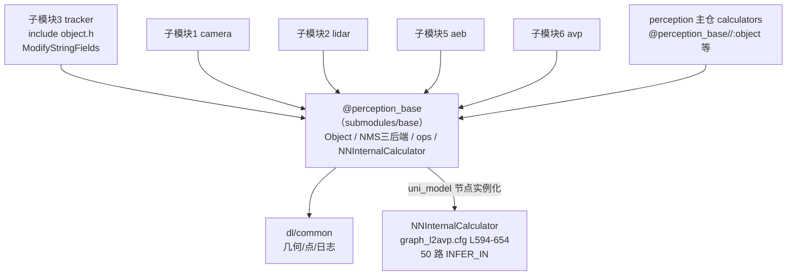

> **30 秒导读**：感知的"积木箱"：Object 等核心数据结构与公共工具，所有子模块共用。
> **本篇回答**：目标在内存里长什么样？有哪些公共工具？为什么单独一个仓库？
> **先修阅读**：无（工具篇，随用随查）。

> **本篇概念速成块**（30 秒，读完再进正文不卡壳）：
> - **base::Object / ObjectPtr**：全仓库统一的「员工档案表」——一个目标长什么的唯一权威定义（完整卡片见 §4.1；所有权机制见 [**ObjectPtr 只读共享**（Perception/03 §3）](../03%20关键数据结构与内存管理.md)）。
> - **object_types.h**：全部目标类别/属性/红绿灯枚举的唯一权威——防各处自定义漂移。
> - **NNInternalCalculator**：base 里的可复用 NN 推理节点——C01 主图 uni_model 节点就是它的实例化，base 不只是头文件库（§4.5）。
> - **@perception_base//**：Bazel 外部仓名——子模块都用它引 base 目标（§3）。
> - **ModifyStringFields**：配置路径环境变量改写工具——tracker Load() 第一件事就调它（§4.4）。
> - **NMS 三后端**：CPU/CUDA/OpenCL 三份实现接口一致，供检测后处理按平台选用（§2）。


> 代码位置：`/sandbox/perception/submodules/base`（子仓检出分支 **Stable_Master_3.2**，与主仓 Stable_Master_4.0_new 的差异仅系 repo 子仓管理，未做改动）。README 仅一句话："Perception base，Depends to dl/common"。

## 1. 定位与职责

**一句话结论**：base 是感知的「积木箱」——统一数据结构（Object）+通用工具（NMS/计时/GPU IO）+可复用 calculator（NNInternalCalculator）三类资产，所有子模块与主仓共用。

**为什么要有单独的 base 层**：八个子模块都要「描述一个目标」，若各定义各的 struct，每条模块边界都得写转换代码，且字段名/枚举值慢慢漂移不可控。base 把这些公共资产抽出来下沉一层，子模块之间传 Object 指针零转换成本——这也是为什么本文是工具篇：读懂 Object 就读懂了感知各模块之间的「通用语言」。

base 是感知仓库的**公共基础库**：向 camera/lidar/tracker/aeb/avp 等算法子模块和 perception 主仓 calculator 提供三类资产——

1. **通用数据结构**：跨传感器统一的目标表示 `base::Object`/`CameraObject`、帧容器 `ResultFrame`/`MultiModalityPreprocessOutput`、各传感器帧/参数结构；
2. **通用工具**：计时、路径环境变量替换、容器转字符串、图像缓冲、CUDA/OpenCL NMS 与算子（ops）、GPU IO 辅助等；
3. **可复用 calculator**：`calculators/nn_common/` 下的 NN 推理编排节点（C01 主图 `uni_model` 节点直接使用的 `NNInternalCalculator` 即出自此处，base 因此**不只是头文件库**）。

## 2. 核心工具类清单（分类）

**一句话结论**：一张表分六类——数据结构是重心（Object/枚举/帧容器），工具按「数学/时间/线程 GPU/配置日志」分桶，随用随查。

**清单里出现的 AI 名词**：NMS（非极大值抑制）是检测后处理的标配——同一目标会被检出多个重叠框，只留分数最高的那个（见 [**AI 字典·NMS 非极大值抑制**](../../../../正典阁/技术栈/AI/NMS%20非极大值抑制.md)）；CUDA/OpenCL 是把算子跑到 GPU 上的两套接口（GPU 预处理原理见 [**AI 字典·CUDA 与 GPU 预处理**](../../../../正典阁/技术栈/AI/CUDA%20与%20GPU%20预处理.md)）；NNInternalCalculator 则是神经网络推理节点的通用实现（推理原理见 [**AI 字典·神经网络与推理引擎**](../../../../正典阁/技术栈/AI/神经网络与推理引擎.md)）。

| 分类 | 代表类/文件 | 一句话说明 |
|-|-|-|
| 数据结构 | `object.h`：`base::Object`（L114 起）、`CameraObject`（L342 起） | 全仓库统一的 3D 目标/相机目标结构（center、size、theta、velocity、type、attribute_type 等），tracker 输入输出即 `ObjectPtr` |
| 数据结构 | `object_types.h`：`ObjectType/ObjectSubType/AttributeType/TrafficSignType` 等枚举 | 全部目标类别、属性、红绿灯状态枚举的唯一权威定义 |
| 数据结构 | `frame/multi_modality_base.h`：`MultiModalityPreprocessOutput`（L19 起） | tracker 输入的多模态打包容器（lidar/radar/camera/uss objects + tf + 地面参数） |
| 数据结构 | `frame/result_frame.h`：`CombinedObstacles`（L12 起） | 行/泊两路障碍物合并的最终输出容器 |
| 数据结构 | `camera/`（traffic_light.h、lane_struct.h、image_struct.h 等）、`lidar/`（lidar_object.h、lidar_frame.h 等） | 相机（红绿灯 `TLColor/LightRegion`、车道线）与雷达（点云旗标 point_flag）侧结构 |
| 数学/几何 | `nms/nms.h、nms.cuh、nms_cuda.cu、nms_opencl.cpp` | NMS（非极大值抑制）的三后端实现（CPU/CUDA/OpenCL），供检测后处理复用 |
| 数学/几何 | `ops/`（crop.cu、matmul.cu、decode.cu、batch_image_preprocess_op.cu 等） | CUDA 预处理/后处理算子库（裁剪、矩阵乘、解码、批量图像预处理） |
| 时间 | `base_utils/timer.h`：`Timer`（L17 起） | `steady_clock` 计时器，`EndMilli(bool reset)` 返回毫秒耗时，perception 各 calculator 通用 |
| 线程/GPU | `base_utils/gpu_io_helper.h、cuda_utils.h、nvtx_helper.h` | GPU 内存/流 IO 辅助、CUDA 工具、NVTX 打点辅助（tracker 的 `MTRACE_GPU_SCOPE` 生态） |
| 配置/路径 | `base_utils/path_overwrite.h`：`GetReplacedPathByEnv()`（L15）、`ModifyStringFields()`（L30） | 用环境变量替换配置串/protobuf 字符串字段中的路径前缀（tracker `Load()` 就靠它改写参数路径） |
| 配置/日志 | `log.h`（仅 `#include "common/log.h"`）、`report_event_keys_values.h` | 日志宏转发至 dl/common；感知事件上报的 key-value 常量表 |
| 其他 | `base_utils/`：`container_to_str.h、image_buffer.h、frame_counter.h、simple_json_str.h、calculator_recorder.h、air_susp.h` | 容器打印、图像缓冲、帧计数、轻量 JSON、calculator 录制、空气悬架参数 |

## 3. 被其他子模块依赖的方式

**一句话结论**：Bazel 外部仓引用（@perception_base//）+相对 include 两条路；依赖方向永远是「子模块/主仓 → base → dl/common」。



**图 3-1 · base 的依赖关系（谁在用它、它又依赖谁）**（箭头指向被依赖方，UNI 是 base 被主图直接运行的证据）

**读图提示**：① 五个算法子模块+主仓全部指向 base——它是唯一的公共下沉层；② base 自身只依赖 dl/common，不反向依赖任何算法模块；③ 右下角 NNInternalCalculator 是「base 被主图链接运行」的铁证，不是纯头文件库。

- **Bazel 外部仓引用**：主仓 `/sandbox/perception/WORKSPACE` L116-118 将本仓注册为 `local_repository(name = "perception_base", path = "submodules/base")`；下游一律以 **`@perception_base//<target>`** 引用，例如：

  - `perception/perception/util/BUILD.bazel`：`"@perception_base//:object"`、`"@perception_base//camera:box"`、`"@perception_base//base_utils:container_to_str"`；
  - `perception/perception/test/calculators/BUILD.bazel`：`"@perception_base//calculators/nn_common:unimodel_preprocess_calculator"` 等；
  - tracker 子仓经 deb 安装路径引用同款头文件（tracker.hpp include `object.h`、`base/trace/trace.h`、`base/hpc_hal/...`）。
- **include 路径形态**：源码中以 `#include "object.h"`（相对 base 根）或 `"base_utils/path_overwrite.h"` 书写，由 perception_cc_wrapper 注入 include 路径。
- **自身依赖**：base 依赖 dl/common（`@common//common:geometry_polygon/point/log`，见 BUILD.bazel object 目标 deps），并提供 proto（`proto/` 各参数 proto，如 `image_preprocess_param`）。
- **发布**：`base_release_package` 仅打包 `bin`（nn_internal_calculator_test_bin）与 `cfg`；头文件随 target 可见性暴露（BUILD.bazel L49-72）。

## 4. 关键数据结构与工具函数（附证据）

**一句话结论**：五段证据——Object 结构、tracker 输入容器、计时器、路径改写、NN 推理节点，覆盖 base 三类资产各一个代表。

### 4.1 base::Object（全仓库目标统一表示）

> 文件路径：/sandbox/perception/submodules/base/object.h  
> 结构体：base::Object（L114 起）  
> 核心逻辑：
> 
> ```cpp
> struct alignas(16) Object {
>   Object() { id = -1; detection_id = -1; sensor_name.clear(); ... }
>   ...
>   Eigen::Vector3f direction = Eigen::Vector3f(1, 0, 0);  // 主方向
>   float theta = 0.0f;                                    // 航向角
>   Eigen::Vector3d center = Eigen::Vector3d(0, 0, 0);     // 包围盒中心
>   Eigen::Vector3d barycenter = Eigen::Vector3d(0, 0, 0); // 点云质心
>   Eigen::Vector3f size = Eigen::Vector3f(0, 0, 0);       // [长,宽,高]
>   Eigen::Vector3d corners[8];                            // 3D 包围盒 8 角点
>   Eigen::Vector3d anchor_point = Eigen::Vector3d(0, 0, 0); // 锚点
>   ObjectType type = ObjectType::UNKNOWN;
>   ObjectSubClass subtype = ObjectSubClass::UNKNOWN_SUBTYPE;
>   ObjectMotion object_motion = ObjectMotion::UNKNOWN;
>   std::vector&lt;ObstacleLightStatus> obstacle_light_status;  // 车灯状态
>   ...
> };
> using ObjectPtr = std::shared_ptr&lt;Object>;   // L339
> ```
> 
> 逻辑说明：`alignas(16)` 对齐 Eigen；id/detection_id 双 ID（跟踪 id 与检测 id，tracker 直接写入）；车灯状态以"状态→score"映射承载（L225 附近）。tracker 输入输出的 `tracked_objects` 即 `std::vector<ObjectPtr>`。

> **📘 概念｜base::Object（全仓库统一目标表示）**
> **是什么**：感知全仓库「一个目标长什么样」的唯一权威定义——3D 包围盒中心/尺寸/8 角点、航向角、速度、类型枚举（ObjectType/ObjectSubType）、车灯状态等全在这一个 struct 里，camera 检出它、tracker 跟踪它（ObjectPtr 列表进出）、aeb 过滤它、发布时序列化成 proto。它与 PerceptionObstacle proto 的区别：Object 是进程内内存结构（Eigen 对齐、直接参与计算），proto 是跨进程传输格式（/perception/objects 话题），两者在输出边界互转；它与 farseer 内部 AgentFeature 的区别：那是预测模块对 Object 的二次加工态（子模块4）。
> **类比与角色映射**：base::Object 是「全公司统一的员工档案表」——每个部门（子模块）看同一个人用同一张表：工牌号（id/detection_id 双 ID：跟踪 id 与检测 id）、体貌（center/size/theta）、部门岗位（type/subtype 枚举，object_types.h 唯一权威）、当前状态（velocity、车灯 status→score 映射）；档案表由人事部（base）印发，各部门只填内容不改表头；「shared_ptr 档案引用」（ObjectPtr，L339）让多部门共享同一份档案而不是复印 N 份（只读共享的所有权机制详见 [**Perception/03 §3**](../03%20关键数据结构与内存管理.md)）。真实数字：alignas(16) Eigen 对齐；L114 起 200+ 行字段。
> **🎯 为什么这样设计**：统一表示让子模块之间零转换成本（[**tracker**（子模块3 §1）](子模块3：tracker%20多目标跟踪子模块.md) 输出直接是 aeb 输入）；枚举权威收敛到 object_types.h 防止各处自定义漂移；alignas(16) 同时满足 Eigen SIMD 与 GPU 传递的对齐需求。
> **🗂 代码在哪里**：object.h L114 起（struct Object）；枚举 object_types.h；tracker 输入输出 `std::vector<ObjectPtr>`（tracker.hpp）。
>
> **30 秒最小例子**：lidar 检出一辆车：uni_model 解码填 center=(25.3, -2.1, 0.8)、size=(4.5,1.9,1.5)、type=SMALLMOT，包成 ObjectPtr；tracker 匹配后写入 id=7、tracking_time=3.2s（仍是同一个 Object）；aeb 过滤链查它 confidence 与盲区，不改字段只决定去留；最终 PerceptionOutputProcessCalculator 把它转成 PerceptionObstacle proto 发布——从检测到发布，下游拿到的都是指向同一份 Object 的指针（只读共享）。

### 4.2 MultiModalityPreprocessOutput（tracker 输入容器）

> 文件路径：/sandbox/perception/submodules/base/frame/multi_modality_base.h  
> 类名：base::MultiModalityPreprocessOutput（L19 起）  
> 核心逻辑：
> 
> ```cpp
> enum class MultiModalityPreprocessType { ... };        // L13：NULL/LIDAR/... 帧类型
> class MultiModalityPreprocessOutput {
>  public:
>   MultiModalityPreprocessType preprocess_type() const; // L25
>   void set_preprocess_type(MultiModalityPreprocessType type);  // L42
>  private:
>   MultiModalityPreprocessType preprocess_type_;        // L47
> };
> ```
> 
> 逻辑说明：C01 图中 `MultiModalityPreprocessCalculator` 产出该容器（流名 `preprocess_output`），`PerceptionTrackerProcessCalculator` 按 `preprocess_type()` 分派（MMPT_LIDAR_TYPE 走主跟踪流程）。完整成员（各传感器 objects、tf、ground_plane_params）由该类封装并经 `mutable_lidar_objects()` 等访问器交给 tracker（见 calculator L317-L326）。

### 4.3 Timer（时间工具）

> 文件路径：/sandbox/perception/submodules/base/base_utils/timer.h  
> 函数名：base_utils::Timer::EndMilli()（L34 起）  
> 核心逻辑：
> 
> ```cpp
> double EndMilli(bool reset = false) {
>   auto now = std::chrono::steady_clock::now();
>   auto duration = `duration_cast<microseconds>`(now - start_).count();
>   if (reset) { Start(); }
>   return `static_cast<double>`(duration) / 1000.0;
> }
> ```
> 
> 逻辑说明：monotonic 时钟毫秒计时；`prediction_with_planner_calculator.cc` 即用 `timer.EndMilli()` 统计预测耗时（L2540）。

### 4.4 GetReplacedPathByEnv / ModifyStringFields（配置路径工具）

> 文件路径：/sandbox/perception/submodules/base/base_utils/path_overwrite.h  
> 函数名：GetReplacedPathByEnv()（L15）/ ModifyStringFields()（L30）  
> 核心逻辑：
> 
> ```cpp
> inline std::string GetReplacedPathByEnv(const std::string& path) {
>   std::string new_path = path;
>   ... // 按环境变量替换路径前缀
> }
> inline void ModifyStringFields(google::protobuf::Message* message) {
>   ... // 递归遍历 proto 所有 string 字段做路径改写
> }
> ```
> 
> 逻辑说明：配置文件中的 `/opt/deeproute/...` 等路径可按部署环境改写；tracker `Tracker::Load()` 第一件事就是 `::perception::base::ModifyStringFields(&param_)`（tracker.hpp L62），是 base 工具被算法子模块直接调用的实例。

### 4.5 NNInternalCalculator（可复用 NN 推理节点）

> 文件路径：/sandbox/perception/submodules/base/calculators/nn_common/nn_internal_calculator.cc  
> 函数名：NNInternalCalculator / REGISTER_CALCULATOR（L164 / L576）  
> 核心逻辑：
> 
> ```cpp
> class NNInternalCalculator : public graphpipe::CalculatorBase { ... };  // L164
> REGISTER_CALCULATOR(NNInternalCalculator);                              // L576
> ```
> 
> 逻辑说明：graphpipe/mediapipe 风格的通用 NN 推理节点（多输入流 INFER_IN、单/多输出流、side packet 传模型参数），C01 主图 `uni_model` 节点（graph_l2avp.cfg L594-654，50 路 INFER_IN）正是它的实例化——证明 base 是被主图直接链接运行的基础组件，而非纯头文件集。

## 5. 代码证据汇总

**一句话结论**：四条证据链各自独立——数据结构权威性、依赖方向、被算法模块调用、被主图直接运行。

- 数据结构权威性：第 4.1、4.2 节（object.h / multi_modality_base.h）；
- 依赖方向：第 3 节 WORKSPACE L116-118 与 `@perception_base//` 引用实例（perception/util/BUILD.bazel L93-L104）；
- 被算法子模块调用：tracker.hpp L19-L26（include `object.h`、`base/trace/trace.h`、`base/hpc_hal/memory/mem_utils.h`）与 L62（`ModifyStringFields`）；
- 被主图直接使用：第 4.5 节 NNInternalCalculator ↔ graph_l2avp.cfg L595 `calculator: "NNInternalCalculator"`；
- NMS/ops 多后端：`submodules/base/nms/`（nms_cpu.cpp/nms_cuda.cu/nms_opencl.cpp）与 `submodules/base/ops/`（目录清单见任务记录，CUDA 预处理算子族）。

## 6. FAQ 与自测

**FAQ**：

**Q1：base 是不是就是个头文件工具库？**（新手常见误解）
不是。`calculators/nn_common/` 的 NNInternalCalculator 被 C01 主图 uni_model 节点直接实例化（50 路 INFER_IN，graph_l2avp.cfg L594-654），base 是被链接运行的基础组件（§1/§4.5）。

**Q2：为什么 Object 里有 id 和 detection_id 两个 ID？**
id 是 tracker 航迹编号（跨帧稳定），detection_id 是本帧检测编号（未匹配为 -1，aeb 尺寸回填就看它）；双 ID 让下游既能「跟人」又能回查本帧原始检测（§4.1）。

**Q3：新子模块想用 base 怎么引？**
WORKSPACE 已注册为 local_repository（name="perception_base"），Bazel 里引 `@perception_base//<target>`；include 路径由 perception_cc_wrapper 注入，源码直接 `#include "object.h"`（§3）。

**Q4：NMS 为什么有三份实现？**
CPU/CUDA/OpenCL 三后端接口一致，按部署平台与数据规模选用——x86 调试走 CPU、orin 主链走 CUDA、特定硬件走 OpenCL（§2）。

**自测**：
1. tracker 的 tracked_objects 是什么类型？
    `std::vector<base::ObjectPtr>`（shared_ptr 持有 Object 列表），进出同一结构零转换。
2. 配置路径环境变量改写工具是什么？谁在用？
    GetReplacedPathByEnv / ModifyStringFields（base_utils/path_overwrite.h）；tracker::Load() 第一件事就调 ModifyStringFields 改写参数路径（tracker.hpp L62）。
3. base 自身依赖谁？
    dl/common（几何/点/日志），BUILD.bazel object 目标 deps 可证；不反向依赖任何算法子模块。
