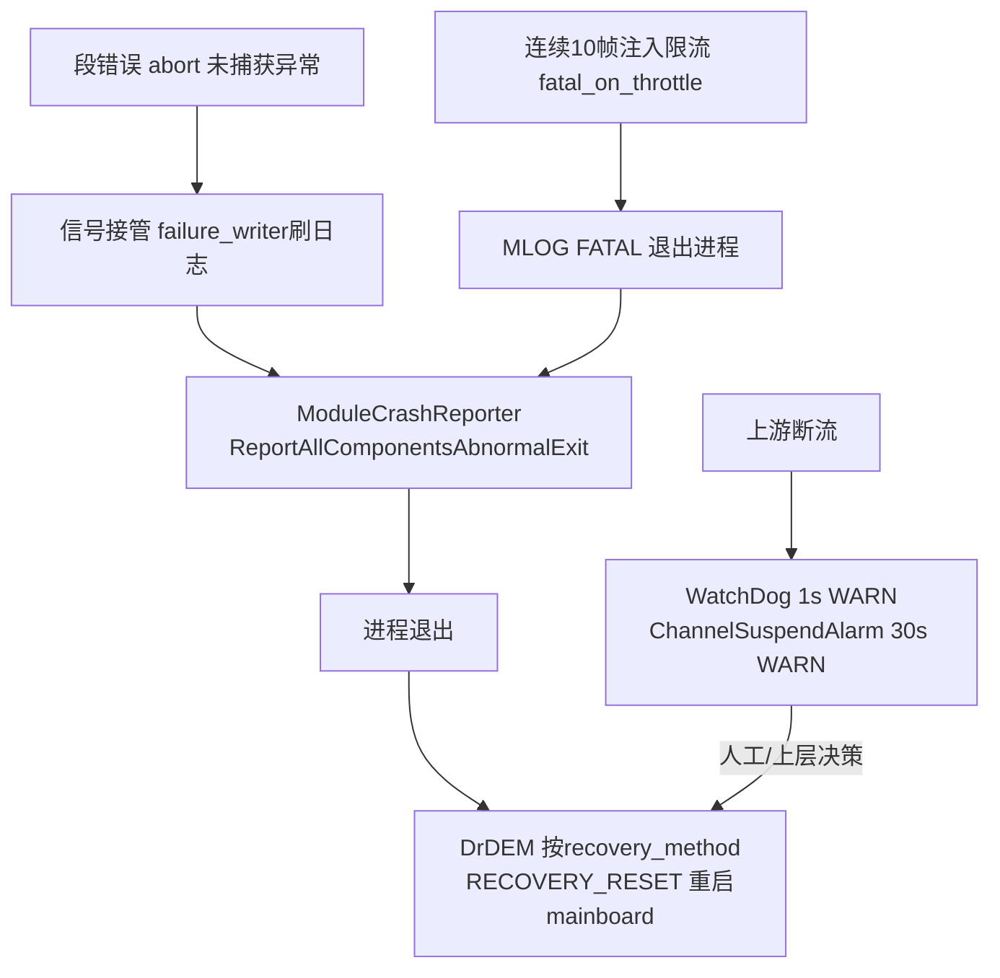

> **30 秒导读**：感知"病了"怎么办：帧同步超时、传感器断流、throttle 降级到整进程重启的完整应对。
> **本篇回答**：哪些情况会告警？哪些会降级？极端情况怎么恢复？
> **先修阅读**：[**05 端到端全链路时序与异常机制**（公共 05）§4 异常链路](../00_公共基础文档/05%20端到端全链路时序与异常机制（C01%20-%20orinx）.md)。

> **本篇概念速成块**（30 秒，读完再进正文不卡壳）：
> - **三层容错**：预防（上游打包降频）→ 容忍（超时装配残缺帧）→ 重启（连续 10 帧限流 FATAL）——异常不是一层解决的（§1）。
> - **超时装配**：100ms 没凑齐也照样发——「能装多少装多少」，保 10Hz 拍点稳定（§1.2；FrameSync 完整卡片见 [**公共 02 §3**](../00_公共基础文档/02%20模块配置与%20Topic%20数据流拓扑（C01%20-%20orinx）.md)）。
> - **背压 kMaxFramesInFlight=2**：处理慢时新帧先不装配（入口侧机制见 [**在途帧背压**（Perception/01 §2.3）](01%20输入数据接入与预处理.md)）。
> - **错误处理三种姿势**：关键路径 fail-fast、非关键 log-and-continue、未知 topic 跳过——分级处置不搞一刀切（§2.1）。
> - **WatchDog vs ChannelSuspendAlarm**：前者看「还有没有帧」（1s），后者看「哪一路断了」（30s）——都是只告警不重启的哨兵（§3）。
> - **崩溃三段接力**：信号接管→回收+日志落盘（5s 超时保护）→逐组件上报后退出（§4）。
> - **RECOVERY_RESET**：感知没有「部分重启」——FATAL/崩溃后 DrDEM 整体重启 mainboard，四组件一并重启（§5）。


> 所属系列：C01车型E2E架构拆解 · Perception 通用机制  
> 读者：具备 C/C++ 基础、不熟悉本仓库的开发者  
> 基线引用：阶段1第4条（watch_dog/ChannelSuspendAlarm/crash reporter/RECOVERY_RESET）

## 1. 输入异常：帧同步超时与丢帧

**一句话结论**：输入异常三层设防——上游打包降频（预防）、FrameSync 超时装配残缺帧（容忍）、连续 10 帧注入限流 FATAL（重启）。

**为什么容错要分三层**：单帧缺一路相机不值得重启，消费持续积压才值得——三层设防让系统对「小病容忍、大病重启」，把异常的处置代价与它的严重程度对齐。这也是所有高可用系统的通用思路，感知只是把它落在了帧节拍上。

### 1.1 帧同步超时参数链

超时值从 proto 默认值一路传到 FrameSyncCalculator：

> 文件路径：/sandbox/platform/church/proto/tasks_config.proto  
> 函数名：TaskProto 字段  
> 核心逻辑：

```proto
optional uint32 frame_sync_timeout = 12 [default = 100000000];  // 100ms（纳秒）
optional bool fatal_on_stream_throttle = 14 [default = true];   // 限流默认致命
optional uint32 cache_size = ... [default = 10];                // channel缓存
optional uint32 msg_trans_warn_threshold_ms = ... [default = 500]; // 传输耗时告警阈值
```

> 文件路径：/sandbox/platform/church/graph/graph_scheduler.cc  
> 函数名：GraphScheduler::FillSidePacketsForFrameSync（449-530行）  
> 核心逻辑：

```cpp
// 把配置注入 FrameSyncCalculator 的 side packet：
//   FRAME_SYNC_TIMEOUT  → task().frame_sync_timeout()（未配置用默认100ms）
//   SETUP_TIMER_CALLBACK → timer_.Emplace(...) 定时器注册
// 定时器触发时：
//   graph_->AddPacketToInputStream(timer_stream, packet)
//   // 带着超时事件进入图 → FrameSyncCalculator 执行 TimeoutAssemble
// 限流保护：
//   if (fatal_on_throttle) {
//     if (++consecutive_throttled >= 10) {
//       MLOG(FATAL) << "Graph input stream throttled for " << count
//                   << " consecutive frames, triggering restart.";
//     }   ← 连续10帧注入失败直接致命退出（触发进程重启）
//   }
```

逻辑说明：**frame_sync_timeout**（帧同步超时）默认 100ms，perception_orin.jsonnet 未覆写即生效。超时不是"放弃本帧"而是**降级装配**（见 1.2）；真正致命的是**注入限流**：组件消费不过来导致输入流满（`ADD_IF_NOT_FULL` 下注入阻塞/失败），连续 10 帧后 `MLOG(FATAL)` 主动结束进程——宁可重启也不带着积压跑。

### 1.2 超时装配与最大在途帧数

> 文件路径：/sandbox/platform/church/graph/calculators/frame_sync_calculator.cc  
> 函数名：FrameSyncCalculator::TimeoutAssemble（460-495行）与帧状态机  
> 核心逻辑：

```cpp
// kMaxFramesInFlight —— 最大在途帧数（C01 orin 平台为 2）：
#if defined(DR_VEHICLE_C01_PT) || defined(ORIN_PLATFORM)  // 57-68行（示意）
constexpr int kMaxFramesInFlight = 2;
#endif
// 帧状态机 FrameStateMachine::CanOutput()：
//   在途帧 ≥ kMaxFramesInFlight 时不再输出新帧（背压）

// TimeoutAssemble(timeout_frame_id)（460-495行）：
//   1. 若该帧已被取消 → 忽略
//   2. 若更高帧已处理过（higher_frame_processed）→ 跳过旧超时帧
//   3. 否则按各 topic 的 ChannelInputType 语义"尽力装配"残缺帧输出
//      （REQUIRED 缺失的通道为空，下游需容忍）
// 乱序保护（BreakingOrderNotifier）：
//   MLOG(WARN) << "frame sync state has been reset, due to breaking-order"
//   // 乱序消息到达后复位帧同步状态机

// 非帧同步输入的装配语义（AssembleNonFramesyncInputs）：
//   ALL_NEW  → 循环 ConsumeOld 取全部新消息
//   REQUIRED → GetNewest（必须有，否则本路为空）
//   OPTIONAL → ConsumeNew（可选，缺了不报错）
//   NEAR     → 取时间戳最近
```

逻辑说明：FrameSyncCalculator（**帧同步计算器**）对超时的处理是"**能装多少装多少**"：`TimeoutAssemble` 输出残缺帧而非丢弃，保证 10Hz 拍点稳定；同时用 `kMaxFramesInFlight=2` 限制同时在途帧数形成背压——处理慢时新帧先不装配，等待 `TriggerNextFrameCalculator` 回边放行。12 路 REQUIRED 输入全部齐套则提前触发（无需等超时）。**FrameSync 帧同步**的完整机制卡片见 [**公共 02 §3**](../00_公共基础文档/02%20模块配置与%20Topic%20数据流拓扑（C01%20-%20orinx）.md)；入口侧背压与 12 路通道语义见 [**在途帧背压**（Perception/01 §2.3）](01%20输入数据接入与预处理.md)。

### 1.3 上游源头：消息打包防限流

> 文件路径：/sandbox/perception/perception/util/msg_type.h  
> 函数名：struct RadarBEVInput  
> 核心逻辑：

```cpp
// 上游把多包雷达消息打包成单条流（以lidar时间戳对齐），
// 避免下游 channel 因消息过密触发 throttle：
struct RadarBEVInput {
  uint64_t lidar_timestamp_us = 0;
  std::shared_ptr<RadarInput> radar_input;
};
```

逻辑说明：这是"输入异常预防"设计——把高频消息在**上游合并**降低注入频率，属于第一层容错（预防），FrameSync 的超时装配是第二层（容忍），fatal_on_throttle 是第三层（放弃治疗重启）。

## 2. 算法异常：calculator 错误路径

**一句话结论**：calculator 错误分级处理——关键路径 fail-fast（absl 状态中断整帧）、非关键路径 log-and-continue、配置错误启动即 FATAL。

### 2.1 错误处理的三种姿势（源自感知 calculators 实码）

> 文件路径：/sandbox/perception/perception/calculators/perception_input_transform_calculator.cc  
> 函数名：ReadImageMayFromShareMemory / TransformInputMsgsToProcessInput  
> 核心逻辑：

```cpp
// 姿势1：致命错误返回 absl 状态，中断整帧
if (read_block == nullptr) {
  MLOG(WARN) << "Perception acuire read block failed, topic=" << topic_name;
  return absl::InternalError("read shm block failed");
}
// 姿势2：非关键缺失打告警继续（压缩图缺、原图兜底）
// 姿势3：未知topic跳过继续（frame_done_calculator.cc）：
//   MLOG(ERROR) << "Topic not found in mapping: " << topic;
//   continue;   // 单topic失败不拖垮整帧发布
```

逻辑说明：calculator 的错误处理采用"**关键路径 fail-fast（返回 absl::InternalError，mediapipe 会置图错误状态），非关键路径 log-and-continue**"分级策略。mediapipe 的图错误最终会被 GraphScheduler/WatchDog 感知（表现为停止产出），由上层监控与重启机制兜底（见 3、5 节）。

### 2.2 配置级致命检查

> 文件路径：/sandbox/platform/church/component/trigger/framesync_trigger.h  
> 函数名：FrameSyncTrigger 构造  
> 核心逻辑：

```cpp
// 帧同步通道为空直接致命退出（配置错误，启动即失败）：
MLOG(FATAL) << "frame sync channels are empty";
// 类似：Component::Check_Component_Version 中版本不匹配也 MLOG(FATAL)
```

逻辑说明：启动期可判定的配置错误（空通道、版本不符）用 `MLOG(FATAL)`**启动即失败**——在 DrDEM 看来等价于崩溃，走重启流程，避免带病运行。

## 3. 框架级监控

**一句话结论**：框架级监控只告警不重启——WatchDog 看图级「有没有帧」（1s）、ChannelSuspendAlarm 看「哪一路断了」（30s）、AnomalyMonitor/ScheduleMonitor 盯组件健康与调度事件。

### 3.1 WatchDog：1 秒无帧告警

> 文件路径：/sandbox/platform/church/graph/watch_dog.h  
> 函数名：WatchDog（82行全文）  
> 核心逻辑：

```cpp
class WatchDog {
  static constexpr int64_t kWaitMsgArrivedMaxTimeNs = 999999999;  // ≈1s
  // PipelineStatusMonitor 线程：每秒检查一次
  // 若图最后收到新输入距今 >1s：
  //   MLOG(WARN) << "There is no incoming frame"
  //              << " ... " << GetRunningProcess();
  // 只告警不重启 —— 上报监控平台由人工/上层决策
};
```

逻辑说明：**WatchDog**（看门狗）监控的是"图层面还有没有新帧进来"，1 秒无帧打 WARN（对应基线第4条）。它不区分"上游没发"还是"处理卡死"，只是最小闭环的第一道哨兵；组件级还有更细的 watchdog（graph_api.h 中 GraphManager::watch_dog\_），推断用于帧级处理超时。

### 3.2 ChannelSuspendAlarm：单通道断流告警

> 文件路径：/sandbox/platform/church/graph/channel_suspend_alarm.cc  
> 函数名：ChannelSuspendAlarm（77行全文）  
> 核心逻辑：

```cpp
static constexpr int kAlarmTimeout = 30;   // 秒
// 每 1s 轮询：某个已配置 topic 超过30s无新消息：
//   MLOG(WARN) << "No message arrived for a long time, component="
//              << ... << ", topic=" << ...;
// close_topic_report 配置可关闭特定topic的上报
```

逻辑说明：**ChannelSuspendAlarm**（通道挂起告警）补足 WatchDog 的粒度：WatchDog 只看"有没有帧"，它看"**哪一路**断了"。30s 阈值对 10Hz 帧基意味着连续 300 帧缺一路——大概率是传感器或上游进程问题。

### 3.3 AnomalyMonitor 与 ScheduleMonitor

> 文件路径：/sandbox/platform/church/component/anomaly_monitor.cc  
> 函数名：AnomalyMonitor 构造（19-28行）  
> 核心逻辑：

```cpp
// 四个监控单元：
MsgePubRateUnit(...)      // 消息发布频率单元，周期2000ms
ComProcTimeUnit(...)      // 组件处理耗时单元，周期1000ms
SubAnomalyUnit(...)       // 子异常单元
ChannelMonitorUnit(...)   // 通道单元，周期1000ms
// 各单元独立定时检查，产出异常上报
```

> 文件路径：/sandbox/platform/church/component/schedule_monitor.h  
> 函数名：ScheduleMonitor  
> 核心逻辑：

```cpp
// boost::lockfree::queue 承载调度事件（调度器无锁上报）
// InstallOnComponents / InstallOnNodes / InstallOnGraph
// RequestReclaimEvents(...)：向崩溃回收机制登记事件
```

逻辑说明：**AnomalyMonitor**（异常监视器）是组件级四合一监控（发布频率/处理耗时/子异常/通道健康），**ScheduleMonitor**（调度监视器）用无锁队列异步收集调度事件，避免监控本身干扰实时线程。两者均为 SCHED_OTHER 低优先级线程（perception.json 中 s_monitor/c_anomaly_monit/sched_monitor，priority -10）——**推断**：故意压低优先级，让监控让位于业务。

## 4. 崩溃处理与上报

**一句话结论**：崩溃走三段接力——信号接管→资源回收+日志落盘（5s 超时保护）→逐组件上报后退出，交给 DrDEM 重启；MLOG(FATAL) 与段错误都汇入这条链路。

### 4.1 崩溃信号接管链

> 文件路径：/sandbox/platform/church/mainboard/church_main.cc  
> 函数名：church_main（216-217行）  
> 核心逻辑：

```cpp
InstallFailureResourceReclaimer(
    RequestChurchAppReclaim,        // 崩溃时请求回收（glog signal handler 回调）
    WaitForChurchAppReclaimed);     // 等待回收完成
// RegisterStopSignals(SIGINT, SIGTERM)：正常退出信号注册
```

> 文件路径：/sandbox/platform/church/module/module_crash_reporter.cc  
> 函数名：ModuleCrashReporter::ReportRoutine（85行全文）  
> 核心逻辑：

```cpp
// crash_reporter 线程循环：
//   WaitForReclaimDone(5s超时)
//     // pthread_equal 防止自己等自己；5s 内未完成回收则放弃等待
//   → ReportAllComponentsAbnormalExit()
//     // 逐组件上报"异常退出"事件（crash上报平台）
//   → 上报完成后进程退出，交给 DrDEM 重启
```

> 文件路径：/sandbox/common/base/logger/spdlog/failure_writer.cc  
> 函数名：InstallFailureResourceReclaimer（1697行定义）  
> 核心逻辑：

```cpp
// 把"崩溃时先刷日志/回收资源"挂进 glog 的 failure handler：
//   信号 → failure_writer → 调用传入的 request/Wait 回调
//   1763行日志："Church async_logger flush successful"
//   —— 即崩溃路径会先保证日志落盘再退出
```

逻辑说明：崩溃链路是三段接力：**信号接管**（glog failure handler 挂入回收回调）→ **资源回收+日志落盘**（5s 超时保护，防回收卡死）→ **上报后退出**（ModuleCrashReporter 逐组件上报异常退出）。`MLOG(FATAL)` 与段错误/abort 都汇入这条链路。

## 5. 降级与恢复

**一句话结论**：降级分帧级/进程级/系统级三档——帧级残缺输出靠算法容忍，进程级 FATAL 退出走崩溃接力，系统级 RECOVERY_RESET 由 DrDEM 整体重启；感知没有"部分重启"。



**图 5-1 · 异常与降级处理链路（从异常源到 DrDEM 重启）**（A/B/C 三类异常源：FATAL 与真崩溃自动走重启，断流只告警）

**读图提示**：① 三条入口对应三类异常——注入限流 FATAL（A）、真崩溃（B）、断流告警（C）；② G→R 是崩溃三段接力的后两段：日志落盘完成才逐组件上报；③ 断流路径（C→H）只打 WARN，重启决策留给人工/上层；④ 所有 FATAL/崩溃的终点都是 DrDEM RECOVERY_RESET 整体重启，感知不"带病运行"。

降级层级总结（对照代码证据）：

| 层级 | 机制 | 后果 | 证据 |
|-|-|-|-|
| 帧 | FrameSync 超时装配 | 残缺帧输出，下游容忍 | frame_sync_calculator.cc TimeoutAssemble |
| 帧 | kMaxFramesInFlight=2 | 背压限流，处理慢时缓收帧 | 同上（C01_PT 条件编译） |
| 进程 | fatal_on_stream_throttle 连续10帧 | MLOG(FATAL) 主动重启 | graph_scheduler.cc FillSidePackets |
| 进程 | 崩溃信号接管+上报 | 日志落盘→上报→退出 | church_main.cc / module_crash_reporter.cc |
| 系统 | DrDEM RECOVERY_RESET | 重启 mainboard 进程 | 感知组件配置 dem_launch 字段；**DrDEM 源码未检出，重启退避策略未验证** |

> 文件路径：/sandbox/driver/config/component/perception_orin.jsonnet  
> 函数名：dem_launch 配置段  
> 核心逻辑：

```jsonnet
dem_launch: {
  recovery_method: "RECOVERY_RESET",   // 异常退出后由守护进程整体重启
},
```

逻辑说明：感知没有进程内的"部分重启"——组件配置的恢复方式是 `RECOVERY_RESET`（整体重置）：任何 FATAL/崩溃后由 **DrDEM**（守护进程管理器）重启整个 mainboard（四个 church 组件随之一并重启）。帧级异常（残缺帧）则完全交给算法自行容忍，不升级为重启。**推断**：残缺帧频率过高会体现在 AnomalyMonitor 的发布频率/耗时指标中，间接促发运维介入。

## 6. 日志机制

**一句话结论**：MLOG 异步落盘——业务线程只入队（10000 深队列），async_logger 专职后台落盘；ERROR 以上即时 flush，崩溃路径强制刷队列保证致命日志不丢。

### 6.1 异步日志线程

> 文件路径：/sandbox/common/base/logger/spdlog/log_initializer.cpp  
> 函数名：InitMlog（异步初始化段）  
> 核心逻辑：

```cpp
static const char kLoggerThread[] = "async_logger";
// init_thread_pool(FLAGS_mlog_local_queue_size /*默认10000*/, 1, ...)
//   ↑ 10000条内存队列、1个后台线程
// kLoggerThreadPriority = -15（非QNX）：压低优先级防日志干扰实时线程
```

> 文件路径：/sandbox/common/base/logger/spdlog/log.cc  
> 函数名：日志初始化（380-388行）  
> 核心逻辑：

```cpp
if (FLAGS_mlog_async) {
  spdlog::async_logger ...            // 异步logger：写队列，后台线程落盘
    (GetAsyncOverflowPolicy())        // 队列满时策略（阻塞/丢弃）
  ->flush_on(GetSpdLogLevel(FLAGS_mlog_flush_level));
  // 高于设定等级（如ERROR）的日志触发立即flush
}
```

逻辑说明：MLOG 底层是 **spdlog 异步 logger**：业务线程只做入队（10000 深度队列），名为 "async_logger" 的专用后台线程负责格式化落盘（对应 perception.json 中 async_logger 条目，SCHED_OTHER priority -10）。`flush_on` 保证 ERROR 级别以上即时刷盘；队列溢出策略由 `GetAsyncOverflowPolicy` 决定（具体取值未验证）。崩溃路径 failure_writer 会强制刷队列（"Church async_logger flush successful"），保证致命错误日志不丢。

### 6.2 日志在容错体系中的角色

- **WARN 级**：WatchDog 无帧 / ChannelSuspendAlarm 断流 / 读 shm 失败 / 乱序复位——供车端日志检索定位；
- **ERROR 级**：未知 topic 跳过等单点失败，触发 flush；
- **FATAL 级**：主动重启开关（throttle 连续10帧、配置错误），进入崩溃链路。

## 7. FAQ 与自测

**Q1（新手常见误解）**：感知异常"降级"后，是不是只重启出问题的那几个组件？
不是。感知没有进程内的"部分重启"——dem_launch 配置的恢复方式是 `RECOVERY_RESET`（整体重置）：任何 FATAL/崩溃后由 DrDEM 重启**整个 mainboard**，四个 church 组件一并重启。帧级异常（残缺帧）则完全交给算法容忍，不会升级为重启——降级粒度只有"帧"和"整个进程"两档。

**Q2**：WatchDog 告警 "There is no incoming frame" 之后系统会自动重启吗？
不会。WatchDog 只打 WARN 上报监控平台，由人工/上层决策；它也不区分"上游没发"还是"处理卡死"。自动触发重启的只有两处：fatal_on_throttle 连续 10 帧注入限流的 MLOG(FATAL)，和真崩溃（段错误/abort，走崩溃接力链路）。

**Q3**：为什么 MLOG 打日志不会拖慢实时线程？
MLOG 底层是 spdlog 异步 logger：业务线程只把日志放进 10000 深的内存队列就返回，名为 async_logger 的后台线程（优先级压到 -10/-15，让位于业务）负责格式化落盘。ERROR 以上等级触发即时 flush；崩溃路径 failure_writer 会强制刷队列，保证致命错误日志不丢。

**Q4**：超时装配输出的残缺帧，下游怎么知道数据不全？
装配按各 topic 的 ChannelInputType 语义"尽力而为"：REQUIRED 缺失的通道为空、需下游容忍；相机数据不全的帧还会附加空 invisible_sector 字段显式告知规划（输出侧见《05 输出发布与中间件交互》§2.1）。

**自测**（先自己想，再看答案）：

1. fatal_on_stream_throttle 连续多少帧注入失败会触发 MLOG(FATAL)？之后是重启单个组件还是整个进程？
    连续 10 帧；MLOG(FATAL) 结束整个进程，由 DrDEM 按 RECOVERY_RESET 重启 mainboard（四个组件一并重启）。
2. WatchDog 和 ChannelSuspendAlarm 的监控粒度与阈值分别是什么？
    WatchDog 看图级"有没有帧"：最后收到新输入超过约 1s（kWaitMsgArrivedMaxTimeNs≈1s）打 WARN；ChannelSuspendAlarm 看单通道"哪一路断了"：已配置 topic 超过 30s 无新消息打 WARN。
3. 崩溃链路的三段接力是什么？哪一步有 5s 超时保护？
    信号接管（glog failure handler 挂入回收回调）→ 资源回收+日志落盘（WaitForReclaimDone 5s 超时，防回收卡死）→ ModuleCrashReporter 逐组件上报异常退出后进程退出，交给 DrDEM 重启。

（完，约 9.5 千字）
