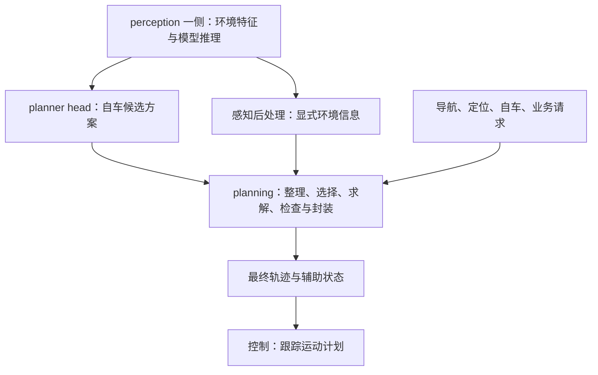
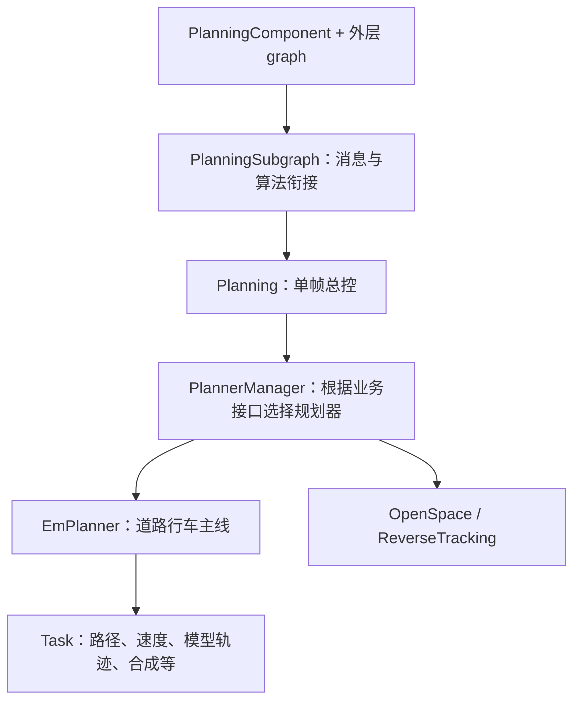

# 01 Planning 的职责：模型已经给轨迹，为什么还需要规划

> **这一篇讲什么**：从一次跟车或变道认识规划的职责，区分模型规划头、规划软件模块、规划器与任务。
>
> **读完你能回答**：planner head 和 planning 有什么区别？模型输出为什么还要处理？源码分成哪几层？
>
> **前置知识**：无需规划背景；可先读上级目录的 E2E 导读。

## 1. 先坐进车里：前车慢了，我们该怎么办

你以 15 m/s 行驶，前方有一辆 8 m/s 的慢车。左侧看起来有空位，但后方可能有车接近。此时需要连续回答四个问题：周围是什么情况、其他车可能怎样运动、自己的车准备怎么走、怎样操作方向盘和制动。

planning 负责其中的**自车运动方案及相关决策**。它接收环境、自车状态、导航、业务请求和模型建议，输出未来一段时间的自车轨迹及辅助状态。控制模块再跟踪轨迹，把运动目标转换成执行指令。

“输出轨迹”不只是画一条绕过慢车的曲线，还要说明什么时候到达哪里、车头朝向、速度、加速度等。否则，同一条线既能慢慢经过，也能危险地冲过去，控制无法仅凭曲线确定驾驶行为。

## 2. 模型与 planning 各自交付什么

| 角色 | 输入的典型形态 | 主要交付物 | 本例中的问题 |
|---|---|---|---|
| 感知与预测 | 传感器、模型特征 | 障碍物、道路、他车预测等 | 前车和后车在哪里，接下来可能去哪 |
| planner head | 环境特征、导航、自车及历史信息 | 自车候选参考线、轨迹、纵向序列、分数等，随模型版本变化 | 跟随或向左行驶，各自有哪些模型方案 |
| planning 软件 | 上述消息以及地图、业务和跨帧状态 | 最终 `ADCTrajectory`、响应、语义、事件等 | 在当前状态与配置下采用什么方案，如何衔接与处理 |
| 控制 | 最终轨迹、自车反馈 | 转向和纵向执行目标 | 怎样跟踪被选择的运动计划 |

planner head 是网络中的任务分支。“部署在 perception 中”描述软件位置，“具备规划能力”描述功能，两者可以同时成立。不要通过进程名判断其内部全部算法的职责。

*图 1-1 · 功能边界。模型方案与显式环境信息都可被 planning 使用；图不规定各分支的运行频率。*

## 3. 为什么还需要这层软件

**模型结果描述一种运动方案，车辆软件还需要把它放进当前执行条件中。** 这包括以下相互关联的工作。

先处理时间。模型预测基于较早的观测，而结果到达时车已经移动；planning 要对齐轨迹起点、观测时刻和自身状态。然后处理连续性：上一帧已经交给控制的轨迹不能被下一帧无缘无故打断。再处理候选、规则、车辆能力和场景，形成适合当前情况的轨迹。

在本仓库的行车路径上，模型候选进入 Frame 的处理，候选参考线执行任务并汇合，选择结果还会进入 iLQR 和速度后处理。最后经过轨迹生成、相关检查、业务状态与消息封装。具体分支取决于模式和配置，不能用“把模型点拟合一下”覆盖全部行为。

这些机制也不意味着模型错误一定会被纠正，或者检查能证明绝对安全。它们是有具体输入、约束和适用条件的软件过程，理解其边界才能正确分析行为。

## 4. 同一个 planner 单词，四个层次

| 名称 | 所在层 | 怎样辨认 |
|---|---|---|
| `PlanningComponent` | 集成与框架装配 | driver 中注册组件、传入参数和回调 |
| `Planning` | 算法总控 | `Process → RunOnce → InternalRun` 组织单帧工作 |
| `Planner` | 规划器接口 | `Plan(Frame*)`，派生出 Em、OpenSpace、ReverseTracking |
| `Task` | 规划器内部工序 | 在一个 Frame 和一个 ReferenceLineInfo 上执行某项工作 |

*图 1-2 · 软件层次。这是职责包含关系，不是每一帧都重建全部对象。*

`/planner/trajectory` 是 topic 名称，不能据此认定“网络头直接发布了最终轨迹”。它在 planning 的后处理和框架输出路径中被封装、送出。

## 5. 学完这一篇，再看代码应该抓住什么

看到 `Planning::Process`，把它当作一帧工作的主持人；看到 `Frame`，把它当作本帧的工作台；看到 `ReferenceLineInfo`，把它当作某个候选道路方案的资料夹；看到 `Task::Execute`，再问它正在变换哪份数据。

本系列后面将把这些类逐个落到具体例子。先记住职责边界，就不会误把“端到端模型”理解为“车上已经没有 planning 软件”，也不会误把所有 planning 代码理解为传统 DP/QP。

## 证据与延伸

以下链接固定到本系列分析的源码提交；行号指向关键实现，不代表整段行为只由这一行决定。

| 要核实的行为 | 源码入口 |
|---|---|
| 组件装配 | [driver/integration/components/planning_component.cc · `bool PlanningComponent::Init()`](https://code.deeproute.ai/deeproute-projects/public/driver/-/blob/eacec82b6662c3c8b2f26a6749e679ef11ce6218/integration/components/planning_component.cc#L56) |
| 单帧总控 | [planning/planning/planning_core.cpp · `bool Planning::Process(`](https://code.deeproute.ai/deeproute-org/pnc/planning/planning/-/blob/dd7cbf35a83fa1f5fb5dc078563235e671365327/planning/planning_core.cpp#L2238) |
| 规划器接口 | [planning/planning/planner/planner.h · `virtual bool Plan(Frame* frame)`](https://code.deeproute.ai/deeproute-org/pnc/planning/planning/-/blob/dd7cbf35a83fa1f5fb5dc078563235e671365327/planning/planner/planner.h#L25) |
| 选线后求解 | [planning/planning/planner/em_planner.cpp · `bool EmPlanner::PlanOnReferenceLine(Frame* frame)`](https://code.deeproute.ai/deeproute-org/pnc/planning/planning/-/blob/dd7cbf35a83fa1f5fb5dc078563235e671365327/planning/planner/em_planner.cpp#L341) |
| 最终轨迹消息 | [planning/planning/calculators/planning_post_process_calculator.cc · `output_msgs["/planner/trajectory"]`](https://code.deeproute.ai/deeproute-org/pnc/planning/planning/-/blob/dd7cbf35a83fa1f5fb5dc078563235e671365327/planning/calculators/planning_post_process_calculator.cc#L123) |

---

[返回 Planning 导读](./index.md) · [下一篇：02 先认识规划的语言：参考线、路径与轨迹](./02%20%E5%85%88%E8%AE%A4%E8%AF%86%E8%A7%84%E5%88%92%E7%9A%84%E8%AF%AD%E8%A8%80%EF%BC%9A%E5%8F%82%E8%80%83%E7%BA%BF%E3%80%81%E8%B7%AF%E5%BE%84%E4%B8%8E%E8%BD%A8%E8%BF%B9.md)
