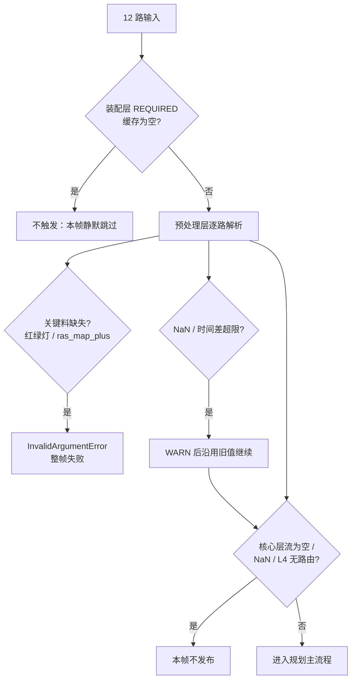

> **30 秒导读**：规划的"进料口与体检"：四样必需输入缺一不可，触发帧取最新、其余取同批。
> **本篇回答**：规划需要哪些输入？缺了会怎样？为什么 objects 取最新帧？
> **先修阅读**：《00 入门》§3 步骤 7~8；《Perception 05 输出》。

> **本篇概念速成块**（30 秒，读完再进正文不卡壳）：
> - **required**：点名必须到——装配时缓存为空，这一帧就不开工（详见 §2 人话版）。
> - **all_new**：迟到名单全收——自上次消费以来攒的消息一条不漏，老→新排队。
> - **optional**：有就拿没有拉倒——锦上添花型输入，缺了照常跑。
> - **TRIGGER**：发令枪——只有 /perception/objects 到达才触发规划；它与另外 4 路输入的先后顺序是感知侧 FrameDone 契约写死的（完整卡片见 [**公共 02 §6.1**](../00_公共基础文档/02%20模块配置与%20Topic%20数据流拓扑（C01%20-%20orinx）.md)）。
> - **AnyCalculator（planning_assemble_node）**：收发室大爷——攒齐触发+回边条件才把一帧料打包（按 topic 排序）送进生产线。
> - **FindFirst / FindLast**：一帧内同 topic 可能有多条（all_new 攒批），First＝最早、Last＝最新——代码里取哪头都是显式选择。
> - **硬校验两道门**：装配层 required 缓存空→本帧不触发；预处理层红绿灯/路网地图缺失→整帧报错（§5）。


> 分析对象：C01（orinx C01PT，L2_driving）Planning 组件的全部输入通道、Church 触发汇聚机制、`PlanningInputPreprocessCalculator` 逐路解析、时间戳对齐与有效性校验。  
> 术语首现加粗；**required（必须存在）、optional（可选）、all_new（全量新消息）** 为 jsonnet 通道类型。

---

## 1. 输入通道全景

**一句话结论**：规划输入 24 路，类型只有三档——1 路触发（required 的 /perception/objects）、2 路硬校验 required、其余多为 optional；/planner/context **不在**其中（它是自回灌，不是外部输入）。

**为什么输入校验值得单独一篇**：规划是「被动触发」的模块——感知不发枪它永不启动，而感知发布的契约（哪路先到、谁和谁同帧）全写在本篇；线上「规划不动了」的问题，十有八九最后查到的是「某路输入没到」而不是规划本身。先读懂进料口的规矩，排查问题才有下手处。

通道声明唯一来源：`/sandbox/driver/config/component/planning.jsonnet`（L20-150）。逐条列表如下：

| # | Topic | 消息类型 | jsonnet type | 流名（有 stream 字段时） | 备注 |
|-|-|-|-|-|-|
| 1 | `/perception/objects` | `deeproute.perception.PerceptionObstacles` | required | `perception__objects` | **TRIGGER 触发源** |
| 2 | `/perception/extra_objects` | `deeproute.perception.PerceptionObstacles` | optional | `perception__extra_objects` | 补充感知目标 |
| 3 | `/canbus/car_state` | `deeproute.common.VehicleState` | required | — | 底盘车状态（代码层不硬报错，见第 5 节） |
| 4 | `/perception/ras_map` | `deeproute.perception.RASMap` | **all_new** | `perception__ras_map` | 与基线"required"表述不符（差异） |
| 5 | `/perception/ras_map_parking` | `deeproute.perception.RASMap` | optional | `perception__ras_map_parking` | 泊车车道边界 |
| 6 | `/perception/traffic_lights_status` | `deeproute.perception.TrafficLightResponse` | required | `perception__traffic_lights_status` | 缺失直接报错 |
| 7 | `/planner/request` | `deeproute.planning.interface.PlanningRequest` | **all_new** | `planner__request` | 单请求事件 |
| 8 | `/planner/multi_requests` | `deeproute.planning.interface.PlanningRequests` | **all_new** | `planner__multi_requests` | 多请求事件 |
| 9 | `/map/ras_map_plus` | `deeproute.map.RASMapPlus` | required | — | 缺失直接报错 |
| 10 | `/visualizer/command` | `deeproute.visualizer.VisualizerCommand` | optional | — | 可视化指令 |
| 11 | `/blc/local_routing_info` | `dr.blc.BlcSpeedLimitInfo` | optional | — | BLC 限速/目的地 |
| 12 | `/blc/operation_status` | `dr.operationstatus.OperationStatus` | optional | — | 操作状态 |
| 13 | `/blc/vla_info` | `dr.blc.vlainfo.VlaStatusInfo` | optional | — | VLA 状态 |
| 14 | `/planner/trajectory_bag` | `deeproute.planning.ADCTrajectory` | optional | — | 回灌轨迹（开环校验用） |
| 15 | `/localization/matching_status` | `deeproute.localization.message.LidarMatchingMessage` | optional | — | 雷达匹配状态 |
| 16 | `/ddl/run_close_loop` | `deeproute.proto.ModuleStatus` | optional | — | 仿真闭环开关 |
| 17 | `/localization/pose` | `deeproute.drivers.gnss.Ins` | optional | — | 定位，覆盖车状态 |
| 18 | `/localization/global_routing_info` | `deeproute.localization.message.GlobalRoutingInfo` | optional | — | VPA 全局路由 |
| 19 | `/localization/local_map_link_data_event` | `deeproute.localization.event.LocalMapLinkdataEvent` | optional | `localization__local_map_link_data_event` | 局部地图联动事件 |
| 20 | `/map/fusion_map` | `deeproute.map.FusionSdMap` | optional | — | 融合高精地图 |
| 21 | `/map/sd_horizon_map` | `deeproute.map.SdHorizonMap` | optional | — | 视界地图 |
| 22 | `/vla/vla_output` | `deeproute.vla.vla_output.VlaOutput` | optional | — | VLA 模型输出 |
| 23 | `/perception/camera_obstacle` | `deeproute.perception.CameraObstacles` | optional | — | 相机障碍物 |
| 24 | `/perception_magic_carpet/objects` | `deeproute.perception.MagicCarpetPerception` | optional | `perception_magic_carpet__objects` | 魔毯感知 |

与基线第 2 条对比的差异：① `/perception/ras_map` 实为 `all_new` 非 required；② `/planner/request`、`/planner/multi_requests` 为 `all_new`；③ 基线未列出的 `/planner/trajectory_bag`、`/visualizer/command`、`/ddl/run_close_loop`、`/localization/global_routing_info` 也在输入列表中；④ `/planner/context`**不在**输入通道中（自回灌在子图内完成，见《00》篇附录）。

---

## 2. Church 触发与汇聚机制

**一句话结论**：规划图没有固定节拍——/perception/objects 一到就尝试触发（IMMEDIATE），由 AnyCalculator 检查「上一帧干完了没（回边）+ 有新触发消息没」，两条件都满足才装配下一帧。

**触发**：仅 `/perception/objects` 是触发通道；`trigger_policy: "IMMEDIATE"` 表示消息到达即尝试触发（planning.jsonnet L11-19）。

**汇聚**由 `AnyCalculator`（节点名 `planning_assemble_node`）完成：

> 文件路径：/sandbox/driver/config/component/planning_graph.cfg  
> 核心逻辑：
> 
> ```
> node {
>   name: "planning_assemble_node"
>   calculator: "AnyCalculator"
>   input_stream: "TRIGGER:0:perception__objects"
>   input_stream: "INPUT:0:perception__extra_objects"
>   ...（INPUT:1~7 共 8 路非触发输入）
>   input_stream: "FINISHED:planning_done"
>   input_stream_info: { tag_index: "FINISHED"  back_edge: true }
>   output_stream: "OUTPUT:planning_input"
>   executor: "planning_executor"
> }
> ```
> 
> 逻辑说明：TRIGGER 1 路 + INPUT 8 路；`FINISHED` 是 back edge（回边），连接 FrameDoneCalculator 的 `TRIGGER:planning_done` 输出，保证**上一帧未完成前不会开始下一帧装配**（防重入）。注意：INPUT 只挂了图 cfg 中声明 `input_stream` 的 9 个流；`/canbus/car_state`、`/localization/pose` 等 jsonnet 通道没有同名 `input_stream`，它们经框架注入的 `CHANNEL_CACHES`（`planning_channel_cache_ptr`）由 AnyCalculator 统一从通道缓存装配（推断：依据 any_calculator.cc 的 Assemble 遍历的是 `channel_caches_` 而非输入流，框架注入细节未验证）。

> 文件路径：/sandbox/platform/church/graph/calculators/any_calculator.cc  
> 函数名：AnyCalculator::Process() / Assemble()  
> 核心逻辑：
> 
> ```cpp
> if (!cc->Inputs().Tag(kFinishedTag).Value().IsEmpty()) {
>   prev_calc_finished_ = true;
> }
> if (prev_calc_finished_ && has_new_trigger_msg_) {
>   has_new_trigger_msg_ = false;
>   OnboardMessageConstPtrVector generated_input;
>   bool ret = Assemble(generated_input);
>   if (ret) {
>     prev_calc_finished_ = false;
>     SortOnboardMessage(generated_input);          // 排序后输出
>     cc->Outputs().Tag(kOutputTag)
>         .AddPacket(`MakePacket<OnboardMessageConstPtrVector>`(generated_input)
>                        .At(Timestamp(GenerateStreamTimestamp())));
> ```
> 
> 逻辑说明：`Assemble()` 按通道类型装配（any_calculator.cc:160-216）：
> 
> - `ALL_NEW`：取该通道自上次消费以来的**全部**未消费消息（老→新，L173-184）；
> - `REQUIRED`：取最新一条，**缓存为空则本次装配失败**（返回 false，L185-193）；
> - `OPTIONAL`：有新消息才取最新一条（L194-201）；
> - `NEAR`：直接 `MLOG(FATAL)` 不支持（L202-205）。  
> 装配结果按 topic 排序（`SortOnboardMessage`）后作为 `planning_input` 下发。若所有通道都无新消息（`assemble_indexes == prev_assemble_indexes_`），本次不触发（L210-212）。

**人话版**：把 Assemble 的四种通道类型想成工头点卯——ALL_NEW 是「把到岗名单全交上来」（老→新排队，一条不漏）；REQUIRED 是「关键工种必须到，缺人今天不开工」（缓存为空返回 false，本帧不触发，但不报错不报警）；OPTIONAL 是「来了就搭把手，没来不影响开工」；NEAR 是「这规矩我们不认」（直接 MLOG(FATAL)，本仓库无人使用）。注意 REQUIRED 的「失败」是静默跳帧——与 §3 预处理层缺料「整帧报错」是两种不同级别的惩罚。

---

## 3. PlanningInputPreprocessCalculator 逐路解析

**一句话结论**：预处理器把一包排序好的消息按 topic 逐条「拆快递」——必填的两路（红绿灯、路网地图）缺了就整帧退货，其余各取所需填进 PlanningFrameData。

**拆快递时的两个通用技巧**：§3.3 的 car_state/pose 融合用的是**最近邻配对**——在时间轴上找与定位时间戳最接近的车状态（时间对齐原理见 [**AI 字典·采样与插值**](../../../正典阁/技术栈/AI/采样与插值.md)，感知侧同款问题见公共 05 §3 FrameSync）；「先入缓存再按需取」是本篇反复出现的模式——车状态缓存 50 条、路网沿用上一帧，都是「上游频率与我不同，自己攒一个缓冲」的工程应对。

`planning_sub_graph.cfg` 中 `planning_input_node` 节点接收 `PLANNING_INPUT:planning_input`，`Process()` 把消息向量解析进 `PlanningFrameData`（定义见 `planning/planning/planning_api.h:51-79`：车状态、红绿灯响应、FrameContext、rasmap、感知目标、融合地图等成员）。

### 3.1 必须存在的输入：traffic_lights_status

> 文件路径：/sandbox/planning/planning/calculators/planning_input_preprocess_calculator.cc  
> 函数名：PlanningInputPreprocessCalculator::Process()  
> 核心逻辑：
> 
> ```cpp
> message = FindFirstMessage(input_msgs, "/perception/traffic_lights_status");
> if (message) {
>   outputs->tl_response_ = std::dynamic_pointer_cast<
>       const deeproute::perception::TrafficLightResponse>(
>       message->payload());
> } else {
>   MLOG(INFO)
>       << "perception/traffic_lights_status is required, but not found";
>   return absl::InvalidArgumentError(
>       "missing perception/traffic_lights_status");
> }
> ```
> 
> 逻辑说明（L209-219）：红绿灯响应缺失 → 本帧直接以 `InvalidArgumentError` 失败，后续 Calculator 不会执行。

### 3.2 required 的 ras_map_plus 同样硬校验

> 文件路径：/sandbox/planning/planning/calculators/planning_input_preprocess_calculator.cc  
> 函数名：PlanningInputPreprocessCalculator::Process()  
> 核心逻辑：
> 
> ```cpp
> message = FindFirstMessage(input_msgs, "/map/ras_map_plus");
> if (message) {
>   auto rasmap_plus_ptr =
>       std::dynamic_pointer_cast&lt;const deeproute::map::RASMapPlus>(
>           message->payload());
>   outputs->rasmap_plus_ =
>       std::make_shared&lt;deeproute::map::RASMapPlus>(*rasmap_plus_ptr);
> } else {
>   MLOG(INFO) << "map/ras_map_plus is required, but not found";
>   return absl::InvalidArgumentError("missing map/ras_map_plus");
> }
> ```
> 
> 逻辑说明（L629-639）：`/map/ras_map_plus`（**RASMapPlus，路网增强地图**）缺失同样整帧报错；成功时写入 `outputs->rasmap_plus_`，下游以 `has_new_rasmap()` 判断（planning_api.h:78）。

### 3.3 car_state / pose：缓存 + 最近邻融合

> 文件路径：/sandbox/planning/planning/calculators/planning_input_preprocess_calculator.cc  
> 函数名：PlanningInputPreprocessCalculator::Process()  
> 核心逻辑：
> 
> ```cpp
> deeproute::common::VehicleState temp_car_state;
> message = FindFirstMessage(input_msgs, "/canbus/car_state");
> if (message) {
>   temp_car_state.CopyFrom(*message->payload());
> }
> 
> // we have MAYBE multiple car_state inputs
> auto [car_state_first_index, car_state_last_index] =
>     FindFirstAndLastMessageIndex(input_msgs, "/canbus/car_state");
> if (car_state_first_index != (size_t)-1) {
>   for (size_t i = car_state_first_index; i <= car_state_last_index; ++i) {
>     auto onboard_msg = input_msgs[i];
>     auto vs_msg_ptr =
>         std::dynamic_pointer_cast&lt;const deeproute::common::VehicleState>(
>             onboard_msg->payload());
>     // note: if  repeated key, `emplace` will fail and do nothing
>     cached_vehicle_state_.emplace(vs_msg_ptr->timestamp(), *vs_msg_ptr);
>   }
> }
> 
> constexpr int kMaxCacheVsNum = 50;
> if (cached_vehicle_state_.size() > kMaxCacheVsNum) {
>   cached_vehicle_state_.erase(cached_vehicle_state_.begin());
> }
> ```
> 
> 逻辑说明（L221-244）：一帧装配内可能有多条 car_state（ALL_NEW/装配窗口导致），全部按 `timestamp` 入缓存 map（去重），最多保留 50 条。

> 文件路径：/sandbox/planning/planning/calculators/planning_input_preprocess_calculator.cc  
> 函数名：PlanningInputPreprocessCalculator::Process()  
> 核心逻辑：
> 
> ```cpp
> message = FindFirstMessage(input_msgs, "/localization/pose");
> if (message) {
>   auto ins_msg_ptr =
>       std::dynamic_pointer_cast&lt;const deeproute::drivers::gnss::Ins>(
>           message->payload());
>   const auto ins_timestamp =
>       `static_cast<uint64_t>`(ins_msg_ptr->measurement_time());
>   if (GetNearestCarStateElement(ins_timestamp, &temp_car_state)) {
>     OverwritePartCarStateWithInsPose(*ins_msg_ptr, &temp_car_state);
>     if (!IntersectionProcessorUtil::CheckVehicleStateNan(temp_car_state)) {
>       vehicle_state_.CopyFrom(temp_car_state);
>       if (!enable_simulation_closeloop_) {
>         frame_context_->set_speed_from_chassis(vehicle_state_.speed());
>         frame_context_->set_speed_from_local(
>             vehicle_state_.velocity_flu().x());
>       }
>     } else {
>       MLOG(WARN) << "[planning] WARN: skip overwrite vehicle state!!!";
>     }
>   }
> } else if (!IntersectionProcessorUtil::CheckVehicleStateNan(temp_car_state)) {
>   vehicle_state_.CopyFrom(temp_car_state);   // 无 pose 时直接用车状态
>   ...
> }
> AlignVehicleStateWithGearInfo(&vehicle_state_);
> ```
> 
> 逻辑说明（L246-278）：有 `/localization/pose` 时，从缓存中找**时间最近**的 car_state，用 Ins 位姿/速度/加速度覆盖部分字段（`OverwritePartCarStateWithInsPose`，L699-711），并写 `localization_timestamp`；NaN 检查失败则放弃覆盖。无 pose 时退化为直接用底盘 car_state。最后按挡位修正速度符号（`AlignVehicleStateWithGearInfo`，倒挡 R 时 x 速度/加速度取反，L679-697）。

### 3.4 ras_map：多帧缓存；ras_map_parking：单条直取

> 文件路径：/sandbox/planning/planning/calculators/planning_input_preprocess_calculator.cc  
> 函数名：PlanningInputPreprocessCalculator::Process()  
> 核心逻辑：
> 
> ```cpp
> auto [rasmap_first_index, rasmap_last_index] =
>     FindFirstAndLastMessageIndex(input_msgs, "/perception/ras_map");
> if (rasmap_first_index != (size_t)-1) {
>   for (size_t i = rasmap_first_index; i <= rasmap_last_index; ++i) {
>     message = input_msgs[i];
>     auto rasmap =
>         std::dynamic_pointer_cast&lt;const deeproute::perception::RASMap>(
>             message->payload());
>     cached_rasmap_->emplace(
>         `static_cast<uint64_t>`(rasmap->time_measurement()), *rasmap);
>     constexpr int kMaxCacheRasmapNum = 10;
>     if (cached_rasmap_->size() >= kMaxCacheRasmapNum) {
>       // ordered map erase early one
>       cached_rasmap_->erase(cached_rasmap_->begin());
>     }
>   }
> }
> 
> message = FindFirstMessage(input_msgs, "/perception/ras_map_parking");
> if (message) {
>   auto ras_map_parking_ptr = ...;
>   frame_context_->mutable_parking_lanes()->CopyFrom(
>       ras_map_parking_ptr->boundary());
>   frame_context_->mutable_vpa_perception_lanes()->CopyFrom(
>       ras_map_parking_ptr->lanes());
>   frame_context_->mutable_vpa_road_polygons()->CopyFrom(
>       ras_map_parking_ptr->road_polygons());
> }
> ```
> 
> 逻辑说明（L575-604）：`/perception/ras_map` 按 `time_measurement` 入有序缓存，最多 10 条（老的先淘汰），供下游按时间取用；`/perception/ras_map_parking` 直接取第一条，其边界/车道/路面多边形写入 FrameContext 的泊车字段。

### 3.5 其余通道速览（同函数）

- `/perception/objects`：`FindLastMessage` 取**最新**一条 + `EnsureNestedFromFlat` 扁平转嵌套兜底（L561-566）。
- `/perception/extra_objects`：`FindFirstMessage` 取第一条 + 同样兜底（L568-573）。
- `/planner/request`：`FindFirstAndLastMessageIndex` 区间全部入 `cached_planner_request_` 队列（L385-396），每帧取队首填入 `frame_context_->hpi_data().planning_request()`（L432-437）；另有 QuickReq 快速握手丢弃可忽略请求的逻辑（L398-450）。
- `/planner/multi_requests`：`FindLastMessage` 取最新（L555-559）。
- `/map/fusion_map`、`/map/sd_horizon_map`、`/vla/vla_output`、`/perception/camera_obstacle`：存在即 CopyFrom 进 FrameContext/成员（L358-376）。
- `/blc/local_routing_info`：存在则更新限速并写 FrameContext；缺失时若车速 ≥15kph 且连续 3 帧丢失则**保持当前速度作为限速**（L281-337）。
- `/planner/context`：`FindFirstMessage`（L163），存在则按 `plan_with_context` 策略恢复上一帧上下文——该消息来自**子图内回边**而非外部订阅（见《05》篇第 6 节）。
- `/localization/matching_status`、`/visualizer/command`、`/perception_magic_carpet/objects`、`/localization/local_map_link_data_event`：存在即取（L378-383、L613-652）。

---

## 4. 时间戳对齐与帧匹配

**一句话结论**：规划输入侧只有一个显式对齐点——定位位姿与车状态按「时间最近、容差 0.5s」配对；其余通道靠「装配窗口内取第一条/最新一条」隐式对齐。

### 4.1 FindFirstMessage 的语义：按 topic 二分取第一条

> 文件路径：/sandbox/platform/church/cache/cache_helper.cc  
> 函数名：FindFirstMessage() / FindFirstMessageIndex()  
> 核心逻辑：
> 
> ```cpp
> OnboardMessageConstPtr FindFirstMessage(
>     const std::vector&lt;OnboardMessageConstPtr>& inputs,
>     const std::string& topic_name) {
>   size_t index = FindFirstMessageIndex(inputs, topic_name);
>   return (index != (size_t)-1) ? inputs[index] : nullptr;
> }
> 
> size_t FindFirstMessageIndex(const std::vector&lt;OnboardMessageConstPtr>& inputs,
>                              const std::string& topic_name) {
>   // BinarySearch() will return first matched element
>   auto iter = BinarySearch(
>       inputs.begin(), inputs.end(), topic_name,
>       [](const OnboardMessageConstPtr& msg) -> const std::string& {
>         return msg->topic();
>       },
>       [](const std::string& x, const std::string& y) -> bool { return x < y; });
>   return (iter != inputs.end()) ? std::distance(inputs.begin(), iter)
>                                 : (size_t)-1;
> }
> ```
> 
> 逻辑说明：装配输出 `input_msgs` 已被 `SortOnboardMessage` 按 **topic 字典序**排序（any_calculator.cc:126）。`FindFirstMessage` 用二分查找返回该 topic 的**第一条**消息——同一 topic 在一帧内出现多条时（ALL_NEW 通道），"第一条"即**时间最早**的一条（Assemble 按 old→new 追加）。对应地，`FindLastMessage` 取该 topic 最后一条=最新一条，`FindFirstAndLastMessageIndex` 返回区间索引对。**因此 planner 车辆状态/请求取"最早"还是"最新"是显式选择，不是随机结果。**

### 4.2 车状态与定位的时间对齐

见 3.3：`GetNearestCarStateElement`（L713-746）在缓存 map 中遍历取 `|ins_timestamp - vs_timestamp|` 最小者，容差 `kTimeDiffTolerance = 500000`（微秒，即 **0.5 s**），超差则匹配失败并打 WARN `[planning] Fail to match vs state with ins timestamp`。这是 Planning 输入侧唯一的显式时间戳对齐逻辑；其余通道以"装配窗口内第一条/最新一条"隐式对齐（推断：跨通道不做更细粒度的时间戳插值，未发现其他对齐代码）。

### 4.3 帧的时间戳基准

每帧开始记录 `planning_start_mono_time`（单调时钟，L153-160），并通过 `cc->InputTimestamp()`（AnyCalculator 生成的流时间戳）在图内传递；输出侧 `/planner/trajectory` 的 `timestamp` 字段在发布阶段由 DataPlane 时间填充（见《05》篇）。

---

## 5. 有效性校验汇总

**一句话结论**：校验分两级、惩罚分轻重——装配层缺料静默跳帧（不触发），预处理层缺关键料整帧报错，其余异常打 WARN 后带旧值继续跑：宁可慢一点也不裸奔。

| 层级 | 校验 | 代码证据 | 失败行为 |
|-|-|-|-|
| 装配层（AnyCalculator） | REQUIRED 通道缓存为空 | any_calculator.cc:185-193 | 返回 false，不产生 planning_input（本帧不触发） |
| 预处理层 | `/perception/traffic_lights_status` 缺失 | preprocess L209-219 | `InvalidArgumentError`，整帧失败 |
| 预处理层 | `/map/ras_map_plus` 缺失 | preprocess L629-639 | `InvalidArgumentError`，整帧失败 |
| 预处理层 | car_state NaN 检查 | `CheckVehicleStateNan`（L257/269） | 跳过覆盖/保留旧值，打 WARN |
| 预处理层 | 定位-car_state 时间差 | `kTimeDiffTolerance=500000us`（L732） | 匹配失败，打 WARN，不覆盖 |
| 核心计算层 | TRAJECTORY/LOCAL_ROUTING/MAP_MSG/ROAD_MASK_DECODER/PLANNING_FRAME 流为空 | planning_core_calculator.cc:95-109 | `InvalidArgumentError` |
| 核心规划层 | 输入验证 & L4 无路由 | `ValidateAndPreprocessInputs`、`CheckPlannerAndRouting`（planning_core.cpp:1334/93-126） | return false，本帧不发布 |

说明：`/canbus/car_state` 虽为 jsonnet required（框架装配层会保证有消息才触发），但**代码层**对其缺失没有硬报错——`FindFirstMessage` 返回空时直接使用 `temp_car_state` 的默认值继续走（L221-225 无 else 分支），依赖后续 NaN/时间差检查兜底。**推断**：这是框架 required 语义与代码防御的双保险设计。



**图 5-1 · 规划输入有效性校验流水线（装配→预处理→核心三层）**（B 是静默跳帧层，D/E 是硬校验层，F/G 是软告警层）

**读图提示**：① 三层校验惩罚分轻重：装配层不触发、预处理层硬报错、NaN/时间差只告警带旧值继续；② 红绿灯与 ras_map_plus 是仅有的两个代码层硬校验通道（required 四件套的另外两个靠框架保证）；③ 所有失败出口都不产生轨迹——规划侧"宁可不跑，不带病跑"。

---

## 6. adapter / FactoryCenter 历史体系（onboard 未启用）

**一句话结论**：ROS 时代的历史数据接入方案，车端链路完全不经过——读代码遇到 adapter/ 直接当「古董展厅」看，别顺着调用。

`planning/planning/adapter/` 下存在一套基于 ROS node handler 的**适配器（Adapter）**体系，是历史数据接入方案：

> 文件路径：/sandbox/planning/planning/adapter/adapter_center.h  
> 函数名：REGISTER_ADAPTER 宏 / class FactoryCenter  
> 核心逻辑：
> 
> ```cpp
> #define REGISTER_ADAPTER(name)                                                 \
>  public:                                                                       \
>   static void Enable##name(const std::string& name, const AdapterMode mode) {  \
>     GetInstance()->InternalEnable##name(name, mode);                           \
>   }                                                                            \
>   ...
> class FactoryCenter {
>  public:
>   static void Init(std::map&lt;int, std::string>& node2topic);
>   enum AdapterCode {
>     PerceptionObjects,
>     PerceptionObjectsPub,
>     VehicleStatePub,
>     ...
> ```
> 
> 逻辑说明：`REGISTER_ADAPTER` 宏为每个 topic 生成 `Enable/Publish/Get/Dump` 静态方法；`AdapterMode`（RECEIVE_ONLY/PUBLISH_ONLY 等，L12-17）表明其订阅/发布语义，内部依赖 `node_handler_`（ROS 风格句柄，L42）。`adapter_center.h` 共声明 50+ 适配器枚举与宏展开（当前文件 225 行）。

onboard 是否启用：**未启用**。证据：全 planning 仓库中 `FactoryCenter` 的调用点仅有 3 处——

- `planning/planning/sim_planning_interface/sim_main_start.cpp:565-568`（`using ACode = adapter::FactoryCenter::AdapterCode; ... FactoryCenter::Init(node2topic)`，仿真入口）；
- `planning/planning/planning_debug/debug_test.cpp:76-81`（调试测试）；
- `planning/planning/visualizer/rviz_visualizer.cpp:197/285/6694`（RViz 可视化发布）。

车端数据链路（见第 2、3 节）完全不经过 FactoryCenter，而是 `jsonnet 声明 → CHANNEL_CACHES → AnyCalculator → PlanningInputPreprocessCalculator`。差异说明：基线第 5 条"历史 adapter::FactoryCenter 50+，onboard 未启用，仅 sim/debug"与代码一致。

---

## 7. FAQ 与自测

**Q1（新手误解）：/planner/context 是规划订阅的外部输入吗？要在 jsonnet 里声明吗？**
不是。§1 的 24 路输入通道表里没有 /planner/context——它不在 jsonnet 输入通道中，而是**规划子图内回边自回灌**：上一帧的规划上下文经子图内部流回到下一帧（§1 差异④、§3.5），FindFirstMessage 找到的是子图内部传递的消息，不是从中间件订阅的。

**Q2：required 通道缺了消息，规划会崩吗？会报警吗？**
分两层：框架装配层（AnyCalculator）里 REQUIRED 缓存为空→本次装配失败，**本帧静默不触发**（无报错日志，§2 人话版）；预处理层代码硬校验的是 /perception/traffic_lights_status 与 /map/ras_map_plus，缺失→`InvalidArgumentError` **整帧失败**（§3.1/3.2）。另注意 /canbus/car_state 虽声明 required，代码层缺失并不硬报错，靠 NaN/时间差检查兜底（§5 说明）。

**Q3：为什么 /perception/objects 取最新一条，/perception/extra_objects 却取第一条？**
显式选择而非随意：objects 是触发源，规划要基于**最新**感知结论，故 FindLastMessage；extra_objects 是补充料，取同批装配窗口的第一条即可与触发帧同源（§3.5）。同一 topic 一帧内多条时 First＝最早、Last＝最新（§4.1）。

**Q4：adapter/FactoryCenter 那 50+ 适配器什么时候启用？**
车端永不启用。全仓调用点仅 3 处，全在仿真/调试/RViz 可视化路径（§6）；车端数据走「jsonnet → CHANNEL_CACHES → AnyCalculator → 预处理」这条新链路。

**自测**（答案在缩进行里）：
1. Assemble 的四种通道类型各自的装配语义是什么？
    答：ALL_NEW 取全部未消费消息（老→新）；REQUIRED 取最新、缓存空则装配失败；OPTIONAL 有新消息才取最新；NEAR 直接 MLOG(FATAL) 不支持（§2）。
2. 定位位姿与车状态怎么对齐？容差多大？
    答：在 car_state 缓存（≤50 条）中取与 ins 时间戳差最小者，容差 kTimeDiffTolerance=500000 微秒即 0.5s，超差打 WARN 不覆盖（§3.3、§4.2）。
3. AnyCalculator 的 FINISHED 回边起什么作用？
    答：防重入——上一帧没干完（planning_done 未到）时即使新触发消息到达也不开始下一帧装配（§2）。

---

## 附：未验证/推断项

1. AnyCalculator 的 `CHANNEL_CACHES` 等 side packet 由框架注入的具体实现（`planning_channel_cache_ptr` 生成逻辑）未逐行验证。
2. "input_msgs 按 topic 排序后同 topic 按时间升序"依据是 Assemble 的 old→new 追加顺序与 `SortOnboardMessage` 的排序键（topic）；`SortOnboardMessage` 是否还带次级时间排序键未验证（不改变"First=最早"的结论成立性，标注推断）。
3. jsonnet required 通道在框架装配层的具体重试/告警行为未验证。
