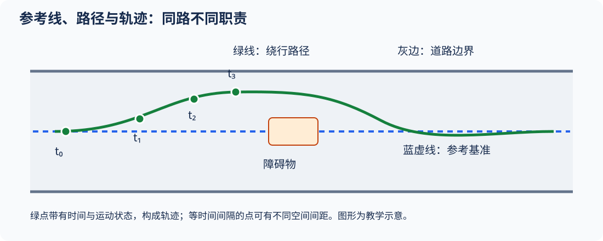
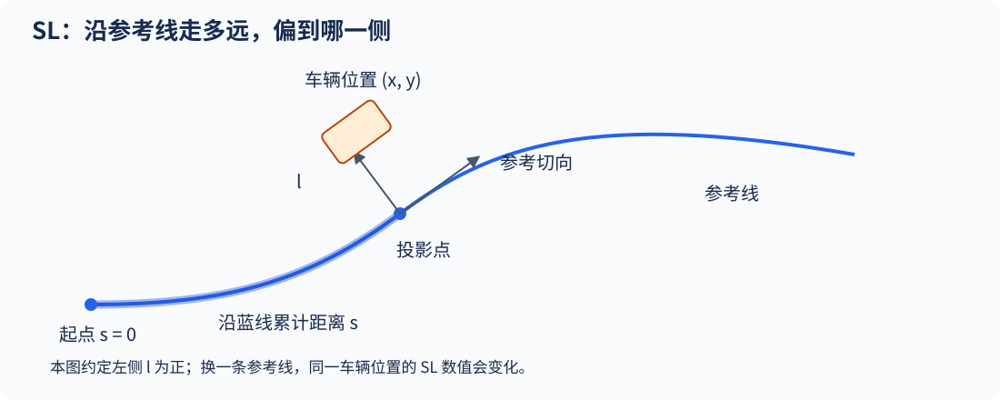
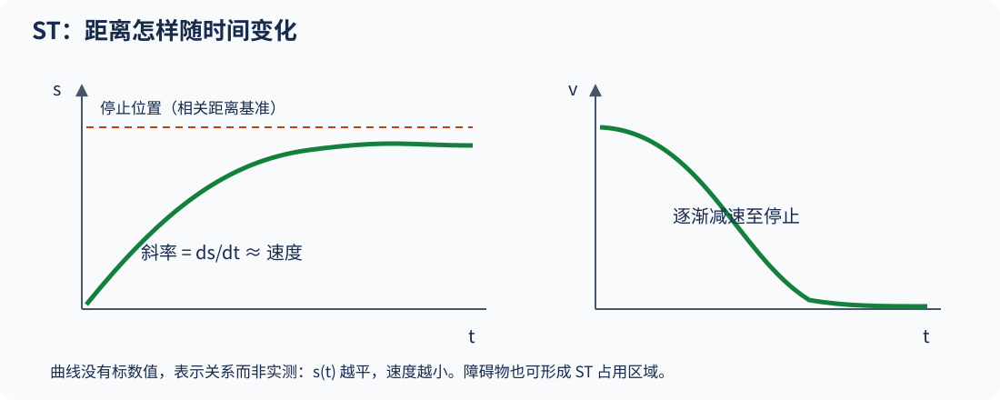

# 02 先认识规划的语言：参考线、路径与轨迹

> **这一篇讲什么**：用道路与时间表解释参考线、路径、轨迹，以及 XY、SL、ST、航向、曲率和 jerk。
>
> **读完你能回答**：参考线是不是路径？SL 和 ST 有什么区别？路径怎样变成轨迹？
>
> **前置知识**：第 01 篇；只需知道坐标、距离和时间。

## 1. 同一条道路上有四种不同的线

**车道线描述道路，参考线提供基准，路径表达行驶几何，轨迹增加时间安排。** 它们有时形状接近，却不是同一种数据。

想象道路中央有一个障碍物。道路上的白色标线不会因为它而移动；规划可以保留道路走向作为参考线，生成向左偏出的绕行路径；然后决定先减速、再绕行，得到轨迹。

*图 2-1 · 蓝色虚线是参考基准，绿色曲线是示意路径，绿点表示按时间取出的轨迹位置。点间空间距离变化，对应不同速度；这些是教学图形，不是算法实跑结果。*

| 词 | 回答什么 | 不包含或不保证什么 |
|---|---|---|
| 车道边界/车道线 | 道路怎样划分 | 不直接给自车时间表 |
| 参考线 reference line | 沿什么基准前进和衡量偏移 | 不必是最后执行路径，也不必严格等于车道中心 |
| 路径 path | 经过哪些空间位置 | 单独的几何路径没有完整时间安排 |
| 轨迹 trajectory | 什么时候到哪里、朝向和运动状态怎样 | 仍需控制跟踪，不是执行器命令 |

从几何意义上讲，参考线是一种曲线或路径；“参考”说明其用途。模型也能预测参考线，转弯或变道参考线可以跨越当前车道，因此不能把它定义成“永远在本车道正中央的一条线”。

## 2. XY 与 SL：地图坐标和沿路坐标

在地图平面，位置写成 `(x,y)`。但弯道里描述“前方 30 米、左偏半米”，沿道路说更方便。选定参考线后，把位置投影到曲线上，就得到一套沿路坐标：

- `s`：沿这条参考线累计的距离。
- `l`：相对参考线的横向偏移，符号按实现约定；本系列图例用左正右负。

*图 2-2 · 蓝线上的投影点确定 s，投影点到车辆的位置偏移表示 l。参考线一旦改变，同一物理位置的 SL 数值也会改变。*

例如车辆在 `(s=30 m,l=0.5 m)`，意思是沿当前基准到 30 米处，再向左偏半米。它不表示全球地图的 x=30、y=0.5。规划中的 `XYToSL` 和 `SLToXY` 就负责这类转换，实际实现还要处理曲线离散、投影范围与有效性。

同一个字母 `s` 还会出现在路径数据中，表示**沿那条路径**的累计长度。读字段时必须问“相对哪条线、哪个原点”。不要把参考线里程、路径里程和消息中的纵向位移无条件当成同一个数。

## 3. ST：把移动障碍物放到时间里

**SL 图主要看空间，ST 图看沿路径前进的距离如何随时间变化。** ST 图的横轴是时间 `t`，纵轴是纵向距离 `s`，并不是车辆行驶的道路俯视图。

一辆慢车在一秒后占据前方某段距离，第二秒又向前挪一些；把每一时刻的占据区连起来，就是一条随时间变化的区域。自车速度方案形成 `s(t)` 曲线，规划要研究它与占据区域的关系，再结合车辆尺寸、预测和安全间距等条件处理。

*图 2-3 · 以停车为例：左图绿线是逐渐趋平的 s(t)，橙色虚线表示停止位置；右图速度逐渐降至零。左图曲线的斜率对应纵向速度。障碍物占据区可以另外画在 ST 图上，本图只解释自车距离与速度的关系。*

## 4. 从路径到轨迹：一次“按距离查位置”

设路径写成 `P(s)`，速度规划给出 `s(t)`。两者合成为：

`p(t) = P(s(t))`

这表示：先问“时刻 t 应走到多远”，再去路径上查这个距离对应的位置，**不是把路径坐标和速度数值相乘**。

例如 t=1 s 时 `s=8 m`，就取路径第 8 米处的位置；t=2 s 时 `s=14 m`，就取第 14 米处的位置。速度方案不同，同一路径得到的轨迹也不同。仓库的合成实现会按时间读取 SpeedData，再计算对应 PathPoint 并填写 TrajectoryPoint。

## 5. 看懂轨迹点上的运动量

| 量 | 直觉 | 常见单位/关系 |
|---|---|---|
| `theta` 航向 | 车头朝哪边 | 弧度；应注意角度跨越 ±π 的连续性 |
| `kappa` 曲率 | 路径弯得多急 | 1/m；圆弧曲率绝对值为 1/半径 |
| `v` 速度 | 每秒走多远 | m/s |
| `a` 加速度 | 速度变化多快 | m/s² |
| jerk | 加速度变化多快 | m/s³；影响顿挫感 |
| `relative_time` | 相对轨迹时间基准的时刻 | 单位由具体消息字段约定 |

曲率与转向有关，但不等于方向盘转角。简化自行车模型中，前轮转角 δ 与轴距 L 满足近似关系 `kappa=tan(δ)/L`；方向盘还涉及转向传动比和实际车辆模型。

模型轨迹每 0.1 秒一个点，只说明它内部的预测采样间隔。planning 的更新周期、最终轨迹点间隔、控制周期分别由对应实现和配置决定，不能从这一数字互相推导。

## 证据与延伸

以下链接固定到本系列分析的源码提交；行号指向关键实现，不代表整段行为只由这一行决定。

| 要核实的行为 | 源码入口 |
|---|---|
| 曲线与坐标基础 | [planning/planning/common/reference_line/reference_line.h · `class ReferenceLine`](https://code.deeproute.ai/deeproute-org/pnc/planning/planning/-/blob/dd7cbf35a83fa1f5fb5dc078563235e671365327/planning/common/reference_line/reference_line.h#L187) |
| 路径速度合成 | [planning/planning/tasks/combine_path_speed/combine_path_speed.cpp · `bool CombinePathSpeedOptimizer::CombinePathAndSpeedProfile(`](https://code.deeproute.ai/deeproute-org/pnc/planning/planning/-/blob/dd7cbf35a83fa1f5fb5dc078563235e671365327/planning/tasks/combine_path_speed/combine_path_speed.cpp#L14) |
| 按时间读取纵向数据 | [planning/planning/tasks/combine_path_speed/combine_path_speed.cpp · `speed_data.EvaluateByTime(cur_rel_time`](https://code.deeproute.ai/deeproute-org/pnc/planning/planning/-/blob/dd7cbf35a83fa1f5fb5dc078563235e671365327/planning/tasks/combine_path_speed/combine_path_speed.cpp#L522) |
| 模型点的相对时间 | [perception/perception/calculators/planning_head_output_calculator.cc · `lon_pos_point->set_relative_time(kTimeStepUs * (t + 1))`](https://code.deeproute.ai/deeproute-org/perception/onboard/perception/-/blob/dc6cd752e2738ec283870f6a3899137a399f7836/perception/calculators/planning_head_output_calculator.cc#L639) |
| 曲率与车辆限制 | [planning/planning/common/trajectory/model_combined_trajectory.cpp · `const double kappa_steer =`](https://code.deeproute.ai/deeproute-org/pnc/planning/planning/-/blob/dd7cbf35a83fa1f5fb5dc078563235e671365327/planning/common/trajectory/model_combined_trajectory.cpp#L4557) |

---

[返回 Planning 导读](./index.md) · [上一篇：01 Planning 的职责：模型已经给轨迹，为什么还需要规划](./01%20Planning%20%E7%9A%84%E8%81%8C%E8%B4%A3%EF%BC%9A%E6%A8%A1%E5%9E%8B%E5%B7%B2%E7%BB%8F%E7%BB%99%E8%BD%A8%E8%BF%B9%EF%BC%8C%E4%B8%BA%E4%BB%80%E4%B9%88%E8%BF%98%E9%9C%80%E8%A6%81%E8%A7%84%E5%88%92.md) · [下一篇：03 一帧全景：从触发到最终发布](./03%20%E4%B8%80%E5%B8%A7%E5%85%A8%E6%99%AF%EF%BC%9A%E4%BB%8E%E8%A7%A6%E5%8F%91%E5%88%B0%E6%9C%80%E7%BB%88%E5%8F%91%E5%B8%83.md)
