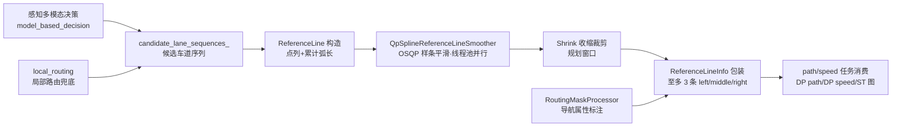

> **30 秒导读**："候选车道中心线"：参考线怎么生成、平滑、注入导航属性，一切规划都在它上面进行。
> **本篇回答**：参考线从哪来？最多几条？变道时怎么选？
> **先修阅读**：《00 入门》§3 步骤 8 的导航类比。

> **本篇概念速成块**（30 秒，读完再进正文不卡壳）：
> - **参考线**：规划的空间骨架——一切 path/speed 任务都在它上面跑（完整卡片见 [**参考线 ReferenceLine**（Planning/00 §3）](../00%20Planning%20模块架构总览.md)；本篇讲生产线）。
> - **来源二分**：C01 行车任务参考线来自 ras_map_plus 多模态候选（感知说了算），local_routing 只是兜底。
> - **ReferenceLine vs ReferenceLineInfo**：前者纯几何（点列+弧长），后者是"参考线+规划中间结果"容器（门面，完整卡片见 [**Planning/00 §2**](../00%20Planning%20模块架构总览.md)）。
> - **QpSpline 唯一启用**：OSQP 样条平滑；advance_discrete 平滑器整体 #ifdef 0 死代码。
> - **并行平滑**：每帧重建平滑器、线程池按段并行、命中缓存复用上帧。
> - **≤3 条上限**：对应 left/middle/right 三线互指拓扑，超限整帧失败。
> - **RoutingMaskProcessor**：导航属性标注（通行性/优先级/公交道），E2E 框架下按 road mask 判可通行。


> 分析对象：`/sandbox/planning/planning/reference_line_info/`（45 文件），关联根级文件 `frame/frame_reference_line.cpp`、`planning_core.cpp`  
> 代码分支：perception/planning/driver @ Stable_Master_4.0_new（平台侧 platform/church 在 dev_master，数据结构/通道命名可能存在差异，文中涉及处已标注）  
> 结论均基于当前检出代码，标注"推断"的为推理结论，标注"未验证"的为本次未查证项。

## 1. 子模块定位与职责

**一句话结论**：参考线子模块是规划的空间骨架生产线——生成（多模态候选→QP 平滑）、标注（导航属性）、包装（ReferenceLineInfo）三步，不做轨迹优化。

**为什么规划需要一条参考线**：规划要在「沿路走」的坐标系里做，而不是在_xy 直角坐标里盲搜——有了参考线，才有「往前 50 米、往左 0.3 米」（Frenet s-l）这种直觉化的表达，path/speed 任务才能各自独立求解（path 在 s-l 里选横向偏移，speed 在时间轴上拉速度曲线）。参考线不平滑，下游切出来的轨迹也会跟着抖——所以本模块最重的活是 QP 样条平滑，这也是理解后续 path 任务的几何前提。

**参考线**（Reference Line，规划所用的几何参考坐标线，是 Frenet 坐标系 **s-l 分解**的基线，完整卡片见 [**Planning/00 §3**](../00%20Planning%20模块架构总览.md)）是 Planning 中 path/speed 任务的公共输入载体。本子模块回答三个问题：参考线从哪来、如何变成平滑可用的几何线、如何包装成规划任务可消费的 `ReferenceLineInfo`（完整卡片见 [**Planning/00 §2**](../00%20Planning%20模块架构总览.md)）。

### 1.1 参考线从哪来（以代码为准）

基线任务提示了三种可能来源：P-map / ras_map_plus / 全局路由。代码证据显示来源按 `task_type`**二分**：

- **C01 当前任务（task_type=L2_driving / L2_driving_vision）**：参考线候选来自 **ras_map_plus（P-map，感知语义地图）+ 感知输出的多模态车道概率**。`ReferenceLineProvider::UpdateLocalRouting()` 对 L2_driving 类任务调用 `GetCandidateRefLines()`，从 `perception_obstacles.model_based_decision()`（感知模型输出的多模态决策，含 `junction_reference_line()` 与 `multi_modal_probs()`）与 `topo_info`（拓扑信息）构建 `candidate_lane_sequences_`（候选车道序列），之后 `GetRouteSegmentsFromRasMap()` 直接从 ras_map 候选生成 RouteSegments——**不走**`local_routing` 逐车道拼接。
- **其他任务类型（L2_parking 等）**：走 `local_routing_.lane_routing_info`（局部路由信息，来自全局路由下游）逐 `LaneSegment` 拼接 `RouteSegments`。

> 文件路径：/sandbox/planning/planning/reference_line_info/reference_line_provider.cpp  
> 函数名：ReferenceLineProvider::GetRouteSegmentsFromLocalRouting()  
> 核心逻辑：
> 
> ```cpp
> // L2_driving 任务下优先走 ras_map 候选车道搜索
> bool ReferenceLineProvider::GetRouteSegmentsFromLocalRouting(
>     std::list&lt;ReferenceLine>* reference_lines,
>     std::list&lt;routing::RouteSegments>* segments) {
>   const auto& task_type = ...;  // /task/task_type，C01 为 L2_driving
>   if (task_type == "L2_driving" || task_type == "L2_driving_vision") {
>     if (GetRouteSegmentsFromRasMap(segments)) {
>       return true;
>     }
>     // ras_map 候选失败才回退 local_routing 拼接
>   }
>   // 非 L2_driving：逐 LaneSegment 拼接 RouteSegments
>   // 拼接过程依赖 semantic_map_server_ptr->ras_map_plus().id() 车道标定
>   ...
> }
> ```
> 
> 逻辑说明：`/task/task_type` 在运行期决定参考线数据源。C01（orinx 平台 C01PT，task_type=L2_driving）命中 `GetRouteSegmentsFromRasMap` 分支，即基线所述"P-map/ras_map_plus 来源"；全局路由（LocalRouting）在该分支下仅作为兜底回退。注意 `GetRouteSegmentsFromLocalRouting` 内部拼接仍需 `ras_map_plus` 提供车道 ID 标定，因此 ras_map_plus 在两种分支下都是底座。

### 1.2 子模块职责边界

- **生成**：候选车道序列选择 → 几何线构造（`ReferenceLine`）→ 平滑（QP 样条）→ 收缩裁剪。
- **标注**：导航/路由属性注入（`RoutingMaskProcessor`：通行性、优先级、剩余里程、公交道等）。
- **包装**：把每条参考线包装为 `ReferenceLineInfo`（含障碍物投影、自车 SL 边界、代价），交给 path/speed 任务消费。
- **不做**：具体轨迹优化（tasks 子模块）、场景决策（scene 子模块）、轨迹校验（trajectory_checker 子模块）。



**图 1-1 · 参考线生产线（从候选来源到任务消费）**（A/C 双来源汇入候选序列，E 是唯一启用的 QP 平滑，G 装配至多 3 条参考线信息）

**读图提示**：① A 是 C01 行车任务的主源（感知多模态说了算），C 是兑底；② E 每帧重建平滑器、按段并行，命中缓存则跳过；③ G 的 3 条上限对应三线互指拓扑——变道选线就在这三条之间比较；④ I 处任务读写的 path_data_/speed_data_ 都挂在 ReferenceLineInfo 上。

### 1.3 关键文件清单（45 文件）

| 文件 | 规模 | 角色 |
|-|-|-|
| reference_line_provider.h/.cpp | 837/8265 行 | 参考线生产者，线程池并行平滑 |
| reference_line_info.h/.cpp | 5159/10224 行 | 单条参考线的规划上下文（门面） |
| qp_reference_line_smoother.h | 77 行 | **唯一启用**的平滑器（OSQP 样条） |
| advance_discrete_reference_line_smoother.h | — | **整体被 `#ifdef 0` 禁用**（死代码） |
| routing_mask_processor.h/.cpp | 176 行+ | 参考线路由属性标注 |
| astar_reference_line_regulator.h/.cpp | 120 行+ | VPA 地面线障碍下的参考线 A\* 修正 |
| reference_line_cost.h/.cpp | 120 行+ | 参考线间横向代价（选线用） |
| data_structure/reference_line_info_data.h | 85 行 | 交通密度/后车/禁变道区等附属数据 |
| smooth 相关、tls 工具等 | — | 平滑支撑 |

## 2. 核心类结构与成员变量

**一句话结论**：四个核心类各司其职——Provider 生产（线程化）、ReferenceLine 纯几何、ReferenceLineInfo 规划容器（门面转发 data_task）、Cost 选线代价（三线互指拓扑）。

### 2.1 ReferenceLineProvider（生产者，根级线程化组件）

> 文件路径：/sandbox/planning/planning/reference_line_info/reference_line_provider.h  
> 函数名：class ReferenceLineProvider  
> 核心逻辑：
> 
> ```cpp
> class ReferenceLineProvider {
>  public:
>   void UpdateLocalRouting(const routing::LocalRouting&, FrameContext*,
>                           const PerceptionObstacles&);   // 每帧入口（planning_core L2128）
>   bool GetReferenceLines(std::list&lt;ReferenceLine>*, std::list&lt;RouteSegments>*);
>   void Start(std::shared_ptr&lt;ThreadPool> major_thread_pool_);
>   struct SmoothingScenarioFlags { ... };                 // 场景化平滑标志(L316-323)
>  private:
>   std::map&lt;int, std::unique_ptr&lt;ReferenceLineSmootherBase>> smoothers_; // L366 每帧重建
>   routing::LocalRouting local_routing_;                  // L382
>   bool vpa_driving_ = false;                             // L423-427
>   bool planning_use_model_path_ = false;
>   bool vpa_use_model_refline_ = false;
>   bool enable_e2e_refline_framework_ = false;            // E2E 参考线框架开关
>   std::list&lt;ReferenceLine> cached_smoothed_refline_;     // L421 平滑缓存
>   static thread_local SmoothingScenarioFlags tls_smoothing_flags_; // L449-450
>   std::unique_ptr&lt;RasmapRoadDecoder> road_mask_decoder_; // L360 ras map 路面解码
>   std::vector&lt;std::vector&lt;LaneId>> candidate_lane_sequences_; // 候选车道序列
> };
> ```
> 
> 逻辑说明：`LightweightFrameContext`（L24-87）只拷贝 `topo_info/lc_sm_info/match_info/ref_line_summary/status_machine_info` 等轻量上下文用于异步平滑，避免整帧深拷贝。`tls_smoothing_flags_` 是 `thread_local` 变量，为并行平滑的每个工作线程保存各自的场景标志（如是否 VPA、是否模型路径）。

### 2.2 ReferenceLine（几何载体，位于 common/reference_line）

> 文件路径：/sandbox/planning/planning/common/reference_line/reference_line.h  
> 函数名：class ReferenceLine  
> 核心逻辑：
> 
> ```cpp
> class ReferenceLine {
>  public:
>   template &lt;typename SegmentContainer>            // L195 模板构造
>   ReferenceLine(const SegmentContainer& segments) {
>     // 计算 accumulated_s_（累计弧长）、segments_、
>     // CalcLaneSegments / CalcCenterLineSigmas（中心线σ，供代价使用）
>   }
>   bool Stitch(const ReferenceLine& other);        // 拼接
>   bool Shrink(...);                               // 裁剪到规划窗口
>   bool Resample(double start_s, double end_s, double interval);
>   SLPoint XYToSL(...) const;                      // 多个重载：笛卡尔→Frenet
>   bool GetSLBoundary(const Box2d&, SLBoundary*) const;
>   bool GetSLBoundaryWithCacheNotThreadSafe(...);  // 带缓存版（预测模块高频调用）
>   FrenetFramePoint GetFrenetPoint(...) const;
>   double GetLaneWidth(double s) const;
>   bool IsOnLane(const SLPoint&) const;
>  private:
>   std::vector&lt;ReferencePoint> reference_points_;  // 几何点列
>   std::vector&lt;double> accumulated_s_;             // 累计弧长
>   // segments_ / map_lane_id_ 等
> };
> ```
> 
> 逻辑说明：`ReferenceLine` 是纯几何类，不含规划状态；`ReferenceLineInfo` 才是"参考线+规划中间结果"的容器。`GetSLBoundaryWithCacheNotThreadSafe` 提供 SL 投影缓存，被 `continuous_object_prediction`（子模块6）高频调用，"NotThreadSafe" 前缀提示单帧单线程约束。

### 2.3 ReferenceLineInfo（规划载体 + 门面）

> 文件路径：/sandbox/planning/planning/reference_line_info/reference_line_info.h  
> 函数名：class ReferenceLineInfo  
> 核心逻辑：
> 
> ```cpp
> class ReferenceLineInfo {
>  public:
>   ReferenceLineInfo(const common::VehicleState& vehicle_state,
>                     const common::TrajectoryPoint& adc_planning_point,
>                     const std::shared_ptr&lt;ReferenceLine>& reference_line,
>                     const std::shared_ptr&lt;routing::RouteSegments>& segment);
>   bool Init(uint32_t reference_line_id, const common::VehicleState&,
>             const EMPlannerConfig*, FrameContext*);   // L804
>   bool AddObstacles(...);                             // L154 转发 task
>  private:  // 关键成员（L4560-4760）
>   ReferenceLineCost cost_;                            // L4562 选线代价
>   double position_ = -1.0;                            // L4567 排序位置
>   std::vector&lt;DiscretizedTrajectory> ...;             // L4569-4578 历史轨迹组
>   std::shared_ptr&lt;ReferenceLine> reference_line_;     // L4587
>   std::shared_ptr&lt;Path> smoothed_model_path_;         // L4588 模型路径
>   std::shared_ptr&lt;routing::RouteSegments> route_segments_; // L4590
>   PathDecision path_decision_;                        // L4641 障碍物决策容器
>   PathData path_data_, fresh_path_data_, model_path_data_; // L4642-4645
>   SpeedData speed_data_;                              // L4646
>   SLBoundary adc_sl_boundary_;                        // L4633 自车 SL 投影
>   std::weak_ptr&lt;ReferenceLineInfo> left_ref_line_info_,   // L4690-4692
>       middle_ref_line_info_, right_ref_line_info_;    // 三线互指（变道选线）
>   std::vector&lt;OverlapInfo> first_encounter_overlaps_; // L4656-4658
>   std::map&lt;ObjectId, OverlapInfo> overlap_map_;
>   StGraphData st_graph_data_;                         // L4663 ST 图数据
>   ReferenceLineInfoTask* reference_line_info_task_ = nullptr; // 门面目标
> };
> ```
> 
> 逻辑说明：`ReferenceLineInfo` 采用**门面模式**：`Init()`/`AddObstacles()` 等实际执行体是 `reference_line_info_task_`（**ReferenceLineInfoDataProcessor**，位于 `common/data_task/reference_line_info_task/`，按 data_task 管线注册），本类只保存结果。这解释了为什么 .cpp 中 `Init` 很短（见第6节证据4）。

### 2.4 ReferenceLineCost（选线代价）

`reference_line_cost.h`：`critical_items_[2]`（critical_items[0] = has_collision 或 out_of_boundary，critical_items[1] = out_of_lane）、`capped_efficiency_cost_`（封顶效率代价）、`total_intention_cost_`、`CompareTo()` 用于多参考线排序。多参考线场景（最多3条）通过 `left/middle/right_ref_line_info_` 互指形成拓扑，供变道/选线决策比较。

## 3. 核心处理流程与函数调用链

**一句话结论**：消费侧通过 ReferenceLineInfo 门面读写 path/speed 结果与决策，st_boundary_mapper/st_cost 直接依赖本模块。

消费侧证据（不越界展开）：path/speed 任务通过 `ReferenceLineInfo` 的 `path_data_`/`speed_data_`/`path_decision_` 读写结果；`st_boundary_mapper.h`、`dp_speed/st_cost.h` 直接 include 本模块头文件（ST 边界机制见 [**ST 图**（子模块1 §3）](子模块1：planner%20与%20tasks%20决策规划任务管线.md)）；planning_core 多处 `frame_->selected_reference_line_info()`（如 L1580 `GetStopObstacles`、L2322-2334 `SetLongitudinalIntention`）。

## 4. 核心算法入口与关键逻辑

**一句话结论**：三条关键链路——多模态候选重建（优先沿用上帧保时序一致性）、线程池并行 QP 平滑（唯一启用 QpSpline）、Frame 装配（≤3 条上限+失败回退上帧）。

### 4.1 GetCandidateRefLines：多模态候选车道选择（L2_driving 核心入口）

> 文件路径：/sandbox/planning/planning/reference_line_info/reference_line_provider.cpp  
> 函数名：ReferenceLineProvider::GetCandidateRefLines()  
> 核心逻辑：
> 
> ```cpp
> // L1139-1265（节选）
> if (!perception_obstacles.has_model_based_decision()) return false;
> const auto& mbd = perception_obstacles.model_based_decision();
> if (mbd.has_junction_reference_line()) { /* 路口级参考线 */ }
> const auto& multi_modal_probs = mbd.multi_modal_probs();
> // 校验多模态概率结构后：
> if (!enable_e2e_refline_framework_ &&
>     GetCandidateRefLinesByLastSelectedMatching(...)) {
>   return true;   // 优先沿用上帧选定匹配，保证时序一致性
> }
> // 否则按感知多模态车道概率重建候选车道序列
> // （IsPerceptionLane 判定感知车道有效性）
> ```
> 
> 逻辑说明：E2E 方案下参考线不再由路由模块单向给定，而是由感知多模态决策（模型给出的若干条候选车道序列及概率）驱动。优先沿用上帧选定（时序平滑），概率结构变化时才重建候选。

**多模态候选是什么**：`multi_modal_probs` 是感知模型对「自车接下来可能在哪条车道」的多种猜测及各自的概率（多模态预测的原理见 [**AI 字典·轨迹预测**](../../../../正典阁/技术栈/AI/轨迹预测.md)）——参考线的候选集合因此也是「感知说了算」：概率高的车道序列成为候选参考线，规划再在少数几条候选里精挑。

### 4.2 SmoothAndShrinkInParallel：线程池并行 QP 平滑

> 文件路径：/sandbox/planning/planning/reference_line_info/reference_line_provider.cpp  
> 函数名：ReferenceLineProvider::SmoothAndShrinkInParallel()  
> 核心逻辑：
> 
> ```cpp
> // L399-501（节选）
> smoothers_.clear();
> for (size_t i = 0; i < segments->size(); ++i) {
>   // GetSmootherConfig 场景选择后，每段重建平滑器
>   smoothers_[i] = std::make_unique&lt;QpSplineReferenceLineSmoother>(smoother_config); // L405-421
> }
> // 命中 cached_smoothed_refline_ 缓存则跳过平滑
> for (auto& seg : *segments) {
>   major_thread_pool_->Enqueue([this, &seg]() {
>       SmoothReferenceLine(...);   // 每段一个 worker
>   });
> }
> WaitUntilWorkComplete();          // 阻塞等待全部平滑完成
> ```
> 
> 逻辑说明：平滑是**每帧重建、按段并行**的：段数决定 `smoothers_` 数量与 worker 数量。缓存 `cached_smoothed_refline_` 命中时复用上帧结果。**唯一启用的平滑器是 `QpSplineReferenceLineSmoother`**；`advance_discrete_reference_line_smoother.h` 从第 4 行起整体 `#ifdef 0` 禁用（CosTheta/FemPos 备选实现为死代码）。

QP 平滑器内部（`qp_reference_line_smoother.h`）：`Sampling/SamplingWithCurvature` 采样锚点 → `AddConstraint/AddKernel` 构建 OSQP（**OsqpSpline2dSolver**，基于 OSQP 的 2 维样条二次规划求解器）问题 → `Solve`；另有 `ExtendReferenceLineWithDecayedKappa`（曲率衰减延伸）。`SmoothReferenceLine`（L5787-5839）流程：`GetAnchorPointsWithAdjustedBound` 调整锚点边界 → `SetSpecialBoundForModel` 模型路径特殊边界 → `Smooth` → `IsReferenceLineSmoothValid` 校验。平滑器配置 `GetSmootherConfig`（L30-71）优先级：VPA 专用 cfg → 低速（<1.0 m/s）model cfg → 默认 cfg，再按场景 uturn > left_turn > right_turn > lane_change 覆盖。

**平滑环节里的 AI 名词**：QpSpline 的三个词各有出处——**样条**是「用分段多项式把锚点连成处处光滑的曲线」的数学工具（见 [**AI 字典·样条与曲线拟合**](../../../../正典阁/技术栈/AI/样条与曲线拟合.md)）；**QP（二次规划）**是「目标函数为二次、约束为线性」的经典连续优化（见 [**AI 字典·二次规划 QP**](../../../../正典阁/技术栈/AI/二次规划%20QP.md)）；OSQP 则是开源 QP 求解器库——把「把参考线拉直拉顺」写成一个 QP 问题交给它解，就是参考线平滑的全部数学。而第一步「采样锚点」用的是**采样与插值**（在连续曲线上按间隔取点，见 [**AI 字典·采样与插值**](../../../../正典阁/技术栈/AI/采样与插值.md)）——平滑器不处理全部点，只挑锚点做优化。

### 4.3 Frame::CreateRefLineInfoFromMap：参考线→ReferenceLineInfo 的装配点

> 文件路径：/sandbox/planning/planning/frame/frame_reference_line.cpp  
> 函数名：Frame::CreateRefLineInfoFromMap()  
> 核心逻辑：
> 
> ```cpp
> // L1708-1790（节选）
> if (!reference_line_provider_->GetReferenceLines(&reference_lines, &segments)) {
>   return "failed to fetch reference lines";
> }
> auto iter_ref = reference_lines.begin();
> auto iter_seg = segments.begin();
> while (iter_ref != reference_lines.end()) {
>   const auto abs_ref_ptr = std::make_shared&lt;ReferenceLine>(*iter_ref);
>   const auto segment_ptr = std::make_shared&lt;routing::RouteSegments>(*iter_seg);
>   em_reference_line_info_.emplace_back(std::make_shared&lt;ReferenceLineInfo>(
>       vehicle_state_, GetPlanningStartPoint(), abs_ref_ptr, segment_ptr));
>   ...
> }
> if (em_reference_line_info_.size() > 3) {          // L1759-1764
>   return "INIT_FAILED_REFERENCE: too many reference lines";  // 上限 3 条
> }
> for (auto& iter : em_reference_line_info_) {
>   iter->Init(em_refline_id, vehicle_state_, planner_config_, &context_); // L1783
> }
> ```
> 
> 逻辑说明：每帧参考线条数硬上限 3 条（与 left/middle/right 三线拓扑对应）。平滑失败整帧回退：`GetReferenceLines`（L105-143）失败时回退 `reference_line_history_.back()`（上帧参考线）。

### 4.4 参考线属性标注：RoutingMaskProcessor

`routing_mask_processor.h`：`AssignNavigationInfoToRefline`（注入导航属性）、`CalculatePriorityAndRemaingS`（优先级与剩余里程）、`IsBusLane`/`GetReferenceLineLaneAttribute`（车道属性）、VLA 靠边停车 `SetVLAPriorityAndCrs`；E2E 参考线框架下 `CalcReflinePassableFromPolyline` 直接按 road mask（ras map 路面多边形）计算参考线可通行性。**推断**：这是 E2E 方案下"无路由也能判可行驶"的关键。`AstarReferenceLineRegulator` 在 VPA 地面线障碍（`vpa_ground_line_obstacles_ptr`）场景用 A\* 对参考线做修正。两者在 C01 L2_driving 下的具体触发矩阵未逐项验证（**未验证**）。

## 5. 输入输出数据结构

**一句话结论**：输入是路由+感知多模态决策+FrameContext 轻量上下文，输出是 ≤3 条 ReferenceLineInfo（含障碍物投影/自车 SL/路径速度数据/ST 数据/代价），最终选出的那条供 [**轨迹校验**（子模块4）](子模块4：trajectory_checker%20轨迹校验子模块.md) 与轨迹发布。

**输入**：

- `routing::LocalRouting`（局部路由，由 planning_core L2128 注入；L2_driving 下仅兜底）。
- `PerceptionObstacles.model_based_decision()`（感知多模态决策：`junction_reference_line()`、`multi_modal_probs()`）——L2_driving 候选来源。
- `FrameContext` 轻量子集（`topo_info/lc_sm_info/match_info/ref_line_summary/status_machine_info`）。
- `RasmapRoadDecoder`（road mask 解码器，planning_core 注入，provider L360 持有）。
- 全局开关：`enable_e2e_refline_framework_`、`vpa_use_model_refline_`、`planning_use_model_path_`。

**中间**：

- `candidate_lane_sequences_`（候选车道序列集合，源自多模态概率）。
- `ReferenceLine`（`reference_points_`/`accumulated_s_`/`map_lane_id_`）+ `RouteSegments`（车道段序列）。
- `cached_smoothed_refline_`、`reference_line_history_`（时序回退用）。

**输出**：

- `std::list<ReferenceLine>` + `std::list<RouteSegments>`（Frame 消费）。
- 每条一个 `ReferenceLineInfo`（≤3 条）：`reference_line_`、`route_segments_`、`adc_sl_boundary_`、`path_decision_`、`path_data_`/`fresh_path_data_`/`model_path_data_`、`speed_data_`、`st_graph_data_`、`cost_`、三线互指 weak_ptr。
- 附属结构 `ReferenceLineInfoData`（交通密度、最近后车、禁变道区、潜在路径、逆行状态）。
- 最终经 `frame_->selected_reference_line_info()` 供下游选线/轨迹输出（`/planner/trajectory`）。

## 6. 代码证据与关键片段

**一句话结论**：五段证据钉死五个结论——任务类型分流、并行平滑、3 条上限、门面转发、死代码禁用。

### 证据1：UpdateLocalRouting 的任务类型分流

> 文件路径：/sandbox/planning/planning/reference_line_info/reference_line_provider.cpp  
> 函数名：ReferenceLineProvider::UpdateLocalRouting()  
> 核心逻辑：
> 
> ```cpp
> // L938-982（节选）
> void ReferenceLineProvider::UpdateLocalRouting(
>     const routing::LocalRouting& local_routing,
>     FrameContext* frame_context,
>     const PerceptionObstacles& perception_obstacles) {
>   local_routing_ = local_routing;
>   const auto& task_type = ...;
>   if (task_type == "L2_driving" || task_type == "L2_driving_vision") {
>     GetNeedKeptMaxProbLaneIdIfL2StatusChanged(...);  // L2 状态变化时保留最大概率车道
>     GetCandidateRefLines(perception_obstacles, ...); // 多模态候选重建
>   }
> }
> ```
> 
> 逻辑说明：C01（task_type=L2_driving）每帧经此入口重建多模态候选；`GetCandidateRefLines` 的结果被同帧稍后的 `GetRouteSegmentsFromRasMap`（经 `GetRouteSegmentsFromLocalRouting` 分流）消费。调用点：`planning_core.cpp` L2128-2129。

### 证据2：并行平滑与每帧重建平滑器

> 文件路径：/sandbox/planning/planning/reference_line_info/reference_line_provider.cpp  
> 函数名：ReferenceLineProvider::SmoothAndShrinkInParallel()  
> 核心逻辑：
> 
> ```cpp
> // L399-501（节选，同4.2）
> smoothers_.clear();
> for (size_t i = 0; i < segments->size(); ++i) {
>   smoothers_[i] = std::make_unique&lt;QpSplineReferenceLineSmoother>(smoother_config);
> }
> ...
> major_thread_pool_->Enqueue([...]{ SmoothReferenceLine(...); });
> WaitUntilWorkComplete();
> ```
> 
> 逻辑说明：线程池来自 `Start(major_thread_pool_)`（planning_core.cpp L1940 注入，与 Frame 共用主线程池）。`thread_local` 的 `tls_smoothing_flags_` 保证并发 worker 间场景标志隔离。

### 证据3：参考线条数上限与创建

> 文件路径：/sandbox/planning/planning/frame/frame_reference_line.cpp  
> 函数名：Frame::CreateRefLineInfoFromMap()  
> 核心逻辑：
> 
> ```cpp
> em_reference_line_info_.emplace_back(std::make_shared&lt;ReferenceLineInfo>(
>     vehicle_state_, GetPlanningStartPoint(), abs_ref_ptr, segment_ptr));
> ...
> if (em_reference_line_info_.size() > 3) {
>   return "INIT_FAILED_REFERENCE: too many reference lines";
> }
> ```
> 
> 逻辑说明：3 条上限对应 left/middle/right 拓扑；超过即整帧失败（触发上层降级/重试，具体降级策略属 planner_manager 范畴，不展开）。

### 证据4：Init 的门面转发

> 文件路径：/sandbox/planning/planning/reference_line_info/reference_line_info.cpp  
> 函数名：ReferenceLineInfo::Init()  
> 核心逻辑：
> 
> ```cpp
> // L109-143（节选）
> bool ReferenceLineInfo::Init(uint32_t reference_line_id,
>                              const common::VehicleState& vehicle_state,
>                              const EMPlannerConfig* config,
>                              FrameContext* frame_context) {
>   // 拷贝 context 的 cached_id_match_ / model_match_lane_info_
>   ...
>   return reference_line_info_task_->Execute(
>       vehicle_state, em_planner_config, this) != DR_STATUS::DR_STATUS_FAIL;
> }
> ```
> 
> 逻辑说明：真正的初始化管线（SL 投影、障碍物关联、导航标注等）在 data_task 体系的 `ReferenceLineInfoDataProcessor` 中注册执行；本模块只做容器与门面。

### 证据5：advance_discrete 平滑器整体禁用

> 文件路径：/sandbox/planning/planning/reference_line_info/advance_discrete_reference_line_smoother.h  
> 函数名：（文件级）  
> 核心逻辑：
> 
> ```cpp
> #ifdef 0
> // 从第 4 行起整个文件被 #ifdef 0 包裹
> class AdvanceDiscreteReferenceLineSmoother ... {
>   // CosThetaSmooth / FemPosSmooth 等备选平滑实现
> };
> #endif
> ```
> 
> 逻辑说明：文件级 `#ifdef 0` 使该平滑器不参与编译，属保留代码。与基线核对：本模块"平滑"环节当前只有 QP 样条一条实现路径。

## 7. FAQ 与自测

**Q1（新手常见误解）**：C01 的参考线是路由模块给的，感知只管障碍物，对吗？
不对——架构已变。C01（task_type=L2_driving）的参考线候选来自感知 ras_map_plus 的多模态车道概率（model_based_decision），local_routing 逐车道拼接只是 ras_map 候选失败或非行车任务的兜底。参考线本身也是"感知驱动"的。

**Q2**：参考线和 ReferenceLineInfo 是什么关系？为什么代码里 Init 那么短？
ReferenceLine 是纯几何类（点列+弧长），不含规划状态；ReferenceLineInfo 是"参考线+规划中间结果"容器，采用门面模式——Init/AddObstacles 的真正执行体是 data_task 体系的 ReferenceLineInfoDataProcessor，本类只保存结果。所以 reference_line_info.cpp 的 Init 很短，别在那里找初始化逻辑。

**Q3**：为什么参考线最多 3 条？超了会怎样？
3 条对应 left/middle/right 三线互指拓扑（weak_ptr），供变道/选线决策比较。超过 3 条 CreateRefLineInfoFromMap 直接返回 INIT_FAILED_REFERENCE 整帧失败——宁可本帧不规划也不带超限状态跑。

**自测**：
1. C01 行车任务参考线的平滑器是哪个？备选实现在哪？
    唯一启用 QpSplineReferenceLineSmoother（OSQP 样条二次规划）；advance_discrete_reference_line_smoother.h 从第 4 行起整体 #ifdef 0 禁用（CosTheta/FemPos 备选为死代码）。
2. 并行平滑怎么隔离多 worker 的场景标志？
    thread_local 静态成员 tls_smoothing_flags_——每个工作线程保存各自的场景标志（VPA/模型路径等），避免并发串扰。
3. 平滑失败的兜底是什么？
    GetReferenceLines 失败时回退 reference_line_history_.back()（上帧参考线）——时序回退保证规划不因单帧平滑失败而中断。

## 附：C01 L2_driving 下的启用小结

- 启用：`UpdateLocalRouting` 多模态候选重建、`GetRouteSegmentsFromRasMap`、并行 QP 平滑、RoutingMaskProcessor 标注（E2E 框架开关 `enable_e2e_refline_framework_` 打开时按 road mask 判通行性）。
- 不启用/兜底：`local_routing` 逐车道拼接（仅 ras_map 候选失败或非 L2_driving 任务时走）。
- 未验证项：`AstarReferenceLineRegulator` 与 `RoutingMaskProcessor` 各函数在 C01 上的逐项触发矩阵；`SmoothAndShrinkInParallel` 的 worker 数上限（依赖线程池容量配置）。
