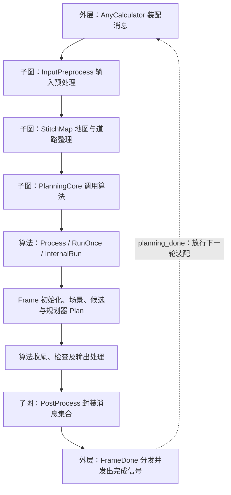

# 03 一帧全景：从触发到最终发布

> **这一篇讲什么**：把外层 graph、planning 子图和核心算法放到同一张地图，认识单帧依赖、候选并行和帧间接力。
>
> **读完你能回答**：一帧从哪里开始？谁等谁？哪些阶段并行？为什么线程数不等于同时处理的帧数？
>
> **前置知识**：第 01、02 篇。

## 1. 一帧是一次规划工作的边界

**这里的一帧，指一次成功装配并进入规划处理的输入集合及其输出过程。** `/perception/objects` 是外层 graph 的触发输入，但它并不是全部输入，也不等于这一秒一定触发十次成功规划。

外层 AnyCalculator 先缓存消息。只有上一轮处理已完成、又收到新触发，并且装配成功，才会生成 `planning_input`。因此图内可以有工作线程和子任务并行，但入口依然有帧完成约束。配置中的 `num_threads: 3` 不能解释成“三帧同时跑”。

## 2. 把三层流程对齐

*图 3-1 · 主数据链。RequestCalculator 是另一个业务请求节点，不应插画为所有主数据必经的串行步骤。*

| 层次 | 典型对象 | 负责的边界 |
|---|---|---|
| 外层 graph | AnyCalculator、FrameDoneCalculator | 消息装配、帧完成与对外流 |
| planning 子图 | 输入预处理、地图整理、Core、Request、输出后处理 | 消息与算法结构之间的转换及业务支路 |
| 算法内部 | Planning、Frame、Planner、Task | 场景与候选处理、求解、轨迹和状态 |

`PlanningCoreCalculator::Inference` 虽然叫 Inference，此处调用的是 `planning_->Process`。函数名字不能作为“这里执行了神经网络推理”的证据。

## 3. 时间放大：候选同时算，最终阶段集中处理

下面是**教学用时间示意**：长度只用于看清依赖，不来自车上测量，也不表示 60 ms 性能承诺。左、中、右用来示例道路候选，实际候选数量、有效性和并行条件由代码决定。

```mermaid
%%{init: {"gantt": {"useMaxWidth": false, "useWidth": 1000, "barHeight": 24, "barGap": 10, "fontSize": 14, "leftPadding": 170}}}%%
gantt
    title 图 3-2 · 单帧行车主线（教学时长，非实测）
    dateFormat x
    axisFormat %L ms
    section 输入与工作台
    消息预处理与地图整理 :a, 0, 8ms
    Frame 初始化与预处理 :b, after a, 15ms
    section 候选参考线任务（满足并行条件时）
    左侧候选任务链 :l, after b, 12ms
    中间候选任务链 :m, after b, 10ms
    右侧候选任务链 :r, after b, 8ms
    section 汇合后的主链
    等待候选并选择 :s, after l m r, 3ms
    选中候选的 iLQR :q, after s, 10ms
    速度处理与轨迹拼接生成 :t, after q, 5ms
    检查、算法收尾及消息输出 :o, after t, 6ms
```

*图 3-2 读法：先看三条候选的共同起点，再看汇合点；10 ms 与 8 ms 的候选先完成，主链仍要等 12 ms 的候选。Frame 内部也存在其他并行，本图省略。*

在 `EmPlanner::PlanOnReferenceLine(Frame*)` 中，满足多线程与场景条件时，各参考线任务被提交到线程池，随后执行 `WaitUntilWorkComplete()`。之后调用 `frame->Postprocess()`，获取选择结果，再在该结果上执行 iLQR 和速度后处理。

## 4. 同步并行和后台异步不能混为一谈

**同步并行**：主线程提交若干任务，等它们全部完成，再消费结果。候选参考线求解是典型例子，单帧耗时取决于关键路径和等待，不能把所有线程用时直接相加。

**后台异步**：提交后，结果可能在后续帧才被取到。OpenSpace 异步管理器负责某些重规划或绕行搜索；模式切换与停止还需要处理任务生命周期。它不是每个普通行车帧的固定步骤，见第 14 篇。

## 5. 三个“结束”各自意味着什么

| 边界 | 含义 | 不等价于 |
|---|---|---|
| 核心 `Plan` 返回 | 规划器算法阶段返回 | 整个 Planning 已完成后处理 |
| `Planning::Process` 返回 | 算法总控完成本次调用 | 框架已发送完全部 topic |
| 外层 FrameDone | 对结果集合分发并发出完成信号 | 每一配置输出都必然有消息 |

原来的 `expected_proc_duration_ms=500` 是组件配置中的预期处理时长参数。它不表示目标运行频率为 2 Hz，也不表示实际每帧耗时 500 ms；其调度影响需结合框架解释。读本系列甘特图时，也不要把示意时间误认为这个配置的测量结果。

## 证据与延伸

以下链接固定到本系列分析的源码提交；行号指向关键实现，不代表整段行为只由这一行决定。

| 要核实的行为 | 源码入口 |
|---|---|
| 外层触发与完成回边 | [driver/config/component/planning_graph.cfg · `name: "planning_assemble_node"`](https://code.deeproute.ai/deeproute-projects/public/driver/-/blob/eacec82b6662c3c8b2f26a6749e679ef11ce6218/config/component/planning_graph.cfg#L64) |
| 装配准入条件 | [platform/church/graph/calculators/any_calculator.cc · `if (prev_calc_finished_ && has_new_trigger_msg_)`](https://code.deeproute.ai/deeproute-org/os/all-member/platform/-/blob/55b503c91f7eaaef78d90b538f34c65f0ea4b154/church/graph/calculators/any_calculator.cc#L119) |
| 子图与请求支路 | [planning/planning/config/planning_sub_graph.cfg · `name: "PlanningRequestCalculator"`](https://code.deeproute.ai/deeproute-org/pnc/planning/planning/-/blob/dd7cbf35a83fa1f5fb5dc078563235e671365327/planning/config/planning_sub_graph.cfg#L88) |
| 候选并行到 iLQR | [planning/planning/planner/em_planner.cpp · `bool EmPlanner::PlanOnReferenceLine(Frame* frame)`](https://code.deeproute.ai/deeproute-org/pnc/planning/planning/-/blob/dd7cbf35a83fa1f5fb5dc078563235e671365327/planning/planner/em_planner.cpp#L341) |
| 组件时长参数 | [driver/config/component/planning.jsonnet · `"expected_proc_duration_ms": 500`](https://code.deeproute.ai/deeproute-projects/public/driver/-/blob/eacec82b6662c3c8b2f26a6749e679ef11ce6218/config/component/planning.jsonnet#L9) |

---

[返回 Planning 导读](./index.md) · [上一篇：02 先认识规划的语言：参考线、路径与轨迹](./02%20%E5%85%88%E8%AE%A4%E8%AF%86%E8%A7%84%E5%88%92%E7%9A%84%E8%AF%AD%E8%A8%80%EF%BC%9A%E5%8F%82%E8%80%83%E7%BA%BF%E3%80%81%E8%B7%AF%E5%BE%84%E4%B8%8E%E8%BD%A8%E8%BF%B9.md) · [下一篇：04 输入与输出：planning 究竟拿到了什么](./04%20%E8%BE%93%E5%85%A5%E4%B8%8E%E8%BE%93%E5%87%BA%EF%BC%9Aplanning%20%E7%A9%B6%E7%AB%9F%E6%8B%BF%E5%88%B0%E4%BA%86%E4%BB%80%E4%B9%88.md)
