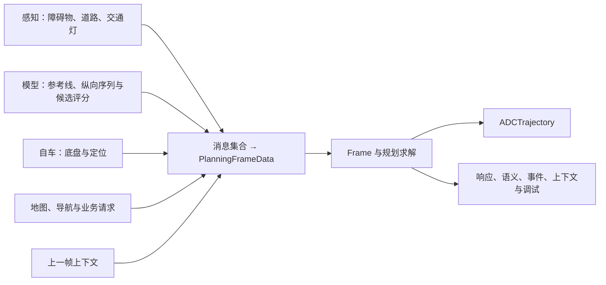

# 04 输入与输出：planning 究竟拿到了什么

> **这一篇讲什么**：按业务意义拆解感知、模型、自车、地图和请求输入，并认识最终轨迹和辅助消息。
>
> **读完你能回答**：一个 objects 消息包含什么？哪些输入触发规划？最终输出除了轨迹还有什么？
>
> **前置知识**：第 01～03 篇。

## 1. 输入不是一张障碍物列表

**一帧输入由多个来源的消息组成，触发源只是其中一路。** planning 既要知道外部世界，也要知道自车状态、目标方向、正在执行的业务和上一帧留下的状态。

*图 4-1 · 按语义分组的输入输出。模型数据可装在感知消息中，因此不同箭头不意味着独立 topic。*

## 2. 先按“用来回答什么”认识输入

| 输入组 | 典型 topic / 载体 | 作用 |
|---|---|---|
| 主环境与模型 | `/perception/objects` / PerceptionObstacles | 障碍物、自车采样信息、模型决策数据等；外层触发源 |
| 补充环境 | `/perception/extra_objects` | 补充目标信息，具体使用按算法分支 |
| 道路结构 | `/perception/ras_map`、`ras_map_parking` | 感知构建的道路、边界、泊车环境等 |
| 道路增强 | `/map/ras_map_plus` | 地图整理使用的增强语义信息 |
| 交通信号 | `/perception/traffic_lights_status` | 红绿灯相关输入 |
| 自车状态 | `/canbus/car_state`、`/localization/pose` | 车辆运动、姿态与位置；预处理中进行状态整理 |
| 导航与地图 | `/localization/global_routing_info`、地图消息、local map link 事件等 | 当前道路与目标方向、地图语义 |
| 请求 | `/planner/request`、`multi_requests` | 功能、任务及业务动作 |
| 上下文 | `/planner/context` 与子图回边 | 上一轮轨迹、状态、决策和工作信息 |

这些是理解用的分组，不是完整订阅表。最终订阅名、类型和策略以 driver 的 `planning.jsonnet` 为准，实际转换为算法字段的方式以 InputPreprocess 为准。某些输入经 channel cache 收集，不一定在子图上拥有独立的显式 stream。

`required`、`optional`、`all_new` 是装配策略；“required”不是“这一轮必须刚产生一份全新结果”的同义词。消息怎样选择还受缓存和框架策略影响，第 05 篇继续解释。

## 3. 特别拆开 objects：名字不能代替消息内容

`PerceptionObstacles` 的障碍物字段用于描述环境；它的 `model_based_decision` 则携带自车模型方案。当前 perception 的规划头转换代码中，能看到如下映射：

| 模型张量 | planning 可读取的字段 | 意义 |
|---|---|---|
| `topk_queries` | `junction_reference_line` | 自车候选参考线点列 |
| `ego_prob` | `multi_modal_probs` 等 | 候选评分/概率信息 |
| `ego_lon_s` | `multi_modal_speed` 中的纵向位置点 | 一串带相对时间的纵向位移；字段叫 speed，也不能只理解为速度标量 |
| `ego_planning_raw` | `model_joint_planning_raw` | 原始模型联合轨迹候选 |
| `ego_planning_prob_raw` | `multi_modal_probs_raw` | 原始候选的评分 |

这一映射来自当前代码里的具体转换路径；别的平台或图可能由 PredictionWithPlannerCalculator 执行同类转换。候选数量和张量形状是模型接口约定，不是 planning 的永久通用常数。

预处理还会调用 `EnsureNestedFromFlat`，把可能采用扁平表示的模型数据恢复到算法使用的嵌套结构。看到同一语义有不同消息布局，不应误认为存在两套独立规划结果。

## 4. 输出首先是一份运动计划

最终轨迹消息类型是 `ADCTrajectory`。它通常包含轨迹点、路径相关信息、挡位、控制模式、行为与时间等字段；哪些字段在特定场景填写，取决于执行路径。

一个概念化的点可以读作：“相对基准 0.8 秒时，车辆在 `(x,y)`，朝向 theta，目标速度 v、加速度 a、路径曲率 kappa。”它供下游控制消费，不直接表示方向盘电机必须转到多少度。

## 5. 辅助输出是解释行为的重要材料

| 输出 | 解决什么问题 |
|---|---|
| `/planner/debug_info` | 候选、选择、轨迹、求解和检查的调试证据 |
| `/planner/response`、`multi_responses` | 对业务请求作响应 |
| `/planner/event` | 规划业务事件，与系统异常事件上报机制应分别核对 |
| `/planner/semantic_info` | 对外可用的规划语义 |
| `/planner/context` | 记录跨帧上下文，也用于回放相关流程 |
| `/planner/context_compressed` | 按开关生成的压缩上下文 |
| `/planner/stop_objects` | 导致停车的目标等辅助结果 |
| `/planner/safety_request` | 对安全相关接口的请求 |
| `/visualizer/command_rp` | 可视化关联输出 |

graph 声明了 13 个 `OUTPUT` 槽位，其中 signals_request 槽位还有“无人发布”的注释。这说明**配置了输出通道，不代表每帧该通道都有一条消息**。此外，通过 `publish_handle` 发出的快速请求结果应与普通主链输出分开分析。

最后，单看 `/planner/trajectory` 到达，仍需要检查轨迹点是否存在、对应哪个感知时间、模式是什么。消息存在与有效运动计划存在不是同一个判断。

## 证据与延伸

以下链接固定到本系列分析的源码提交；行号指向关键实现，不代表整段行为只由这一行决定。

| 要核实的行为 | 源码入口 |
|---|---|
| 订阅与类型 | [driver/config/component/planning.jsonnet · `"input_channels"`](https://code.deeproute.ai/deeproute-projects/public/driver/-/blob/eacec82b6662c3c8b2f26a6749e679ef11ce6218/config/component/planning.jsonnet#L20) |
| 帧输入与输出对象 | [planning/planning/planning_api.h · `struct PlanningFrameData`](https://code.deeproute.ai/deeproute-org/pnc/planning/planning/-/blob/dd7cbf35a83fa1f5fb5dc078563235e671365327/planning/planning_api.h#L51) |
| objects 解包与转换 | [planning/planning/calculators/planning_input_preprocess_calculator.cc · `message = FindLastMessage(input_msgs, "/perception/objects")`](https://code.deeproute.ai/deeproute-org/pnc/planning/planning/-/blob/dd7cbf35a83fa1f5fb5dc078563235e671365327/planning/calculators/planning_input_preprocess_calculator.cc#L623) |
| 模型字段转换 | [perception/perception/calculators/planning_head_output_calculator.cc · `void FillPlanningHead(`](https://code.deeproute.ai/deeproute-org/perception/onboard/perception/-/blob/dc6cd752e2738ec283870f6a3899137a399f7836/perception/calculators/planning_head_output_calculator.cc#L425) |
| 输出槽位 | [driver/config/component/planning_graph.cfg · `name: "planning_frame_done_node"`](https://code.deeproute.ai/deeproute-projects/public/driver/-/blob/eacec82b6662c3c8b2f26a6749e679ef11ce6218/config/component/planning_graph.cfg#L108) |

---

[返回 Planning 导读](./index.md) · [上一篇：03 一帧全景：从触发到最终发布](./03%20%E4%B8%80%E5%B8%A7%E5%85%A8%E6%99%AF%EF%BC%9A%E4%BB%8E%E8%A7%A6%E5%8F%91%E5%88%B0%E6%9C%80%E7%BB%88%E5%8F%91%E5%B8%83.md) · [下一篇：05 数据进入 planning：收集、缓存与时间对齐](./05%20%E6%95%B0%E6%8D%AE%E8%BF%9B%E5%85%A5%20planning%EF%BC%9A%E6%94%B6%E9%9B%86%E3%80%81%E7%BC%93%E5%AD%98%E4%B8%8E%E6%97%B6%E9%97%B4%E5%AF%B9%E9%BD%90.md)
