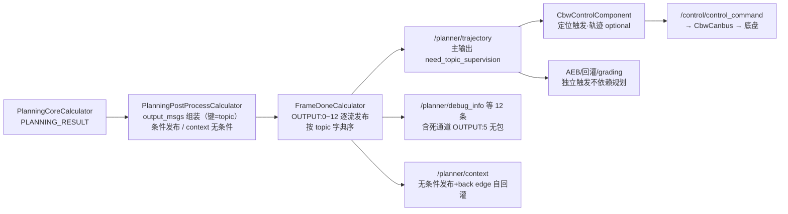

> **30 秒导读**："轨迹出炉"：OUTPUT:0~12 都发了什么、/planner/trajectory 谁在消费、调试数据怎么带走。
> **本篇回答**：轨迹里有哪些字段？控制怎么收到？/planner/context 为什么不是输入？
> **先修阅读**：[**00 入门**（§3 步骤 10）](../00_公共基础文档/00%20入门：写给新手的%20E2E%20架构故事（C01%20-%20orinx）.md)；[**公共 05 全链路时序**（§1）](../00_公共基础文档/05%20端到端全链路时序与异常机制（C01%20-%20orinx）.md)。

> **本篇概念速成块**（30 秒，读完再进正文不卡壳）：
> - **13 条输出**：trajectory 是唯一主角，debug/response/event/context 等是配角；OUTPUT:5 signals_request 是死通道（无生产者）。
> - **条件发布**：各输出成员非空才发布，唯一例外 `/planner/context` 无条件发布（每帧必发）。
> - **发布顺序**：FrameDoneCalculator 按 topic 字典序（std::map）发布，不保证 trajectory 先发。
> - **FrameContext**：规划的"交接班记录"——上帧选中轨迹/参考线摘要/状态机，下一帧拼接起点靠它（完整卡片见 §6）。
> - **自回灌**：`/planner/context` 不是输入通道，是自己的输出经 back edge 回到自己的输入（新手最常见误解）。
> - **控制协议**：控制以 `/localization/pose` 触发，轨迹是 optional 输入（cache_size=1 只留最新）。
> - **降级语义在 proto 层**：`trajectory_type` NORMAL/PATH_FALLBACK/SPEED_FALLBACK，`checker_result` 随轨迹下发（详见 [**轨迹校验**（子模块4 §1）](02_核心子模块拆解/子模块4：trajectory_checker%20轨迹校验子模块.md)）。


> 分析对象：C01（orinx C01PT，L2_driving）Planning 组件的 13 条输出通道、`PlanningPostProcessCalculator` 输出组装、`FrameDoneCalculator` 发布顺序、`/planner/trajectory` 关键字段、与控制的交互协议、`/planner/context` 自回灌、已知死通道。  
> 控制内部实现不在本文范围，只写到组件边界。

---

## 1. 输出通道全景

**一句话结论**：13 条输出一条主线（trajectory）+一堆辅助（debug/response/event/context…），声明唯一来源是 planning.jsonnet；配置里最刺眼的是死通道 OUTPUT:5。

**为什么输出值得专门一篇**：轨迹是规划的「交付物」，控制只认这条消息里的字段—— trajectory_point 的坐标/速度/加速度/航向就是控制环的输入；同时 13 条输出里有降级标签、事件、安全请求这些「副通道」，线上排查规划问题靠的就是它们。搞清「什么消息给谁、什么时候发」，才能看懂控制为什么没跟轨迹走。

通道声明唯一来源：`/sandbox/driver/config/component/planning.jsonnet`（L151-218），共 **13 条输出**：

| # | Topic | 消息类型 | 流名（stream） | 备注 |
|-|-|-|-|-|
| 1 | `/planner/trajectory` | `deeproute.planning.ADCTrajectory` | `planner__trajectory` | **主输出**，`need_topic_supervision: true` |
| 2 | `/planner/debug_info` | `deeproute.planning.debug.PlanningDebug` | `planner__debug_info` | 调试信息 |
| 3 | `/planner/response` | `deeproute.planning.interface.PlanningResponse` | `planner__response` | 单响应 |
| 4 | `/planner/multi_responses` | `deeproute.planning.interface.PlanningResponses` | `planner__multi_responses` | 多响应 |
| 5 | `/planner/event` | `deeproute.planning.interface.PlanningEvent` | `planner__event` | 规划状态事件 |
| 6 | `/common/cancel_trigger_request` | `deeproute.recorder.CancelTriggerRequest` | `planner__cancel_trigger` | E2E 泊出取消触发 |
| 7 | `/planner/signals_request` | `deeproute.perception.TrafficLightDetectionTask` | `planner__signals_request` | **死通道**（见第 7 节） |
| 8 | `/planner/semantic_info` | `deeproute.planning.PlanningSemanticInfo` | `planner__semantic_info` | 语义信息 |
| 9 | `/visualizer/command_rp` | `deeproute.visualizer.VisualizerCommandRP` | `visualizer__command_rp` | 可视化响应 |
| 10 | `/planner/context` | `deeproute.planning.FrameContext` | `planner__context` | 帧上下文（自回灌+观测） |
| 11 | `/safety/request` | `dr.safety.Request` | `planner__safety_request` | 安全请求（topic check 控制） |
| 12 | `/planner/context_compressed` | `deeproute.planning.PlanningContextCompressed` | `planner__context_compressed` | 压缩上下文（序列化 bytes） |
| 13 | `/planner/stop_objects` | `deeproute.perception.PerceptionObstacles` | `planner__stop_objects` | 导致刹停的障碍物 |

主要消费者（代码证据为主、其余标注推断）：`/planner/trajectory` → CbwControlComponent（第 5 节）、AEB/回灌 prediction/blc/grading（基线，未逐一验证）；`/planner/context` → 组件自身回灌观测（`context_config`）；`/planner/stop_objects` → 回放/质检（推断）。

---

## 2. PlanningPostProcessCalculator 输出组装

**一句话结论**：output_msgs 的键名就是最终 topic——组装即发布内容的定型点；唯一无条件发布的是 FrameContext。

子图末端 `planning_post_process_node` 接收 `PlanningCoreCalculator` 的 `PLANNING_RESULT`（类型 `PlanningFrameDataOutput`，成员定义见 `planning_api.h:81-101`），组装 `topic → message向量` 的映射：

> 文件路径：/sandbox/planning/planning/calculators/planning_post_process_calculator.cc  
> 函数名：PlanningPostProcessCalculator::Process()  
> 核心逻辑：
> 
> ```cpp
> ProtoBaseMsgPtrVectorMap output_msgs;
> if (out_frame->trajectory != nullptr) {
>   ...
>   MLOG(ERROR) << "[PlanningPublish] trajectory_point_size: "
>               << out_frame->trajectory->trajectory_point_size()
>               << ", perception_time_measurement: " << ...;
>   output_msgs["/planner/trajectory"].emplace_back(
>       std::move(out_frame->trajectory));
> }
> if (out_frame->debug_info != nullptr) {
>   output_msgs["/planner/debug_info"].emplace_back(
>       std::move(out_frame->debug_info));
> }
> ...
> output_msgs["/planner/context"].emplace_back(          // 无条件发布
>     std::move(out_frame->frame_context_));
> if (out_frame->planning_response != nullptr) {
>   output_msgs["/planner/response"].emplace_back(
>       std::move(out_frame->planning_response));
> }
> ...
> if (out_frame->safety_request_info != nullptr) {
>   MLOG(WARN) << "[planning] [Safety Request] Publish safety request, ...";
>   output_msgs["/safety/request"].emplace_back(
>       std::move(out_frame->safety_request_info));
> }
> // 发布导致planning刹停的障碍物，使用与感知相同的消息格式
> if (out_frame->stop_obstacles != nullptr) {
>   output_msgs["/planner/stop_objects"].emplace_back(
>       std::move(out_frame->stop_obstacles));
> }
> cc->Outputs().Tag(kOutPlanningOutput)
>     .AddPacket(`MakePacket<ProtoBaseMsgPtrVectorMap>`(std::move(output_msgs))
>                    .At(cc->InputTimestamp()));
> ```
> 
> 逻辑说明（L104-209）：键名即**最终发布 topic**。各输出为条件发布（成员非空才放入 map），**唯 `/planner/context` 无条件发布**。QuickReq 通路：当快速请求握手标志激活时，直接用 `quick_req_->second.second`（缓存轨迹）替换本帧轨迹并重打 DataPlane 时间戳（L106-115）。另有 `/common/cancel_trigger_request`（L178-186）与 `/planner/semantic_info`、`/planner/context_compressed`（`enable_context_compressed` side packet 开启时序列化 FrameContext+Debug 为 bytes，L96-135、L226-270）。

各输出成员的填充源头在 `PlanningCoreCalculator::Inference()`（`planning_core_calculator.cc:154-187`）：`trajectory` 来自 `IPlanningProcessor::Process()` 直写；`debug_info` 经 `GetDebugInfoFromSingleInstance()`（L199-206）；`planning_response(s)`、`last_planning_event` 从 `debug_info.hpi_info()` 提取且**与上一帧比较、变化才发布**（L217-339）；`safety_request_info` 在 open-space replan 开始/结束时发 `TCA_DISABLE`/`TCA_RESET_TO_CONFIG`（L236-302）；`stop_obstacles` 来自 `planning_->GetStopObstacles()`（L370-373）。

---

## 3. FrameDoneCalculator 发布顺序

**一句话结论**：OUTPUT:0~12 与 13 条输出一一对应，发布顺序按 topic 字典序；发完打 planning_done 回边解锁下一帧（FrameDone 机制见 [**公共 02 §3**](../00_公共基础文档/02%20模块配置与%20Topic%20数据流拓扑（C01%20-%20orinx）.md)）。



**图 3-1 · 规划输出发布全链路（组装→发布→消费三段）**（B 是内容定型点，C 是唯一发布口，D/F 是两条关键去向）

**读图提示**：① B 的 map 键名即最终 topic——组装完内容就定型，下游只是搬运；② C 按 std::map 字典序逐流发布，trajectory 不是第一个，但同帧发布在微秒级内完成；③ F 有两条去向：对外发布给观测/仿真，图内 back edge 自回灌给下一帧（§6 两路径）；④ 右侧两类消费者的触发模型不同：控制由定位触发、轨迹是 optional 输入，AEB/grading 更是独立触发——规划不控制下游节拍。

> 文件路径：/sandbox/driver/config/component/planning_graph.cfg  
> 核心逻辑：
> 
> ```
> node {
>   name: "planning_frame_done_node"
>   calculator: "FrameDoneCalculator"
>   input_stream: "INPUT:planning_output"
>   output_stream: "OUTPUT:0:planner__trajectory"
>   output_stream: "OUTPUT:1:planner__debug_info"
>   output_stream: "OUTPUT:2:planner__response"
>   output_stream: "OUTPUT:3:planner__multi_responses"
>   output_stream: "OUTPUT:4:planner__event"
>   output_stream: "OUTPUT:5:planner__signals_request" # no one publish it
>   output_stream: "OUTPUT:6:planner__semantic_info"
>   output_stream: "OUTPUT:7:visualizer__command_rp"
>   output_stream: "OUTPUT:8:planner__context"
>   output_stream: "OUTPUT:9:planner__cancel_trigger"
>   output_stream: "OUTPUT:10:planner__safety_request"
>   output_stream: "OUTPUT:11:planner__context_compressed"
>   output_stream: "OUTPUT:12:planner__stop_objects"
>   output_stream: "ALL_OUTPUTS:planning_output_vector"
>   output_stream: "TRIGGER:planning_done"
>   input_side_packet: "TOPIC_TO_STREAM_ID_MAP:planning_topic_to_stream_id_map"
>   input_side_packet: "GENERATE_HEADER_CALLBACK:planning_generate_header_callback"
>   input_side_packet: "STREAM_PUBLISH_OBSERVER:planning_stream_publish_observer"
>   executor: "planning_executor"
> }
> ```
> 
> 逻辑说明：OUTPUT 0\~12 与第 1 节 13 条输出一一对应；OUTPUT:5 注释 `# no one publish it` 为仓库内**原注释**。

> 文件路径：/sandbox/platform/church/graph/calculators/frame_done_calculator.cc  
> 函数名：FrameDoneCalculator::Process()  
> 核心逻辑：
> 
> ```cpp
> for (const auto& [topic, messages] : input_message_map) {
>   if (topic_to_stream_id_.count(topic) == 0) {
>     MLOG(ERROR) << "Topic not found in mapping: " << topic;
>     continue;  // Skip this topic and continue processing others
>   }
>   const int stream_id = topic_to_stream_id_[topic];
>   for (size_t i = 0; i < messages.size(); ++i) {
>     auto onboard_message = generate_header_callback_(topic, messages[i]);
>     cc->Outputs().Get(kOutputTag, stream_id)
>         .AddPacket(`MakePacket<OnboardMessageConstPtr>`(onboard_message)
>                        .At(Timestamp(cc->InputTimestamp() + i)));
>     if (stream_publish_observer_) {
>       stream_publish_observer_(onboard_message);
>     }
>     output_messages.emplace_back(std::move(onboard_message));
>   }
> }
> cc->Outputs().Tag(kAllOutputsTag).AddPacket(...);   // ALL_OUTPUTS
> frame_id_++;
> cc->Outputs().Tag(kTriggerTag)
>     .AddPacket(`MakePacket<int>`(frame_id_).At(Timestamp(cc->InputTimestamp())));
> ```
> 
> 逻辑说明（L133-177）：遍历 topic→messages 映射，经 `topic_to_stream_id_` 找到 OUTPUT 流号，`generate_header_callback_` 包成 `OnboardMessage` 后逐条发布（同 topic 多条时时间戳 +i）。最后 `ALL_OUTPUTS`（调度观测向量）与 `TRIGGER: planning_done`（帧号递增）——后者经 back edge 回到 AnyCalculator 的 FINISHED，解锁下一帧。**发布顺序由 `std::map`（topic 字典序）决定**，不保证 trajectory 最先/最后；框架据此将各流经组件 `publish_handle` 投递到对应 topic（推断：回调链路细节未逐行验证）。

---

## 4. /planner/trajectory 关键字段

**一句话结论**：一条轨迹=本体（点序列/gear）+决策语义（behavior/stop/灯语）+质量降级（type/checker_result/estop）+控制辅助（曲率/control_mode）+链路观测（时戳/latency）五组信息；字段详解见 [**Planning/03 §1.5**](03%20关键数据结构与参数配置.md)。

Proto 定义：`/sandbox/proto_msg/proto/planning/planning.proto`（L119-276，`message ADCTrajectory`；另有 `/sandbox/proto_msg/proto_external/p177/planning/planning.proto` 同名消息，为外部协议镜像）。关键字段摘录：

> 文件路径：/sandbox/proto_msg/proto/planning/planning.proto  
> 核心逻辑：
> 
> ```protobuf
> // next id: 23
> message ADCTrajectory {
>   reserved 8;
>   optional deeproute.common.Header header = 1;
>   optional double total_path_length = 2;  // in meters
>   optional double total_path_time = 3;    // in seconds
> 
>   // path data + speed data
>   repeated deeproute.common.TrajectoryPoint trajectory_point = 12;
> 
>   optional EStop estop = 6;
>   // path point without speed info
>   repeated deeproute.common.PathPoint path_point = 13;
> 
>   // is_replan == true mean replan triggered
>   optional bool is_replan = 9 [default = false];
>   optional string replan_reason = 22;
>   // Specify trajectory gear
>   optional deeproute.canbus.Chassis.GearPosition gear = 10;
>   optional deeproute.taskconfig.DecisionResult decision = 14;
>   optional LatencyStats latency_stats = 15;
>   optional RightOfWayStatus right_of_way_status = 17;   // UNPROTECTED/PROTECTED
>   repeated deeproute.hdmap.Id lane_id = 18;
>   optional deeproute.common.EngageAdvice engage_advice = 19;
> 
>   enum TrajectoryType {
>     UNKNOWN = 0;  NORMAL = 1;  PATH_FALLBACK = 2;
>     SPEED_FALLBACK = 3;  COMBINE_PATH_SPEED_FAILED = 4;
>   }
>   optional TrajectoryType trajectory_type = 21 [default = UNKNOWN];
>   optional CheckerResult checker_result = 38;
>   optional Stop stop = 31;
>   optional deeproute.perception.PerceptionObstacle follow_vehicle = 4;
>   optional deeproute.common.VehicleSignal vehicle_signal = 33;
>   optional int64 perception_header_timestamp = 5;
>   optional double desired_curvature = 35 [default = 0.0];
>   optional deeproute.planning.PlannerType planner_type = 40;
>   optional double planning_curvature = 41 [default = 0.0];
> 
>   enum TrajectoryBehavior {
>     LANE_KEEP = 0;  RIGHT_LANE_CHANGE = 1;  LEFT_LANE_CHANGE = 2;
>     MIDDLE_LEFT_NUDGE = 3;  MIDDLE_RIGHT_NUDGE = 4;  UNDEFINED = 5;
>   }
>   optional TrajectoryBehavior trajectory_behavior = 43;
>   optional deeproute.canbus.Chassis.DrivingMode control_mode = 44;
>   optional int64 timestamp = 48;  // trajectory publish time(us)
>   ...
>   optional bool start_open_space_replan = 53 [default = false];
>   optional int64 trajectory_start_point_time = 54;  // trajectory start point time(us)
>   optional PlannerTaskType planner_task_type = 50;  // DEFAULT/HAVP/LSS/...
> ```
> 
> 逻辑说明：一条 ADCTrajectory 携带——
> 
> - **轨迹本体**：`trajectory_point`（带速度的 **TrajectoryPoint** 轨迹点序列）、`path_point`（纯路径点）、`total_path_length/time`、`gear`；
> - **决策语义**：`decision`（DecisionResult）、`trajectory_behavior`（保持车道/左右变道/左右微调）、`right_of_way_status`、`stop`、`follow_vehicle`（跟随的前车）、`vehicle_signal`（灯语）、`is_replan/replan_reason`；
> - **质量与降级**：`trajectory_type`（NORMAL/PATH_FALLBACK/SPEED_FALLBACK 等）、`checker_result`（轨迹校验结果）、`estop`；
> - **控制执行辅助**：`control_mode`、`desired_curvature/planning_curvature`、`engage_advice`、`timestamp`（发布时刻，us）、`trajectory_start_point_time`（起点时刻，us）；
> - **链路观测**：`perception_header_timestamp`（触发的感知帧时间）、`latency_stats`、`planner_type/planner_task_type`。

代码侧字段填充示例：`planning_core.cpp:1416-1424` 写 `is_replan` 与 `enable_rear_wheel_steering`；`SetControlMode`（step13）写 `control_mode`；规划失败时 `HandleTrajectoryPublishingAndExceptions` 会 `clear_trajectory_point()/clear_path_point()` 再发布（planning_core.cpp:1513-1516）。

---

## 5. 与控制的交互协议

**一句话结论**：控制以定位触发、轨迹 optional 输入——轨迹晚到一拍控制就用旧轨迹+最新定位先算，与规划的 IMMEDIATE 跟随触发（[**Planning/04 §2**](04%20线程调度与规划周期.md)）形成两级节拍。

控制侧由 `CbwControlComponent` 订阅规划轨迹并生成控制指令：

> 文件路径：/sandbox/driver/config/component/cbw_control.jsonnet  
> 核心逻辑：
> 
> ```jsonnet
> class_name: 'CbwControlComponent',
> config: { name: 'CbwControl',
>   task: {
>     name: 't_CbwControl',
>     expected_proc_duration_ms: 20,
>     trigger_channels: [ '/localization/pose' ],
>     trigger_policy: 'IMMEDIATE',
>     input_channels: [
>       { name: '/planner/trajectory', msg_type: 'deeproute.planning.ADCTrajectory',
>         type: 'optional', cache_size: 1 },
>       { name: '/canbus/car_state', ... }, { name: '/canbus/car_info', ... },
>       { name: '/localization/pose', ... } ],
>     output_channels: [
>       { name: '/control/control_command', msg_type: 'deeproute.control.ControlCommand',
>         need_topic_supervision: true },
>       { name: '/control/debug_info', ... }, { name: '/control/context', ... } ]
> ```
> 
> 逻辑说明：控制组件以 `/localization/pose` 为触发源，`/planner/trajectory` 为 optional 输入（cache_size=1，只保留最新一条轨迹）。

> 文件路径：/sandbox/driver/integration/components/cbw_control_component.cc  
> 函数名：CbwControlComponent::Proc()  
> 核心逻辑：
> 
> ```cpp
> constexpr char kControlCommandTopic[] = "/control/control_command";
> ...
> bool CbwControlComponent::Proc(const OnboardMessageConstPtrVector& input_msgs,
>                                OnboardMessagePtrVector* output_msgs) {
>   OnboardMessageConstPtr onboard_msg;
>   onboard_msg = FindFirstMessage(input_msgs, "/localization/pose");
>   if (onboard_msg) {
>     sSingletonPose->SetPose(
>         std::dynamic_pointer_cast&lt;const Ins>(onboard_msg->payload()));
>   }
>   onboard_msg = FindFirstMessage(input_msgs, "/planner/trajectory");
>   if (onboard_msg) {
>     sSingletonAdcTrajectory->SetAdcTrajectory(
>         std::dynamic_pointer_cast&lt;const ADCTrajectory>(onboard_msg->payload()));
>   }
>   ...  // car_info / car_state 同样写入单例
>   control_manager_->ControlProcess();
>   auto ctrl_cmd = control_manager_->GetCtrlCmdOutput();
>   if (ctrl_cmd) {
>     output_msgs->emplace_back(
>         MakeOnboardMessage(kControlCommandTopic, ctrl_cmd));
>   }
>   ...  // debug_info / context
> }
> ```
> 
> 逻辑说明（L38-85）：控制交互协议边界为——①订阅 `/planner/trajectory`，经 `sSingletonAdcTrajectory->SetAdcTrajectory()` 注入单例缓存；②`ControlManager::ControlProcess()` 在控制线程内消费缓存完成控制计算；③输出 `/control/control_command`（**deeproute.control.ControlCommand**）、`/control/debug_info`、`/control/context`。之后由 **CbwCanbusComponent**（`cbw_canbus.jsonnet` 声明）把控制指令下发底盘（基线结论，组件内部不在本文范围）。

至此规划→控制的完整链路：`PlanningPostProcessCalculator` 组装 → `FrameDoneCalculator` 发布 `/planner/trajectory` → 控制组件触发消费 → `ControlCommand` → 底盘。

---

## 6. /planner/context 自回灌机制

`/planner/context`（FrameContext，**帧上下文**：上一帧决策/轨迹起点/VPA/限速等状态）的"自回灌"有**两条独立路径**，需区分：

> **📘 概念｜Context（FrameContext 帧上下文，规划的跨帧记忆）**
> **是什么**：Planning 自己产生、又回给自己下一帧用的大 proto 消息——装着上一帧的选中轨迹（`last_selected_trajectory`，下一帧拼接起点）、每条参考线的选择/代价摘要（`ref_line_summary`）、L2 状态机、HPI 请求、VPA 信息等。它与 [**Perception 的 FrameDone**（公共 02 §3）](../00_公共基础文档/02%20模块配置与%20Topic%20数据流拓扑（C01%20-%20orinx）.md)的区别：FrameDone 是"通知下游我发完了"的事件，Context 是"留给下帧的自己人备忘"——发布对象不同、用途不同。它也**不是规划的输入通道**：输入预处理读的是图内 back edge 递回来的同一份数据（"自回灌"），外部 topic `/planner/context` 只是对外发布+观测。数据结构与回环拓扑详解见 [**Planning/03 §1.2**](03%20关键数据结构与参数配置.md)。
> **类比与角色映射**：Context 是「出租车两班倒的交接班记录本」——白班司机（上一帧规划）下班前把车况、乘客、路况写进记录本，夜班司机（下一帧规划）接班先读记录本再上路，不用从头摸情况。角色映射：记录本本体＝FrameContext proto；白班司机＝上一帧 PlanningCoreCalculator（`GetFrameContext()` 打包回写）；夜班司机读记录＝PlanningInputPreprocessCalculator 的 FRAME_CONTEXT 输入（back_edge: true）；车队调度台抄送一份存档＝外部 topic `/planner/context` 逐帧 dump；记录本里最关键的一行＝`last_selected_trajectory`（上帧轨迹，下一帧的拼接起点）；三种接班方式＝plan_with_context 策略（只继承起点/全量拷贝/闭环只恢复速度）。真实数字：每帧必发（无条件发布）、dump_frame_interval=1（逐帧 dump）、回边在 planning_sub_graph.cfg 第 24~27 行声明。
> **🎯 为什么这样设计**：轨迹拼接必须连续——控制看到的是 10Hz 的轨迹流，若下一帧从零开始规划，轨迹起点会跳变、车辆会顿挫；Context 让每帧站在上一帧的肩膀上。back_edge 是代码硬保证（每帧必经），外部 topic 发布是为观测/仿真闭环/dump 恢复留的旁路；恢复策略分三档是因为不同异常场景需要的"记忆量"不同——起点够用就不全量拷贝，省时省内存。
> **🗂 代码在哪里**：frame/context.h（C++ 封装类 Context，带锁）；proto 定义 planning_frame_context.proto L1884 起；回边声明 planning_sub_graph.cfg L24~27；回写点 planning_core_calculator.cc L139-145；恢复策略 planning_input_preprocess_calculator.cc L162-207。
>
> **30 秒最小例子**：上一帧自车沿参考线 2 以 50km/h 行驶并选中其轨迹→PlanningCoreCalculator 把"上帧轨迹+参考线摘要+状态机"写进 FrameContext 经 back_edge 回给输入预处理→下一帧感知帧到达，预处理器按 plan_with_context 读出 last_selected_trajectory 的末端点作拼接起点→新轨迹从旧轨迹末端无缝续接，控制看到的轨迹流不跳变。

**路径一：子图内 back edge（每帧必经，代码硬保证）**

> 文件路径：/sandbox/planning/planning/config/planning_sub_graph.cfg  
> 核心逻辑：
> 
> ```
> node {
>   name: "planning_input_node"
>   calculator: "PlanningInputPreprocessCalculator"
>   input_stream: "PLANNING_INPUT:planning_input"
>   input_stream: "FRAME_CONTEXT:frame_context"
>   input_stream_info { tag_index: "FRAME_CONTEXT"  back_edge: true }
>   ...
> }
> node {
>   name: "PlanningCoreCalculator"
>   ...
>   output_stream: "PLANNING_RESULT:planning_result"
>   output_stream: "FRAME_CONTEXT:frame_context"
> }
> ```
> 
> 逻辑说明：`PlanningCoreCalculator` 把 `planning_->GetFrameContext()` 打包回 `FRAME_CONTEXT` 流（planning_core_calculator.cc:139-145，注释 `// send current FrameContext back to PlanningInputPreprocessCalculator`），回连到 `PlanningInputPreprocessCalculator` 的 `FRAME_CONTEXT` 输入，形成图内环。预处理器按 `plan_with_context` 策略恢复/初始化上下文（planning_input_preprocess_calculator.cc:162-207：仅用起点、全量拷贝、或闭环只恢复速度）。

**路径二：外部 topic `/planner/context`（发布+组件级回灌观测）**

- 发布：`PlanningPostProcessCalculator::Process()` 无条件 `output_msgs["/planner/context"]`（L142-143）→ `FrameDoneCalculator` OUTPUT:8 → `/planner/context`。
- 组件级配置：`planning.jsonnet` 的 `context_config: { channel_name: "/planner/context", dump_frame_interval: 1 }`（L15-18）——框架按该配置对 `/planner/context` 做逐帧 dump（推断：dump 供组件重启时恢复上下文，具体恢复逻辑未验证）。
- 消费：`PlanningInputPreprocessCalculator::Process()` 中 `FindFirstMessage(input_msgs, "/planner/context")`（L163）。由于 jsonnet input_channels 无此通道，该查找命中与否取决于框架是否把组件自身的输出流回投为输入消息；onboard 主路径的状态恢复依赖**路径一**（标注：路径一为代码确证的机制，路径二在车端是否参与每帧回灌**未验证**）。

---

## 7. 已知不一致：/planner/signals_request 死通道

**一句话结论**：三处声明、零处生产——配置链路完整但 output_msgs 组装里没有它的键，OUTPUT:5 永远无包。

`/planner/signals_request`（TrafficLightDetectionTask）在配置中"三处声明、一处缺席"：

1. jsonnet 输出通道第 7 条：`/planner/signals_request`（planning.jsonnet L184-187）。
2. 图配置输出流：`output_stream: "planner__signals_request"`（planning_graph.cfg L24）+ `OUTPUT:5:planner__signals_request`（L103），且带**仓库原注释**：

   > `output_stream: "OUTPUT:5:planner__signals_request" # no one publish it`
3. `PlanningPostProcessCalculator::Process()` 的 `output_msgs` 组装中**没有**`"/planner/signals_request"` 键（全文件键集合为第 2 节所列 12 个 topic）。
4. `FrameDoneCalculator` 收到的 map 中自然不含该 topic，OUTPUT:5 永远无包。

结论：**OUTPUT:5 为死通道**——配置链路完整但无生产者，`/planner/signals_request` 不会有任何消息发布（若下游有订阅，将永久收不到数据）。与基线第 4 条结论一致，此处补充了完整证据链。

---

## 8. FAQ 与自测

**Q1（新手常见误解）**：`/planner/context` 出现在规划的数据流里，所以它是规划的输入通道？
不是。它是规划的**输出通道**（OUTPUT:8）——"自回灌"指的是自己的输出经图内 back edge 回到自己下一帧的输入（§6 路径一），并非外部谁给它喂数据。新手常因为它"出现在输入预处理代码里"就误当成输入；输入侧读到的 FRAME_CONTEXT 是上一帧的自己写的。

**Q2**：为什么 13 条输出里只有 `/planner/context` 是无条件发布？
轨迹/事件等都是"有好东西才发"（成员非空才放入 output_msgs），但 FrameContext 承担跨帧状态连续性——哪怕本帧规划失败、轨迹清空，"上帧发生了什么"的记忆也必须照常传给下一帧，否则下一帧拼接起点丢失（§2/§6）。

**Q3**：FrameDoneCalculator 按 topic 字典序发布，trajectory 会不会被别的 topic 延迟？
会排在 planner__debug_info 之后（字典序 response < trajectory），但同一帧内所有 topic 的发布在同一个 FrameDoneCalculator Process 调用里完成，微秒级差异；控制侧对轨迹是 optional 输入 + cache_size=1，不依赖严格先序（§3/§5）。

**自测**：

1. Context 的两条回灌路径分别是什么？哪条是硬保证？
    路径一：子图内 back edge（FRAME_CONTEXT 流，代码硬保证，每帧必经）；路径二：外部 topic `/planner/context` 发布+组件级 dump（车端每帧参与度未验证）（§6）。
2. OUTPUT:5 为什么是死通道？
    `/planner/signals_request` 在 jsonnet/图配置有声明，但 PlanningPostProcessCalculator 的 output_msgs 组装中没有该键，无生产者，FrameDone 收不到包（§7）。
3. 控制组件的触发源是什么？轨迹输入是什么类型？
    触发源 `/localization/pose`（IMMEDIATE）；`/planner/trajectory` 是 optional 输入，cache_size=1 只保留最新一条（§5）。

## 附：未验证/推断项汇总

1. `publish_handle` → 各输出流 → Church node `Publish` 的中间回调链（`GENERATE_HEADER_CALLBACK`、`STREAM_PUBLISH_OBSERVER` 的框架侧实现）未逐行验证。
2. `/planner/context` 外部 topic 是否参与车端每帧状态恢复（第 6 节路径二）未验证。
3. `/planner/trajectory` 的 AEB/回灌侧消费者（基线所述）未逐一验证代码；控制侧证据仅到 `CbwControlComponent::Proc()` 边界。
4. `PlanningRequestCalculator`（planning_sub_graph.cfg L87-105）的 QuickReq 快速轨迹握手细节仅覆盖到输入侧逻辑，输出 `VPA_DRIVING_STATE` 对 StitchMap 的影响未展开（属任务管线文档范围）。
