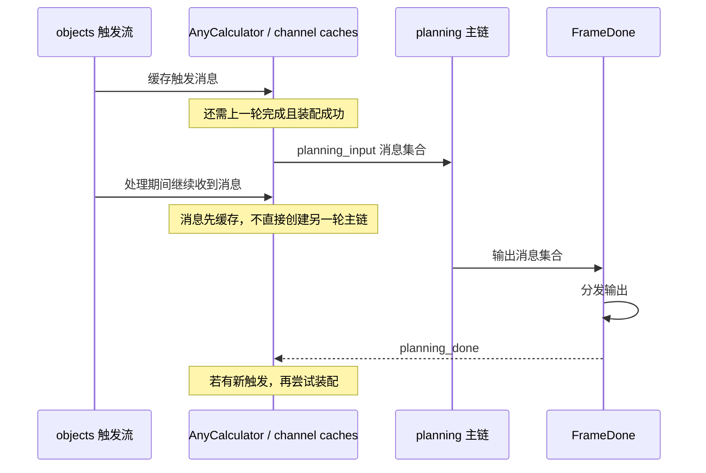

# 05 数据进入 planning：收集、缓存与时间对齐

> **这一篇讲什么**：解释触发与消息收集、不同频率的数据怎样共存，以及真实测量时间为什么必须保留。
>
> **读完你能回答**：收到触发就马上跑吗？新消息等于新观测吗？感知 5 Hz 与 planning 10 Hz 怎样衔接？
>
> **前置知识**：第 03、04 篇。

## 1. 一次输入是“凑出可用的一组数据”

**AnyCalculator 把消息先放进各通道缓存，再在允许开始下一轮时组装输入。** 它有两个重要状态：是否有新触发、上一轮是否完成。装配成功后会暂时关闭下一轮准入，等 `planning_done` 回来再放行。

*图 5-1 · 主链准入与缓存。它不承诺所有触发消息都一一形成成功输出，实际选择、超时和丢弃策略要继续看 channel cache。*

这也说明不能从“收到十次 objects”直接推导“执行了十次完整 planning”。输入不齐、计算跟不上或缓存策略，都可能改变实际成功处理频率。

## 2. 输入预处理：把消息集合改成算法工作数据

InputPreprocess 根据 topic 名找到消息，读取或更新自车状态、道路缓存、交通灯、请求和上下文，生成 `PlanningFrameData`。这个步骤没有进行整套轨迹优化，却决定后面的算法究竟看到了什么。

例如自车输入既可能有底盘消息，也可能有定位提供的速度和姿态。代码会寻找合适的车辆状态，再用定位覆盖部分运动信息；它不是任取一条 car_state 后直接原样传下去。

对于地图等共享输入，`PlanningFrameData` 中使用了 `shared_ptr<const T>`。这保留消息生命周期并表达只读意图；它不能阻止生产者通过另一个可写别名修改同一对象。因此文档里的“共享”不表示允许任意模块一起改。

## 3. 看一份 10 Hz 包装、5 Hz 障碍物更新的输入

在支持交替模式的一条 perception 路径中，规划头新结果会与缓存感知结果组装。以下只说明一种可能节奏，**不是当前所有车辆的实测频率或唯一组装时延**：

| 模型帧时刻 | 本次模型方案 | 可用障碍物观测时刻 | 障碍物年龄 |
|---|---|---|---|
| 200 ms | 200 ms 的方案 | 100 ms | 100 ms |
| 300 ms | 300 ms 的方案 | 300 ms | 0 ms |
| 400 ms | 400 ms 的方案 | 300 ms | 100 ms |

表中第一行即使外层消息属于 200 ms，也不能把障碍物的位置解释为 200 ms 的新测量。相关字段分别保留：

- `time_measurement`：当前包装帧对应的测量时间。
- `time_measurement_objects`：障碍物内容实际对应的测量时间。

具体平台可能延迟消费完整帧，因此旧障碍物不一定只旧一帧。代码要用真实时间差，不能固定假设“所有小帧都恰好旧 100 ms”。

## 4. 旧障碍物怎样参与当前计算

仓库的 `perception_time_utils` 在 `DR_PERCEPTION_INTERLEAVING_FEATURE` 启用的相应路径中，计算障碍物年龄，并用速度作一阶位置外推：

`x_aligned = x_raw + v_x × Δt`，`y_aligned = y_raw + v_y × Δt`。

若前车速度为 10 m/s、数据旧 0.1 s，那么匀速估计的位置相差 1 m。这对车道关联、包围盒筛选和距离判断都可能有影响。

**外推是估计，不是新的观测。** 它不能凭空补出旧帧之后才出现的障碍物，也不能准确还原突然急刹或转向。代码中的轻量对齐主要服务特定计算路径，不意味着所有预测、地图与对象已经完成统一的精确同步。

*图 5-2 · 时间对齐的用途；是否采用某项结果由具体调用路径决定。*

## 5. 缺失、复用和失败要按输入分别说

交通灯和 ras_map_plus 的缓存复用有编译宏条件；地图输入有自身的保留策略；MagicCarpet 属于帧级可选输入，不能顺手宣称所有字段都会沿用上一帧。缺少必要数据时，一些预处理路径直接返回错误，主链不会得到本轮正常结果。

所以排查“为什么 planning 没有 10 Hz”时，顺序应是：触发是否到达 → 准入是否放行 → 输入是否装配成功 → 算法是否完成 → 输出是否有效。模型推理频率、消息交付频率、算法成功频率和最终轨迹更新频率应分别测量。

## 证据与延伸

以下链接固定到本系列分析的源码提交；行号指向关键实现，不代表整段行为只由这一行决定。

| 要核实的行为 | 源码入口 |
|---|---|
| 触发与上轮完成条件 | [platform/church/graph/calculators/any_calculator.cc · `if (prev_calc_finished_ && has_new_trigger_msg_)`](https://code.deeproute.ai/deeproute-org/os/all-member/platform/-/blob/55b503c91f7eaaef78d90b538f34c65f0ea4b154/church/graph/calculators/any_calculator.cc#L119) |
| 自车与输入缓存处理 | [planning/planning/calculators/planning_input_preprocess_calculator.cc · `reuse last cached`](https://code.deeproute.ai/deeproute-org/pnc/planning/planning/-/blob/dd7cbf35a83fa1f5fb5dc078563235e671365327/planning/calculators/planning_input_preprocess_calculator.cc#L240) |
| 当前帧与障碍物时间 | [perception/perception/calculators/planning_head_output_calculator.cc · `set_time_measurement_objects(`](https://code.deeproute.ai/deeproute-org/perception/onboard/perception/-/blob/dc6cd752e2738ec283870f6a3899137a399f7836/perception/calculators/planning_head_output_calculator.cc#L308) |
| 对象年龄和功能宏 | [planning/planning/common/perception/perception_time_utils.h · `inline int64_t GetPerceptionObjectsAgeUs`](https://code.deeproute.ai/deeproute-org/pnc/planning/planning/-/blob/dd7cbf35a83fa1f5fb5dc078563235e671365327/planning/common/perception/perception_time_utils.h#L36) |
| 一阶对齐 | [planning/planning/common/perception/perception_time_utils.cpp · `AlignedObstaclePose ComputeAlignedObstaclePose(`](https://code.deeproute.ai/deeproute-org/pnc/planning/planning/-/blob/dd7cbf35a83fa1f5fb5dc078563235e671365327/planning/common/perception/perception_time_utils.cpp#L8) |

---

[返回 Planning 导读](./index.md) · [上一篇：04 输入与输出：planning 究竟拿到了什么](./04%20%E8%BE%93%E5%85%A5%E4%B8%8E%E8%BE%93%E5%87%BA%EF%BC%9Aplanning%20%E7%A9%B6%E7%AB%9F%E6%8B%BF%E5%88%B0%E4%BA%86%E4%BB%80%E4%B9%88.md) · [下一篇：06 一帧的工作台：Frame、Context 与规划起点](./06%20%E4%B8%80%E5%B8%A7%E7%9A%84%E5%B7%A5%E4%BD%9C%E5%8F%B0%EF%BC%9AFrame%E3%80%81Context%20%E4%B8%8E%E8%A7%84%E5%88%92%E8%B5%B7%E7%82%B9.md)
