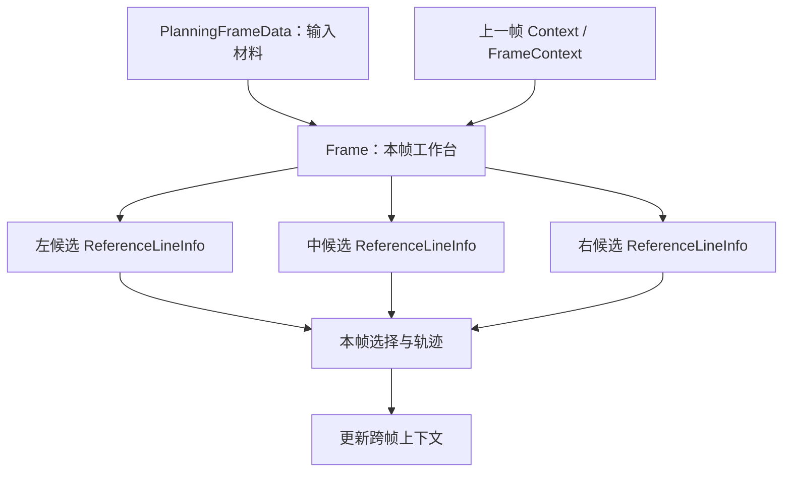
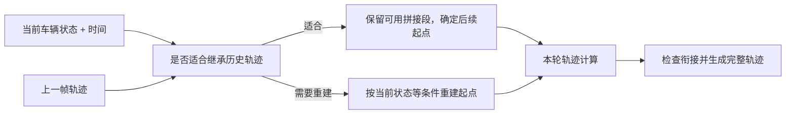
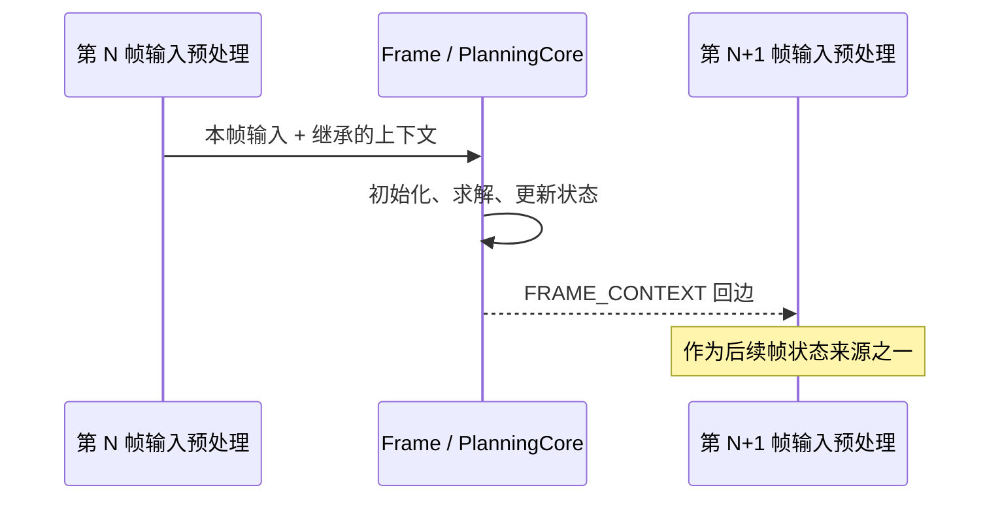

# 06 一帧的工作台：Frame、Context 与规划起点

> **这一篇讲什么**：把帧输入、算法 Frame、候选资料夹和跨帧上下文对应起来，解释轨迹起点与连续性。
>
> **读完你能回答**：Frame 与 FrameContext 有何区别？为什么需要上一帧？规划从车辆当前位置开始吗？
>
> **前置知识**：第 02～05 篇。

## 1. 四种对象，不是四个同义名字

**数据进入算法后，需要分清本帧输入、本帧计算状态、每个候选的状态，以及跨帧记忆。** 把它们都叫“frame”会掩盖职责和生命周期。

| 对象 | 白话 | 主要内容 |
|---|---|---|
| `PlanningFrameData` | 本轮交给算法的材料包 | 车辆、感知、地图、请求和上下文等引用或数据 |
| `Frame` | 本帧工作台 | 对象集合、参考线、场景、起点、候选处理和本帧状态 |
| `ReferenceLineInfo` | 一种候选行驶方案的资料夹 | 参考线、相关障碍物、路径、速度、轨迹、决策和代价 |
| `FrameContext` / `Context` | 跨帧记录及其算法访问封装 | 历史轨迹、选择结果、状态机与其他持续信息 |

`ReferenceLineInfo` 不只是曲线点列。曲线是其中的几何基准，资料夹还保存围绕这条基准计算出来的结果。同一个障碍物可以关联到多个资料夹，但相对距离与决策影响可能不同。

*图 6-1 · 对象职责关系。左中右是教学示例，图不要求所有场景都具备三条有效候选。*

## 2. Frame 初始化已经做了重要规划工作

`Planning::InternalRun` 调用帧初始化，`Frame::Init` 又按阶段建立基础设施、继承轨迹与状态、创建和处理参考线、设置障碍物以及准备速度等信息。之后 `ProcessFrameInitStuff` 还会执行交通规则和 Frame 预处理。

因此，“Init 只是分配内存，真正规划从 Plan 才开始”会漏掉大量业务处理。对模型候选的筛选、障碍物映射和场景信息，也不能仅在 Task 中寻找。

初始化失败会返回不同结果，例如参考线、对象或配置相关失败。上层对这些结果有不同处理条件，不能简单说“任何 init 失败都会自动切到某个规划器”。

## 3. 规划起点不总是当前位置

假设控制正在沿上一帧轨迹行驶。新轨迹若从另一个位置或速度直接开始，目标可能突然跳变。规划通常先判断历史轨迹是否仍适合当前状态，保留可衔接的短段，再从它的末端继续计算。

反过来，如果车辆偏离了历史方案，或发生模式切换、初始状态不适合继承，就需要根据车辆状态等条件重新初始化。**连续性与状态真实性之间存在选择，不能永远盲信旧轨迹。**

*图 6-2 · 起点选择的概念图。具体阈值与重建条件分散在 Frame 轨迹处理及配置中，本图不是逐条件展开。*

这里有两次容易混淆的“拼接”：**先为本轮计算准备起点和历史段，后在结果阶段把可用历史段与新轨迹接成完整输出**。函数所在位置不同，但服务的是同一连续性需求。

## 4. Context 是业务记忆，不是模型记忆库

上一轮选择左变道后，下一轮需要知道动作进行到了哪里；否则，左右候选分数稍有波动，系统就可能频繁切换。历史状态还用于匹配对象、参考线和轨迹，组织请求与响应。

*图 6-3 · 子图中的帧间状态。实际还需区分回放读入的 `/planner/context` 与运行中子图反馈，代码按开闭环和配置决定继承方式。*

planner head 的 `history_condition` 是网络特征记忆；planning 的 Context 保存软件业务与计算状态。二者都跨帧，却不能互相替代。

## 5. 状态有了记忆，也必须有边界

复制整个历史对象并不意味着其中所有字段都应该继续生效。输入预处理会处理开环、闭环、仅使用起点等不同场景，某些请求字段会清理；规划器切换也有 Clear 与保留的不同分支。

阅读源码时给每个字段追问三件事：谁在本帧读取、谁在本帧更新、下帧从哪里继承。这样比仅记住一个庞大的 FrameContext 字段列表更容易判断状态错误。

## 证据与延伸

以下链接固定到本系列分析的源码提交；行号指向关键实现，不代表整段行为只由这一行决定。

| 要核实的行为 | 源码入口 |
|---|---|
| 帧材料包 | [planning/planning/planning_api.h · `struct PlanningFrameData`](https://code.deeproute.ai/deeproute-org/pnc/planning/planning/-/blob/dd7cbf35a83fa1f5fb5dc078563235e671365327/planning/planning_api.h#L51) |
| 工作台初始化 | [planning/planning/frame/frame_lifecycle.cpp · `Frame::INIT_RESULT Frame::Init(`](https://code.deeproute.ai/deeproute-org/pnc/planning/planning/-/blob/dd7cbf35a83fa1f5fb5dc078563235e671365327/planning/frame/frame_lifecycle.cpp#L215) |
| 参考线资料夹 | [planning/planning/reference_line_info/reference_line_info.h · `class ReferenceLineInfo {`](https://code.deeproute.ai/deeproute-org/pnc/planning/planning/-/blob/dd7cbf35a83fa1f5fb5dc078563235e671365327/planning/reference_line_info/reference_line_info.h#L829) |
| 轨迹与状态继承 | [planning/planning/frame/frame_init_utils.cpp · `Frame::INIT_RESULT Frame::ProcessTrajectoryAndContext()`](https://code.deeproute.ai/deeproute-org/pnc/planning/planning/-/blob/dd7cbf35a83fa1f5fb5dc078563235e671365327/planning/frame/frame_init_utils.cpp#L31) |
| 起点和历史段处理 | [planning/planning/frame/frame_trajectory.cpp · `stitch`](https://code.deeproute.ai/deeproute-org/pnc/planning/planning/-/blob/dd7cbf35a83fa1f5fb5dc078563235e671365327/planning/frame/frame_trajectory.cpp#L191) |
| 选线后拼接 | [planning/planning/planner/em_planner.cpp · `frame->PrependTrajectory(`](https://code.deeproute.ai/deeproute-org/pnc/planning/planning/-/blob/dd7cbf35a83fa1f5fb5dc078563235e671365327/planning/planner/em_planner.cpp#L527) |
| 子图 Context 反馈 | [planning/planning/config/planning_sub_graph.cfg · `tag_index: "FRAME_CONTEXT"`](https://code.deeproute.ai/deeproute-org/pnc/planning/planning/-/blob/dd7cbf35a83fa1f5fb5dc078563235e671365327/planning/config/planning_sub_graph.cfg#L25) |

---

[返回 Planning 导读](./index.md) · [上一篇：05 数据进入 planning：收集、缓存与时间对齐](./05%20%E6%95%B0%E6%8D%AE%E8%BF%9B%E5%85%A5%20planning%EF%BC%9A%E6%94%B6%E9%9B%86%E3%80%81%E7%BC%93%E5%AD%98%E4%B8%8E%E6%97%B6%E9%97%B4%E5%AF%B9%E9%BD%90.md) · [下一篇：07 道路怎样变成可计算的空间](./07%20%E9%81%93%E8%B7%AF%E6%80%8E%E6%A0%B7%E5%8F%98%E6%88%90%E5%8F%AF%E8%AE%A1%E7%AE%97%E7%9A%84%E7%A9%BA%E9%97%B4.md)
