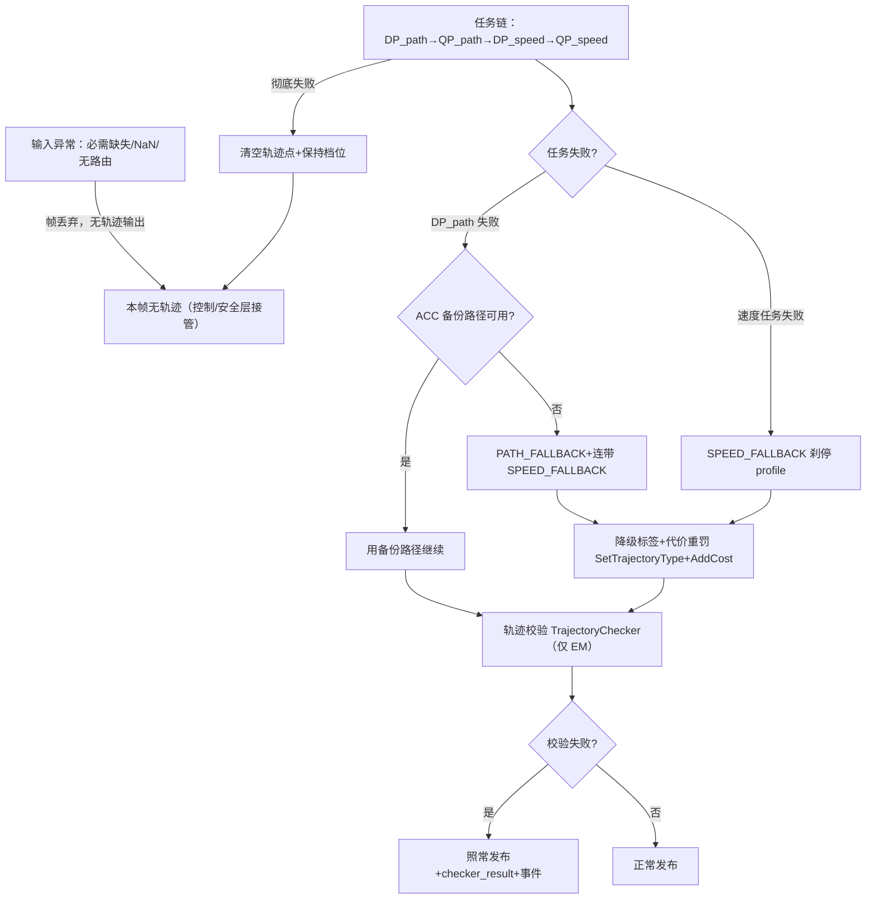

> **30 秒导读**：规划"病了"怎么办：输入缺失、任务失败、校验不过，层层降级直到安全刹停。
> **本篇回答**：降级有哪几级？PATH/SPEED_FALLBACK 什么区别？AEB 兜底在什么时候接管？
> **先修阅读**：[**00 入门**（§3 步骤 9）](../00_公共基础文档/00%20入门：写给新手的%20E2E%20架构故事（C01%20-%20orinx）.md)；[**公共 05 全链路时序**（§4）](../00_公共基础文档/05%20端到端全链路时序与异常机制（C01%20-%20orinx）.md)。

> **本篇概念速成块**（30 秒，读完再进正文不卡壳）：
> - **降级不是停车**：PATH_FALLBACK 横向靠右缓行，SPEED_FALLBACK 温和刹停——都出轨迹，只是打了降级标签（完整卡片见 §2）。
> - **三级路径退化**：DP_path 失败→先用 ACC 备份路径→不可用才 PATH_FALLBACK 且连带刹停；QP_path 失败沿用 DP 结果。
> - **代价重罚**：降级参考线加 kPathFallBackCost/kSpeedFallBackCost，防止降级线被选为主选。
> - **彻底失败才清空**：整帧规划失败→清空轨迹点+保持档位，让控制/安全层接管。
> - **校验失败照发**：轨迹校验不过也发布，但带 checker_result+事件，软告警不拦截（详见 [**轨迹校验**（子模块4 §1）](02_核心子模块拆解/子模块4：trajectory_checker%20轨迹校验子模块.md)）。
> - **BLC 丢帧冻结**：车速≥15kph 连丢 3 帧限速→冻结在丢失时刻车速，防急减速。
> - **AEB 独立兜底**：AEB 自带感知输入不依赖规划输出；规划侧只在泊车重规划时发 TCA_DISABLE 暂停看护。


> 范围：C01（orinx C01PT，L2_driving）E2E planning。主线索：**输入异常→帧内失败→轨迹降级→校验拦截→看门狗兜底**，逐级给代码证据。

---

## 1. 输入异常处理

**一句话结论**：必需输入缺失整帧拒绝（图内丢弃、无轨迹输出）、NaN 跳过、L4 无路由帧失败——输入关口的策略是"宁可不跑，不带病跑"。

**为什么容错要层层设防**：规划是链路里「最后有机会安全停车」的模块——感知坏了还有 AEB，规划的输出失控则没有退路。所以它的容错哲学是"宁可不出、出的必安全"：输入不对就整帧拒绝（§1），算法失败就打标签降级（§2），发布前再体检一遍（§4），最后还有看门狗与 AEB 兑底（§5/§6）——每一层都假设上一层可能失守。

### 1.1 必需输入缺失 → 整帧拒绝（图层返回错误）

> 文件路径：/sandbox/planning/planning/calculators/planning_input_preprocess_calculator.cc  
> 函数名：PlanningInputPreprocessCalculator::Process()  
> 核心逻辑：
> 
> ```cpp
> message = FindFirstMessage(input_msgs, "/perception/traffic_lights_status");
> if (message) {
>   outputs->tl_response_ = std::dynamic_pointer_cast<...>(message->payload());
> } else {
>   MLOG(INFO) << "perception/traffic_lights_status is required, but not found";
>   return absl::InvalidArgumentError("missing perception/traffic_lights_status");
> }
> ...
> message = FindFirstMessage(input_msgs, "/map/ras_map_plus");
> if (message) { ... } else {
>   MLOG(INFO) << "map/ras_map_plus is required, but not found";
>   return absl::InvalidArgumentError("missing map/ras_map_plus");
> }
> ```
> 
> 逻辑说明：与 planning.jsonnet 的 `type: "required"` 一致（`/perception/objects`、`/canbus/car_state`、`/perception/traffic_lights_status`、`/map/ras_map_plus` 为 required，其余 optional）；calculator 返回非 OK 状态后该帧在图内被丢弃（church 图向下游传播错误），**不会产生轨迹输出**。

### 1.2 车辆状态 NaN → 跳过规划

> 文件路径：/sandbox/planning/planning/planning_core.cpp  
> 函数名：Planning::ValidateAndPreprocessInputs()（L278\~309）  
> 核心逻辑：
> 
> ```cpp
>   if (IntersectionProcessorUtil::CheckVehicleStateNan(vehicle_state)) {
>     MLOG(ERROR) << "Vehicle_state check NaN!!! Skip Planning::Process";
>     return false;
>   }
>   return true;
> ```
> 
> 逻辑说明：Ins 位姿与底盘 car_state 时间对齐误差可能引入 NaN（代码注释"part of vehicle state info from ins pose. if aligned error, vs maybe nan."），NaN 直接终止本帧。同一检查也存在于拼接地图阶段（preprocess.cpp L52：`Skip stitchMap`）。此外 car_state 与 ins_pose 的时间差匹配容忍 500ms（planning_input_preprocess_calculator.cc L732：`constexpr uint64_t kTimeDiffTolerance = 500000;`），匹配失败仅告警跳过覆盖。

### 1.3 L4 模式无路由 → 帧失败

> 文件路径：/sandbox/planning/planning/planning_core.cpp  
> 函数名：Planning::CheckPlannerAndRouting()（L93\~126）  
> 核心逻辑：
> 
> ```cpp
>   const bool no_local_routing_under_l4 =
>       (adc_mode == DeepRoute::planning::L2StatusType::L4_HD) &&
>       (planner_->planner_type() == deeproute::planning::PlannerType::EM_PLANNER) &&
>       (!reference_line_provider_->HasRouting());
>   if (no_local_routing_under_l4) {
>     MLOG(WARN) << "routing is no ready";
>     abnormal_events_.push_back(
>         PlanningEventInfo(dr::common::Event::PLANNING_INPUT_ROUTING_INVALID));
>     return false;
>   }
> ```
> 
> 逻辑说明：路由缺失属于"上游数据无效"事件（PLANNING_INPUT_ROUTING_INVALID），直接置帧失败。速度限值为 0 的情况则**自愈**而非失败（planning_core.cpp L423\~443：`current speed limit is 0, set to adc init speed`，用自车速度+0.1 兜底）。

### 1.4 BLC 限速消息丢失 → 缓存/保持（详见第 4 节）

---

## 2. 规划失败与降级

**一句话结论**：降级是"打标签的退化"而非不出轨迹——三级路径退化+刹停速度曲线+代价重罚，宁可慢与停，不冒险硬开。

**降级链里的 AI 名词**：本节反复出现的 DP_path 是**动态规划**粗算路径（把 SL 空间划格递推找粗解，见 [**AI 字典·动态规划 DP**](../../../正典阁/技术栈/AI/动态规划%20DP.md)）、QP_path 是**二次规划**精修（见 [**AI 字典·二次规划 QP**](../../../正典阁/技术栈/AI/二次规划%20QP.md)）——所以「QP 失败沿用 DP 结果」的本质是：精修失败了，粗解还能凑合用；这正是两级优化的容错红利。

> **📘 概念｜降级 Fallback（规划的安全退化路径）**
> **是什么**：规划算不出"理想轨迹"时的一整套安全退化机制——不是不出轨迹，而是出一条**打了降级标签**的轨迹，让下游（控制/安全/回放排查）明确知道"这是兜底产物"。核心两级：PATH_FALLBACK（路径降级：沿 ACC 备份路径或横向靠右缓行）与 SPEED_FALLBACK（速度降级：生成减速刹停速度曲线），两者都伴随代价函数重罚（kPathFallBackCost/kSpeedFallBackCost），避免降级参考线在选线中被误选。它与 [**轨迹校验**（子模块4 §1）](02_核心子模块拆解/子模块4：trajectory_checker%20轨迹校验子模块.md)的区别：降级发生在任务链**内**（生成阶段的质量退化处理，输入是 [**DP/QP/ST 图**（子模块1 §3）](02_核心子模块拆解/子模块1：planner%20与%20tasks%20决策规划任务管线.md) 的失败状态），校验发生在任务链**后**（发布前的门卫拦截）——一个是"病了吃药继续走"，一个是"出门前体检"。
> **类比与角色映射**：降级像「导航没路时的下匝道靠边停」。角色映射：DP_path 失败但 ACC 备份路径可用＝主路堵但辅路能走（用自车预测路径续行）；备份也没有＝主辅路全堵，下匝道（PATH_FALLBACK）；速度任务失败＝发动机带病运转，温和减速到安全停车（SPEED_FALLBACK，`GenerateFallbackSpeedProfile` 生成刹停曲线）；ST 图搜索时间 ≤2s 或紧急碰撞＝前方突然有人，切急刹档（is_emergency）；降级标签＝车顶双闪（TrajectoryType 写进 ADCTrajectory，下游一眼可见）；代价重罚＝导航把该路线标为"仅紧急使用"；彻底失败清空轨迹＝熄火开双闪（控制/安全层接管，见 [**Planning/05**](05%20Planning%20输出发布与控制指令生成.md) 的空轨迹发布）。
> **🎯 为什么这样设计**：安全底线是"宁可慢与停，不冒险硬开"——降级保证任何异常下车辆行为可预期（缓行或刹停）而非失控；打标签而非静默降级，让下游与回放排查都能识别"这不是正常决策"；代价重罚保证降级线只在异常时被选中，不会因偶发代价波动成常态；急迫分级（≤2s）让刹停强度匹配危险程度。
> **🗂 代码在哪里**：em_planner.cpp RunTasksStage L587-734（三级降级判定）；planner.cpp FallBackPathSpeedSetting L10-86（标签+代价+刹停曲线）；speed_profile_generator.h（GenerateFallbackSpeedProfile/GenerateFastestStopProfile）；planning_core.cpp L1490-1518（彻底失败清空轨迹点）。
>
> **30 秒最小例子**：前方施工突然封路，DP_path 在 [**ST 图**（子模块1 §3）](02_核心子模块拆解/子模块1：planner%20与%20tasks%20决策规划任务管线.md)上找不到可行驶走廊而失败→先试 ACC 备份路径（自车预测外推）不可用→置 path_fallback=true 连带 speed_fallback=true→给参考线打上 PATH_FALLBACK 标签+双份降级代价，同时生成 3s 温和刹停曲线→轨迹以 SPEED_FALLBACK 类型发布，控制平滑刹停，/planner/event 上报，回放里一眼认出这是降级帧。



**图 2-1 · 规划异常的降级决策流水线（从输入异常到发布/接管）**（D/F/G 是降级三分支，H 是标签定型点，M 是最重的整帧失败出口）

**读图提示**：① 三级路径退化在 D 分流：备份路径→PATH_FALLBACK 是"先温柔后决绝"；② H 是全链路定性点——任何降级最终都落到 SetTrajectoryType+AddCost 两件套；③ 校验失败照常发布（K），降级/失败才改轨迹内容，这是两条独立的异常通道；④ 最右 M 是最重出口：清空轨迹+锁档位，主动把控制权交出去。

### 2.1 降级判定：RunTasksStage 的 fallback 标志

> 文件路径：/sandbox/planning/planning/planner/em_planner.cpp  
> 函数名：EmPlanner::RunTasksStage()（L587\~734）  
> 核心逻辑：
> 
> ```cpp
>     auto execute_status = task->Execute(frame, reference_line_info);
>     if (execute_status != DR_TASK_STATUS_OK) {
>       MLOG(WARN) << "stage tasks: Failed to run " << task->Name() << ...;
>       if (flag_dp_path) {
>         if (is_backup_path_valid) {
>           reference_line_info->set_use_backup_path_data(true);
>           reference_line_info->set_normal(true);
>           reference_line_info->mutable_path_data()->SetDiscretizedAndFrenetPath(
>               discretized_backup_path, reference_line_info->init_sl_point().s());
>           use_backup_path = true;
>           MLOG(WARN) << "path fallback use Adc prediction path";
>           continue;
>         }
>         *path_fallback = true;
>         MLOG(WARN) << "[ReferenceLinePosition:...] Path fallback triggered for refline id: " ...;
>         // if path fallback, speed need to be set as fallback to brake
>         *speed_fallback = true;
>       } else if (task->Name() == "DP_speed" || task->Name() == "QP_speed") {
>         *speed_fallback = true;
>       } else if (task->Name() == "QP_path") {
>         MLOG(WARN) << reference_line_info->reference_line_position()
>                    << ", qp path failed, use dp path result";
>         continue;
>       }
>       break;
>     }
> ```
> 
> 逻辑说明：**三级路径降级**：① DP_path 失败但 ACC 备份路径（自车预测路径）可用 → 用备份路径继续；② 备份也不可用 → `path_fallback=true` 且连带 `speed_fallback=true`（路径没了必须刹停）；③ QP_path 失败 → 直接沿用 DP_path 结果。速度任务失败 → `speed_fallback=true`。且 DP_path 失败后循环开头跳过 QP_path（L615\~619 "dp path failed, skip qp path"）。

### 2.2 降级执行：FallBackPathSpeedSetting（类型标记 + 代价惩罚 + 刹停速度）

> 文件路径：/sandbox/planning/planning/planner/planner.cpp  
> 函数名：Planner::FallBackPathSpeedSetting()（L10\~86）  
> 核心逻辑：
> 
> ```cpp
>   if (path_fallback) {
>     reference_line_info->SetTrajectoryType(
>         deeproute::planning::ADCTrajectory::PATH_FALLBACK);
>     reference_line_info->AddCost(kPathFallBackCost);   // ReferenceLineCost set_fallback()
>     reference_line_info->AddCost(kSpeedFallBackCost);
>   }
>   if (speed_fallback) {
>     constexpr double kEmergencyTimeThres = 2.0;
>     bool is_emergency = (!reference_line_info->flag_last_frame_path() &&
>                          reference_line_info->st_grid_max_searched_time() <=
>                              kEmergencyTimeThres) ||
>                         reference_line_info->is_emergency_collision();
>     SpeedProfileGenerator::GenerateFallbackSpeedProfile(
>         reference_line_info->adc_planning_point(), reference_line_info->id(),
>         reference_line_info->mutable_speed_data(),
>         speed_profile_generator_config_, is_emergency);
>     UpdateBrakeInfoAsFallback(reference_line_info);  // 刹车原因记为 OBSTACLE
>     reference_line_info->SetTrajectoryType(
>         deeproute::planning::ADCTrajectory::SPEED_FALLBACK);
>   }
>   if (reference_line_info->GetTrajectoryType() == UNKNOWN) {
>     reference_line_info->SetTrajectoryType(NORMAL);
>   }
> ```
> 
> 逻辑说明：降级不是"不出轨迹"而是**出一条标记过的降级轨迹**：`TrajectoryType` 写进 ADCTrajectory（proto L171~179），fallback 代价抬高该参考线总代价避免被选为主线；速度侧用 `SpeedProfileGenerator::GenerateFallbackSpeedProfile`（/sandbox/planning/planning/common/speed/speed_profile_generator.h L13~28，另有 `GenerateFastestStopProfile` / `GenerateSmoothStopProfileAtDistance`）生成**减速停车速度曲线**，急迫时（ST 图搜索时间 ≤2s 或紧急碰撞）走急刹档。**未发现名为 "neutral trajectory" 的减速带轨迹**：本仓库 "neutral" 出现在 model path 的 `model_path_neutral_l_map`（em_planner.cpp L875，中性横向偏移映射，语义不同）；基线所提 neutral 停车在本分支对应实现即 SPEED_FALLBACK 刹停 profile（**差异/更正标注**）。

### 2.3 上一帧轨迹续用（换帧/绕行场景）

> 文件路径：/sandbox/planning/planning/planning_misc_utils.cpp  
> 函数名：Planning::（Detour 决策处理，L2395\~2450）  
> 核心逻辑：
> 
> ```cpp
>   // Truncate previous trajectory using planning start point
>   DiscretizedTrajectory trajectory(last_selected_trajectory);
>   if (!trajectory.TruncateTrajectorybyIndex(...)) { ... return false; }
>   if (decision == DetourPlannerDecision::USE_LAST_TRAJ_WITH_BRAKE) {
>     SpeedData stoping_speed;
>     SpeedProfileGenerator::GenerateFallbackSpeedProfile(
>         selected_ref_line_info->adc_planning_point(), ...,
>         &stoping_speed, ..., false);
>     if (!ApplySpeedProfile(stoping_speed, ...)) { return false; }
>   }
>   ...
>   selected_ref_line_info->SetTrajectory(trajectory);
> ```
> 
> 逻辑说明：绕行（Detour）决策支持"沿用上一帧轨迹"（USE_LAST_TRAJ）/ "沿用但刹停"（USE_LAST_TRAJ_WITH_BRAKE，叠加刹停速度）/ "沿用并转前进档"（USE_LAST_TRAJ_WITH_FORWARD，需满足低速才允许改档，L2419\~2438）。EM 线路中 `flag_last_frame_path()`（planner.cpp L49）亦表明路径 fallback 优先用上一帧路径。

### 2.4 规划彻底失败 → 清空轨迹输出

> 文件路径：/sandbox/planning/planning/planning_core.cpp  
> 函数名：Planning::ProcessPlanStuff()（L138~199）与 HandleTrajectoryPublishingAndExceptions()（L1490~1518）  
> 核心逻辑：
> 
> ```cpp
>   const bool _plan_ok = planner_->Plan(frame_.get());
>   if (!_plan_ok) {
>     MLOG(ERROR) << "[REAL ERROR] planner planning failed!";
>     if (planner_->planner_type() != deeproute::planning::PlannerType::OPEN_SPACE_PLANNER) {
>       abnormal_events_.push_back(
>           PlanningEventInfo(dr::common::Event::PLANNING_OUTPUT_PLANNING_FAILD));
>       run_success = false;
>     }
>   }
>   ...
>   // When planner fail, don't change adc gear in any planner.
>   if (!run_success) {
>     planner_->mutable_adc_trajectory()->set_gear(frame_->GetVehicleState().gear());
>   }
> ...
>     if (!run_success) {
>       trajectory_obj->clear_trajectory_point();
>       trajectory_obj->clear_path_point();
>     }
> ```
> 
> 逻辑说明：EM 规划失败 → 上报 PLANNING_OUTPUT_PLANNING_FAILD、**清空轨迹点**（发布空轨迹，让控制/安全层接手），且失败帧强制保持当前档位（防换挡）。open-space 失败允许静默（泊车中规划失败不退出自动模式）。另有 `Planner::GenerateFakeTrajectory`（planner.cpp L513\~554，131 点原地伪轨迹，仅在路径为空时兜底，走停车保持语义——推断其用于特定拉手/泊车保持场景）。

---

## 3. 轨迹有效性保障（trajectory_checker）

**一句话结论**：仅 EM 线路校验；失败轨迹照常发布但带事件与状态机处理，唯一特例是 checker 自身故障强制放行（完整卡片见 [**子模块4 §1**](02_核心子模块拆解/子模块4：trajectory_checker%20轨迹校验子模块.md)）。

### 3.1 校验项与失败枚举

> 文件路径：/sandbox/planning/planning/trajectory_checker/trajectory_checker.h  
> 函数名：enum TRAJECTORY_FEASIBILITY（L31\~51）
> 
> ```cpp
>   enum TRAJECTORY_FEASIBILITY {
>     SUCCESS = 0, UNMOVEABLE_COLLISION = 1, MOVING_OBJ_COLLISION = 2,
>     OFF_LANE = 3, LANE_COLLISION = 4, NOT_CONTROLABLE = 5,
>     NOT_ENOUGH_POINT = 6, PLANNER_FAILED = 7,
>     TRAJECTORY_PERCEPTION_TIME_UNMATCHED = 8, UPSTREAM_MODULE_FAILED = 9,
>     MAP_ERROR = 10, FRONT_MOVING_OBJ_COLLISION = 11, LAT_UNCOMFORTABLE = 12,
>     LON_HARD_BRAKE = 13, WIBBLE_TRAJECTORY = 14, STEER_SHAKING = 15,
>     STEER_JERKY = 16, SAFETY_CHECKER = 17, CHECKER_INTERNAL_FAULT = 101,
>   };
> ```
> 
> 逻辑说明：覆盖碰撞（静止/移动/前车）、出线、不可控、点数不足、感知时间不匹配、横/纵向舒适性、方向盘抖动等 17 类失效。另有 `SECURITY_WARNING_LEVEL PASS~WARNING_LEVEL5`（L53\~60）分级告警与独立 `SafetyChecker`（safety_checker.h）。

### 3.2 失败后果

> 文件路径：/sandbox/planning/planning/planning_trajectory_process.cpp  
> 函数名：Planning::RunTrajectoryChecker()（L2529\~2580）  
> 核心逻辑：
> 
> ```cpp
>   if (is_em_planner && trajectory_checker_) {
>     trajectory_passed_checker = trajectory_checker_->RunChecker(
>         vehicle_state, perception_obstacles,
>         frame_->selected_reference_line_info()->GetPathDecision(), ...,
>         run_success, trajectory_obj, trajectory_bag);
>     if (trajectory_checker_->HasInternalFault()) {
>       trajectory_passed_checker = true;    // checker 自身故障不拦截业务
>     }
>     trajectory_checker_->AbnormalEventsChecker(trajectory_obj);
>   }
> ```
> 
> 逻辑说明：仅 EM 线路校验（泊车线路不查）；**校验失败轨迹照样发布**，但：  
> ① 触发异常事件映射（planning_trajectory_process.cpp L1616~1634：`UNMOVEABLE_COLLISION→PLANNING_OUTPUT_UNMOVEABLE_COLLISION`、`OFF_LANE→PLANNING_OUTPUT_OFF_LANE` 等，进 `/planner/event`）；  
> ② 影响下游状态机（planning_core.cpp L1457~1464：`frame_->ProcessVPAStatus(trajectory_checker_fail_reasons)`）；  
> ③ `LAT_UNCOMFORTABLE/LON_HARD_BRAKE` 等属"告警不拦截"级别——失败原因与后果的映射表在 trajectory_checker.h L90\~98 的预定义集合中（推断其区分"硬失败/软告警"）。  
> ④ checker 自身崩溃防护：`CHECKER_INTERNAL_FAULT` 时强制放行（上段代码）。

---

## 4. 帧丢失与恢复（blc frame loss speed calculator 查证）

**一句话结论**：BLC 限速丢帧的恢复策略按车速分档——高速冻结在丢失时刻车速、低速清零计数、从未收到直接清空回默认。

git 近期提交（planning 仓库 HEAD a29e2ca4c01，2026-09-16）："restore E2E out parking first-stage check; **restore blc frame loss speed calculator**; ..."。经 `git show a29e2ca4c01` 验证，其 28 行增量正落在 `planning/calculators/planning_input_preprocess_calculator.cc`，即 **BLC 限速消息丢帧保持逻辑**：

> 文件路径：/sandbox/planning/planning/calculators/planning_input_preprocess_calculator.cc  
> 函数名：PlanningInputPreprocessCalculator::Process()（L299\~332）  
> 核心逻辑：
> 
> ```cpp
>     if (!has_blc_speed_limit_msg) {
>       constexpr double kBlcHoldSpeedThresholdMps = 15.0 / 3.6;  // 15 kph
>       if (vehicle_state_.speed() >= kBlcHoldSpeedThresholdMps) {
>         constexpr int kBlcSpeedLimitMissThreshold = 3;
>         blc_speed_limit_miss_count_++;
>         if (blc_speed_limit_miss_count_ >= kBlcSpeedLimitMissThreshold) {
>           if (!blc_speed_limit_holding_) {
>             blc_speed_limit_hold_speed_ = vehicle_state_.speed();
>             blc_speed_limit_holding_ = true;
>             MLOG(WARN) << "[BLC] Speed limit lost for "
>                        << kBlcSpeedLimitMissThreshold << " frames, holding speed at "
>                        << blc_speed_limit_hold_speed_ << " m/s";
>           }
>           blc_speed_limit_.set_current_speed_limit(blc_speed_limit_hold_speed_);
>           blc_speed_limit_.set_next_speed_limit(blc_speed_limit_hold_speed_);
>           blc_speed_limit_.set_next_speed_limit_remaining_s(10000.0);
>           frame_context_->mutable_blc_speed_limit_info()->CopyFrom(blc_speed_limit_);
>         }
>       } else { blc_speed_limit_miss_count_ = 0; }
>     }
>     if (!has_blc_speed_limit_msg && !ever_received_blc_speed_limit_) {
>       frame_context_->clear_blc_speed_limit_info();
>     }
> ```
> 
> 逻辑说明：**帧丢失恢复策略 = 按车速分档**：车速 ≥15kph 时连续丢 3 帧 BLC 限速 → **冻结在丢失时刻车速**（hold），限速剩余距离设 10000m 防触发降速；低速时丢帧计数清零；从未收到过 BLC → 直接清空 context 字段回到默认限速。目的：防止上游 blc 偶发掉流时规划突然失去限速导致急减速/超速。

---

## 5. 超时与看门狗

**一句话结论**：两级监控都只告警不干预——500ms 超时上报事件、1s 无帧打印卡死节点；真正的硬约束在下游 grading 的 lua 判定（触发机制见 [**Planning/04**](04%20线程调度与规划周期.md)）。

### 5.1 组件级 proc 超时（500ms）

> 文件路径：/sandbox/platform/church/component/proc_time_unit.cc  
> 函数名：ComProcTimeUnit::ComponentProcTimeoutCallback()（L188\~208）  
> 核心逻辑：
> 
> ```cpp
>   MLOG(WARN) << name << " proc time out !!! "
>              << ", proc run id: " << proc_id << ", duration: " << duration / 1000
>              << " ms, expected duration: " << cs->expected_duration() << " ms";
>   nlohmann::json component_timeout;
>   component_timeout["expected_proc_duration_ms"] = cs->expected_duration();
>   deeproute::common::ReportEvent(dr::common::Module::CHURCH,
>                                  dr::common::Event::CHURCH_PROC_TIMEOUT_EVENT, ...);
> ```
> 
> 逻辑说明：planning.jsonnet `expected_proc_duration_ms: 500` 超过即上报 `CHURCH_PROC_TIMEOUT_EVENT`（json 携带 proc_id/开始时间/耗时）。**行为只是告警/事件上报，不杀帧、不降级**。规划自有的整帧耗时另经 `latency_stats.total_time_ms` 随轨迹输出（planner.cpp L271\~275，供 grading lua 算子 lua_frame_overtime 判阈值触发）。

### 5.2 图级看门狗（无帧 ≥1s 告警）

> 文件路径：/sandbox/platform/church/graph/watch_dog.h  
> 函数名：WatchDog::PipelineStatusMonitor()（L46\~66）  
> 核心逻辑：
> 
> ```cpp
> constexpr uint64_t kWaitMsgArrivedMaxTimeNs = 999999999;  // ns
> if (elapsed_time > kWaitMsgArrivedMaxTimeNs) {
>   MLOG(WARN) << "There is no incoming frame" << " Running Process"
>              << ::common::Container2Str(GetRunningProcess());
> }
> ```
> 
> 逻辑说明：独立线程 `graph_watch_dog` 每秒巡检；1 秒无新帧则打印当前仍在运行的图节点（`graph_->GetRunningNodes()`），定位卡死的 calculator。启用见 component_task_ddl.cc L487\~488/L501。**注意**：该实现属 platform/church（dev_master 分支，与 planning 主分支版本存在差异）。

---

## 6. 错误码与日志机制

**一句话结论**：无 numeric 错误码，三级表达——MLOG 分级日志、PLANNING_* 异常事件（经 /planner/event 发布且变化才发）、CHURCH 平台事件。

planning 没有 numeric 错误码体系，采用**三级异常表达**：

1. **MLOG 日志分级**：帧边界打点用 MLOG(WARN)（`FRAME START/FRAME END | cost=`，planning_input_preprocess_calculator.cc L155 / planning_post_process_calculator.cc L211），错误路径 MLOG(ERROR)（如 "[REAL ERROR] planner planning failed!"），配合 `absl::Status`（InvalidArgumentError）表达图级失败。
2. **异常事件（abnormal_events\_）**：任务失败/校验失败帧内聚合成 `dr::common::Event::PLANNING_*` 枚举事件（PLANNING_OUTPUT_PLANNING_FAILD、PLANNING_INPUT_ROUTING_INVALID、PLANNING_RUNTIME_ILQR_SOLVE_FAILED、PLANNING_ILQR_CONSTRAINT_CHECK_FAILED、PLANNING_STITCH_POINTS_CONSTRAINT_CHECK_FAILED、PLANNING_ILQR_AND_MODEL_SPEED_DIFF_CHECK_FAILED 等，planning_core.cpp L138~199/L1521~1529），经由 debug_info→`ProcessPlanningResponses`→`/planner/event` 发布（planning_core_calculator.cc L326\~339：从 debug_info.hpi_info().planning_event() 提取、与上帧比较变化才发）。
3. **CHURCH 平台事件**：proc 超时等由平台 ReportEvent（Module::CHURCH）。

> 文件路径：/sandbox/planning/planning/calculators/planning_post_process_calculator.cc  
> 函数名：PlanningPostProcessCalculator::Process()（L155\~176）
> 
> ```cpp
>       MLOG(WARN) << "[/planner/event][global_counter=" << FLAGS_global_counter
>                  << "] contains DESTINATION_REACHED: "
>                  << ... << ", planning_statuses_size: " << ...;
>       output_msgs["/planner/event"].emplace_back(
>           std::move(out_frame->last_planning_event));
> ```
> 
> 逻辑说明：`/planner/event` 是 PlanningEvent 结构（含 planning_statuses 列表，如 DESTINATION_REACHED），是**对上游/车机报告异常与状态的标准出口**。

---

## 7. 与 AEB / 安全的兜底关系

**一句话结论**：双向协议——规划主动申请暂停/恢复 safety 对轨迹的看护（TCA_DISABLE/RESET）；AEB 则完全独立（自带感知输入），规划侧用空轨迹+stop_objects 配合其接管。

### 7.1 planning → safety：/safety/request 控制 /planner/trajectory 的看护

> 文件路径：/sandbox/planning/planning/calculators/planning_core_calculator.cc  
> 函数名：PlanningCoreCalculator::ProcessSafetyRequest()（L236\~302）  
> 核心逻辑：
> 
> ```cpp
>       auto* override_item = topic_check_control->add_overrides();
>       override_item->set_topic_name("/planner/trajectory");
>       override_item->set_action(action);
>       if (ttl_sec > 0) { override_item->set_ttl_sec(ttl_sec); }
>       override_item->set_operator_("SOC_Planning");
>       output_data.safety_request_info = safety_request;
>     ...
>     if (need_stop_monitor && frame_rate_check_flag_) {
>       if (current_replan_flag) {
>         create_safety_request(
>             dr::safety::TopicCheckAction::TCA_DISABLE,
>             "Replan started, sending TCA_DISABLE request with TTL=10s", 10);
>       }
>       ...
>     if (!need_stop_monitor && !frame_rate_check_flag_) {
>       create_safety_request(
>           dr::safety::TopicCheckAction::TCA_RESET_TO_CONFIG,
>           "Replan flag cleared, sending TCA_RESET_TO_CONFIG request");
> ```
> 
> 逻辑说明：safety 模块默认对 `/planner/trajectory` 做 topic 看护（频率/超时检查，配置见 aeb/safety）；planning 在**泊车重规划（replan/PRE_PLAN）期间主动发 `TCA_DISABLE`（TTL=10s）暂停该 topic 的帧率看护**，重规划结束再 `TCA_RESET_TO_CONFIG` 恢复——防止异步重规划帧率下降被安全模块误判。该请求经 `/safety/request` 通道发布（planning.jsonnet output_channels L204\~207）。

### 7.2 AEB → planning：独立兜底

> 文件路径：/sandbox/driver/config/component/aeb.jsonnet  
> 函数名：input_channels 条目（L101\~106）
> 
> ```json
> { "name": '/planner/trajectory',
>   "msg_type": 'deeproute.planning.ADCTrajectory',
>   "type": 'optional', "cache_size": 1 },
> ```
> 
> 逻辑说明：**AEB 订阅 /planner/trajectory（optional、cache 1）用于跟踪规划意图/目标轨迹**；AEB 自身有独立的感知输入（radar、ultrasonic、camera_obstacle 等，同文件），其触发不依赖 planning 输出有效。planning 侧与之配合的语义：规划失败时清空轨迹点（2.4）→ 上游看护（safety topic check）与控制侧看到空轨迹即接管减速；同时 planning 发布 `/planner/stop_objects`（刹停障碍物，感知格式；planning_core.cpp GetStopObstacles L1558\~1672，将导致刹停的最近 ST 障碍物 type 改写为 PLANNING_STOP_OBSTACLE 一帧），供下游追溯刹停原因。planning 的 `EStop` 字段（planning.proto L129）与 `security_strategy`（FrameContext L1905）为平台安全策略预留接口（本分支未见 planning 主动置位 EStop——**未验证全部分支**）。

---

## 8. FAQ 与自测

**Q1（新手常见误解）**：规划一降级就是停车，PATH_FALLBACK 和 SPEED_FALLBACK 都会把车刹停？
不是。PATH_FALLBACK 是**路径**降级——横向靠右/沿备份路径继续走，速度可以不刹；SPEED_FALLBACK 才是纵向刹停（且分温和/急迫两档）。只有两者连带触发（路径没了必须刹停）或整帧彻底失败（清空轨迹点）才真正停下来（§2 卡片/图 2-1）。

**Q2**：轨迹校验失败的轨迹会下发给控制吗？
会。校验失败轨迹照样发布，但 checker_result 随轨迹携带、失败原因映射为 PLANNING_OUTPUT_* 事件进 /planner/event、并影响 VPA 状态机——是"带故障标志发布"而非拦截。舒适度类（横摆/急刹/画龙）更软：只记告警不拦截（§3.2）。

**Q3**：AEB 什么时候接管规划？规划失效它怎么知道？
AEB 不依赖规划输出触发——它自带独立感知输入（radar/ultrasonic/camera_obstacle），订阅 /planner/trajectory（optional）只为跟踪规划意图。规划失效时表现为轨迹清空/停流，safety 的 topic 看护与控制侧自然接管；泊车重规划期间规划会主动发 TCA_DISABLE（TTL=10s）暂停看护防误判，结束后 TCA_RESET 恢复（§7）。

**自测**：

1. DP_path 失败后的三级路径退化是什么？
    ① ACC 备份路径可用→用备份路径继续；② 备份不可用→PATH_FALLBACK 且连带 SPEED_FALLBACK；③ QP_path 失败→直接沿用 DP_path 结果（§2.1）。
2. BLC 限速丢帧的恢复策略？
    车速≥15kph 时连续丢 3 帧→冻结在丢失时刻车速（剩余距离设 10000m 防降速）；低速时计数清零；从未收到过→清空 context 字段回默认限速（§4）。
3. 规划整帧彻底失败时的三个动作？
    上报 PLANNING_OUTPUT_PLANNING_FAILD 事件、清空 trajectory_point/path_point、强制保持当前档位不换挡（§2.4）。

## 小结

| 异常 | 检测点 | 动作 |
|-|-|-|
| 必需输入缺失 | Preprocess Calculator | 帧丢弃（InvalidArgumentError） |
| VS NaN | ValidateAndPreprocessInputs | 跳过本帧 |
| L4 无路由 | CheckPlannerAndRouting | 帧失败 + INPUT_ROUTING_INVALID |
| DP_path 失败 | RunTasksStage | 备份路径→PATH_FALLBACK→连带刹停 |
| DpSpeed/QpSpeed 失败 | RunTasksStage | SPEED_FALLBACK 刹停 profile |
| Planner 整体失败 | ProcessPlanStuff | 清空轨迹点 + 保持档位 + FAILD 事件 |
| 轨迹校验失败 | TrajectoryChecker | 照常发布 + PLANNING_OUTPUT\_\* 事件 + 状态机处理 |
| BLC 限速丢帧 | Preprocess（车速≥15kph 连续 3 帧） | 冻结限速 10s 语义（hold） |
| 单帧 >500ms / 无帧 ≥1s | church proc_time_unit / watch_dog | 事件上报/日志，不干预业务 |
| 泊车重规划 | PlanningCoreCalculator | TCA_DISABLE→TCA_RESET（/safety/request） |
