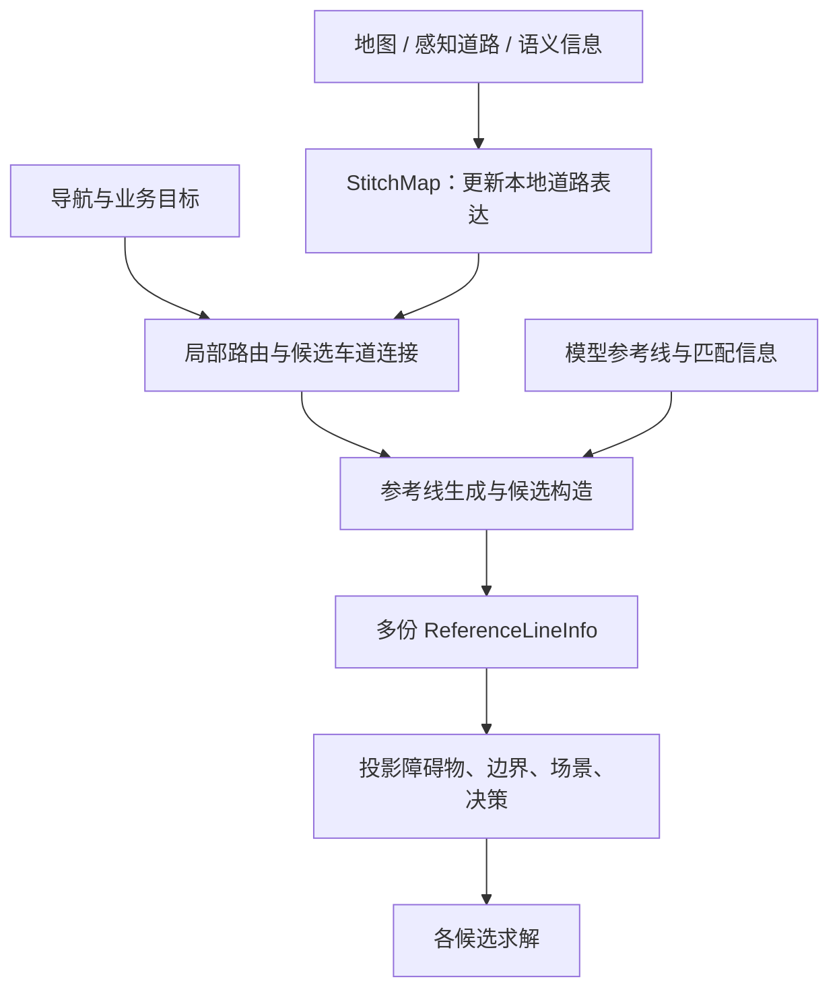
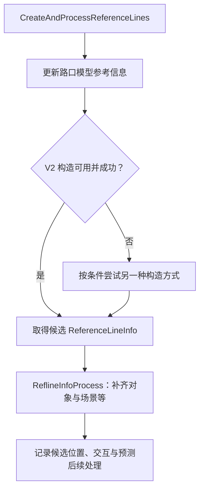
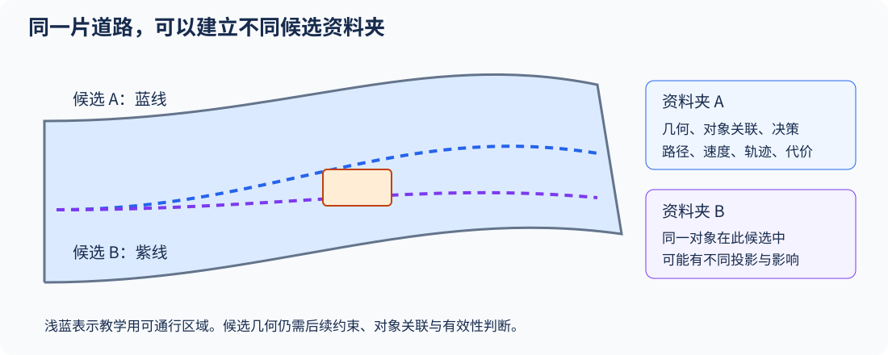

# 07 道路怎样变成可计算的空间

> **这一篇讲什么**：把地图、导航、道路参考线、候选资料夹和可通行区域连接起来，理解车能在哪里规划。
>
> **读完你能回答**：导航是不是轨迹？模型参考线和道路参考线有什么联系？ReferenceLineInfo 装了什么？
>
> **前置知识**：第 02、04、06 篇。

## 1. 导航只说往哪里去，规划还要知道这一段怎样走

导航告诉你“下个路口右转”，不能直接告诉控制每 0.1 秒车应在哪里。它首先影响局部路线：当前道路、后续连接、出口、可选车道以及距离目的地的关系。地图或语义道路提供几何和连接信息；参考线生成再把其中的候选走向变成适合计算的曲线。

在本项目里，“地图”也不宜只理解成预先测好的高精地图。输入包含感知道路结构、RAS 系列数据与语义地图等，具体使用哪些取决于模式、可用数据和配置。`PlanningStitchMapCalculator` 中有地图更新、道路解码、状态衔接等工作；名字里的 stitch map 与后文的**历史轨迹拼接**是两件事。

*图 7-1 · 道路数据走向规划候选。模型信息和语义道路有交汇，不是互不相干的两套输入。*

## 2. 三个名字相近、用途不同的对象

| 对象 | 从哪里来 | 用来做什么 | 不能直接等同于 |
|---|---|---|---|
| 模型预测参考线 | planner head 的 `junction_reference_line` 等 | 表达模型认为可能的自车空间走向，参与匹配、候选和轨迹生成 | 最终选中的道路方案 |
| 道路参考线 `ReferenceLine` | provider 或结合模型匹配与语义道路的构造流程 | 提供曲线、SL 基准及道路几何 | 最终执行路径 |
| `ReferenceLineInfo` | Frame 创建并初始化 | 汇集某个候选的参考线、障碍物、场景、决策、代价、路径、速度和轨迹 | 一条单纯的曲线 |

可以把道路参考线看成底图上的一条基准线，把 `ReferenceLineInfo` 看成围绕这条线建立的“候选资料夹”。同一障碍物放进不同资料夹，前后左右关系可能不同；每个候选要分别判断如何处理它。

模型参考线与道路参考线也不保证一对一。模型方案可能有多个横向模态，语义车道又可能有多种连接。后续需要匹配、分组、过滤和保留；不能把模型输出的数量直接当成本帧求解的 `ReferenceLineInfo` 数量。

## 3. 当前代码怎样建立这些候选

Frame 的 `CreateAndProcessReferenceLines` 先更新模型路口参考信息，再尝试 `CreateReferenceLineInfoV2`。V2 中检查模型路径和框架开关，利用语义车道、候选车道序列、起始车道以及模型匹配上下文构造候选。V2 并非在所有模式运行：例如 `enable_e2e_refline_framework` 打开时，它会返回 false，进入后续条件分支。

另一条 `CreateReferenceLineInfo` 路径通过 `ReferenceLineProvider::GetReferenceLines` 等接口取得道路曲线及相关路段信息。不要把这里的“V2 返回 false”直接翻译成“规划失败”：外层还会判断是否走另一种构造方式。

*图 7-2 · 候选构造分支。图表达控制结构，不保证另一种构造总能成功；失败应继续沿调用方返回值检查。*

## 4. 边界和可通行区域怎样参与

参考线只提供基准，边界还要说明车身能放在哪里。道路边缘、车道边界、静态障碍物、邻车位置和业务规则可以分别影响可用空间。代码中可见 passable area、boundary、road mask 等表达；它们的用途和更新阶段不同，不能统一称为“一个碰撞地图”。

例如右侧有停靠车辆，左侧是不可越过的道路边缘：规划需要同时考虑自车宽度、障碍物包围盒、边界余量和当前速度下的运动能力。可通行区域用于缩小候选和约束后续任务，最终车辆运动仍由路径、速度和数值求解共同决定。

*图 7-3 · 同一片道路中的两份候选资料夹。浅蓝区域表示教学用可通行空间，橙框是障碍物；边界不是轨迹，曲线也不保证天然可行。*

## 5. 这一过程交付什么，失败会怎样

| 阶段 | 输入 | 交付 | 要追踪的失败 |
|---|---|---|---|
| 地图准备 | 道路消息、位姿、历史地图状态 | 本地道路表达及相关共享对象 | 更新缺失、数据过旧、模式不匹配 |
| 路由与生成 | 导航、车道连接、模型匹配上下文 | 候选参考线和路段信息 | 起始车道/连接不足、构造失败 |
| 候选初始化 | 几何、障碍物、规则与历史 | 可供任务执行的 `ReferenceLineInfo` 集合 | 投影失败、候选无效或不可用 |

这些错误有的会减少候选，有的触发备选构造，有的使帧初始化或后续规划失败。判断结果必须看调用者是否继续、最终是否有选中候选以及最终消息内容，不能只查一条 ERROR 日志。

## 证据与延伸

以下链接固定到本系列分析的源码提交；行号指向关键实现，不代表整段行为只由这一行决定。

| 要核实的行为 | 源码入口 |
|---|---|
| 地图更新入口 | [planning/planning/calculators/planning_stitch_map_calculator.cc · `UpdateMapOnce(`](https://code.deeproute.ai/deeproute-org/pnc/planning/planning/-/blob/dd7cbf35a83fa1f5fb5dc078563235e671365327/planning/calculators/planning_stitch_map_calculator.cc#L481) |
| 参考线生成器 | [planning/planning/reference_line_info/reference_line_provider.cpp · `ReferenceLineProvider::GetReferenceLines`](https://code.deeproute.ai/deeproute-org/pnc/planning/planning/-/blob/dd7cbf35a83fa1f5fb5dc078563235e671365327/planning/reference_line_info/reference_line_provider.cpp#L101) |
| 构造与后续处理 | [planning/planning/frame/frame_reference_line.cpp · `Frame::CreateAndProcessReferenceLines`](https://code.deeproute.ai/deeproute-org/pnc/planning/planning/-/blob/dd7cbf35a83fa1f5fb5dc078563235e671365327/planning/frame/frame_reference_line.cpp#L3302) |
| V2 的条件 | [planning/planning/frame/frame_reference_line.cpp · `Frame::CreateReferenceLineInfoV2`](https://code.deeproute.ai/deeproute-org/pnc/planning/planning/-/blob/dd7cbf35a83fa1f5fb5dc078563235e671365327/planning/frame/frame_reference_line.cpp#L3393) |
| 候选补全 | [planning/planning/frame/frame_init_utils.cpp · `Frame::ReflineInfoProcess`](https://code.deeproute.ai/deeproute-org/pnc/planning/planning/-/blob/dd7cbf35a83fa1f5fb5dc078563235e671365327/planning/frame/frame_init_utils.cpp#L58) |

---

[返回 Planning 导读](./index.md) · [上一篇：06 一帧的工作台：Frame、Context 与规划起点](./06%20%E4%B8%80%E5%B8%A7%E7%9A%84%E5%B7%A5%E4%BD%9C%E5%8F%B0%EF%BC%9AFrame%E3%80%81Context%20%E4%B8%8E%E8%A7%84%E5%88%92%E8%B5%B7%E7%82%B9.md) · [下一篇：08 障碍物与场景：从“看见它”到“它影响我”](./08%20%E9%9A%9C%E7%A2%8D%E7%89%A9%E4%B8%8E%E5%9C%BA%E6%99%AF%EF%BC%9A%E4%BB%8E%E2%80%9C%E7%9C%8B%E8%A7%81%E5%AE%83%E2%80%9D%E5%88%B0%E2%80%9C%E5%AE%83%E5%BD%B1%E5%93%8D%E6%88%91%E2%80%9D.md)
