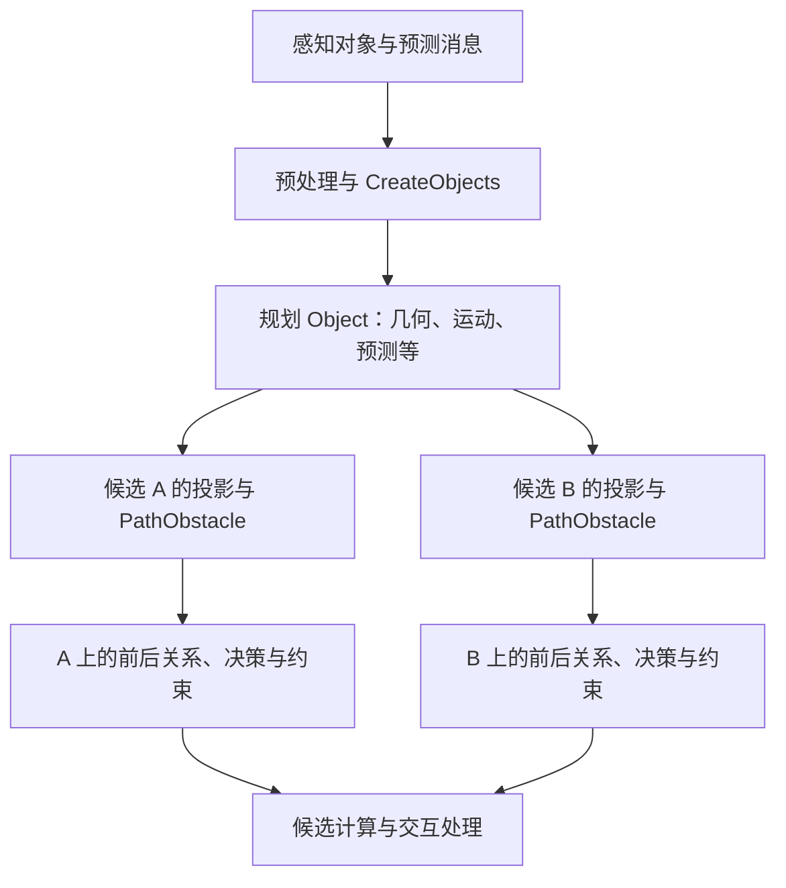
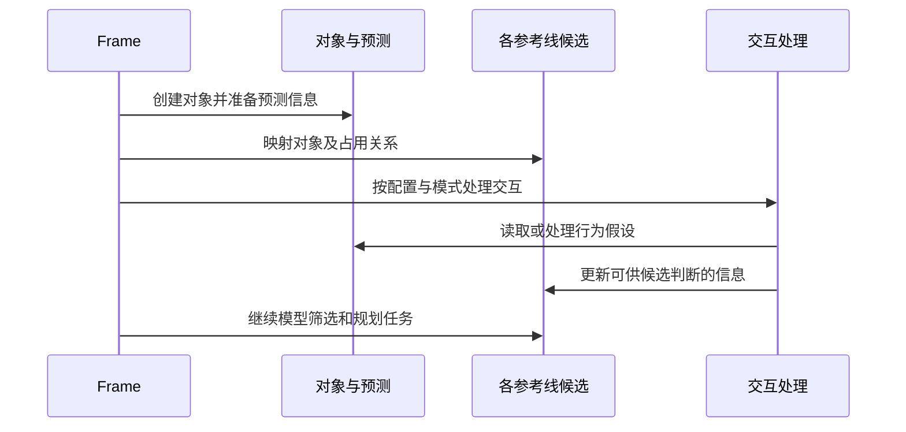

# 08 障碍物与场景：从“看见它”到“它影响我”

> **这一篇讲什么**：解释感知对象怎样变成规划对象、预测和参考线关联，以及交互推演与场景识别的作用。
>
> **读完你能回答**：为什么同一辆车在不同候选中有不同影响？预测、LevelK 和场景分别解决什么问题？
>
> **前置知识**：第 02、06、07 篇。

## 1. 障碍物列表只是起点

感知说“有一辆车，在这里，速度大约如此”，规划要继续问“它是否会进入我的路径、什么时候进入、我该怎样响应”。因此，从消息里的障碍物到规划里的障碍物，不只是复制字段。

Frame 在参考线后续处理中进行感知对象预处理、创建规划 `Object`、更新占用关系，并把对象映射到各参考线。`Object` 的声明在 `common/obstacle/obstacle.h`；文件名是 obstacle，不代表类名也一定叫 Obstacle。

*图 8-1 · 物理对象与候选上的关联对象。图中共享同一物理对象信息，不表示每条线一定复制整份原始消息。*

## 2. Object 与 PathObstacle 为什么要分开

一辆在左后方的车，对“保持本车道”可能只是邻车，对“向左变道”却可能是关键后车。物理位置没有变，**相对于候选方案的意义变了**。

| 层次 | 主要描述 | 例子 |
|---|---|---|
| 感知对象 | 观测与上游估计 | 车辆 ID、位置、尺寸、速度、预测 |
| 规划 `Object` | 本帧可供规划使用的对象信息 | 包围盒、运动信息、预测轨迹及相关状态 |
| 候选上的 `PathObstacle` | 相对这一条参考线/路径的关联 | SL 范围、纵向或横向决策、与本候选的关系 |

包围盒让规划处理车身范围，而不是只避开一个中心点。SL 投影把二维对象转成“占据从哪里到哪里、横向偏多少”。但弯道、路口、长车和不同投影结果都可能影响它；一个简单投影区间不能替代所有后续几何检查。

`MapObjectsToRefline` 可以借助线程池把多个候选上的工作分发出去，再等待完成。这里的并行单位是候选相关工作，不等于多个完整 planning 帧并行。

## 3. 为什么还需要预测和交互推演

障碍物当前不在路上，不代表两秒后不在。预测用未来时间索引描述其可能运动；规划据此判断会不会在同一时间占据相近空间。只在二维图上看两条线相交，还不能证明碰撞：两车可能在不同时间经过交点。

**交互推演再多问一步：对方的行为会不会受自车方案影响。** 在代码中可见 `RunLevelKHandler`、`ObstacleLevelKHandler::RunObstacleInteraction` 等处理。可以把 LevelK 理解成有限层次的行为假设：我怎样走、对方可能怎样回应，再据此调整评估。这里是帮助读懂的解释，不表示每帧都执行固定 K 层、也不表示调用同一个端到端网络重新推理。

*图 8-2 · 对象处理的依赖示意。部分预测处理穿插在其他初始化步骤；这不是每个函数逐行调用的完整时序。*

预测可能有多个模态，也可能缺失或失准；交互处理受模式、开关和数据条件限制。阅读时应分别记录“观测到的量”“上游预测”“本地假设”“已经采取的决策”，避免把四者都写成事实。

## 4. 场景识别怎样改变处理方式

SceneManager 运行启用的 detector，更新其配置，并按置信度等条件整理当前场景结果。场景可以为参数、行为判断和后续处理提供上下文。识别“窄路”与直接生成一条避让轨迹是两件工作。

不要把 `SceneManager` 当作整车唯一状态机。系统还存在业务接口、变道过程、路口状态、泊车状态以及跨帧 Context。SceneManager 的检测结果只是其中一种组织机制。

例如接近拥堵路口，输入可能同时反映“前车慢”“横向来车”“导航要转弯”。这些事实并不会自动变成唯一策略，后续还需要业务请求、候选筛选、规则和求解共同决定。

## 5. 用对象 ID 沿数据流查一次

若某辆车影响异常，先核对感知 ID、测量时间和预测，再查它是否创建成 `Object`、是否关联到预期候选。然后查 SL/占用、交互结果、决策以及最终求解是否使用它。

| 现象 | 先问什么 |
|---|---|
| 感知有车但规划似乎没反应 | 是否过滤、是否关联到最终选线、是否位于相关时空范围 |
| 邻车一变道，自车策略突然变化 | 候选关联、预测模态或交互假设是否变化 |
| 有对象投影失败日志 | 影响哪个候选，是否该候选已被淘汰，是否有其他有效表示 |
| 场景结果抖动 | 原始检测、阈值、历史状态分别在哪层处理 |

此阶段交付的是**与候选相关的环境及约束信息**，最终自车轨迹还没有仅凭它们确定。

## 证据与延伸

以下链接固定到本系列分析的源码提交；行号指向关键实现，不代表整段行为只由这一行决定。

| 要核实的行为 | 源码入口 |
|---|---|
| 规划对象声明 | [planning/planning/common/obstacle/obstacle.h · `class Object`](https://code.deeproute.ai/deeproute-org/pnc/planning/planning/-/blob/dd7cbf35a83fa1f5fb5dc078563235e671365327/planning/common/obstacle/obstacle.h#L59) |
| 对象与场景初始化 | [planning/planning/frame/frame_init_utils.cpp · `Frame::ReflineInfoProcess`](https://code.deeproute.ai/deeproute-org/pnc/planning/planning/-/blob/dd7cbf35a83fa1f5fb5dc078563235e671365327/planning/frame/frame_init_utils.cpp#L58) |
| 并行关联到参考线 | [planning/planning/frame/frame_reference_line.cpp · `Frame::MapObjectsToRefline`](https://code.deeproute.ai/deeproute-org/pnc/planning/planning/-/blob/dd7cbf35a83fa1f5fb5dc078563235e671365327/planning/frame/frame_reference_line.cpp#L2844) |
| 交互入口 | [planning/planning/common/obstacle/obstacle_level_k_handler.cpp · `ObstacleLevelKHandler::RunObstacleInteraction`](https://code.deeproute.ai/deeproute-org/pnc/planning/planning/-/blob/dd7cbf35a83fa1f5fb5dc078563235e671365327/planning/common/obstacle/obstacle_level_k_handler.cpp#L677) |
| 场景检测 | [planning/planning/scene_sets/scene_manager.cpp · `SceneManager::DetectScenes`](https://code.deeproute.ai/deeproute-org/pnc/planning/planning/-/blob/dd7cbf35a83fa1f5fb5dc078563235e671365327/planning/scene_sets/scene_manager.cpp#L19) |

---

[返回 Planning 导读](./index.md) · [上一篇：07 道路怎样变成可计算的空间](./07%20%E9%81%93%E8%B7%AF%E6%80%8E%E6%A0%B7%E5%8F%98%E6%88%90%E5%8F%AF%E8%AE%A1%E7%AE%97%E7%9A%84%E7%A9%BA%E9%97%B4.md) · [下一篇：09 模型候选：多条建议如何进入 planning](./09%20%E6%A8%A1%E5%9E%8B%E5%80%99%E9%80%89%EF%BC%9A%E5%A4%9A%E6%9D%A1%E5%BB%BA%E8%AE%AE%E5%A6%82%E4%BD%95%E8%BF%9B%E5%85%A5%20planning.md)
