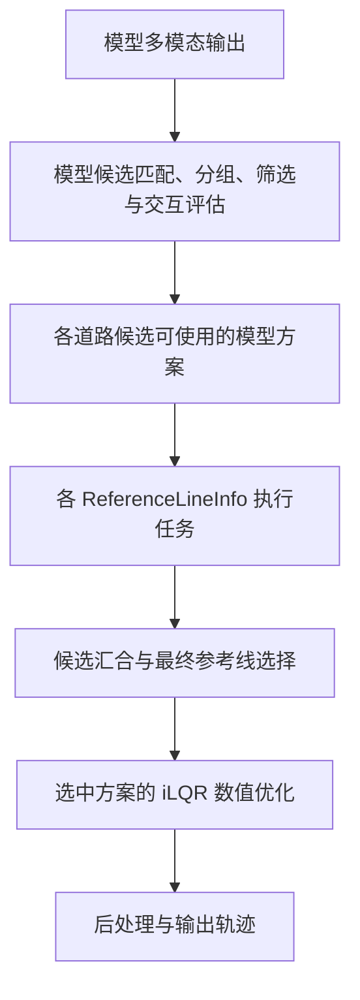

# 09 模型候选：多条建议如何进入 planning

> **这一篇讲什么**：沿模型输出、消息字段、候选匹配、交互筛选与轨迹生成，拆解端到端主线。
>
> **读完你能回答**：模型概率最高的一条是否必然执行？路径和速度能任意组合吗？模型候选选择与最终选线有什么区别？
>
> **前置知识**：第 04、07、08 篇。

## 1. 模型给出的不是唯一、完成封装的控制轨迹

这一版本的感知接口会把多模态参考线、纵向序列、概率，以及 raw joint 轨迹等填进 planning 能读取的消息。模型接口会演进；理解字段之间的对应关系，比背候选数量更重要。

| 模型侧数据 | 当前转换落点 | 需要理解的含义 |
|---|---|---|
| `topk_queries` | `junction_reference_line` | 多条自车空间候选参考信息 |
| `ego_prob` | `multi_modal_probs` | 对应模态的模型分数 |
| `ego_lon_s` | `multi_modal_speed` | 各时刻的纵向累计位移等；字段叫 speed 不代表只含速度 |
| `ego_planning_raw` 等 | `model_joint_planning_raw` 等 | 原始联合轨迹及其分数等信息 |

`PlanningHeadOutputCalculator::FillPlanningHead` 将相关局部坐标结合位姿转成全局坐标，raw joint 还涉及后轴位置偏移。纵向点的 `relative_time` 以 `100000 * (t+1)` 填入，单位是微秒，即这一转换的点间隔为 0.1 秒。**点间隔、推理频率、消息发布频率、planning 运行频率是四个量。**

这个接口里可见 42 条参考候选、64 条 raw 候选的具体配置/形状使用，但它们不是所有模型版本的固定定义，也不是 planning 每帧都执行这么多次完整求解。

## 2. 三次“选择”分别选择什么

*图 9-1 · 模型候选处理、道路候选选择、连续数值优化。三者工作对象不同，不能统称为“选概率最大那条”。*

`Frame::Preprocess` 会进入 `SelectPathByInteraction`，所以模型候选处理**发生在 Planner::Plan 之前**。以后看到任务链中的 ModelTrajectoryGenerator，不要误以为它才开始读取和选择所有模型候选。

`SelectPathByInteraction` 先检查模型轨迹任务是否活跃，再有条件地使用历史相似度等筛选信息，分别处理变道、保持车道等候选，最后进行后续处理与模型路径平滑。代码存在偏向纯最大概率选择的特定分支，也存在更复杂的条件处理；不能把任一分支推广成全部场景。

## 3. 路径和速度的下标对应不能拆散

模型候选可以包含横向走向与一个或多个纵向方案。`GenerateModelCombinedTrajectory` 会检查数组规模、计算路径对应的纵向候选数量，再按接口和配置组织组合。**不是任意一条路径都能自由搭配任意一条速度。**

把它想成带编号的套餐：路径编号、速度编号、概率和原始数据有约定的对应关系。过滤掉一个候选后，如果只缩短其中一个数组，就可能拿到“路径 A + 本应属于 B 的速度”。因此候选来源、匹配关系、有效性与后续选中下标都值得追踪。

从几何与时间上，组合的核心仍是 `P(s(t))`：路径提供沿累计距离的空间位置，纵向序列提供随时间走多远。这里的 s 必须使用与该路径相适配的定义，不能随意换成别的参考线里程。

## 4. 如何从模型点变成可使用的轨迹

`GenerateCombinedTrajectory` 及其相关处理会寻找与 stitching 起点的匹配，生成路径点、取得模型纵向数据，并处理模型时间相对规划起点的延迟。随后还有航向、曲率等生成与滤波相关工作。候选代价与安全相关评估也参与处理。

*图 9-2 · 数据变换示意。不是所有处理都集中在一个函数中；此图用于确定排查顺序。*

`ModelCombinedTrajectory::CalculateCombinedTrajectoryCost` 中可见实际启用的轨迹构造和安全相关代价处理。源码还有注释掉的效率、舒适性等片段；不能据注释写出一套声称始终生效的总分公式。模型概率也是建议的评分，不是物理安全概率或碰撞概率的反数。

历史连续性帮助减少帧间跳选，但是否启用、如何淘汰仍取决于条件。平滑可以降低点列噪声，不能凭空补出缺失道路信息，也不能证明候选一定满足车辆约束。

## 5. ModelTrajectoryGenerator 还要做什么

它把已经进入 Frame / ReferenceLineInfo 的模型方案进一步整理成该候选任务链使用的 path/speed 数据。`GenerateModelTrajectory` 中分别处理模型路径与速度；`GenerateModelPath` 还会根据 `use_dp_path` 选择是否保留 DP 路径。倒车模型轨迹有专门处理，不能直接套用前进的坐标符号。

| 处理阶段 | 交付 | 失败时应继续查 |
|---|---|---|
| 消息转换 | planning 可识别的模型字段 | tensor 形状、坐标系、时间单位、版本对应 |
| Frame 候选处理 | 匹配后可使用的模型方案及评估 | 空候选、过滤原因、匹配和数组数量 |
| 模型轨迹任务 | 候选路径、速度/轨迹数据 | Task 状态、是否保留 DP 路径、后续 fallback |
| 最终选线与优化 | 被执行的候选运动方案 | 选线原因、求解器分支、后处理是否改变 |

看到模型候选无效，不应立刻得出“必定紧急停车”或“必定切回传统规划”。下一步行为由当前任务链、可用备份和外层失败处理共同决定。

## 证据与延伸

以下链接固定到本系列分析的源码提交；行号指向关键实现，不代表整段行为只由这一行决定。

| 要核实的行为 | 源码入口 |
|---|---|
| 模型字段转换 | [perception/perception/calculators/planning_head_output_calculator.cc · `FillPlanningHead`](https://code.deeproute.ai/deeproute-org/perception/onboard/perception/-/blob/dc6cd752e2738ec283870f6a3899137a399f7836/perception/calculators/planning_head_output_calculator.cc#L376) |
| Frame 阶段的候选选择 | [planning/planning/frame/frame_modal_selection.cpp · `Frame::SelectPathByInteraction`](https://code.deeproute.ai/deeproute-org/pnc/planning/planning/-/blob/dd7cbf35a83fa1f5fb5dc078563235e671365327/planning/frame/frame_modal_selection.cpp#L1376) |
| 组合数量与关联 | [planning/planning/frame/frame_modal_selection.cpp · `Frame::GenerateModelCombinedTrajectory`](https://code.deeproute.ai/deeproute-org/pnc/planning/planning/-/blob/dd7cbf35a83fa1f5fb5dc078563235e671365327/planning/frame/frame_modal_selection.cpp#L2506) |
| 组合轨迹的代价 | [planning/planning/common/trajectory/model_combined_trajectory.cpp · `ModelCombinedTrajectory::CalculateCombinedTrajectoryCost`](https://code.deeproute.ai/deeproute-org/pnc/planning/planning/-/blob/dd7cbf35a83fa1f5fb5dc078563235e671365327/planning/common/trajectory/model_combined_trajectory.cpp#L148) |
| 模型任务入口 | [planning/planning/tasks/model_trajectory/model_trajectory_generator.cpp · `ModelTrajectoryGenerator::Execute`](https://code.deeproute.ai/deeproute-org/pnc/planning/planning/-/blob/dd7cbf35a83fa1f5fb5dc078563235e671365327/planning/tasks/model_trajectory/model_trajectory_generator.cpp#L12) |
| 模型路径与速度 | [planning/planning/tasks/model_trajectory/model_trajectory.cpp · `GenerateModelTrajectory`](https://code.deeproute.ai/deeproute-org/pnc/planning/planning/-/blob/dd7cbf35a83fa1f5fb5dc078563235e671365327/planning/tasks/model_trajectory/model_trajectory.cpp#L49) |

---

[返回 Planning 导读](./index.md) · [上一篇：08 障碍物与场景：从“看见它”到“它影响我”](./08%20%E9%9A%9C%E7%A2%8D%E7%89%A9%E4%B8%8E%E5%9C%BA%E6%99%AF%EF%BC%9A%E4%BB%8E%E2%80%9C%E7%9C%8B%E8%A7%81%E5%AE%83%E2%80%9D%E5%88%B0%E2%80%9C%E5%AE%83%E5%BD%B1%E5%93%8D%E6%88%91%E2%80%9D.md) · [下一篇：10 行为与规则：为什么选择跟车、变道或停车](./10%20%E8%A1%8C%E4%B8%BA%E4%B8%8E%E8%A7%84%E5%88%99%EF%BC%9A%E4%B8%BA%E4%BB%80%E4%B9%88%E9%80%89%E6%8B%A9%E8%B7%9F%E8%BD%A6%E3%80%81%E5%8F%98%E9%81%93%E6%88%96%E5%81%9C%E8%BD%A6.md)
