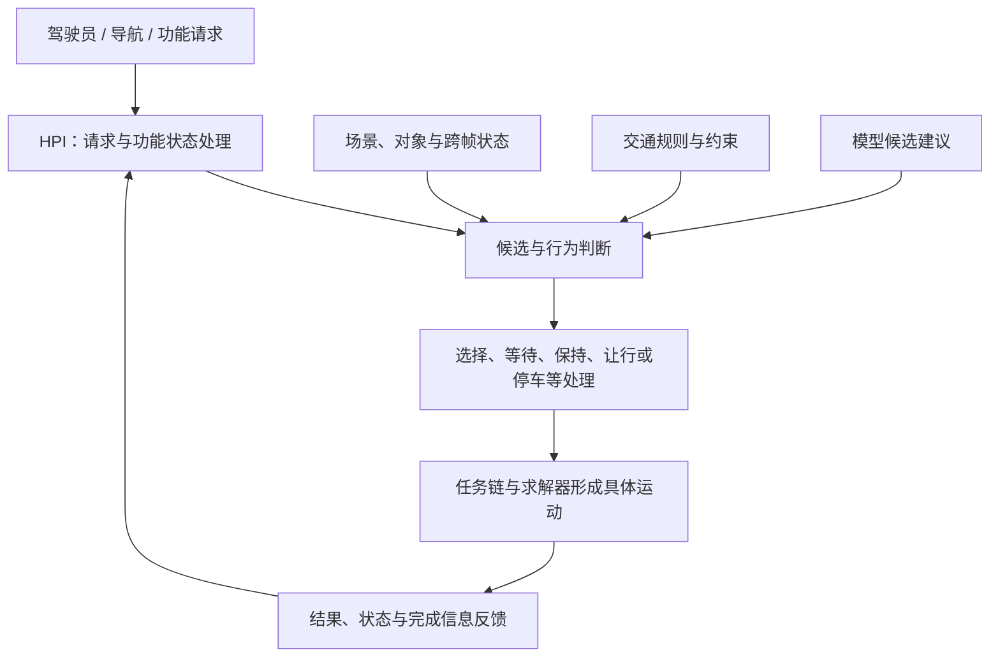
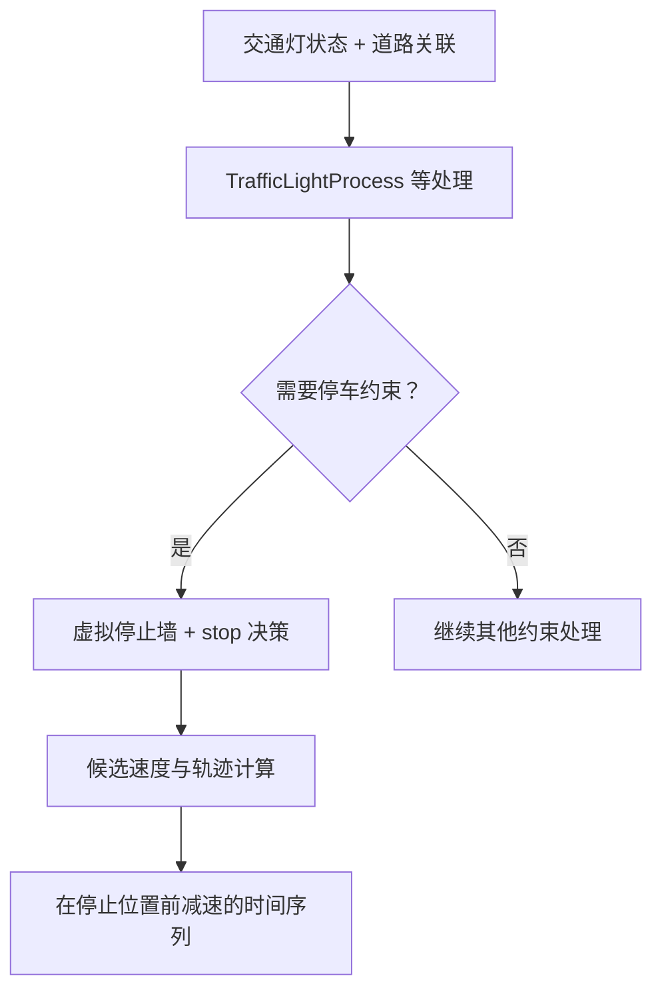

# 10 行为与规则：为什么选择跟车、变道或停车

> **这一篇讲什么**：把业务请求、交通规则、场景、变道状态与求解约束串起来，解释决策怎样影响轨迹。
>
> **读完你能回答**：业务请求是不是立即执行？红灯怎样变成停车轨迹？虚拟障碍物是什么？
>
> **前置知识**：第 06～09 篇。

## 1. 行为是多种信息协作的结果

“向左变道”可能来自导航、驾驶员请求、超车需求或模型建议；但接到请求与执行变道之间还有环境、状态和可用候选的判断。规划需要同时处理“想做什么”“允许做什么”“现在能做什么”。

HumanPlanningInterface（HPI）管理请求、功能状态、冲突与完成等业务关系，并影响规划输入、模式及约束。`Planning::Process` 中有 HPI 前后处理，不能把它当成只有一条 UI 消息透传的薄壳。

*图 10-1 · 决策参与方。图表达职责关系；不同信息在一帧中的读取阶段并不完全一致。*

## 2. 决策不是轨迹，却会改变轨迹

纵向决策可以表达停在某位置、跟随或让行；横向决策可以影响绕行一侧、偏移或变道相关处理。任务与求解器再把这些离散意图落实成连续的位置、速度和加速度。

例如“停止”还不足以给控制执行：需要停车位置、当前距离、车速、减速度变化、前方空间与历史衔接。两辆当前速度不同的车，即使收到同一停车意图，也不能使用完全相同的时间序列。

参考线候选也会参与行为表达：保持与变道候选可以分别计算，再通过有效性、代价、状态等后处理选取。不能只在最终 trajectory behavior 字段上看到“变道”，就认定行为决策只发生在输出封装时。

## 3. 红灯怎样从语义变成可计算约束

交通灯处理需要先知道哪个灯控制当前走向、停止位置在哪里，再结合灯色、当前状态和条件进行处理。Frame 的 `TrafficLightProcess` 是重要入口，不能只阅读 `traffic_rules/signal_light.cpp` 就认为覆盖了全部红灯逻辑。

*图 10-2 · 红灯停车的教学主线。黄灯、通过路口、关联失败等细节不能由这张简图推断。*

`AddVirtualStopWallForTrafficLight` 会建立静态虚拟对象并添加纵向 stop 决策。虚拟墙把“这里应该停”转成后续规划可处理的对象/决策表达，**不代表感知在那里发现了一堵真实的墙**。目的地、人行横道等也有虚拟停止对象相关实现。

虚拟对象的几何位置不必等于最终自车车体中心的停止位置；还涉及车身参考点、停止距离和安全余量。读日志时应区分 stop point、墙的位置与轨迹终点。

## 4. TrafficDecider 与场景并不是一回事

TrafficDecider 组织启用的规则并调用 `ApplyRule`；规则可能修改候选上的决策和相关信息。当前规则容器使用无序映射，不应按源码注册顺序想象一个稳定的“规则优先级流水线”。

| 机制 | 主要问题 | 例子 |
|---|---|---|
| HPI | 当前功能/请求是什么，怎样衔接 | 变道请求、模式选择、完成反馈 |
| 场景检测 | 现在处于什么环境条件 | 窄路等 detector 结果 |
| 交通规则 | 哪些交通要求要表达成约束 | 停止、到达目的地等 |
| 行为/交互判断 | 当前方案应怎样回应对象 | 跟随、让行、偏移及候选处理 |
| 数值优化 | 怎样连续地执行方案 | 加速度、曲率等随时间的变化 |

这些机制会互相读取信息，但类名不同不等于具有绝对隔离的职责边界；应沿具体输入和修改对象追踪。

## 5. 跨帧状态为什么重要

车辆不能这一帧想变道，下一帧因为分数小幅变化就突然反向。代码通过 Context、变道阶段、历史候选、业务请求状态及各处条件判断维持连续性。防抖与状态转移分布在相关逻辑中，不是 SceneManager 独立完成一切。

分析一次不期望的变道，应把过程拆成：谁提出请求，哪个状态允许推进，候选是否存在，为什么选中该候选，最终轨迹有没有实际横移。若请求没有被满足，也要区分“等待条件”“拒绝/冲突”“没有有效轨迹”与“已经结束”。

这一层交付的是**行为、决策、约束与状态**。约束之间可能冲突，候选也可能不可行；它们并不保证下游一定成功，失败需继续看任务与总控。

## 证据与延伸

以下链接固定到本系列分析的源码提交；行号指向关键实现，不代表整段行为只由这一行决定。

| 要核实的行为 | 源码入口 |
|---|---|
| HPI 实现 | [planning/planning/human_planning_interface/human_planning_interface.cpp · `Preprocess`](https://code.deeproute.ai/deeproute-org/pnc/planning/planning/-/blob/dd7cbf35a83fa1f5fb5dc078563235e671365327/planning/human_planning_interface/human_planning_interface.cpp#L197) |
| 规则组织与执行 | [planning/planning/traffic_rules/traffic_decider.cpp · `TrafficDecider::Execute`](https://code.deeproute.ai/deeproute-org/pnc/planning/planning/-/blob/dd7cbf35a83fa1f5fb5dc078563235e671365327/planning/traffic_rules/traffic_decider.cpp#L86) |
| 交通灯与虚拟停止墙 | [planning/planning/frame/frame_traffic_light.cpp · `AddVirtualStopWallForTrafficLight`](https://code.deeproute.ai/deeproute-org/pnc/planning/planning/-/blob/dd7cbf35a83fa1f5fb5dc078563235e671365327/planning/frame/frame_traffic_light.cpp#L10) |
| 总控中的业务处理 | [planning/planning/planning_core.cpp · `bool Planning::Process(`](https://code.deeproute.ai/deeproute-org/pnc/planning/planning/-/blob/dd7cbf35a83fa1f5fb5dc078563235e671365327/planning/planning_core.cpp#L2238) |

---

[返回 Planning 导读](./index.md) · [上一篇：09 模型候选：多条建议如何进入 planning](./09%20%E6%A8%A1%E5%9E%8B%E5%80%99%E9%80%89%EF%BC%9A%E5%A4%9A%E6%9D%A1%E5%BB%BA%E8%AE%AE%E5%A6%82%E4%BD%95%E8%BF%9B%E5%85%A5%20planning.md) · [下一篇：11 候选求解：任务链、DP、QP 与参考线选择](./11%20%E5%80%99%E9%80%89%E6%B1%82%E8%A7%A3%EF%BC%9A%E4%BB%BB%E5%8A%A1%E9%93%BE%E3%80%81DP%E3%80%81QP%20%E4%B8%8E%E5%8F%82%E8%80%83%E7%BA%BF%E9%80%89%E6%8B%A9.md)
