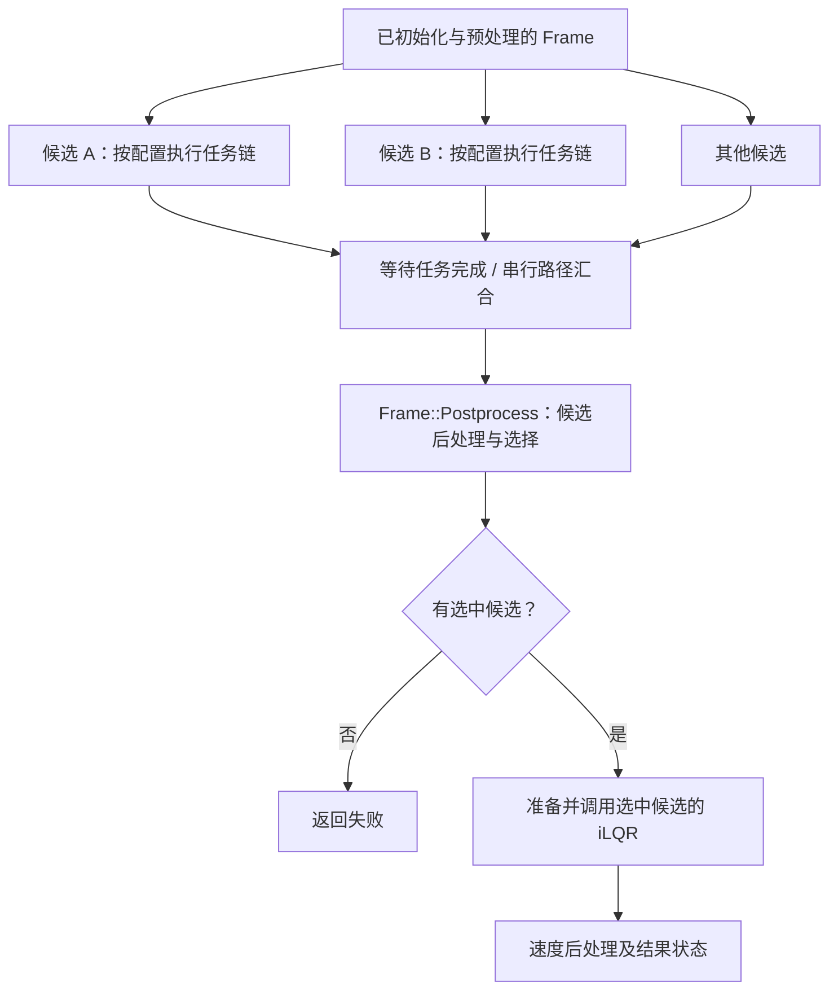

# 11 候选求解：任务链、DP、QP 与参考线选择

> **这一篇讲什么**：对照 EmPlanner 的真实条件解释任务装配、传统与模型数据的组合、候选并行和失败分支。
>
> **读完你能回答**：为什么开启模型后仍能看到 DP Speed？每个候选都做 iLQR 吗？任务失败就意味着整帧失败吗？
>
> **前置知识**：第 07～10 篇；不要求最优化基础。

## 1. EmPlanner 是容纳多种方法的行车规划器

EmPlanner 在当前仓库中既能组织传统路径/速度任务，也能使用模型轨迹和 iLQR。名字不能用来判断本车一定运行经典 DP→QP，也不能把当前架构描述成模型彻底替代全部优化。

主线是：对多个候选分别执行任务，汇合并选择候选，然后对选中候选执行 iLQR 和速度后处理。是否多线程、有哪些任务、任务内部是否提前返回，由配置和状态决定。

*图 11-1 · 候选计算与最终优化。double_ilqr 还会在候选内部插入一段任务，见下文。*

## 2. 先看条件，再看任务顺序

下表以 `EmPlanner` 构造函数实际表达式为准。为便于阅读，M 代表 `enable_model_path`，V 代表 `enable_model_speed`。

| 顺序 | 任务 | 被装入任务链的条件 |
|---|---|---|
| 1 | DP Path | `!M || (M && use_dp_path)` |
| 2 | QP Path | `!M && use_qp_path_obtimizer`；字段原名有拼写特点 |
| 3 | DecisionMaking | `enable_decision_making` |
| 4 | ModelTrajectoryGenerator | `M && V` |
| 5 | StaticLatDecider | `enable_static_lat_decider` |
| 6 | 一组前置任务 | `enable_double_ilqr`：VpaInitSpeed → IntentionRecognition → simple Combine → VpaModelSpeed → simple iLQR |
| 7 | DP Speed | 当前构造条件 `dp_speed_active = true` |
| 8 | QP Speed | `use_qp_speed_optimizer` |
| 9 | CombinePathSpeed | 构造时加入 |
| 10 | TrajectorySafety | 构造时加入 |

这张表解决的是“有没有这个任务对象”，**不等于任务每帧都完整执行算法**。任务可能使用已有数据、根据模式跳过或提前返回。尤其 DP Speed 上方旧注释说“未用模型速度时创建”，实际代码设为 true；这里应信可执行表达式。

还要区分：构造任务时的配置、Frame 中动态条件以及 Task::Execute 内部分支。只找到一份默认配置，不能证明车上某帧实际采用哪条路径。

## 3. DP 怎样寻找粗略方案

动态规划（DP）把连续问题离散成若干层，每层若干候选点，比较前一层到当前层的连接成本，保留较优的累计方案。它适合先在有限采样空间里找一条可用骨架。

- **DP Path**：常用 SL 视角。沿前方距离 s 设置采样层，在各层尝试不同横向 l，比较绕障、偏移和变化等代价。
- **DP Speed**：常用 ST 视角。时间 t 向前推进，选择走到哪个距离 s，同时考虑障碍物时空占用、速度和运动变化等。

*图 11-2 · DP 的层次结构。每个方框实际可含多个采样节点；图没有画出全部连接。*

DP 的“最优”只针对当前离散模型、候选连接和代价定义，不保证找出真实驾驶世界的全局最优，也不保证采样足以覆盖所有可行绕行方式。边界和时间范围不合适时，仍可能无解。

## 4. QP 为什么跟在粗解后面

二次规划（QP）在给定数学形式下，优化平方型目标并满足相应约束。可以把粗解附近的偏移、导数、速度或加速度变化磨得更平顺，同时遵守设置的边界。

路径和速度分开处理有助于降低一次优化的复杂度，但两者并不独立：弯道曲率会限制合适车速，速度又影响可实现的横向运动及动态障碍交互。CombinePathSpeed 将它们组合成时间轨迹，后面的 iLQR 继续处理车辆模型和运动目标。

因此，“路径 × 速度”只能当口语速记。数学关系更接近路径位置 `P(s(t))` 加上航向、速度、加速度等字段，不是把两个数组逐项相乘。

## 5. 哪些地方并行，哪里必须等待

启用 `use_multithreading_planning` 且满足模式条件时，各参考线任务进入线程池；否则串行处理。当前代码还根据首个候选的 VPA 状态限制这段并行。等待完成后才能 `Frame::Postprocess`，因为选择需要比较候选结果。

```mermaid
%%{init: {"gantt": {"useMaxWidth": false, "useWidth": 1050, "barHeight": 22, "fontSize": 14}}}%%
gantt
    title 候选并行与汇合：纯教学耗时
    dateFormat x
    axisFormat %L ms
    section 准备
    候选已就绪 :r, 0, 5ms
    section 候选计算
    候选 A :a, after r, 13ms
    候选 B :b, after r, 21ms
    候选 C :c, after r, 9ms
    section 汇合后
    后处理和选线 :s, after a b c, 4ms
    选中候选 iLQR :q, after s, 12ms
    速度后处理 :v, after q, 3ms
```

*图 11-3 · 数值用于解释等待关系，全部不是实测。并行等待受最慢分支、线程可用性和同步影响，不能把三条分支时间相加当作墙钟耗时。*

## 6. 失败分支要读到最后

`RunTasksStage` 对不同任务的失败做不同处理：DP Path 可能使用有效 backup，否则设置路径/速度 fallback 标志；QP Path 失败可以保留 DP 路径；速度任务失败可设置速度 fallback；其他失败可能终止这条任务链。随后还可能执行 `FallBackPathSpeedSetting`，并重新合成或检查。

| 观察 | 能得出的结论 | 还不能得出的结论 |
|---|---|---|
| 某任务返回失败 | 该任务在该候选上未正常完成 | 整帧必定无轨迹 |
| 某候选不可用 | 该候选可能被淘汰 | 其他候选一定可用 |
| 走到 fallback | 尝试具体备选处理 | 必定成功、必定停车或保证安全 |
| `Plan` 返回 true | 走到了某条成功返回路径 | 最终消息必定含有效完整轨迹 |

最后一行尤其要谨慎：EmPlanner 有约束违例相关早返回路径，最终还要结合状态、选中候选、轨迹构造及外层处理判断。下一篇再拆解选中候选的 iLQR。

## 证据与延伸

以下链接固定到本系列分析的源码提交；行号指向关键实现，不代表整段行为只由这一行决定。

| 要核实的行为 | 源码入口 |
|---|---|
| 任务条件与顺序 | [planning/planning/planner/em_planner.cpp · `EmPlanner::EmPlanner(`](https://code.deeproute.ai/deeproute-org/pnc/planning/planning/-/blob/dd7cbf35a83fa1f5fb5dc078563235e671365327/planning/planner/em_planner.cpp#L202) |
| 候选分发、汇合、选线后求解 | [planning/planning/planner/em_planner.cpp · `bool EmPlanner::PlanOnReferenceLine(Frame* frame)`](https://code.deeproute.ai/deeproute-org/pnc/planning/planning/-/blob/dd7cbf35a83fa1f5fb5dc078563235e671365327/planning/planner/em_planner.cpp#L341) |
| 任务失败处理 | [planning/planning/planner/em_planner.cpp · `EmPlanner::RunTasksStage`](https://code.deeproute.ai/deeproute-org/pnc/planning/planning/-/blob/dd7cbf35a83fa1f5fb5dc078563235e671365327/planning/planner/em_planner.cpp#L591) |
| 路径速度 fallback | [planning/planning/planner/em_planner.cpp · `FallBackPathSpeedSetting`](https://code.deeproute.ai/deeproute-org/pnc/planning/planning/-/blob/dd7cbf35a83fa1f5fb5dc078563235e671365327/planning/planner/em_planner.cpp#L770) |
| 轨迹生成与返回分支 | [planning/planning/planner/em_planner.cpp · `bool EmPlanner::Plan(Frame* frame)`](https://code.deeproute.ai/deeproute-org/pnc/planning/planning/-/blob/dd7cbf35a83fa1f5fb5dc078563235e671365327/planning/planner/em_planner.cpp#L476) |

---

[返回 Planning 导读](./index.md) · [上一篇：10 行为与规则：为什么选择跟车、变道或停车](./10%20%E8%A1%8C%E4%B8%BA%E4%B8%8E%E8%A7%84%E5%88%99%EF%BC%9A%E4%B8%BA%E4%BB%80%E4%B9%88%E9%80%89%E6%8B%A9%E8%B7%9F%E8%BD%A6%E3%80%81%E5%8F%98%E9%81%93%E6%88%96%E5%81%9C%E8%BD%A6.md) · [下一篇：12 iLQR：把候选方案优化为车辆能跟踪的运动](./12%20iLQR%EF%BC%9A%E6%8A%8A%E5%80%99%E9%80%89%E6%96%B9%E6%A1%88%E4%BC%98%E5%8C%96%E4%B8%BA%E8%BD%A6%E8%BE%86%E8%83%BD%E8%B7%9F%E8%B8%AA%E7%9A%84%E8%BF%90%E5%8A%A8.md)
