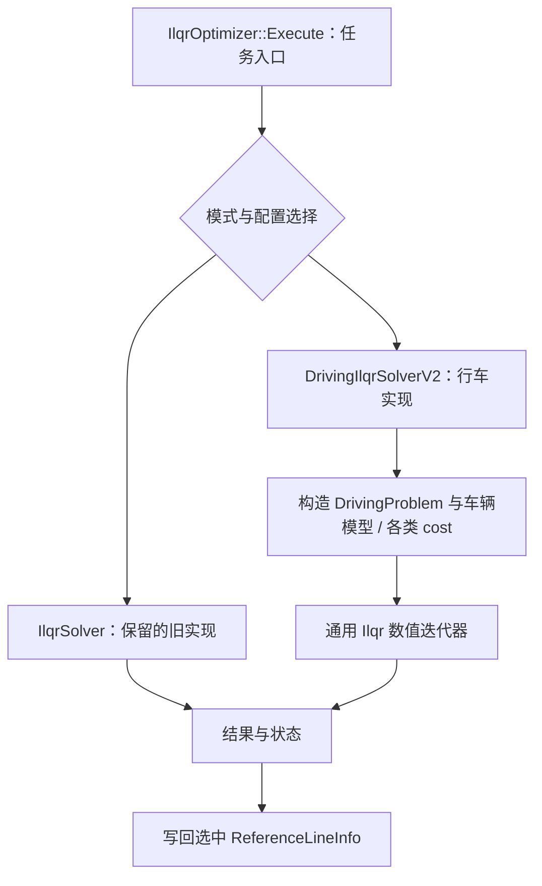
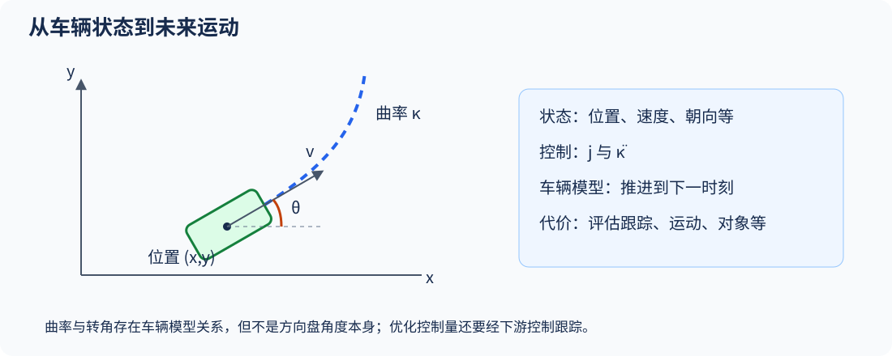
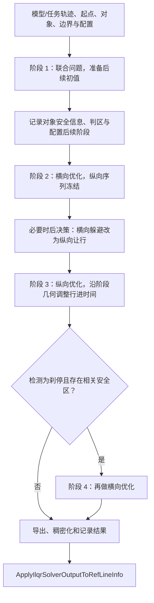
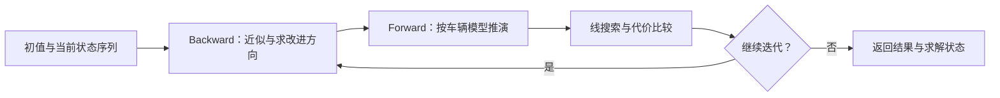

# 12 iLQR：把候选方案优化为车辆能跟踪的运动

> **这一篇讲什么**：从车辆状态和代价入门，解释当前行车求解器的联合、横向、纵向阶段和迭代过程。
>
> **读完你能回答**：iLQR 优化什么？为什么不只是曲线拟合？新的行车求解器与旧实现有什么关系？
>
> **前置知识**：第 02、09、11 篇。公式用于解释，不要求自行推导。

## 1. 先区分规划优化与执行控制

这里的 iLQR 在 planning 内优化未来运动轨迹；输出还要交给控制跟踪。它借用最优控制方法来生成方案，不意味着 planning 在这一层直接下发方向盘或制动。

假设候选点列要求车辆突然横移两米，即使画出来没有撞到物体，车也未必能按这个时间表运动。iLQR 要同时考虑初始状态、车辆运动模型、参考方案、舒适性和障碍物相关目标，反复调整一段控制量序列，得到与模型一致的状态序列。

## 2. 三层代码、两种求解器

*图 12-1 · 任务适配、行车问题组织、通用数值求解。名称中的 V2 不表示所有模式已只用它。*

`IlqrOptimizer` 根据 VPA 状态、行车配置、高速条件及相关模型模式等选择求解器。特别是 `driving_config.enable_ilqr = false` 会进入旧求解器分支，不能直接读成“所有 iLQR 都禁用”。在判断是否实际优化之前，还要读 Execute 前面的模式与有效性检查。

下文重点讲新行车求解器，旧实现的成本项和流程不应未经核对混进同一张图里。

## 3. 它真正优化哪些量

新实现的联合状态和控制在 `driving_state_layout.h` 明确定义。

| 符号 | 白话 | 联合布局中的位置 |
|---|---|---|
| x、y | 车的位置 | 状态 |
| v | 速度 | 状态 |
| θ | 车头朝向 | 状态 |
| a | 纵向加速度 | 状态 |
| κ | 路径弯曲程度 | 状态 |
| κ̇ | 曲率对时间的变化率 | 状态 |
| j | 加速度对时间的变化率，即 jerk | 控制 |
| κ̈ | 曲率变化率再随时间怎样变化 | 控制 |

联合状态是 `[x,y,v,θ,a,κ,κ̇]`，控制是 `[j,κ̈]`。这些是数学模型的控制变量，不是直接下发给执行器的油门百分比或方向盘角度。

*图 12-2 · 自车位置、朝向与曲率的关系。图使用简化运动学解释，不代表全部车辆动力学或真实转向系统。*

用连续关系帮助建立直觉：位置变化受速度和朝向影响，朝向变化与 `vκ` 有关，加速度变化受 j 影响。新车辆模型再通过数值积分推进状态。代码中的积分子步、优化采样节点间隔和消息频率各有用途；某处出现 0.02 秒或 0.1 秒，都不能直接翻译成整套 planning 的运行频率。

## 4. “更好”怎样变成可优化的数值

代价函数为候选运动打分。新行车问题下有中心/参考跟踪、跨帧一致性、速度、状态与舒适性、静态/动态对象、效率、大车避让等 cost 实现；实际启用项、权重、对象筛选与阶段开关需要结合输入和配置。

可以用下式理解其形态，而不要把它当成本项目完整的精确公式：

`总代价 ≈ 各时刻的跟踪偏差 + 运动变化 + 对象相关代价 + 其他已启用项`

代价项是希望优化器倾向满足的目标。即便代码把某项称为 hard constraint，也要看它具体通过惩罚、边界、检查或求解器机制怎样实现。有限权重、数值误差、不可行问题和提前停止都意味着**代价变小不等于已经证明轨迹绝对安全**。

## 5. 当前行车实现分成哪些阶段

`GenerateTrajectory` 先准备输入和共享几何，调用 `SolvePhase1`，记录对象安全信息，检查安全区并准备后续阶段，再调用 `SolveLatLonDecoupleSegments`。当前主调用旁边有一段被注释掉的纯跟踪联合分支；不能把注释中的 `SolveTrackingJoint` 当作本次必经路径。

*图 12-3 · 新行车实现的当前主线。最后一段横向优化有条件，不能描述成每帧固定四段；每段失败还有局部处理。*

| 阶段 | 优化变量 | 固定或引用的内容 | 作用 |
|---|---|---|---|
| 联合 | 7 维状态、2 维控制 | 当前输入与参考 | 得到后续可用的联合初始方案 |
| 横向 | `[x,y,θ,κ,κ̇]`，控制 κ̈ | v、a、j 等纵向参考 | 调整几何和横向运动 |
| 纵向 | `[s,v,a]`，控制 j | 前段几何作为距离参数曲线 | 调整什么时候沿几何走多远 |
| 条件性再横向 | 横向布局 | 更新后的纵向结果 | 在刹停和相关安全条件下进一步处理 |

纵向段不是把 x(t)、y(t) 原封不动冻结：它改变 s(t)，再沿固定的几何按距离插值得到位置和朝向。因此位置随时间也会改变。横纵解耦减少一次求解的变量，但通过阶段传递、对象安全信息和后决策保持联系。

## 6. 每段里，iLQR 怎样迭代

先有一条初值轨迹。求解器在附近近似车辆模型和代价，通过 backward pass 算出控制改进方向，再 forward rollout 推演新状态，并用回溯线搜索尝试改进幅度。若接受则继续迭代；也可能因收敛、预算、次数或数值问题停止。

*图 12-4 · 迭代方法的读图模型。不是神经网络训练中的反向传播，也不是在车端重新训练 planner head。*

## 7. 求解完成之后还要看什么

`ApplyIlqrSolverOutputToRefLineInfo` 将输出写回候选，后续仍有速度处理、历史轨迹拼接、消息构造和检查。应同时核对状态、实际使用的轨迹、约束信息与外层处理，不要仅凭“solver finished”日志认定轨迹已经发布。

若求解失败或超时，要查哪一段、是否保留前段结果、Task 返回什么，以及 EmPlanner 如何继续。当前各层的处理有具体分支，不能统一概括为“自动输出刹停轨迹”。

## 证据与延伸

以下链接固定到本系列分析的源码提交；行号指向关键实现，不代表整段行为只由这一行决定。

| 要核实的行为 | 源码入口 |
|---|---|
| 求解器选择与任务适配 | [planning/planning/tasks/ilqr/ilqr_optimizer.cpp · `bool use_driving_ilqr = false;`](https://code.deeproute.ai/deeproute-org/pnc/planning/planning/-/blob/dd7cbf35a83fa1f5fb5dc078563235e671365327/planning/tasks/ilqr/ilqr_optimizer.cpp#L680) |
| 结果回写 | [planning/planning/tasks/ilqr/ilqr_optimizer.cpp · `ApplyIlqrSolverOutputToRefLineInfo`](https://code.deeproute.ai/deeproute-org/pnc/planning/planning/-/blob/dd7cbf35a83fa1f5fb5dc078563235e671365327/planning/tasks/ilqr/ilqr_optimizer.cpp#L1137) |
| 行车主线 | [planning/planning/tasks/ilqr/driving/driving_ilqr_solver_v2.cpp · `DrivingIlqrSolverV2::GenerateTrajectory`](https://code.deeproute.ai/deeproute-org/pnc/planning/planning/-/blob/dd7cbf35a83fa1f5fb5dc078563235e671365327/planning/tasks/ilqr/driving/driving_ilqr_solver_v2.cpp#L3123) |
| 横纵分段与条件性末段 | [planning/planning/tasks/ilqr/driving/driving_ilqr_solver_v2.cpp · `DrivingIlqrSolverV2::SolveLatLonDecoupleSegments`](https://code.deeproute.ai/deeproute-org/pnc/planning/planning/-/blob/dd7cbf35a83fa1f5fb5dc078563235e671365327/planning/tasks/ilqr/driving/driving_ilqr_solver_v2.cpp#L2607) |
| 状态和控制布局 | [planning/planning/tasks/ilqr/driving/driving_problem/driving_state_layout.h · `namespace joint`](https://code.deeproute.ai/deeproute-org/pnc/planning/planning/-/blob/dd7cbf35a83fa1f5fb5dc078563235e671365327/planning/tasks/ilqr/driving/driving_problem/driving_state_layout.h#L14) |
| 车辆模型 | [planning/planning/tasks/ilqr/driving/driving_problem/driving_vehicle_model.h · `RungeKutta`](https://code.deeproute.ai/deeproute-org/pnc/planning/planning/-/blob/dd7cbf35a83fa1f5fb5dc078563235e671365327/planning/tasks/ilqr/driving/driving_problem/driving_vehicle_model.h#L60) |
| 通用求解器 | [planning/planning/tasks/ilqr/solver/ilqr.cpp · `BackwardPass`](https://code.deeproute.ai/deeproute-org/pnc/planning/planning/-/blob/dd7cbf35a83fa1f5fb5dc078563235e671365327/planning/tasks/ilqr/solver/ilqr.cpp#L205) |

---

[返回 Planning 导读](./index.md) · [上一篇：11 候选求解：任务链、DP、QP 与参考线选择](./11%20%E5%80%99%E9%80%89%E6%B1%82%E8%A7%A3%EF%BC%9A%E4%BB%BB%E5%8A%A1%E9%93%BE%E3%80%81DP%E3%80%81QP%20%E4%B8%8E%E5%8F%82%E8%80%83%E7%BA%BF%E9%80%89%E6%8B%A9.md) · [下一篇：13 最后一段：速度处理、拼接、检查与发布](./13%20%E6%9C%80%E5%90%8E%E4%B8%80%E6%AE%B5%EF%BC%9A%E9%80%9F%E5%BA%A6%E5%A4%84%E7%90%86%E3%80%81%E6%8B%BC%E6%8E%A5%E3%80%81%E6%A3%80%E6%9F%A5%E4%B8%8E%E5%8F%91%E5%B8%83.md)
