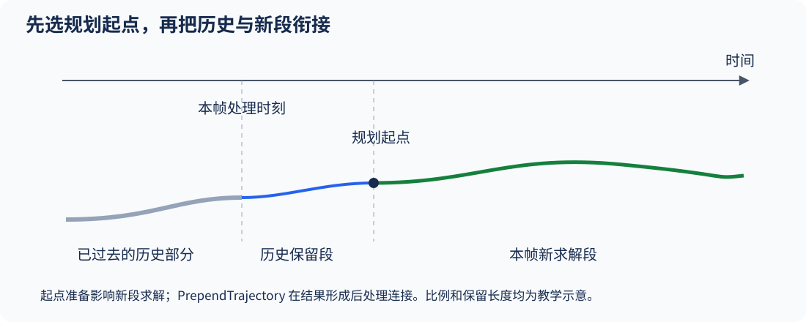
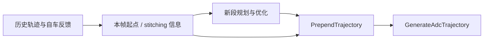
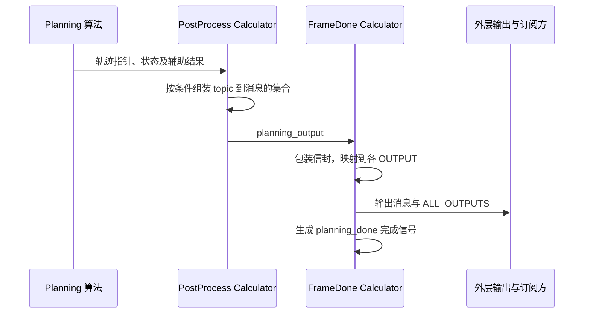

# 13 最后一段：速度处理、拼接、检查与发布

> **这一篇讲什么**：沿选中轨迹追到最终 topic，区分速度处理、历史拼接、各层检查与异常发布行为。
>
> **读完你能回答**：有轨迹点就代表已发布吗？检查失败是否一定不发消息？旧轨迹如何接到新轨迹？
>
> **前置知识**：第 03、06、11、12 篇。

## 1. 选中并优化之后，还没有到终点

EmPlanner 对选中候选调用 iLQR 后，还会调用速度后处理任务。该任务由 `CreateSpeedPostProcessTask` 创建，实际类是 `OptimalJerk`，位置在 `speed_profile_preprocess/optimal_jerk.cpp`，不能只根据目录名猜它发生在流程前面。

当前任务围绕舒适刹停处理：检查 `enable_comfortable_stop`，判断停止速度型，取初始 s/v/a 和各段时间，构造 jerk 相关 QP；只有处理成功才替换候选上的轨迹。关闭功能返回 UNKNOWN，其他条件不满足或求解未成功也有返回状态。调用方会记录结果，不能把“未返回 OK”全部等同于整帧规划失败。

## 2. 轨迹拼接怎样维持连续性

上一帧交给控制的轨迹已经执行了一部分，也还有一段处于近期执行窗口。新帧选规划起点时会参考历史与当前状态；完成新段后，`PrependTrajectory` 再处理保留段与新段的连接，随后 `GenerateAdcTrajectory` 构造轨迹消息。

*图 13-1 · 历史保留段、新段与规划起点的关系。所有时刻和长度都是示意；不是每次都保留历史，偏差或状态条件不合适时会重新初始化。*

*图 13-2 · 起点准备与末端拼接是首尾呼应的两件事。不能只在发布前拼点，而忽略求解起点。*

衔接需要位置、朝向、速度、加速度及时间的配合。简单把两个数组首尾连接，可能造成位置跳变或控制目标突变。拼接函数和消息构造都有失败返回，应与规划器整体状态一起追踪。

## 3. 至少分清三层检查

| 层次 | 位置与对象 | 主要意义 |
|---|---|---|
| 候选任务中的安全处理 | `TrajectorySafety` 等 Task | 在候选路径/速度合成后进行该任务负责的处理 |
| 求解与约束相关检查 | iLQR 状态、`ConstraintViolationChecker` 等 | 反映求解结果和相关运动约束状态 |
| 总控轨迹检查 | `ExecuteTrajectoryValidation → RunTrajectoryChecker` | 对规划输出做该 checker 支持的检查，并供事件与状态使用 |

它们既不是同一个函数，也不保证覆盖所有可能危险。`RunTrajectoryChecker` 的主检查有 EM 模式和 checker 存在等条件；当前代码还在 `HasInternalFault()` 时把通过标志设为 true。因此 debug 中的“通过”应结合检查是否真正运行、内部状态和失败原因解释。

**检查也不全在最后。** `RunOnce` 包含轨迹检查和异常处理，外层 `Planning::Process` 之后还有 `PostProcessTrajectory`、控制模式设置和最终收尾。不能画成“所有修改完成 → 一道万能安全闸 → 发布”的绝对结构。

## 4. 异常时到底发什么

`HandleTrajectoryPublishingAndExceptions` 在上游 ready 或 OpenSpace 分支内处理状态与事件。代码对 `run_success=false` 清除 trajectory_point 和 path_point；checker 未通过则按分支记录异常，**没有在这里统一执行“checker false 就丢弃消息”**。

| 已进入上述条件分支时 | 该函数的可见行为 | 不能由此推断 |
|---|---|---|
| run_success=true，checker 通过 | 保留该函数处理前的轨迹点 | 后续无修改、控制必定执行 |
| run_success=true，checker 未通过 | 记录相应异常事件 | 消息一定被直接丢弃 |
| run_success=false | 清除路径点与轨迹点，并按条件处理事件 | 根本没有轨迹消息信封 |
| 上游未 ready 且不是 OpenSpace | 不进入这段处理 | 全系统统一采用某一种 fallback |

这是**某个函数的条件行为表**，不是覆盖所有早返回、业务覆盖和控制降级的全系统真值表。尤其应区分“没有消息”“有消息但轨迹点为空”“有点但带异常状态”“正常轨迹”。

## 5. 从算法结果到 topic，还有两次交接

*图 13-3 · 算法完成、消息封装、框架完成三个边界。生成 packet 的次序与最终订阅方调度次序不能不加分析地画等号。*

PostProcess 在轨迹指针非空等条件下，将消息放入 `output_msgs["/planner/trajectory"]`；相关业务还有快速请求结果覆盖等处理。FrameDone 遍历消息集合，按 topic 映射到输出槽，包装 header，并产生 ALL_OUTPUTS 和完成信号。

graph 配置有 13 个 OUTPUT 槽，不代表每一帧每个槽都有消息。`OUTPUT:0` 标识映射位置，不能单独证明“轨迹有最高业务优先级”或“所有订阅方总先收到轨迹”。

最终检查一帧应沿着：选中候选 → iLQR/后处理结果 → 拼接与轨迹构造 → run_success/checker → 外层后处理 → topic 信封。这样才能准确回答“轨迹在哪一步变空”或“为什么看到成功日志却没有期望输出”。

## 证据与延伸

以下链接固定到本系列分析的源码提交；行号指向关键实现，不代表整段行为只由这一行决定。

| 要核实的行为 | 源码入口 |
|---|---|
| 舒适刹停后处理 | [planning/planning/tasks/speed_profile_preprocess/optimal_jerk.cpp · `DR_STATUS OptimalJerk::Execute`](https://code.deeproute.ai/deeproute-org/pnc/planning/planning/-/blob/dd7cbf35a83fa1f5fb5dc078563235e671365327/planning/tasks/speed_profile_preprocess/optimal_jerk.cpp#L284) |
| 拼接与最终构造 | [planning/planning/planner/em_planner.cpp · `res = frame->PrependTrajectory`](https://code.deeproute.ai/deeproute-org/pnc/planning/planning/-/blob/dd7cbf35a83fa1f5fb5dc078563235e671365327/planning/planner/em_planner.cpp#L527) |
| 检查条件及内部状态 | [planning/planning/planning_trajectory_process.cpp · `bool Planning::RunTrajectoryChecker`](https://code.deeproute.ai/deeproute-org/pnc/planning/planning/-/blob/dd7cbf35a83fa1f5fb5dc078563235e671365327/planning/planning_trajectory_process.cpp#L2807) |
| 异常处理与清除点列 | [planning/planning/planning_core.cpp · `void Planning::HandleTrajectoryPublishingAndExceptions`](https://code.deeproute.ai/deeproute-org/pnc/planning/planning/-/blob/dd7cbf35a83fa1f5fb5dc078563235e671365327/planning/planning_core.cpp#L2474) |
| 外层后处理仍在 RunOnce 之后 | [planning/planning/planning_core.cpp · `PostProcessTrajectory(trajectory_pb`](https://code.deeproute.ai/deeproute-org/pnc/planning/planning/-/blob/dd7cbf35a83fa1f5fb5dc078563235e671365327/planning/planning_core.cpp#L2383) |
| 消息封装 | [planning/planning/calculators/planning_post_process_calculator.cc · `output_msgs["/planner/trajectory"]`](https://code.deeproute.ai/deeproute-org/pnc/planning/planning/-/blob/dd7cbf35a83fa1f5fb5dc078563235e671365327/planning/calculators/planning_post_process_calculator.cc#L123) |
| 框架输出与完成信号 | [platform/church/graph/calculators/frame_done_calculator.cc · `for (const auto& [topic, messages] : input_message_map)`](https://code.deeproute.ai/deeproute-org/os/all-member/platform/-/blob/55b503c91f7eaaef78d90b538f34c65f0ea4b154/church/graph/calculators/frame_done_calculator.cc#L148) |

---

[返回 Planning 导读](./index.md) · [上一篇：12 iLQR：把候选方案优化为车辆能跟踪的运动](./12%20iLQR%EF%BC%9A%E6%8A%8A%E5%80%99%E9%80%89%E6%96%B9%E6%A1%88%E4%BC%98%E5%8C%96%E4%B8%BA%E8%BD%A6%E8%BE%86%E8%83%BD%E8%B7%9F%E8%B8%AA%E7%9A%84%E8%BF%90%E5%8A%A8.md) · [下一篇：14 其他规划器：泊车、倒车与后台 OpenSpace](./14%20%E5%85%B6%E4%BB%96%E8%A7%84%E5%88%92%E5%99%A8%EF%BC%9A%E6%B3%8A%E8%BD%A6%E3%80%81%E5%80%92%E8%BD%A6%E4%B8%8E%E5%90%8E%E5%8F%B0%20OpenSpace.md)
