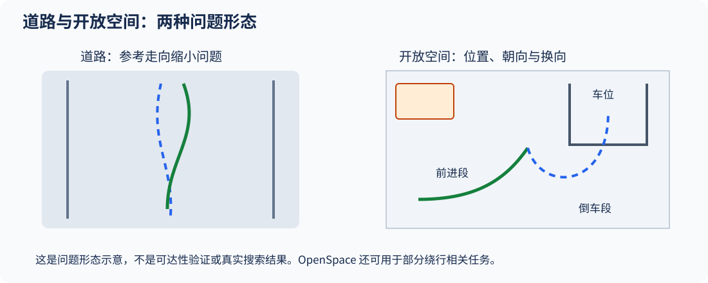
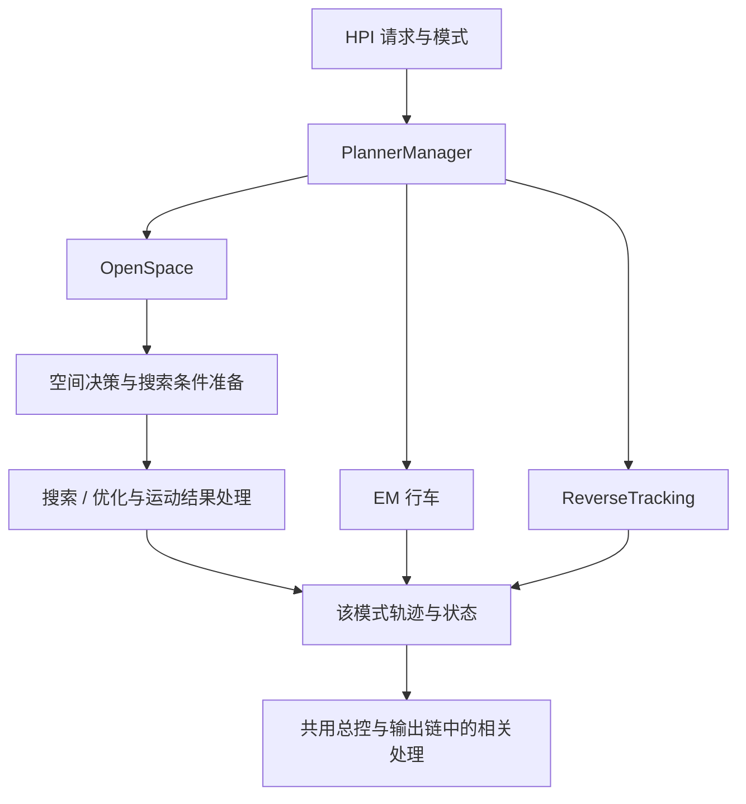
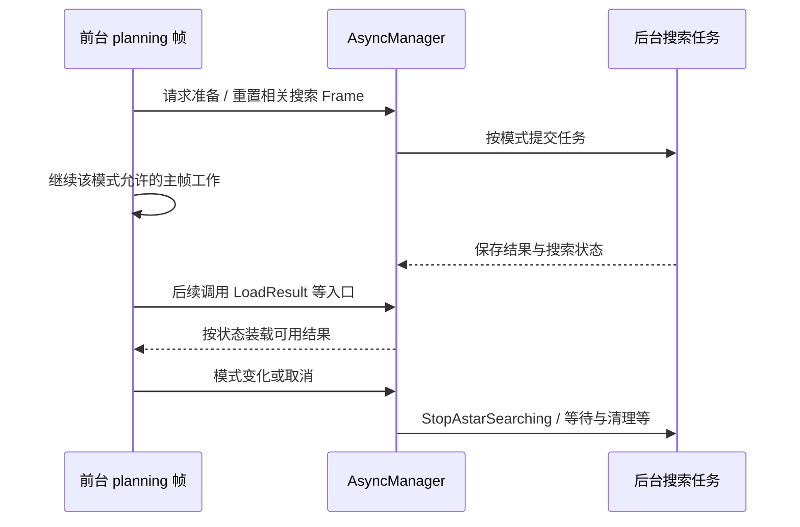

# 14 其他规划器：泊车、倒车与后台 OpenSpace

> **这一篇讲什么**：把道路行车主线与 OpenSpace、ReverseTracking 和后台搜索的边界讲清楚。
>
> **读完你能回答**：倒车就一定是 ReverseTracking 吗？OpenSpace 为什么要搜索？后台结果怎样进入主帧？
>
> **前置知识**：第 03、06、11、13 篇。

## 1. Planning 还包含其他规划器

PlannerManager 初始化 EM、OpenSpace、ReverseTracking，并默认选 EM。每帧根据 HPI 中的 planner selection 更新当前规划器；不是先运行 EM 失败，再无条件把所有其他规划器轮流试一遍。

| 规划器 | 典型任务 | 需要避免的误解 |
|---|---|---|
| EmPlanner | 道路行车，包含模型与优化任务 | 不只是传统 DP/QP |
| OpenSpacePlanner | 泊车、狭窄空间及部分绕行相关任务 | 不只在停车场使用，也不表示完全没有参考信息 |
| ReverseTrackingPlanner | 特定倒车跟踪过程 | 不等于所有倒车动作 |

`PlannerManager::Update` 切换时会处理旧规划器清理；OpenSpace 的 DETOUR 场景存在保留状态的特殊逻辑。EM 配置变化还可能引起其重新构造。所以“切换”涉及对象状态和任务生命周期，不能只改一个字符串。

## 2. 为什么泊车不能照搬沿道路前进

道路行车常以向前延伸的参考走向缩小问题。泊车可能需要大幅转向、前进后退、多次换挡、以特定朝向进入车位。一个不断增大的道路 s 很难单独表达整个过程。

OpenSpace 的输入仍包括自车状态、目标、车身参数、障碍物与空间约束等；然后组织开放空间决策、搜索与优化。Hybrid A* 用离散的搜索结构管理候选，同时按车辆可实现的运动扩展位置和朝向，帮助找到通向目标的几何方案。随后还需要相应平滑、运动和时间信息处理，才能交给车辆。

*图 14-1 · 道路中的向前走向与泊车中的前进/后退段。虚线是倒车段；示意线不是该实现实际输出，也未用于验证车辆可达性。*

*图 14-2 · 规划器替换的是核心 Plan 路径；各模式共用的外层处理也有条件差异。*

`UpdateHybridAStarConfig` 根据泊入、泊出和具体场景等选择搜索配置。不要把某份搜索范围、步长或超时参数当成所有 OpenSpace 任务的常量。

## 3. 三种“倒车”必须分别辨认

一是最终运动本身朝后，二是模型接口里包含倒车候选与其生成逻辑，三是当前运行的规划器类型为 ReverseTracking。这三个条件并不等价。

OpenSpace 可以规划含后退段的运动；模型任务也有 reverse 轨迹处理；ReverseTracking 则有自身的 Plan、历史段处理、轨迹生成和挡位相关判断。分析前先看 planner type、HPI 状态、gear 与最终速度/方向约定，再看具体轨迹。

换挡附近尤其需要把“几何方向”“车头朝向”“运动方向”“速度符号”“挡位”分别说明，不能只看到 path 点反向排列就判断车辆实际执行顺序。

## 4. 后台异步搜索怎样与前台帧合作

某些搜索比普通帧内处理重，不必在每个主帧里从头同步做完。`OpenSpacePlanningAsyncManager` 管理专用线程池、搜索状态、结果加载、停止与清理，包含 VPA 切 APA、APA replan、DETOUR 等不同入口。具体入口可能检查或等待工作完成，不能一概认为“异步所以永不等待”。

*图 14-3 · 生命周期示意，不承诺结果恰好在下一帧完成。加载前必须确认搜索已完成、结果属于当前任务并满足调用条件。*

此处与第 11 篇“候选并行后立即等待”不同：后台任务可能跨越主帧边界。检查结果时要确认目标/地图快照、发起条件、完成状态和取消情况，避免把旧任务结果误当作新请求结果。

## 5. 搜索失败并不自动定义车辆怎样运动

没有搜索到路径、搜索被停止、结果还没准备好、装载被拒绝，代表不同状态。前台模式可能保持既有状态、重规划或进入失败处理，具体要沿对应 Reset/LoadResult 和调用方查看。

读完本篇，应能解释“选择哪个规划器”“在其中执行什么任务”“是否有后台工作”三个独立问题。它们最后在 Planning 总控和输出链会合，但并不具有完全相同的成功条件和检查路径。

## 证据与延伸

以下链接固定到本系列分析的源码提交；行号指向关键实现，不代表整段行为只由这一行决定。

| 要核实的行为 | 源码入口 |
|---|---|
| 规划器创建与切换 | [planning/planning/planner_manager.cpp · `bool PlannerManager::Update`](https://code.deeproute.ai/deeproute-org/pnc/planning/planning/-/blob/dd7cbf35a83fa1f5fb5dc078563235e671365327/planning/planner_manager.cpp#L47) |
| OpenSpace 主流程 | [planning/planning/planner/open_space_planner.cpp · `bool OpenSpacePlanner::Plan`](https://code.deeproute.ai/deeproute-org/pnc/planning/planning/-/blob/dd7cbf35a83fa1f5fb5dc078563235e671365327/planning/planner/open_space_planner.cpp#L99) |
| 搜索配置按场景选择 | [planning/planning/planner/open_space_planner.cpp · `OpenSpacePlanner::UpdateHybridAStarConfig`](https://code.deeproute.ai/deeproute-org/pnc/planning/planning/-/blob/dd7cbf35a83fa1f5fb5dc078563235e671365327/planning/planner/open_space_planner.cpp#L670) |
| 倒车跟踪 | [planning/planning/planner/reverse_tracking_planner.cpp · `ReverseTrackingPlanner::Plan`](https://code.deeproute.ai/deeproute-org/pnc/planning/planning/-/blob/dd7cbf35a83fa1f5fb5dc078563235e671365327/planning/planner/reverse_tracking_planner.cpp#L34) |
| 后台生命周期 | [planning/planning/open_space_planning_async_manager.cpp · `OpenSpacePlanningAsyncManager::StopAstarSearching`](https://code.deeproute.ai/deeproute-org/pnc/planning/planning/-/blob/dd7cbf35a83fa1f5fb5dc078563235e671365327/planning/open_space_planning_async_manager.cpp#L57) |
| 后台结果装载 | [planning/planning/open_space_planning_async_manager.cpp · `OpenSpacePlanningAsyncManager::LoadResultForDetour`](https://code.deeproute.ai/deeproute-org/pnc/planning/planning/-/blob/dd7cbf35a83fa1f5fb5dc078563235e671365327/planning/open_space_planning_async_manager.cpp#L557) |

---

[返回 Planning 导读](./index.md) · [上一篇：13 最后一段：速度处理、拼接、检查与发布](./13%20%E6%9C%80%E5%90%8E%E4%B8%80%E6%AE%B5%EF%BC%9A%E9%80%9F%E5%BA%A6%E5%A4%84%E7%90%86%E3%80%81%E6%8B%BC%E6%8E%A5%E3%80%81%E6%A3%80%E6%9F%A5%E4%B8%8E%E5%8F%91%E5%B8%83.md) · [下一篇：15 用完整场景串起来：从输入变化到车辆行为](./15%20%E7%94%A8%E5%AE%8C%E6%95%B4%E5%9C%BA%E6%99%AF%E4%B8%B2%E8%B5%B7%E6%9D%A5%EF%BC%9A%E4%BB%8E%E8%BE%93%E5%85%A5%E5%8F%98%E5%8C%96%E5%88%B0%E8%BD%A6%E8%BE%86%E8%A1%8C%E4%B8%BA.md)
