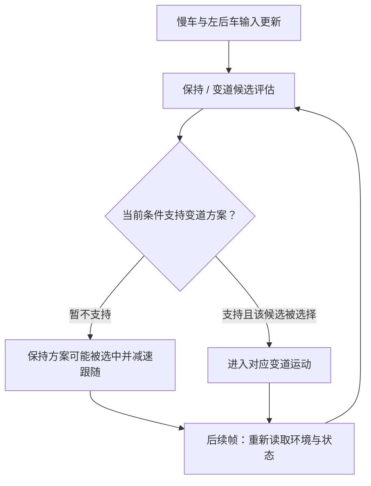
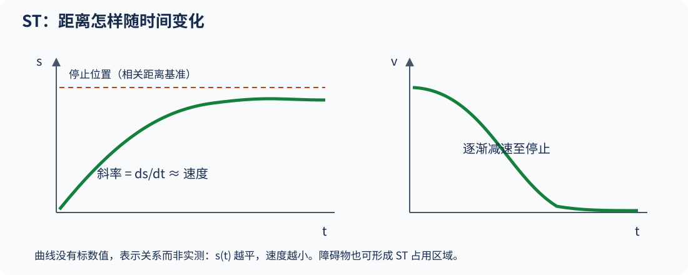
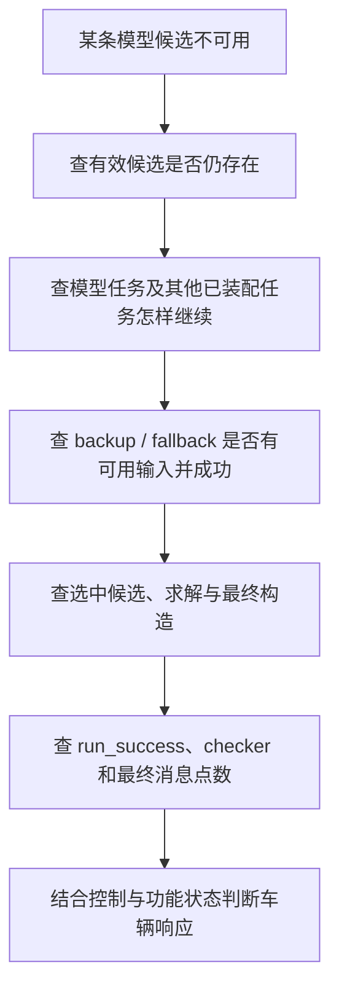

# 15 用完整场景串起来：从输入变化到车辆行为

> **这一篇讲什么**：用跟车变道、红灯、无效模型候选和规划器切换四个场景，复习完整数据链并练习定位。
>
> **读完你能回答**：看到车辆行为后，怎样倒推每一层？怎样区分已知事实、算法假设和需要实测的结论？
>
> **前置知识**：第 01～14 篇；也可先看场景，再回对应章节。

## 1. 四个场景都是教学推演

下面的数字、环境和变化用来帮助读懂源码结构，不是回放实验或量产功能保证。每个场景都先列条件，再沿数据流推演，最后给出需要证据才能确认的部分。真实某帧必须用对应代码版本、配置、消息和日志还原。

## 2. 慢车：为什么这一帧跟车，后来才变道

**设定**：自车 15 m/s，前车 8 m/s；左后方有接近车辆，导航暂时允许继续直行。这里只讨论具备相应候选和模式的情况。

| 阶段 | 会处理什么 | 应观察的证据 |
|---|---|---|
| 输入 | 前车、左后车、模型建议和自车状态 | 各自测量时刻与有效数据 |
| Frame | 建立保持与变道等候选，关联对象 | ReferenceLineInfo、SL、预测与占用 |
| 模型候选 | 处理保持/变道的匹配、概率和交互信息 | 候选过滤及历史相关信息 |
| 行为与规则 | 结合请求、变道状态与允许条件 | HPI、Context、决策和状态转移 |
| 每候选任务 | 形成该方案的路径、速度及代价等 | 每条任务链结果，不只看概率 |
| 汇合与优化 | 选择候选，iLQR 处理具体运动 | 选线理由、对象代价、求解状态 |
| 收尾 | 速度处理、拼接、检查和输出 | 最终横移、速度、状态与信封 |

*图 15-1 · 条件更新与闭环重规划。不是本项目变道状态机的逐状态复刻，也不保证左侧有空位就一定变道。*

为什么不能只看一帧模型概率？因为最终运动还取决于候选有效性、邻车关系、业务状态、历史衔接和后续求解。若左后车远离后才变道，合理的排查是比较这些数据怎样变化，而不是先认定模型“反应慢”。

## 3. 红灯：语义怎样变成逐步刹停

**设定**：有效道路关联指向本车受控停止位置，相关灯态要求停车，且规划分支采用停车处理。

先在交通灯消息和道路关系中确定受控对象与停止位置；交通灯处理生成虚拟停止墙及 stop 决策；候选上的速度和轨迹计算把“停在这里”变成时间安排；iLQR 及条件性舒适刹停继续处理运动；最后拼接、检查和输出。

*图 15-2 · ST 中逐渐趋平的 s(t) 表达逐渐停止。实际停止墙、车身参考点与最终停车位置的偏移需读具体字段。*

若车辆停得太早，依次核对停止位置关联、虚拟墙与 stop point、车身参考点、速度规划、iLQR 输出和最终后处理。只修改某个减速度参数，可能掩盖上游位置关联错误。

## 4. 模型候选无效：不要把局部失败直接翻译成整车行为

**设定**：某条模型路径因数据不足、索引不匹配或匹配起点失败而不可用。

*图 15-3 · 失败定位顺序。每一层都可能继续或失败，图不预设最后一定停车。*

单条模型候选无效，不等于全部模型输出无效；全部模型候选无效，也不证明当前配置已经具备完整传统替代链。若 run_success 为 false，还要区分是否进入清点分支、外层是否封装了空轨迹，以及控制怎样处理。这些都需要不同位置的证据。

## 5. 行车转泊车：模式变化会改变哪一段

**设定**：HPI 产生有效的 OpenSpace 规划器选择及相应目标。PlannerManager 切换规划器，并按条件处理旧状态；OpenSpace 建立适合空间搜索的任务，可能使用后台搜索管理；结果按模式装载并转成该模式输出，最终回到总控及框架输出链。

不能只比较两帧轨迹点数量，认为“同一规划器变慢了”：它们可能采用不同搜索、不同目标和不同后台生命周期。要同时保存 planner type、请求状态、目标、搜索阶段、取消状态和结果归属。

## 6. 用五个问题检验自己是否读懂

1. 参考线、绕行路径、带时间的轨迹各是哪一种对象？
2. 当前消息里的模型时间与障碍物测量时间是否相同？
3. 当前是模型候选选择、道路候选选择，还是连续数值优化？
4. 你看到的是任务返回、Planning 返回，还是框架已经送出消息？
5. 哪些结论来自源码，哪些取决于配置，哪些必须用运行数据验证？

能沿一条具体对象 ID、一条候选和一条最终轨迹回答这些问题，就已经具备阅读与排查 planning 的主干能力。遇到陌生名词可查附录 A，遇到“车上到底开没开、跑多快”可查附录 B。

## 证据与延伸

以下链接固定到本系列分析的源码提交；行号指向关键实现，不代表整段行为只由这一行决定。

| 要核实的行为 | 源码入口 |
|---|---|
| 单帧完整骨架 | [planning/planning/planning_core.cpp · `bool Planning::Process(`](https://code.deeproute.ai/deeproute-org/pnc/planning/planning/-/blob/dd7cbf35a83fa1f5fb5dc078563235e671365327/planning/planning_core.cpp#L2238) |
| 候选前处理 | [planning/planning/frame/frame_modal_selection.cpp · `Frame::SelectPathByInteraction`](https://code.deeproute.ai/deeproute-org/pnc/planning/planning/-/blob/dd7cbf35a83fa1f5fb5dc078563235e671365327/planning/frame/frame_modal_selection.cpp#L1376) |
| 任务与选线 | [planning/planning/planner/em_planner.cpp · `bool EmPlanner::PlanOnReferenceLine(Frame* frame)`](https://code.deeproute.ai/deeproute-org/pnc/planning/planning/-/blob/dd7cbf35a83fa1f5fb5dc078563235e671365327/planning/planner/em_planner.cpp#L341) |
| 红灯处理 | [planning/planning/frame/frame_traffic_light.cpp · `AddVirtualStopWallForTrafficLight`](https://code.deeproute.ai/deeproute-org/pnc/planning/planning/-/blob/dd7cbf35a83fa1f5fb5dc078563235e671365327/planning/frame/frame_traffic_light.cpp#L10) |
| 失败时点列处理 | [planning/planning/planning_core.cpp · `void Planning::HandleTrajectoryPublishingAndExceptions`](https://code.deeproute.ai/deeproute-org/pnc/planning/planning/-/blob/dd7cbf35a83fa1f5fb5dc078563235e671365327/planning/planning_core.cpp#L2474) |
| 规划器切换 | [planning/planning/planner_manager.cpp · `PlannerManager::PlannerDispatch`](https://code.deeproute.ai/deeproute-org/pnc/planning/planning/-/blob/dd7cbf35a83fa1f5fb5dc078563235e671365327/planning/planner_manager.cpp#L82) |

---

[返回 Planning 导读](./index.md) · [上一篇：14 其他规划器：泊车、倒车与后台 OpenSpace](./14%20%E5%85%B6%E4%BB%96%E8%A7%84%E5%88%92%E5%99%A8%EF%BC%9A%E6%B3%8A%E8%BD%A6%E3%80%81%E5%80%92%E8%BD%A6%E4%B8%8E%E5%90%8E%E5%8F%B0%20OpenSpace.md) · [下一篇：附录 A 名词、数据对象与源码阅读地图](./%E9%99%84%E5%BD%95%20A%20%E5%90%8D%E8%AF%8D%E3%80%81%E6%95%B0%E6%8D%AE%E5%AF%B9%E8%B1%A1%E4%B8%8E%E6%BA%90%E7%A0%81%E9%98%85%E8%AF%BB%E5%9C%B0%E5%9B%BE.md)
