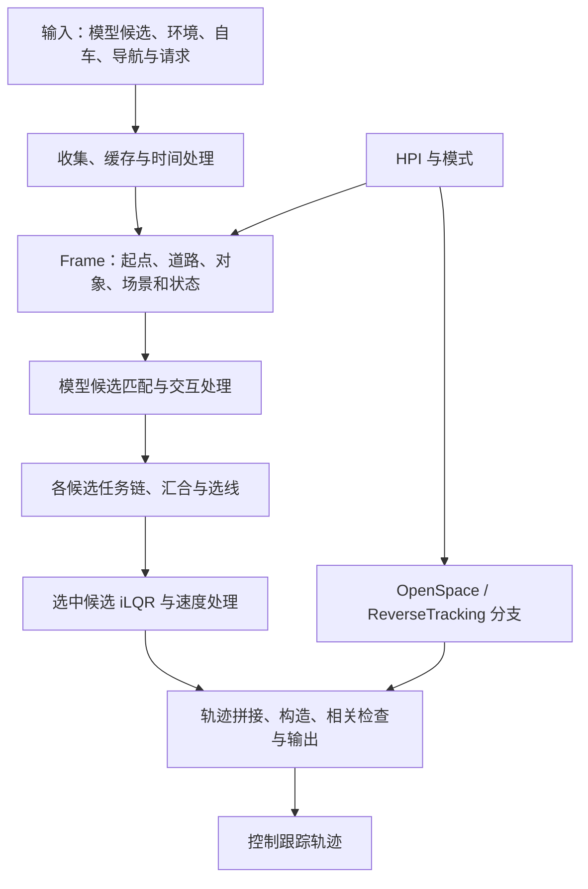

# Planning 架构拆解 · 导读

> **这一套讲什么**：模型已经会给轨迹，planning 为什么还存在？这一帧从哪些输入开始，怎样整理道路和障碍物、挑选方案、优化运动，再输出给控制？
>
> **阅读目标**：即使没有规划背景，也能分清 planner head、planning、Planner 和 Task，画出完整数据链，并找到每段的源码证据。

## 1. 先建立一张全景地图

本系列延续[上级 E2E 导读](../index.md)的“先总后分、以数据流为纲”结构，向下拆解 planning。主叙事是**端到端模型参与的道路行车**，穿插传统 DP/QP 及组合条件；泊车、倒车与后台 OpenSpace 单独解释。

*图 0-1 · 从输入到输出的知识地图。检查与规则分布在多个阶段，图中的收尾框不表示只有最后才做检查。*

## 2. 按你的问题选择路线

| 路线 | 建议读法 | 读完应会什么 |
|---|---|---|
| 15 分钟先看懂 | 01 的职责 → 02 的四种线 → 03 的总图 → 04 输入输出表 | 解释 planning 的边界与一帧主线 |
| 从零完整理解 | 01～15 顺序读，遇到术语查附录 A | 理解数据对象、候选、求解、输出与模式分支 |
| 看端到端怎样落车 | 04～06 → 09 → 11～13 | 追踪 head 结果到最终轨迹 |
| 看源码与排查 | 03 → 附录 A 源码地图 → 对应章节 → 附录 B | 结合配置、消息和运行证据定位 |

每篇都先说明要解决的问题，再解释输入、数据变换和输出；失败条件在相关小节展开。图形中的时间、距离、对象场景除特别说明外均为教学示意，没有把它们当作实车测试结果。

## 3. 章节地图

| 篇目 | 核心问题 |
|---|---|
| [01 Planning 的职责：模型已经给轨迹，为什么还需要规划](./01%20Planning%20%E7%9A%84%E8%81%8C%E8%B4%A3%EF%BC%9A%E6%A8%A1%E5%9E%8B%E5%B7%B2%E7%BB%8F%E7%BB%99%E8%BD%A8%E8%BF%B9%EF%BC%8C%E4%B8%BA%E4%BB%80%E4%B9%88%E8%BF%98%E9%9C%80%E8%A6%81%E8%A7%84%E5%88%92.md) | 模型会给轨迹，软件还负责什么？ |
| [02 先认识规划的语言：参考线、路径与轨迹](./02%20%E5%85%88%E8%AE%A4%E8%AF%86%E8%A7%84%E5%88%92%E7%9A%84%E8%AF%AD%E8%A8%80%EF%BC%9A%E5%8F%82%E8%80%83%E7%BA%BF%E3%80%81%E8%B7%AF%E5%BE%84%E4%B8%8E%E8%BD%A8%E8%BF%B9.md) | 参考线、路径、轨迹与 SL/ST 怎样区分？ |
| [03 一帧全景：从触发到最终发布](./03%20%E4%B8%80%E5%B8%A7%E5%85%A8%E6%99%AF%EF%BC%9A%E4%BB%8E%E8%A7%A6%E5%8F%91%E5%88%B0%E6%9C%80%E7%BB%88%E5%8F%91%E5%B8%83.md) | 一帧谁先谁后，哪里并行，何时完成？ |
| [04 输入与输出：planning 究竟拿到了什么](./04%20%E8%BE%93%E5%85%A5%E4%B8%8E%E8%BE%93%E5%87%BA%EF%BC%9Aplanning%20%E7%A9%B6%E7%AB%9F%E6%8B%BF%E5%88%B0%E4%BA%86%E4%BB%80%E4%B9%88.md) | 每种输入和输出分别承载什么？ |
| [05 数据进入 planning：收集、缓存与时间对齐](./05%20%E6%95%B0%E6%8D%AE%E8%BF%9B%E5%85%A5%20planning%EF%BC%9A%E6%94%B6%E9%9B%86%E3%80%81%E7%BC%93%E5%AD%98%E4%B8%8E%E6%97%B6%E9%97%B4%E5%AF%B9%E9%BD%90.md) | 消息不同频，怎样缓存并解释时间？ |
| [06 一帧的工作台：Frame、Context 与规划起点](./06%20%E4%B8%80%E5%B8%A7%E7%9A%84%E5%B7%A5%E4%BD%9C%E5%8F%B0%EF%BC%9AFrame%E3%80%81Context%20%E4%B8%8E%E8%A7%84%E5%88%92%E8%B5%B7%E7%82%B9.md) | Frame、Context、历史和起点怎样组织？ |
| [07 道路怎样变成可计算的空间](./07%20%E9%81%93%E8%B7%AF%E6%80%8E%E6%A0%B7%E5%8F%98%E6%88%90%E5%8F%AF%E8%AE%A1%E7%AE%97%E7%9A%84%E7%A9%BA%E9%97%B4.md) | 导航、地图与模型怎样形成道路候选？ |
| [08 障碍物与场景：从“看见它”到“它影响我”](./08%20%E9%9A%9C%E7%A2%8D%E7%89%A9%E4%B8%8E%E5%9C%BA%E6%99%AF%EF%BC%9A%E4%BB%8E%E2%80%9C%E7%9C%8B%E8%A7%81%E5%AE%83%E2%80%9D%E5%88%B0%E2%80%9C%E5%AE%83%E5%BD%B1%E5%93%8D%E6%88%91%E2%80%9D.md) | 物理对象怎样变成影响某个候选的对象？ |
| [09 模型候选：多条建议如何进入 planning](./09%20%E6%A8%A1%E5%9E%8B%E5%80%99%E9%80%89%EF%BC%9A%E5%A4%9A%E6%9D%A1%E5%BB%BA%E8%AE%AE%E5%A6%82%E4%BD%95%E8%BF%9B%E5%85%A5%20planning.md) | 多模态建议怎样匹配、筛选和生成？ |
| [10 行为与规则：为什么选择跟车、变道或停车](./10%20%E8%A1%8C%E4%B8%BA%E4%B8%8E%E8%A7%84%E5%88%99%EF%BC%9A%E4%B8%BA%E4%BB%80%E4%B9%88%E9%80%89%E6%8B%A9%E8%B7%9F%E8%BD%A6%E3%80%81%E5%8F%98%E9%81%93%E6%88%96%E5%81%9C%E8%BD%A6.md) | 业务、场景和交通要求怎样影响运动？ |
| [11 候选求解：任务链、DP、QP 与参考线选择](./11%20%E5%80%99%E9%80%89%E6%B1%82%E8%A7%A3%EF%BC%9A%E4%BB%BB%E5%8A%A1%E9%93%BE%E3%80%81DP%E3%80%81QP%20%E4%B8%8E%E5%8F%82%E8%80%83%E7%BA%BF%E9%80%89%E6%8B%A9.md) | 任务何时创建，怎样求解、汇合与降级？ |
| [12 iLQR：把候选方案优化为车辆能跟踪的运动](./12%20iLQR%EF%BC%9A%E6%8A%8A%E5%80%99%E9%80%89%E6%96%B9%E6%A1%88%E4%BC%98%E5%8C%96%E4%B8%BA%E8%BD%A6%E8%BE%86%E8%83%BD%E8%B7%9F%E8%B8%AA%E7%9A%84%E8%BF%90%E5%8A%A8.md) | 行车求解器优化什么，怎样分阶段迭代？ |
| [13 最后一段：速度处理、拼接、检查与发布](./13%20%E6%9C%80%E5%90%8E%E4%B8%80%E6%AE%B5%EF%BC%9A%E9%80%9F%E5%BA%A6%E5%A4%84%E7%90%86%E3%80%81%E6%8B%BC%E6%8E%A5%E3%80%81%E6%A3%80%E6%9F%A5%E4%B8%8E%E5%8F%91%E5%B8%83.md) | 结果怎样拼接、检查并最终送出？ |
| [14 其他规划器：泊车、倒车与后台 OpenSpace](./14%20%E5%85%B6%E4%BB%96%E8%A7%84%E5%88%92%E5%99%A8%EF%BC%9A%E6%B3%8A%E8%BD%A6%E3%80%81%E5%80%92%E8%BD%A6%E4%B8%8E%E5%90%8E%E5%8F%B0%20OpenSpace.md) | 道路外的搜索、倒车和后台任务怎样组织？ |
| [15 用完整场景串起来：从输入变化到车辆行为](./15%20%E7%94%A8%E5%AE%8C%E6%95%B4%E5%9C%BA%E6%99%AF%E4%B8%B2%E8%B5%B7%E6%9D%A5%EF%BC%9A%E4%BB%8E%E8%BE%93%E5%85%A5%E5%8F%98%E5%8C%96%E5%88%B0%E8%BD%A6%E8%BE%86%E8%A1%8C%E4%B8%BA.md) | 怎样用场景把整条数据链串起来？ |
| [附录 A 名词、数据对象与源码阅读地图](./%E9%99%84%E5%BD%95%20A%20%E5%90%8D%E8%AF%8D%E3%80%81%E6%95%B0%E6%8D%AE%E5%AF%B9%E8%B1%A1%E4%B8%8E%E6%BA%90%E7%A0%81%E9%98%85%E8%AF%BB%E5%9C%B0%E5%9B%BE.md) | 陌生名词与源码入口在哪里？ |
| [附录 B 配置、线程与运行证据](./%E9%99%84%E5%BD%95%20B%20%E9%85%8D%E7%BD%AE%E3%80%81%E7%BA%BF%E7%A8%8B%E4%B8%8E%E8%BF%90%E8%A1%8C%E8%AF%81%E6%8D%AE.md) | 怎样确认配置、频率与实际耗时？ |

## 4. 怎样读图，怎样看证据

流程图说明依赖与职责；时序图说明参与方交接；甘特图说明并行和等待，标注时长均非实测；SVG 示意图解释几何、坐标和车辆运动。图省略细节时，正文会指出范围。宽图可以横向滚动。

每篇末尾的“证据与延伸”使用固定提交的 GitLab 链接，便于复查。正文区分“实现具备什么能力”“条件满足时会走什么分支”“实际运行是否采用该分支”。最后一种需要实际配置和日志，不能由静态代码独自证明。

## 5. 分析基线与范围

| 仓库 | 本系列分析提交 | 用途 |
|---|---|---|
| planning | [`dd7cbf35a83f`](https://code.deeproute.ai/deeproute-org/pnc/planning/planning/-/tree/dd7cbf35a83fa1f5fb5dc078563235e671365327) | 算法主线与子图 |
| driver | [`eacec82b6662`](https://code.deeproute.ai/deeproute-projects/public/driver/-/tree/eacec82b6662c3c8b2f26a6749e679ef11ce6218) | 组件装配、输入输出与外层 graph |
| perception | [`dc6cd752e273`](https://code.deeproute.ai/deeproute-org/perception/onboard/perception/-/tree/dc6cd752e2738ec283870f6a3899137a399f7836) | head 字段转换与交错输入来源 |
| platform | [`55b503c91f7e`](https://code.deeproute.ai/deeproute-org/os/all-member/platform/-/tree/55b503c91f7eaaef78d90b538f34c65f0ea4b154) | Church 装配、完成信号与发布机制 |

这些仓库的静态快照用于理解接口和实现，不代表它们已作为同一发布包完成集成验证。本系列没有进行车辆回放、算法回归或实际 5/10 Hz 性能测量。

关于原讨论的三个疑问：planner head 与 planning 的差异看第 01 篇；参考线是不是路径看第 02 篇；“head 10 Hz、环境 5 Hz、planning 5/10 Hz”怎样拆开验证看第 05 篇与附录 B。训练频率的约定还需要模型侧配置和部署策略，不能从 planning 代码单独反推出全部结论。

本系列解释结构与工作机制，不逐条枚举每个场景的全部策略、所有参数默认值或求解器每个 Hessian 推导。需要更细的行为结论时，从对应篇目的固定源码链接继续向调用方与配置下钻。
