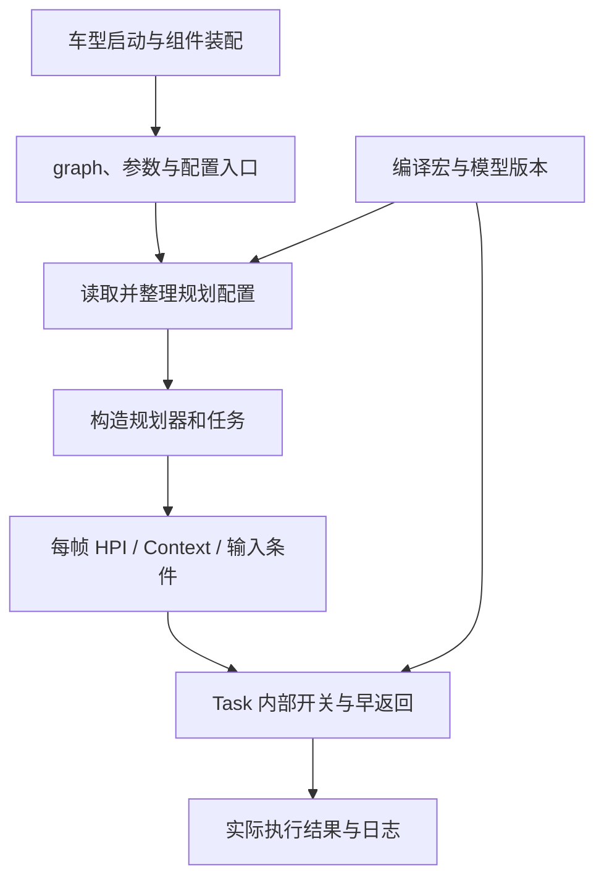
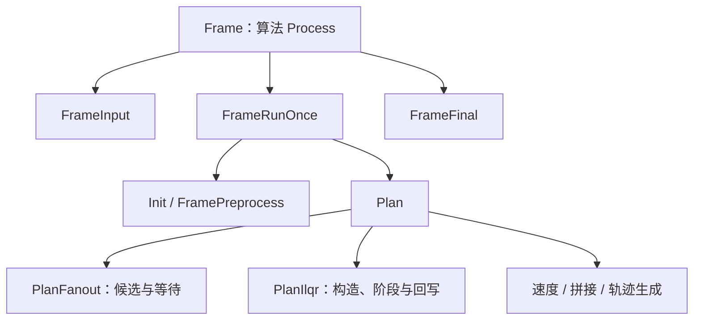

# 附录 B 配置、线程与运行证据

> **这一篇讲什么**：区分仓库中的能力、配置选中的分支与车上实际行为，并给出频率和耗时的验证方法。
>
> **读完你能回答**：5 Hz/10 Hz 到底测哪个边界？默认配置能代表实车吗？并行耗时应该怎样算？
>
> **前置知识**：第 03、05、11、14 篇。

## 1. 三层证据不能混用

| 证据 | 能证明什么 | 例子 |
|---|---|---|
| 代码存在 | 某种行为具有实现及其条件 | 仓库有 OpenSpace 或模型轨迹任务 |
| 当前配置与编译产物 | 某条分支有机会被启用 | 某车型配置开启模型路径，宏编译进缓存处理 |
| 运行消息、状态与 trace | 某个版本在某次运行实际做了什么 | 某帧 planner type、任务执行、轨迹发布与实测耗时 |

“当前仓库能看到 10 Hz 支持”和“这辆车正在稳定 10 Hz 输出有效轨迹”不是同一结论。后者需要部署版本与运行证据。

## 2. 从组件配置一路读到动态条件

首先查 driver 装配的组件和 graph，以及传入的 city/task/配置路径等参数。`PlanningStitchMapCalculator::Open` 基于路径加载配置并创建 planning processor；配置加载过程还有组合与模式处理。进入算法后，HPI、功能状态和当前帧条件继续影响采用的规划器及任务行为。

*图 B-1 · 静态配置与动态条件共同决定执行路径。找到一份 defaults 文件并不足以确认最后一格。*

例如 `DR_PERCEPTION_INTERLEAVING_FEATURE` 影响部分交错频率输入缓存与时间处理。若不知道二进制是否带该宏，必须保留条件表述。PlannerManager 在新 EM 配置出现时还可能重建规划器，这也说明构造条件不是永久不变的车端事实。

## 3. 5 Hz / 10 Hz 要先说清测量边界

| 指标 | 定义 | 主要证据 |
|---|---|---|
| 模型推理频率 | 每秒真正执行多少次相关模型推理 | 推理序号、设备 trace / 运行日志 |
| planner head 更新频率 | 每秒多少份新 head 结果进入消息 | 模型结果序号与原始时刻 |
| 感知对象更新频率 | 每秒多少份真正新测量/处理的障碍物 | `time_measurement_objects` 等原始时间 |
| objects 消息频率 | `/perception/objects` 信封每秒发送多少条 | topic 发布记录 |
| planning 成功装配频率 | 每秒多少帧被入口装配并进入处理 | Any / Core 输入及帧标记 |
| 最终输出频率 | 每秒多少条 trajectory 信封 | 发布记录，另统计空轨迹和异常状态 |
| 有效新轨迹频率 | 新内容且满足所定义有效条件的轨迹数 | 输出序号、点数、状态与定义 |

**一个 10 Hz 的 objects topic 可以混合新 head 与较低频缓存环境信息。** 因而“感知 + planning 10 Hz”必须说明指哪一段，不能推断所有感知后处理也变成 10 Hz。

原讨论中的“planner head 10 Hz，但 5 Hz 给 planning”可以描述一种运行策略；在 objects 触发的装配下，planning 能处理多快还受实际发布、缓存装配、完成信号和耗时影响。是否每两次取一次、在哪里降频，要查那次部署的实现和运行记录，本系列不把口述策略当成当前配置的实测事实。

同样，10 Hz 训练常意味着模型学习的采样节奏或历史间隔有约定；这为部署一致性提出要求，但不能仅凭训练频率推导出“所有模块都必须 10 Hz”。历史输入更新、重采样、状态递推和输出节流还需要模型接口及推理侧证据。

## 4. 频率、延迟和处理时间分开计算

取同一时钟域的一组时间：`t_obs` 是观测/模型来源时刻，`t_enter` 是规划进入时刻，`t_exit` 是算法返回，`t_pub` 是实际发布。则：

- 输入年龄约为 `t_enter - t_obs`，不同输入分别计算。
- 算法处理时长为 `t_exit - t_enter`，不含此前缓存等待。
- 发布时的来源年龄为 `t_pub - t_obs`。
- 输出间隔为相邻两次 `t_pub` 之差，其倒数反映局部发布频率。

这些相减的前提是时间单位、时钟域和含义相容；单调时钟和 UTC 时刻不能直接混算。接收频率稳定也不能排除数据越来越旧。

`expected_proc_duration_ms=500` 是组件配置的预期处理时长参数，不能当作实际耗时、目标周期或 2 Hz 频率。若要解释它是否触发框架告警，应继续阅读相应框架路径；仅该字段本身不提供完整调度语义。

## 5. 线程数、并行分支与后台任务

外层 executor 的 3 个线程、算法 major/task 线程池、各参考线同步 fan-out、OpenSpace 后台池处在不同层次。它们不能相加得出“同时在算多少帧”，也不能仅看 CPU 利用率判断哪个阶段拖慢。

在候选并行阶段，主链要等待最慢的相关工作完成。三个分支各占 10 ms，并不意味着整帧增加 30 ms；线程竞争或排队也可能使三者无法完全重叠。分析时同时看墙钟、各线程工作与等待。

## 6. 现有分层打点怎样读

`PlanProfiler` 用 FrameGuard 覆盖 `Planning::Process` 的算法调用，分层节点表在 `plan_profiler_nodes.h`；可从 FrameInput、FrameRunOnce、FrameFinal 向 Init、PlanFanout、PlanIlqr 等下钻。分析脚本是 `common/profiling/scripts/plan_profiler_analyze.py`，使用前先读其 `--help` 和当前日志格式。

*图 B-2 · 为阅读而简化的打点树，精确父子关系以节点表为准。Process 之外的消息装配和实际发布仍要看框架 trace。*

父节点包含子节点，不能把父子时间重复求和；多线程聚合还需区分 wall、inclusive/self 与每候选统计。代码对 worker 复用时的 refline 统计可靠性有警告，分析报告应保留这些提示。

该 profiler 明确依赖同步子树的帧边界与 barrier，**不能直接把 PLAN_PROF 加进跨帧 OpenSpace detached job**，否则下一帧 reset 与后台写入可能冲突。后台任务用适合其生命周期的证据单独分析。

## 7. 验证一次部署，保留最少但完整的材料

记录代码/二进制与模型版本、车型/模式、实际配置和宏；采集 objects 的信封时刻与内部来源时刻、planning 入帧/完成、轨迹发布及内容状态；再对齐同一帧的 profiler/trace 与 planner type。

最后分别回答“输入多久更新一次”“算法耗时多少”“多久输出一次新有效轨迹”“输出来自多旧的观测”。这四个答案比一句“现在是 5 Hz”更能解释车辆实际行为。

## 证据与延伸

以下链接固定到本系列分析的源码提交；行号指向关键实现，不代表整段行为只由这一行决定。

| 要核实的行为 | 源码入口 |
|---|---|
| 组件入口配置 | [driver/config/component/planning.jsonnet · `"expected_proc_duration_ms": 500`](https://code.deeproute.ai/deeproute-projects/public/driver/-/blob/eacec82b6662c3c8b2f26a6749e679ef11ce6218/config/component/planning.jsonnet#L9) |
| 配置加载 | [planning/planning/calculators/planning_stitch_map_calculator.cc · `LoadConfigFiles(`](https://code.deeproute.ai/deeproute-org/pnc/planning/planning/-/blob/dd7cbf35a83fa1f5fb5dc078563235e671365327/planning/calculators/planning_stitch_map_calculator.cc#L164) |
| 动态切换与重建 | [planning/planning/planner_manager.cpp · `bool PlannerManager::Update`](https://code.deeproute.ai/deeproute-org/pnc/planning/planning/-/blob/dd7cbf35a83fa1f5fb5dc078563235e671365327/planning/planner_manager.cpp#L47) |
| 输入缓存与测量时间 | [planning/planning/common/perception/perception_time_utils.cpp · `DR_PERCEPTION_INTERLEAVING_FEATURE`](https://code.deeproute.ai/deeproute-org/pnc/planning/planning/-/blob/dd7cbf35a83fa1f5fb5dc078563235e671365327/planning/common/perception/perception_time_utils.cpp#L15) |
| Profiler 边界和异步约束 | [planning/planning/common/profiling/plan_profiler.h · `struct FrameGuard`](https://code.deeproute.ai/deeproute-org/pnc/planning/planning/-/blob/dd7cbf35a83fa1f5fb5dc078563235e671365327/planning/common/profiling/plan_profiler.h#L106) |
| 分层节点表 | [planning/planning/common/profiling/plan_profiler_nodes.h · `PLAN_TIMER_NODES`](https://code.deeproute.ai/deeproute-org/pnc/planning/planning/-/blob/dd7cbf35a83fa1f5fb5dc078563235e671365327/planning/common/profiling/plan_profiler_nodes.h#L5) |
| 分析脚本 | [planning/planning/common/profiling/scripts/plan_profiler_analyze.py · `argparse`](https://code.deeproute.ai/deeproute-org/pnc/planning/planning/-/blob/dd7cbf35a83fa1f5fb5dc078563235e671365327/planning/common/profiling/scripts/plan_profiler_analyze.py#L10) |

---

[返回 Planning 导读](./index.md) · [上一篇：附录 A 名词、数据对象与源码阅读地图](./%E9%99%84%E5%BD%95%20A%20%E5%90%8D%E8%AF%8D%E3%80%81%E6%95%B0%E6%8D%AE%E5%AF%B9%E8%B1%A1%E4%B8%8E%E6%BA%90%E7%A0%81%E9%98%85%E8%AF%BB%E5%9C%B0%E5%9B%BE.md)
