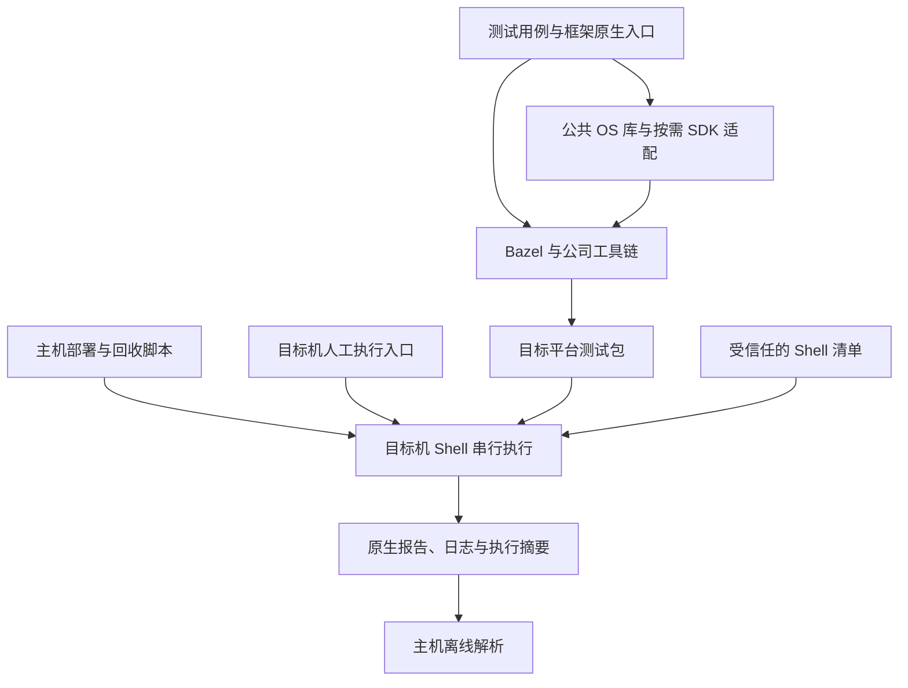

# PlatformBench：跨平台测试用例仓库

PlatformBench 维护底软需求检查和平台性能测试用例，供平台工程师执行 Bringup 检查、底软验证和资源评估。用例直接使用 GoogleTest、Google Benchmark 等成熟框架；公共库处理平台差异，Bazel 复用公司工具链，脚本串行执行并收集原生报告。

本文档集按 `/sandbox/PlatformBench` 的第一期实现更新，整体替代此前设计。
当前已实现 OS 检查、CPU 整数和内存复制示例，贯通 Bazel 构建、默认/选包交付、
目标机 Shell 执行、主机 SSH 部署回收和离线解析。本文中的构建配置、目标和接口对应现有代码；
`board-a`、板卡目录和业务需求编号仍需按实际环境填写。未来能力会明确标注，不视为已交付。

## 1. 已确定的选择

| 事项 | 设计选择 |
| --- | --- |
| 仓库核心 | 可追溯需求、测试方法明确的测试用例 |
| 测试框架 | 底软检查使用 GoogleTest，CPU/内存基准使用 Google Benchmark，允许其他框架和已有工具 |
| 源码组织 | 按测试目的和领域分层，一个底软需求一个源文件 |
| 构建与执行粒度 | 按情况自由组织，源码文件、可执行目标和清单项目分别决定 |
| 平台适配 | 公共 OS 接口及 Linux/QNX 实现；SDK 按实际复用需求提取小接口 |
| 构建交付 | 公司 Bazel 工具链，平台默认集合，同时支持选择目标打包 |
| 正式入口 | 主机 Python 通过 SSH 部署执行回收；目标机 Shell 独立批量运行 |
| 共用逻辑 | 两个入口使用相同目标机脚本和受信任的 Shell 清单 |
| 默认失败策略 | 普通测试失败继续，超时、崩溃和结果保存失败等异常停止 |
| 结果 | 原生报告及日志，加统一执行摘要；测试结论与执行状态分别表达 |

一期详细覆盖底软需求检查、CPU 与内存基准。GPU/NPU、推理运行时及厂商 SDK 在扩展规范中说明后续接入方法，不承诺一期实现。ONNX Runtime 是推理运行时，可以由 Google Benchmark 驱动，也可以通过已有性能工具接入。

## 2. 协作关系

用例负责方法和判定依据，测试框架负责断言或基准迭代，平台库负责 OS/SDK 差异，脚本负责进程与文件。公共设计不增加统一 Case 生命周期、注册中心、测量循环或动态插件机制。

## 3. 文档导航

| 文档 | 内容 |
| --- | --- |
| [01 总体设计与用例组织](./01%20总体设计与用例组织.md) | 仓库目录逐项说明、阅读顺序、目标粒度及三个示例的方法 |
| [02 平台抽象与扩展规范](./02%20平台抽象与扩展规范.md) | OS/SDK 边界及新增用例、框架和平台的方法 |
| [03 Bazel 构建与测试包交付](./03%20Bazel%20构建与测试包交付.md) | 公司构建体系、默认集合、选包及运行依赖 |
| [04 脚本运行与结果收集](./04%20脚本运行与结果收集.md) | 双入口、清单、失败策略、结果和验收 |

目录及框架以第 01 篇为准，平台接口以第 02 篇为准，交付以第 03 篇为准，脚本与结果以第 04 篇为准。此前的单一测试程序、自研执行器和强制统一样本格式不再作为实施依据。

## 4. 实施与验证边界

第一期已验证 11 组配置的实际构建、链接及打包：本机 Linux x86_64、Orin/ThorU/M97/J6P
四组 Linux AArch64，以及 QNX 7.1、8.0、公司 SDP 8 v2 的 x86_64/AArch64 六组配置。
本机默认包和内存选包已从源码目录外独立执行并解析，OS 两个 GTest 与 CPU/内存基准通过；
17 项宿主机工作流回归覆盖参数、失败策略、报告、选包和假 SSH 回收。
具体配置和命令见第 03 篇，执行约定与验证方法见第 04 篇。

交叉产物仅完成静态架构、加载器和递归依赖核验，尚未提供目标板连接参数，
不宣称板端装载、运行和性能标定通过。真实 SSH、BSP、权限、信号和工具能力仍须实机验收。
性能阈值和底软准入值由对应需求确定，不由公共脚本默认设置。

源码仓库保留代码、构建配置、回归与使用说明，不维护一次性验证文档、日志、旧包和编辑器配置。
验证产物可通过构建矩阵和运行命令重新生成，输出目录使用新路径且不纳入提交。
设计文档保存在本目录，使用入口保存在实现仓库的 `README.md`。

保留的[GPU/NPU 调研报告](../调研报告/自动驾驶芯片%20GPU-NPU%20推理能力评估全面调研报告.md)供后续方法和工具选型参考，其中的架构建议不覆盖本次已确定的边界。
