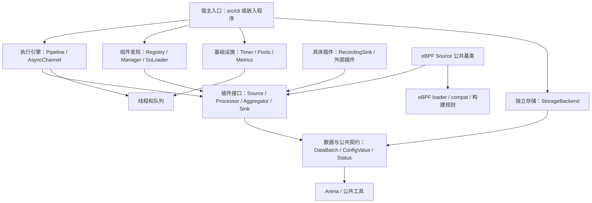
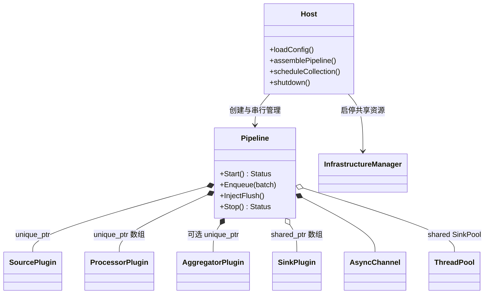
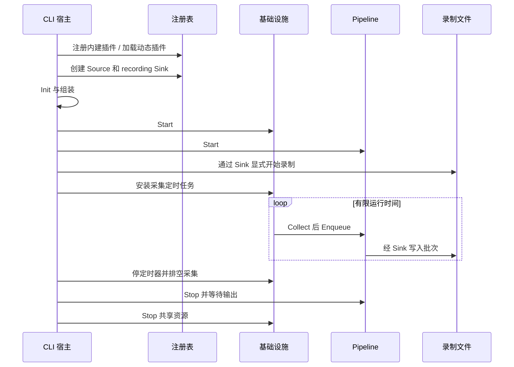

# 01 总体架构与模块边界

Illuminator 的核心由数据契约、执行引擎和组件扩展三部分组成。CLI 是这些能力的一个使用者。引擎无需 HTTP、界面或业务 Feature 即可执行；插件实现也无需通过上层 Driver 才能加入 Pipeline。

返回 [设计总览](./index.md)。事件与并发细节见 [Pipeline v3](./02-pipeline-v3.md)。

## 1. 逻辑分层

分层描述的是依赖方向，而不是每层各自启动一个服务。大量基础设施是头文件实现；静态链接和 `#include` 边界同样需要通过 Bazel target 约束。

### 1.1 数据与公共契约

`src/core/common` 提供 Status、ConfigValue、GlobalConfig、YAML、日志、DataBatch 和 JSON。虽然物理目录相同，Bazel 已拆成 `common`、`data`、`serialization`、`yaml_config` 等目标，避免让每个使用方都隐含依赖 YAML 或全部引擎。

DataBatch 是运行期交付单位；Status 是调用结果契约；ConfigValue 是插件参数载体。它们不应反向依赖 CLI、存储后端或具体插件。

### 1.2 执行引擎

`Pipeline` 管理组件组合、处理线程、输入通道、输出提交及整管道停止。`AsyncChannel` 提供有界事件传递与水位状态。Pipeline 自身不扫描动态库、不解析配置文件，也不自动建立采集定时器。

`InfrastructureManager` 管理 TimerWheel、CollectPool、SinkPool，当前通过单例提供访问。它不持有 Pipeline 集合，不提供应用级编排能力。

### 1.3 组件扩展与持久化

`plugin/api` 定义四类组件；`plugin/infra` 创建实例。当前显式注册的内建输出为 RecordingSink。Processor、Aggregator 保留接口及扩展位置，文档中的过滤、符号化、窗口统计属于可实现的插件职责，不表示当前存在对应的生产插件。

`src/storage` 是独立持久化 API。SQLite 不再位于 Server 目录，构建仅依赖基础数据、公共配置及 SQLite 系统库。后续 StorageSink 可以依赖它，引擎不必知道数据库结构。

## 2. 源码与构建地图

下表中的路径相对 `/sandbox/illuminator`。

| 目录 / 文件 | 主要职责 | 关键构建目标 |
| --- | --- | --- |
| `src/core/common/status.h`、`config.h` | 状态与配置基础结构 | `//src/core:common` |
| `src/core/common/data_batch.h` | Record、StackSample、批次与字符串驻留 | `//src/core:data` |
| `src/core/common/json_serializer.h` | 数据 JSON 输出 | `//src/core:serialization` |
| `src/core/common/yaml_config_loader.h` | 根配置解析和校验 | `//src/core:yaml_config` |
| `src/core/engine` | Pipeline、Channel、调度、PID、自观测 | `//src/core:engine` |
| `src/core/memory` | Arena、环形队列 | `//src/core:memory` |
| `src/core/threading` | 线程池与线程工具 | `//src/core:threading` |
| `src/plugin/api` | 四类接口、录制控制接口 | `//src/plugin:api` |
| `src/plugin/api/ebpf_source_base.h` | eBPF skeleton 生命周期 | `//src/plugin:ebpf_source_base` |
| `src/plugin/infra` | 注册、发现、动态装载 | `//src/plugin:infra`、`//src/plugin:builtin` |
| `src/plugin/sinks/recording_sink` | `.ilr` 输出 | `//src/plugin/sinks:recording_sink` |
| `src/storage` | StorageBackend、SQLite | `//src/storage:storage`、`//src/storage:sqlite_backend` |
| `src/ebpf_common` | 公共 BPF 类型、用户态工具、探针规则 | `//src/ebpf_common:loader` 等 |
| `src/cli` | 参数处理、组装、调度和关闭 | `//src/cli:illuminator` |

注意 `//src/core:engine` 依赖 `//src/plugin:api`，而 `api` 依赖 `core:common/data/memory`，不依赖 `core:engine`，因此不存在这一层面的引擎循环依赖。概念上的“插件在引擎之上”和构建上的“引擎调用插件接口”需要区分。

## 3. 运行关系与对象所有权

Source、Processor 和 Aggregator 通常只属于一条 Pipeline。Sink 使用共享所有权，因为异步输出任务需要延长其实例寿命。**共享所有权只能延长对象内存寿命，不能自动延长已关闭文件、BPF fd 等外部资源的可用期。**

宿主必须比其提交的采集回调活得更久；动态库必须比从中创建的组件实例及仍可调用的工厂活得更久。独立 StorageBackend 的 Close 应发生在其所有读写调用结束之后。

## 4. 宿主的责任

| 阶段 | 宿主应执行的工作 | Pipeline 自动执行的工作 |
| --- | --- | --- |
| 配置 | 读取 YAML、选择工厂、逐个 Init 插件 | 不解析 YAML，不调用 Init |
| 组装 | 设置 Source、Processor、Aggregator、Sink 和 SinkPool | 保存对象所有权 |
| 启动 | 启动基础设施、调用 Pipeline Start、安装定时任务 | 按顺序 Start 插件并启动 ProcessThread |
| 采集 | 定时投递 Collect、阻止同一 Source 重叠采集、检查结果 | 接收有效批次并处理 |
| 聚合调度 | 根据正的 FlushIntervalMs 注入 Flush | 在 ProcessThread 执行 Flush、超期兜底 |
| 停止 | 停止并等待定时回调、排空外部 Collect 任务 | 停 Source、排空通道、等待自身 Write、停其余组件 |
| 释放 | 停止共享基础设施、关闭存储、最后处理动态库寿命 | 析构调用 Stop，但无法补救外部悬空回调 |

不要把 `GetSource()` 返回的裸指针当作可独立保存的所有权句柄。读取 `IsRunning()` 后继续调用 Source 也不是生命周期屏障；状态可能在检查之后改变。

## 5. 最小运行闭环

该闭环已经能在没有 Server 与前端的情况下运行。实际 CLI 目前只装配 Source 与 recording Sink，更复杂的处理链通过 C++ SDK 组装。

## 6. 演进时保持的边界

新增业务采集应作为 Source 或宿主配置进入，而非恢复引擎内业务 Driver。新增持久化应作为 Sink 适配层进入。新增控制服务可以持有宿主运行对象，但应继续遵守外部生产者的关闭顺序。

后续若引入 RuntimeContext、多实例隔离或调度句柄，应优先替换隐式全局依赖和裸指针回调，不改变批次处理语义。未解决的 ABI、热更新和并发输出问题见 [核心审阅](./10-core-audit-and-evolution.md)。
