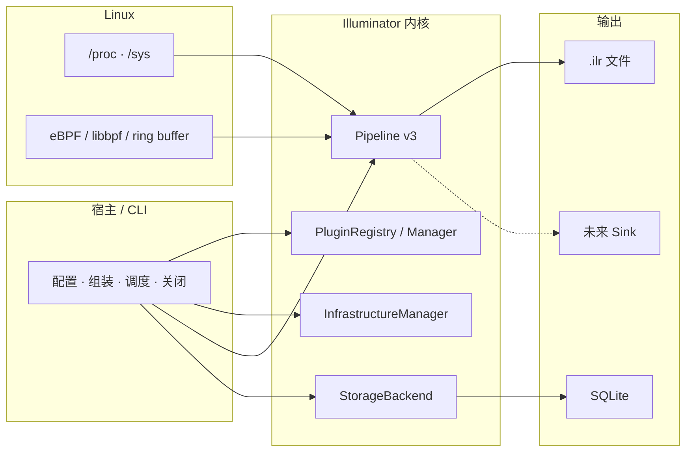
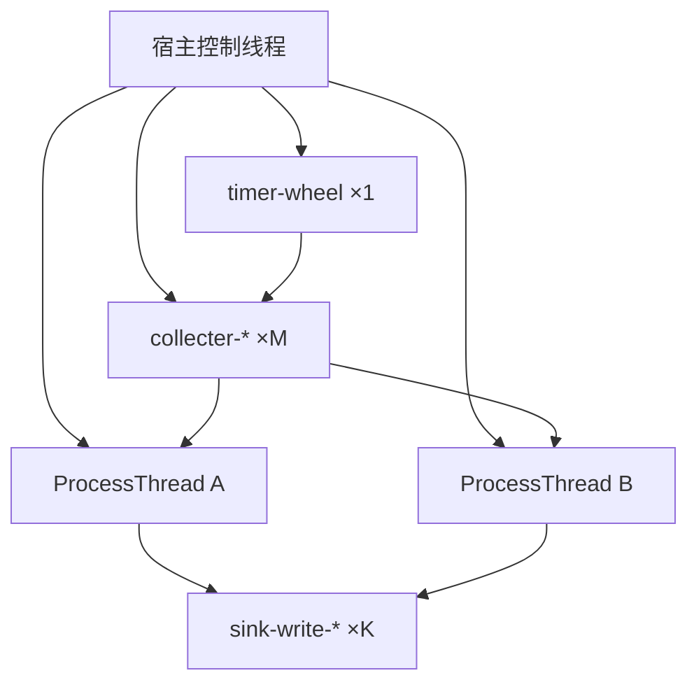
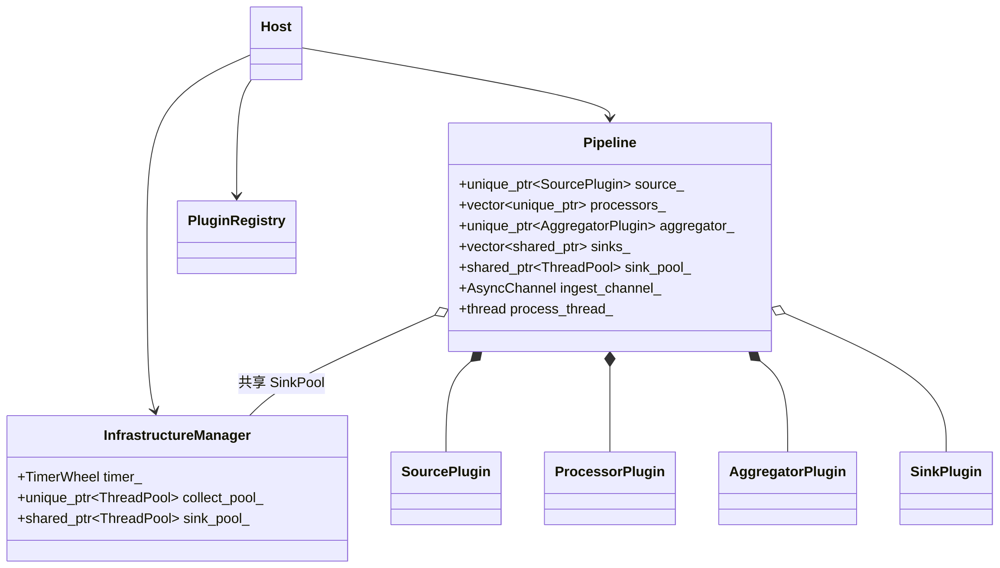
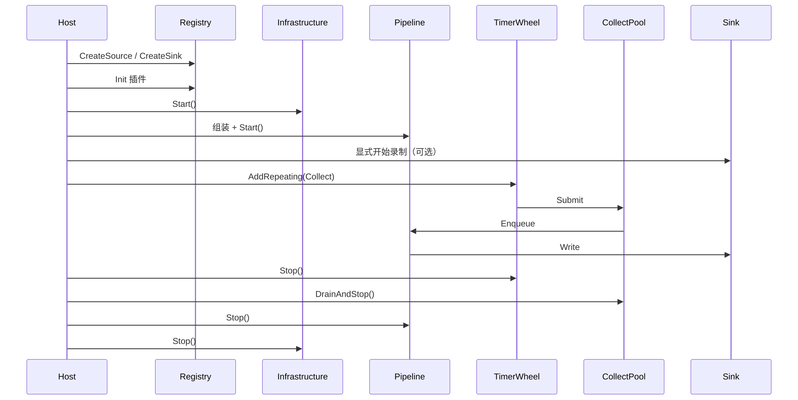

# 01 全局架构与模块边界

本篇是整套设计文档的“地图”：只回答系统由什么组成、谁拥有谁、什么代码跑在哪个线程，以及宿主必须遵守哪些契约。具体机制链接到专题，不在本篇展开。

返回 [设计总览](./index.md)。

## 1. 设计目标与约束

| 目标 | 具体表现 | 代价 |
| --- | --- | --- |
| 低开销 | 无锁通道、Arena、批量传递 | 有界丢弃、每批 64KiB 起步 |
| 可嵌入 | 不依赖 Server/UI，宿主控制生命周期 | 宿主必须自己组装和调度 |
| 采集与处理解耦 | Timer 只调度，CollectPool 执行采集 | 多一层任务队列 |
| 处理状态简单 | 每 Pipeline 一个处理线程 | 单 Pipeline 处理能力受单核限制 |
| 输出隔离 | SinkPool 执行慢 I/O | 同一 Sink 可能并发、乱序 |
| 可扩展 | 四类插件接口 + 动态库 | C++ ABI 兼容约束 |
| 可观测 | 通道/输出池指标、日志 | 指标不是精确实时快照 |

非目标：它不是服务端、不是数据库、不是完整 APM 产品，也不提供开箱即用的生产探针。

## 2. 系统上下文

<div style="overflow-x: auto; margin: 1.5rem 0;">



</div>

明确边界：

- **不是服务端**：没有 HTTP API、没有 Web UI、没有告警引擎。
- **不是数据库**：SQLite 只是可选持久化后端，不自动接入 Pipeline。
- **不是探针集合**：当前只有 eBPF Source 基类和事件结构，没有生产探针。
- **不是编排框架**：YAML 只配置资源和全局项，不定义 Pipeline 图。

## 3. 组件职责

| 组件 | 是什么 | 输入 | 输出 | 不做什么 |
| --- | --- | --- | --- | --- |
| Host | 组合根 | 配置、插件 | 运行中的 Pipeline | 不实现业务 Driver |
| Source | 数据生产者 | 无 | `DataBatchPtr` | 不决定何时运行 |
| Processor | 逐批转换 | 批次 | 批次 / `nullptr` / 错误 | 不跨批保存状态 |
| Aggregator | 跨批聚合 | 批次 | 0..N 批次 | 不自动刷新 |
| Sink | 输出终点 | 只读批次 | 外部副作用 | 不保证顺序 |
| Pipeline | 一条数据路径 | 批次 | 交给 Sink | 不调用 `Init()` |
| AsyncChannel | 有界事件通道 | 数据 / Sentinel | 事件 | 不保证控制信号不丢 |
| TimerWheel | 全局调度 | 定时器注册 | 回调 | 不执行重活 |
| CollectPool | 采集线程池 | 任务 | 执行结果 | 不防重入 |
| ProcessThread | 处理线程 | 事件 | 处理/提交 | 每 Pipeline 一个 |
| SinkPool | 输出线程池 | Write 任务 | 执行结果 | 不丢弃任务（丢弃在 Pipeline） |
| PluginRegistry | 工厂表 | 名称 | 实例 | 不管理生命周期 |
| PluginManager / SoLoader | 动态库发现 | 目录 | 工厂 | 不保证全部成功 |
| StorageBackend | 持久化接口 | 记录/样本 | 数据库 | 不自动接入 Pipeline |
| InternalMetrics | 自观测 | 计数/仪表 | 导出文本 | 不提供 HTTP |
| ResourceLimiter | 资源检查 | `/proc/self/statm` | RSS/告警 | 不强制限额 |

### 3.1 组件交互矩阵

行是调用方，列是被调用方；“数据”表示传批次，“控制”表示启停/注册，“所有权”表示持有对象。

| 调用方 → | Host | Pipeline | Channel | TimerWheel | CollectPool | SinkPool | Plugin | Storage |
| --- | --- | --- | --- | --- | --- | --- | --- | --- |
| Host | — | 组装/启停 | — | 注册定时器 | 间接 | 注入 | Init/创建 | 直接调用 |
| Pipeline | — | — | 入队/出队 | — | — | 提交 Write | Start/Stop/调用 | — |
| TimerWheel | — | 注入 Flush | 入队 | — | 提交 Collect | — | — | — |
| CollectPool | — | 入队 | 入队 | — | — | — | 调用 Collect | — |
| ProcessThread | — | — | 出队 | — | — | 提交 Write | 调用 Process/Add/Flush | — |
| SinkPool | — | — | — | — | — | — | 调用 Write | — |
| Sink | — | — | — | — | — | — | — | 可选 |
| Storage | — | — | — | — | — | — | — | — |

## 4. 分层与构建依赖

概念上的层次：

```text
应用/宿主（CLI、嵌入式程序）
        ↓
具体插件（RecordingSink、eBPF Source、教学插件）
        ↓
插件 API（Source/Processor/Aggregator/Sink）
        ↓
引擎（Pipeline、Channel、TimerWheel、ThreadPool）
        ↓
数据与公共契约（DataBatch、Arena、Status、Config）
```

构建上要注意一个“反向”关系：

- `core:engine` 依赖 `plugin:api` 的接口来持有和调用插件。
- 具体插件依赖 `plugin:api` 和 `core:common`，不应反向依赖 `core:engine`。
- CLI 负责把两者装配起来。

因此“插件在概念上位于引擎之上，但引擎在编译上依赖插件接口”。这不是循环依赖，而是接口倒置。

## 5. 运行全景与线程拓扑

<div style="overflow-x: auto; margin: 1.5rem 0;">



</div>

| 线程 | 数量 | 职责 | 阻塞点 |
| --- | --- | --- | --- |
| TimerWheel | 1 | 定时调度、轻量回调 | `epoll_wait`、回调 |
| CollectPool | M（默认 2） | `Source::Collect()` | 采集 I/O |
| ProcessThread | 每 Pipeline 1 | Processor/Aggregator | Dequeue、Processor、同步 Sink |
| SinkPool | K（默认 `max(2, CPU/2)`） | `Sink::Write()` | 文件/网络 I/O |
| Host | 1+ | 配置、组装、启停 | 由宿主决定 |

线程数公式：

```text
1 + M + N + K + 宿主控制线程
```

其中 N 是 Pipeline 数量。详细规则见 [02/04 线程模型](./02-pipeline-v3/04-thread-model-and-scheduling.md)。

## 6. 对象所有权

<div style="overflow-x: auto; margin: 1.5rem 0;">



</div>

| 对象 | 所有权 | 说明 |
| --- | --- | --- |
| Source / Processor / Aggregator | Pipeline `unique_ptr` | 独占，生命周期与 Pipeline 一致 |
| Sink | Pipeline `shared_ptr` | 支持 `GetSinks()` 快照和异步任务捕获 |
| SinkPool | Host 创建，Pipeline 共享 | `InfrastructureManager` 持有，Pipeline 持有 `shared_ptr` |
| CollectPool | `InfrastructureManager` `unique_ptr` | 只在 Start 后有效，Stop 后裸指针失效 |
| TimerWheel | `InfrastructureManager` 成员 | 全局唯一 |
| 动态库 | `SoLoader` 句柄 | 必须活过工厂和实例 |
| DataBatch | `shared_ptr` 流动 | 最后一个所有者释放时销毁 Arena |

## 7. 宿主必须遵守的 8 条契约

| # | 契约 | 违反后果 |
| --- | --- | --- |
| 1 | 先 `Init()`，再交给 Pipeline `Start()` | 插件使用未初始化状态 |
| 2 | 同一 Source 不重叠 `Collect()` | 数据竞争、重复计数、资源冲突 |
| 3 | Pipeline 不自动注册采集/Flush 定时器 | 没有数据或聚合永不刷新 |
| 4 | 停止顺序：Timer → CollectPool → Pipeline → Infrastructure | 残留 Enqueue、Stop 卡死、最终 Flush 无人执行 |
| 5 | 不能提前停止 SinkPool | `pending_writes_` 永不归零，Stop 永久等待 |
| 6 | Start/Stop 串行调用 | 重复启动第二个处理线程，或并发 Stop 语义混乱 |
| 7 | 动态 Sink 移除前自行处理在途写 | 写入已停止的 Sink |
| 8 | `GetCollectPool()` 返回裸指针，Stop 后不得使用 | 悬空指针 |

## 8. 最小运行闭环

<div style="overflow-x: auto; margin: 1.5rem 0;">



</div>

CLI 的 `RuntimeShutdown` 就是按这个顺序实现的。

## 9. 源码地图

| 路径 | 职责 |
| --- | --- |
| `src/core/common/` | DataBatch、Config、Status、JSON、日志 |
| `src/core/memory/` | Arena、LockFreeQueue |
| `src/core/engine/` | Pipeline、AsyncChannel、TimerWheel、InfrastructureManager、PidManager |
| `src/core/threading/` | ThreadPool、线程工具 |
| `src/plugin/api/` | 四类插件接口、Plugin API、eBPF Source 基类 |
| `src/plugin/infra/` | Registry、Manager、SoLoader、内建注册 |
| `src/plugin/sinks/recording_sink/` | `.ilr` 录制 |
| `src/ebpf_common/` | 事件结构、loader 工具、feature probe |
| `src/storage/` | StorageBackend、SQLite |
| `src/cli/` | 最小宿主与 demo |
| `src/*/test/` | GoogleTest 与 CLI 冒烟 |

## 10. 扩展边界

新增插件时：

1. 放在 `src/plugin/{sources,processors,aggregators,sinks}/` 下（当前目录只有 BUILD 占位）。
2. 只依赖 `plugin/api` 和 `core/common`，不要依赖 `core/engine` 或 CLI。
3. 在 `RegisterBuiltinPlugins()` 或独立注册入口显式注册，不要依赖链接器保留静态对象。
4. 如果要做动态库，保持宿主与插件的工具链兼容。

不要恢复已删除的 Server/Feature/Driver 层；当前目标是可独立嵌入的核心引擎。

## 小结

- Illuminator 是“宿主 + 共享基础设施 + 多条 Pipeline + 四类插件”的组合。
- Host 负责组装、Init、调度和关闭；Pipeline 负责运行期数据路径。
- TimerWheel、CollectPool、SinkPool 是共享资源；Channel 和 ProcessThread 是每 Pipeline 私有。
- 构建上引擎依赖插件接口，概念上插件位于引擎之上。

## 边界与后续

- 没有统一的应用层 Feature/Driver 编排。
- 动态库仍是 C++ SDK，不是跨工具链纯 C ABI。
- StorageBackend 不自动接入 Pipeline。
- 当前没有生产 eBPF 探针和前端。

返回 [设计总览](./index.md) · 下一篇：[Pipeline v3 总览](./02-pipeline-v3/index.md)
