# 02 Pipeline v3 详细设计

Pipeline v3 采用“外部调度采集、管道独立处理、共享线程池输出”的执行结构。Source 采集与 Processor 处理之间通过有界 AsyncChannel 解耦；批次与 FlushSentinel 统一为事件；单条管道的 ProcessThread 顺序处理这些事件。这样可以将处理阶段的状态限制在一个执行线程内，同时让慢输出通过 SinkPool 与处理阶段分离。

本篇对应 `src/core/engine/pipeline.h`、`async_channel.h` 和 `src/core/memory/lock_free_queue.h`。这是对当前 v3 执行路径的详细描述，不包含已经删除的 Feature 框架。返回 [设计总览](./index.md)。

## 1. 组件模型与不变量

一条 Pipeline 包含一个 Source、零到多个有序 Processor、零或一个 Aggregator，以及至少一个 Sink。构造参数指定管道名、通道容量、丢弃策略和高低水位；SinkPool 由宿主可选注入。

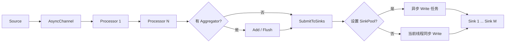

使用时需要保持以下条件：

| 条件 | 由谁保证 | 原因 |
| --- | --- | --- |
| 同一 Pipeline 的组装、Start、Stop 串行调用 | 宿主 | 当前没有完整的并发生命周期状态机 |
| 插件 Init 在 Start 前完成 | 宿主 | Pipeline 不代调 Init |
| 同一 Source 的 Collect 不重叠 | 宿主调度器 | Source 接口未统一承诺可重入 |
| 正常路径的 Process、Add、Flush 在 ProcessThread 执行 | Pipeline | 保持处理状态顺序访问 |
| 输出发布后不再修改批次 | 插件与宿主 | const 视图不能阻止其他可变别名 |
| Sink 支持并发 Write，或采用同步输出 | Sink / 宿主 | 共享池不提供每 Sink 串行队列 |
| 外部采集任务结束后再 Stop Pipeline | 宿主 | Pipeline 不追踪外部生产者 |
| 本 Pipeline 的输出完成后再关闭 SinkPool | 宿主与 Pipeline | 最终 Flush 仍可能产生输出任务 |

## 2. 线程模型

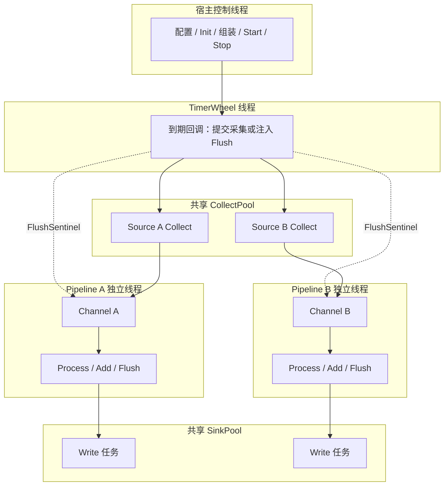

TimerWheel 回调应保持轻量，Collect 本体交给 CollectPool。每条 Pipeline 有一个处理线程，因此 N 条管道至少带来 N 个 ProcessThread，再加共享采集池、输出池和定时器线程。不能仅以插件数量估计线程开销。

无 SinkPool 时，Write 在 ProcessThread 中同步执行，慢 Sink 会直接阻塞下一批处理与 Flush。使用 SinkPool 可以隔离这部分阻塞，但会引入并发、乱序和积压。

### 2.1 正常采集时序

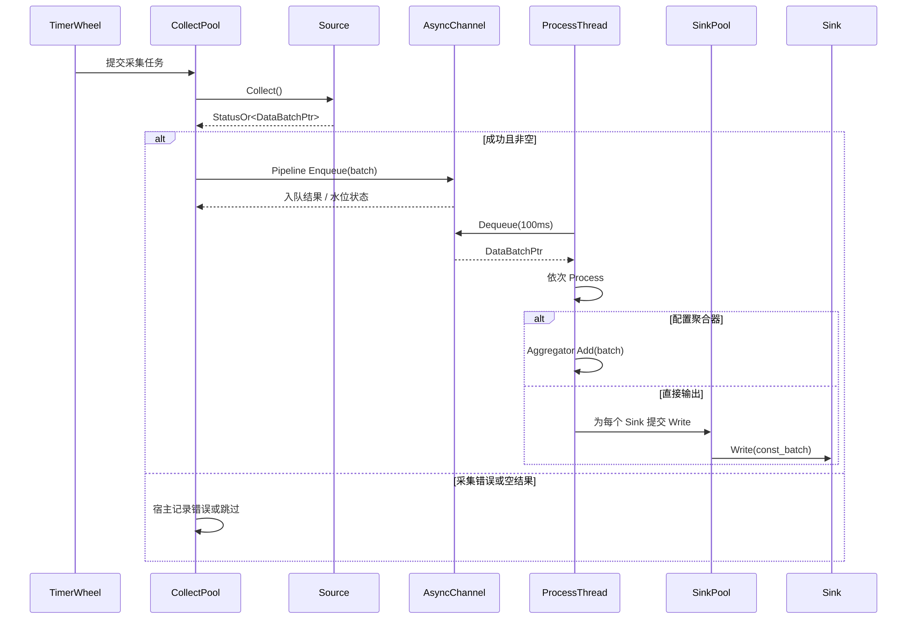

采集错误发生在 Pipeline 外，是否重试、告警或停止由宿主决定。Pipeline 的 ErrorCount 不自动包含 Source Collect 失败次数。

## 3. 统一事件通道

### 3.1 消息类型

通道条目为 `std::variant<DataBatchPtr, FlushSentinel>`。ProcessThread 使用 `std::visit` 分发：数据走 HandleData，标记走 HandleFlush。控制事件与数据共享通道顺序，使 Flush 相对已经入队的数据形成处理位置；它不代表精确的事件时间窗口。

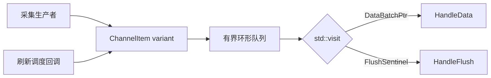

FlushSentinel 不携带窗口编号、时间戳或确认序号。窗口切分依赖 Aggregator 自身实现，以及数据到达 ProcessThread 的顺序。

### 3.2 容量与底层队列

| 配置名称 | 请求容量 | 计量单位 |
| --- | --- | --- |
| small | 1024 | ChannelItem 条目 |
| medium | 4096 | ChannelItem 条目 |
| large | 16384 | ChannelItem 条目 |

直接构造时的自定义容量会向上对齐到 2 的幂。底层 LockFreeQueue 采用环形槽位、每槽 sequence、生产和消费位置的原子 CAS，以及 acquire/release 发布协议；它支持多个生产者与消费者竞争槽位。常规数据消费只有一个 ProcessThread，但 DropOldest 和 InjectFlush 也会从生产侧弹出旧条目。

这里的“无锁队列”描述其实现方式，不构成整条 Pipeline 的无锁、无分配或固定延迟承诺。SizeApprox 读取不同原子位置，只能用于观测与水位判断，不能据此证明生产者已经退出。

### 3.3 空队列等待

Dequeue 依次尝试 16 次自旋、8 次 yield，然后每 1ms 休眠重试，直到超时。ProcessLoop 使用 100ms 超时。该路径没有生产者 eventfd 唤醒机制，因此稀疏数据场景可能受到轮询休眠与系统调度的影响。

不要将源码注释中的“纳秒级响应”当作性能指标；实际延迟要以目标机负载、批次大小及调度条件实测。

### 3.4 满队列与数据丢弃

| 策略 | 第一次 TryPush 失败后的动作 | 结果 |
| --- | --- | --- |
| DropNewest | 不驱逐旧条目 | 新批次丢弃，保留已排队数据 |
| DropOldest | 尝试弹出一个最旧条目，再尝试 Push | 更偏向保留新数据，但重试仍可能失败 |
| InjectFlush | 不论数据策略，尝试驱逐一个旧条目后重试 | 提高 Flush 入队机会，仍可能失败 |

被驱逐的旧条目可能是数据，也可能是另一个 FlushSentinel。`dropped` 统计条目丢弃，不能直接解释为丢失记录数。控制标记与数据共用容量，所以该机制不等于可靠控制通道。

## 4. 数据处理与聚合

### 4.1 Processor 链

HandleData 首先将输入批次的 `Size()` 累加到 RecordsProcessed，然后按组装顺序逐个调用 Processor。Process 可以返回同一个批次、新批次、空指针或错误。

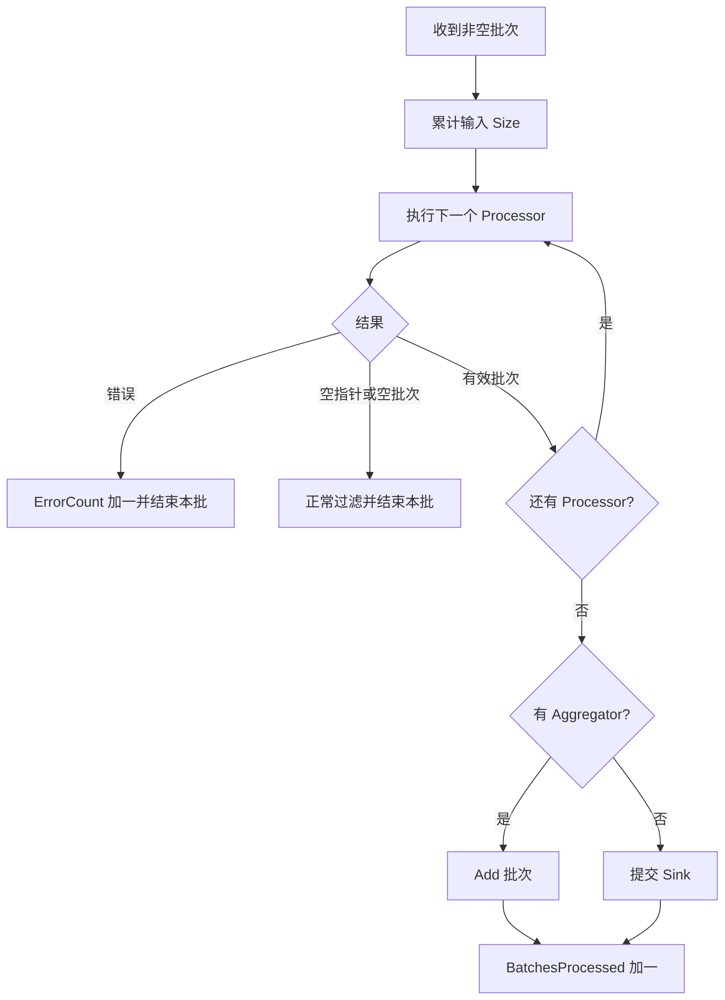

过滤返回空不是错误，Processor 失败也不会自动终止整条 Pipeline。不同 Processor 的输出形状、字段约定需要插件组合方验证，当前没有 schema 编排检查。

### 4.2 Aggregator 的串行刷新

Aggregator 的 Add 与 Flush 都在正常处理线程执行。Flush 返回 `vector<DataBatchPtr>`，因此一次窗口关闭可以输出零批、一批或多批。聚合状态归插件管理，Pipeline 不推断窗口统计公式。

刷新有三种触发来源：

1. 宿主定时调用 InjectFlush，标记被 ProcessThread 取出后触发。
2. 正的 FlushIntervalMs 超过三倍仍未刷新时，ProcessLoop 的 MaybeForceFlush 触发兜底。
3. Stop 之后 Drain 完成，再执行一次最终 Flush。

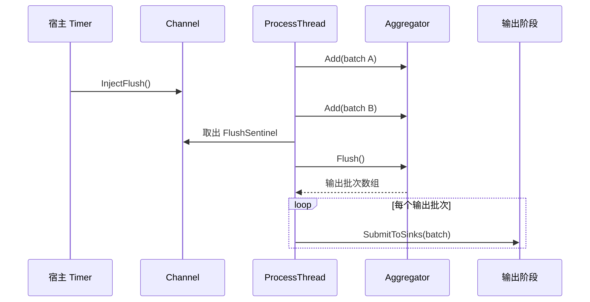

图中的批次 B 是否位于窗口内由其与 Sentinel 的实际入队顺序决定。宿主应为正的刷新间隔建立调度；Pipeline 本身不安装 TimerWheel 回调。

当前 `FlushIntervalMs()==0` 会关闭三倍间隔兜底，并不会在每次 Add 后自动 Flush。接口注释中的“每来一批刷一批”尚未落实到执行路径；需要逐批输出时使用 Processor 或无 Aggregator 路径。

### 4.3 聚合错误边界

当前 HandleData 没有检查 Add 的返回状态；HandleFlush 仅在 Flush 成功时提交结果，失败不会增加 ErrorCount。聚合器作者必须理解这一缺口，宿主也不能用 ErrorCount 为零证明聚合无错误。完善状态传播属于后续核心工作。

## 5. 两级反压与资源边界

### 5.1 输入通道水位

通道使用高低水位滞回，默认 high=0.8、low=0.2。判断是严格大于或严格小于整数阈值：`size > floor(capacity*high)` 进入；`size < floor(capacity*low)` 退出。中间区域保留原状态。

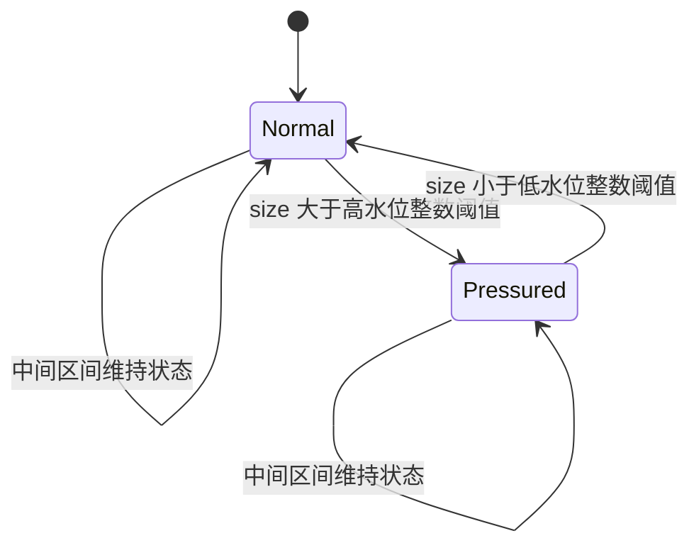

水位只给出反馈信号，不会让 Source 自动降频。插件可以响应 OnBackpressure，但 Timer 的调度间隔若已固定，还需要宿主与插件协作调整采集行为。

### 5.2 输出池软阈值

SubmitToSinks 在提交前读取共享 SinkPool 的 PendingTasks：

| 观察值 | 当前动作 |
| --- | --- |
| pending ≤ 128 | 清除本 Pipeline 记录的输出池压力标志 |
| pending > 128 | 设置压力标志和对应 gauge |
| pending > 256 | 丢弃本输出批次，sink_drops 与 ErrorCount 加一 |

PendingTasks 仅统计排队任务，不包括正在执行的 Write。检查发生在为各 Sink 扇出之前，多管道也可同时提交，因此 256 不是硬队列上限。共享池中其他 Pipeline 的慢输出也会触发本 Pipeline 的反馈和丢弃。

### 5.3 反馈传播时机

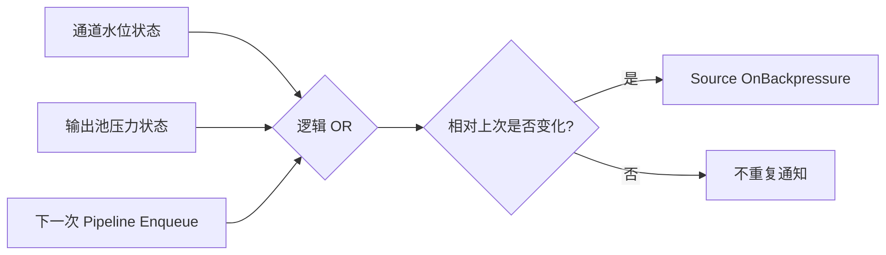

Source 的通知发生在后续 Enqueue 中。队列已排空不意味着立即收到解除通知；没有新入队时可能继续保持插件端的旧状态。当前压力机制属于尽力反馈，不能作为严格的端到端流控协议。

### 5.4 容量估算

假设采集速率为 λ 批/秒、平均处理速率为 μ 批/秒、空闲容量为 C，持续过载时首次填满时间近似 `C/(λ-μ)` 秒，前提是 λ>μ 且负载相对稳定。窗口聚合和输出扇出会改变下游速率，需分别估算。

队列条目只保存共享指针，不代表其数据成本只有一个指针。默认每个新批次 Arena 首块为 64KiB：4096 个各自持有独立默认 Arena 的排队批次，仅 Arena 块就约 256MiB，还不含记录容器、堆栈、缓存和输出在途引用。实际内存受批次合并、共享、块增长和处理状态影响。

所以调优应同时观察“批次数、每批记录数、驻留字节、窗口状态、输出任务数”，而不能单独增大 Channel。

## 6. 输出扇出与在途写入

### 6.1 输入只读与 Sink 并发

SubmitToSinks 将 DataBatchPtr 转成 ConstDataBatchPtr，并为每个 Sink 提交独立任务。任务持有 Sink 和批次的 shared_ptr。这样避免每个 Sink 深拷贝整个批次，但不保证同一 Sink 的任务串行执行，也不保证批次完成顺序。

RecordingSink 用 mutex 保护状态和文件访问；锁的获取顺序仍可能与提交顺序不同。自定义 Sink 必须自行保证并发安全。需要严格有序输出时，当前可以选择不设置 SinkPool，让写入顺序跟随处理线程；代价是处理阶段受 I/O 阻塞影响。

### 6.2 每 Pipeline 的写入完成屏障

每次异步提交前增加 `pending_writes_`。任务进入 Write 之前构造 WriteCompletion，退出时析构守卫减计数；减到零时通过 condition_variable 通知等待者。减计数与通知使用和 Stop 等待者相同的 `writes_mutex_`，避免 Stop 看到零后销毁仍被完成路径访问的 Pipeline 状态。

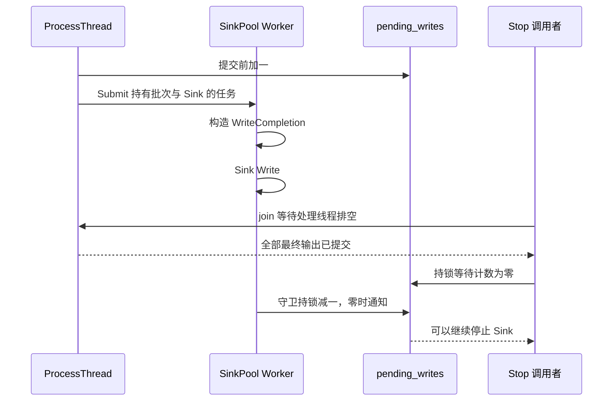

Write 抛异常时，守卫仍运行，packaged_task 将异常保存到 future；当前 Pipeline 不读取这个 future，因此异常不会自动计入 ErrorCount。插件应以 Status 报告预期错误，不依赖异常作为正常控制流程。

屏障只等待本 Pipeline 的输出，不关闭共享线程池，不阻塞其他 Pipeline 的提交。它也没有超时或取消机制；若 Sink Write 永远不返回，Stop 将持续等待。

## 7. 启动、失败回滚与停止

### 7.1 启动顺序

宿主完成 Init 与组装后调用 Start。Pipeline 检查 Source 存在、Sink 集合非空，再按 Source → Processor 顺序 → Aggregator → Sink 顺序启动，最后设置 running 并创建 ProcessThread。

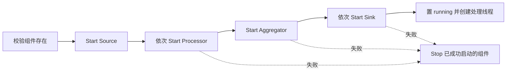

回滚只处理此前已确认成功的组件；失败组件自身需要释放 Start 中已获取的部分资源。当前线程创建异常、重复 Start、并发 Start/Stop 不构成完整事务。宿主应让同一 owner 串行调用，不在已经运行的 Pipeline 上重复 Start。

### 7.2 全局关闭顺序

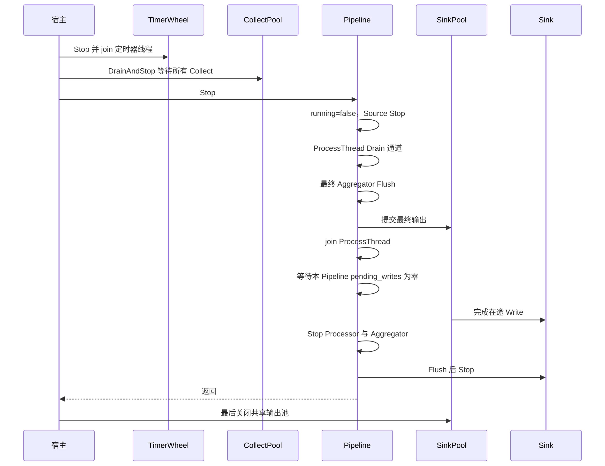

多 Pipeline 宿主必须先让所有外部采集静默，再逐个 Stop 管道，最后停共享基础设施。Timer Cancel 不能替代等待已触发回调；仅检查 running 也不能消除“检查后立即停止”的采集竞态。

### 7.3 Drain 的含义

运行循环退出后，Drain 非阻塞取完剩余条目，正常处理每个 DataBatch 和 Sentinel，最后再 Flush Aggregator。随后主调用者 join ProcessThread，保证不会再从内部处理线程提交新 Write，才等待输出计数归零。

Drain 不是“保证所有采集数据落盘”：之前已丢弃的条目无法恢复，Processor 可以过滤，输出过载仍可丢批，录制可能未开启或达到大小上限，聚合错误也可能没有传播。

Stop 当前对多个组件的 Stop/Flush 返回状态未做完整聚合，返回 OK 也不等同于持久化成功证明。

## 8. 动态操作的实际边界

| 操作 | 已实现行为 | 使用限制 |
| --- | --- | --- |
| AddSinkRuntime | 检查运行状态，Start 新 Sink，持写锁加入列表 | 不自动 Init；与 Stop 并发缺少完整协调 |
| RemoveSinkRuntime | 从列表移除，解锁后 Flush/Stop | 不等待该 Sink 已提交的 Write |
| GetSinks | 在读锁下复制 shared_ptr 集合 | 返回快照，不是稳定运行状态 |
| RunProcessors | 直接在调用线程执行处理链 | 绕过 ProcessThread；运行时调用需自行同步 |
| Reconfigure | 直接顺序调用组件，跳过不参与者、汇总需重启状态 | 非事务，可能部分生效，与工作线程未自动互斥 |

动态移除后，旧任务的 shared_ptr 能防止对象析构，但不能阻止 Write 使用已经关闭的文件。当前有异步输出时，推荐停止管道后重建 Sink 集合；未来需要每 Sink 的执行队列和等待屏障。

## 9. 指标的精确定义

| 指标 | 统计位置 | 不能推导的结论 |
| --- | --- | --- |
| RecordsProcessed | HandleData 入口输入批次 Size 之和 | 最终持久化记录数 |
| BatchesProcessed | 完成处理后执行 Add 或输出提交的次数 | 成功 Write 次数、Flush 输出批次数 |
| ErrorCount | Processor 失败、Sink 返回失败、输出过载丢弃 | 所有采集/聚合/异常/停止错误总数 |
| ChannelEnqueued | 成功入队的数据批次次数 | Sentinel 数量 |
| ChannelDequeued | 成功取出的通道条目数 | 纯数据批次数 |
| ChannelDropped | 满队列等路径丢弃的条目 | 丢失记录或字节数 |
| ChannelFlushInjected | 成功注入 Sentinel 的次数 | 已成功 Flush 次数 |
| ChannelBackpressureEvents | 进入通道压力状态的次数 | 压力持续时间 |

处理循环约每 100 次迭代同步通道指标；正常事件路径还同步 SinkPool 和资源检查，空闲分支只同步通道。它不是固定时间的全量指标采样周期。全局自观测的锁与统计能力见 [06](./06-scheduling-and-observability.md)。

## 10. 验证要求与后续工作

Pipeline 验证至少包括：有无聚合器的数据路径、满队列两种策略、Sentinel 刷新、启动失败回滚、停止排空、阻塞 Sink 下的 Write 等待，以及共享池仍能被其他使用者继续使用。过载测试应阻塞工作线程建立确定条件，避免依靠固定睡眠碰到积压窗口。

当前已通过的测试范围见 [09](./09-development-and-validation.md)。下一轮应优先补齐每 Sink 串行/移除屏障、外部生产者调度句柄、聚合错误传播、停止后拒绝提交与可靠控制命令通道。它们是后续建议，不是 v3 当前已实现的保证。
