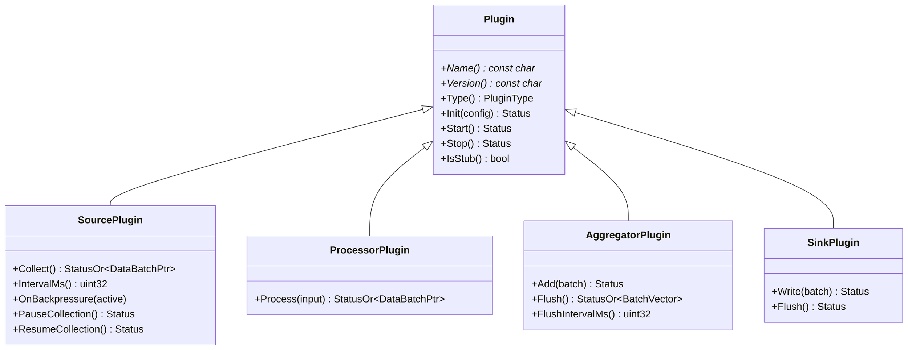
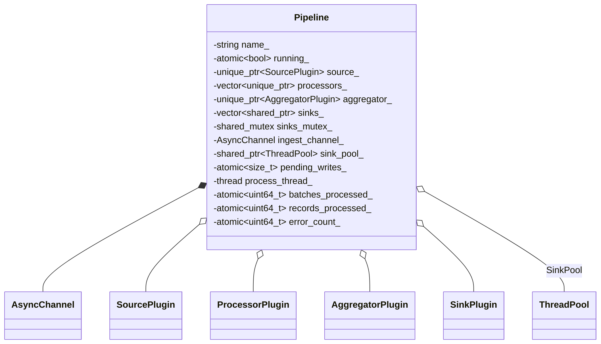
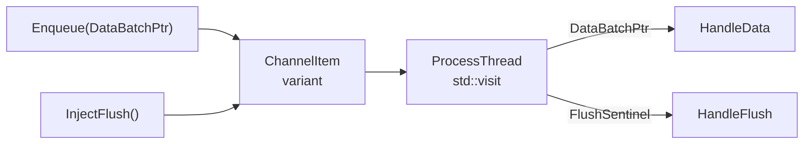
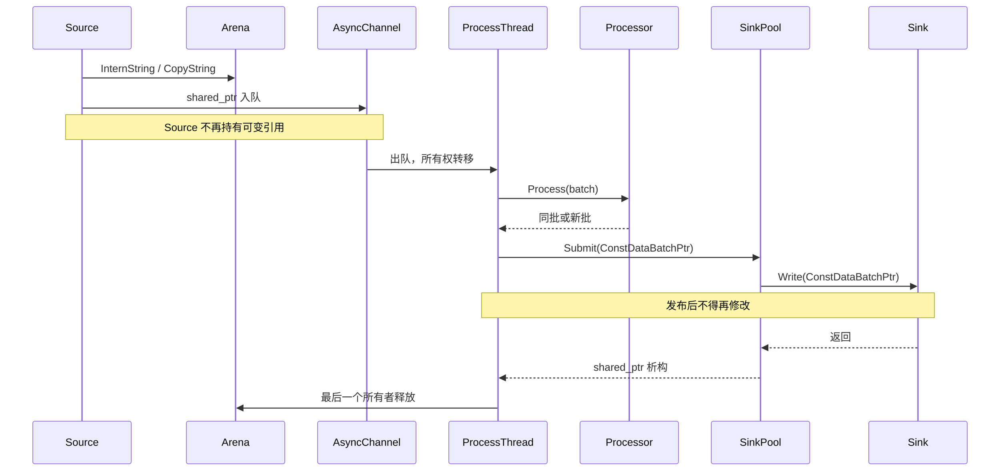

# 02-01 Pipeline 模型与数据结构

本篇回答三个问题：Pipeline 持有什么？通道里流动的到底是什么类型？一个 `DataBatch` 从创建到释放，所有权如何转移？

返回 [Pipeline v3 总览](./index.md)。

## 1. 四类角色

Pipeline 只认四个 C++ 接口，不认具体实现：

<div style="overflow-x: auto; margin: 1.5rem 0;">



</div>

### 1.1 Source：拉取式生产者

Source 不自己决定何时运行。宿主通过 TimerWheel 周期性触发，再把它提交到 CollectPool：

```cpp
// 简化自 src/cli/main.cc
infrastructure.GetTimerWheel().AddRepeating(
    std::chrono::milliseconds(pipeline.GetSource()->IntervalMs()),
    [&pipeline, collect_pool, busy] {
        if (busy->exchange(true)) return;   // 同一 Source 不重叠
        collect_pool->Submit([&pipeline, busy] {
            auto batch = pipeline.GetSource()->Collect();
            if (batch.ok()) pipeline.Enqueue(std::move(*batch));
            busy->store(false);
        });
    });
```

关键点：

- `Collect()` 运行在 **CollectPool** 线程，不在 TimerWheel 线程。
- `IntervalMs()` 是宿主安装定时器时读取一次的值；之后 Source 运行时改变它，不会自动重建定时器。
- Source 的 `Init()` 由宿主调用；Pipeline 从不调用它。

### 1.2 Processor：逐批可变

`Process()` 的返回语义：

| 返回 | 含义 | Pipeline 行为 |
| --- | --- | --- |
| 同一个 `shared_ptr` | 原地修改 | 继续下一个 Processor |
| 新的 `shared_ptr` | 替换批次 | 旧批次引用释放 |
| `nullptr` | 过滤整批 | 静默结束，不计错误、不计 `BatchesProcessed` |
| `Status` 错误 | 处理失败 | `ErrorCount++`，丢弃该批 |

### 1.3 Aggregator：跨批状态

`Add()` 接收批次所有权；`Flush()` 返回 0..N 个新批次。聚合窗口内累积了什么、如何合并，完全由插件自己决定，Pipeline 不检查 `Add()` 的返回状态。

### 1.4 Sink：只读终点

Sink 收到的是 `ConstDataBatchPtr`。一个 Pipeline 可以有多个 Sink，每个批次会扇出给所有 Sink。异步路径下，**同一个 Sink 可能同时收到多个 `Write()` 调用**，插件必须自己保护文件、缓冲等状态。

## 2. Pipeline 的成员

<div style="overflow-x: auto; margin: 1.5rem 0;">



</div>

| 成员 | 类型 | 为什么需要 |
| --- | --- | --- |
| `name_` | `std::string` | 日志、指标前缀、线程名 |
| `running_` | `atomic<bool>` | `Enqueue`、`ProcessLoop`、动态 Sink 操作的可见状态 |
| `source_` | `unique_ptr<SourcePlugin>` | 独占源插件；Pipeline 不共享它 |
| `processors_` | `vector<unique_ptr<ProcessorPlugin>>` | 有序处理链，只在 Start 前修改 |
| `aggregator_` | `unique_ptr<AggregatorPlugin>` | 可选；为空时批次直接去 Sink |
| `sinks_` | `vector<shared_ptr<SinkPlugin>>` | 支持运行期增删，所以用 shared_ptr + 读写锁 |
| `sinks_mutex_` | `shared_mutex` | 处理线程读锁遍历；动态增删用写锁 |
| `ingest_channel_` | `AsyncChannel` | 有界事件通道，容量与丢包策略在构造时确定 |
| `sink_pool_` | `shared_ptr<ThreadPool>` | 由宿主注入；多个 Pipeline 可共享同一个池 |
| `pending_writes_` | `atomic<size_t>` | 本 Pipeline 尚未完成的异步写入数，Stop 的屏障 |
| `process_thread_` | `std::thread` | 每 Pipeline 唯一的处理线程 |
| `last_flush_time_` | `steady_clock::time_point` | `MaybeForceFlush` 的超期判断 |
| 三个统计量 | `atomic<uint64_t>` | 输入记录数、成功处理批次数、错误数 |

注意 `sinks_` 使用 `shared_ptr` 而不是 `unique_ptr`：`GetSinks()` 返回快照、异步任务捕获 Sink 指针，都需要共享所有权。

## 3. 通道里流动的类型

```cpp
struct FlushSentinel {};                       // 空标记，占 1 字节
using DataBatchPtr = std::shared_ptr<DataBatch>;
using ChannelItem = std::variant<DataBatchPtr, FlushSentinel>;
```

<div style="overflow-x: auto; margin: 1.5rem 0;">



</div>

`std::visit` 配合 `Overloaded` 把两个 lambda 合成一个访问器：

```cpp
template <class... Ts> struct Overloaded : Ts... { using Ts::operator()...; };
template <class... Ts> Overloaded(Ts...) -> Overloaded<Ts...>;

std::visit(Overloaded{
    [this](DataBatchPtr& batch) { HandleData(std::move(batch)); },
    [this](FlushSentinel&)     { HandleFlush(); },
}, *item);
```

`FlushSentinel` 不携带窗口编号或时间戳。它只是一个**顺序标记**：处理到它时，就刷新一次聚合器。因此：

- 它不是精确的时间窗口边界，而是“入队顺序上的边界”。
- 如果它排在批次 B 之前，B 就不在本轮刷新内；排在 B 之后，B 才进入本轮。
- 队列满时 `InjectFlush()` 会驱逐一个旧条目再重试，所以控制信号也可能与数据竞争容量。

## 4. 一个批次的生命周期

<div style="overflow-x: auto; margin: 1.5rem 0;">



</div>

### 4.1 所有权规则

1. **Source 创建批次**：字符串必须复制进该批次的 Arena，不能把临时 `std::string` 的 `string_view` 留在批次里。
2. **入队即移交**：`Enqueue(std::move(batch))` 后，Source 不应再使用该指针。
3. **Processor 可以原地改**：这是最省事的路径；返回新批次时，不能只复制指向旧 Arena 的 `string_view` 而丢掉旧批次。
4. **Sink 只读**：`ConstDataBatchPtr` 在编译期阻止 Sink 修改；但 Pipeline 无法撤销上游留下的可变别名，所以“发布后不再修改”是契约。
5. **最后一个 `shared_ptr` 释放**：批次和它的 Arena 一起销毁。

### 4.2 常见悬空场景

```cpp
// 错误：临时字符串在语句结束后销毁
record.labels.push_back({batch->InternString("source"), name});

// 正确：值也复制进 Arena
record.labels.push_back({batch->InternString("source"),
                         batch->InternString(name)});
```

另一个容易忽略的点：`AddRecord()` 可能让 `records_` 向量扩容，之前保存的 `Record&` 会失效。批次共享所有权并不保护内部 vector 的引用稳定性。

## 5. Pipeline 不做什么

| 宿主以为 Pipeline 会做 | 实际行为 |
| --- | --- |
| 调用插件 `Init()` | 不会；宿主必须在交给 Pipeline 前完成 |
| 安装采集定时器 | 不会；宿主读取 `IntervalMs()` 后自行注册 |
| 安装聚合刷新定时器 | 不会；宿主应为 `FlushIntervalMs()` 注册 `InjectFlush` |
| 防止同一 Source 重叠 `Collect()` | 不会；CLI 用 `busy` 原子标记，SDK 使用方需自行保证 |
| 等待外部仍在执行的 `Collect()` | 不会；Stop 只排空通道，外部采集必须先静默 |
| 保证 Sink 写入顺序 | 不会；异步路径按任务调度，可能乱序 |
| 聚合子组件错误 | 不会；`Stop()` 返回 OK 不代表所有 Sink 都成功 |

## 6. 组装顺序

```cpp
Pipeline pipeline("demo_counter", /*capacity=*/4096,
                  DropPolicy::kDropNewest, 0.8, 0.2);

pipeline.SetSource(std::move(source));
pipeline.AddProcessor(std::make_unique<MyProcessor>());   // 可选，可多个
pipeline.SetAggregator(std::make_unique<MyAggregator>()); // 可选
pipeline.AddSink(std::move(sink));                        // 至少一个
pipeline.SetSinkPool(infrastructure.GetSinkPool());       // 可选

auto status = pipeline.Start();
```

组装阶段（`Start()` 之前）可以随意增删；运行期只能通过 `AddSinkRuntime` / `RemoveSinkRuntime` 调整 Sink，Processor 链和 Aggregator 不支持热替换。

## 小结

- Pipeline 是“一条通道 + 一个处理线程 + 一组角色”的组合，不拥有 TimerWheel，也不负责插件初始化。
- `ChannelItem` 让数据和刷新信号走同一条有序通道，`FlushSentinel` 的语义是“处理到此处刷新”，不是时间窗口。
- 批次所有权通过 `shared_ptr` 转移，Sink 侧只读；字符串寿命绑定 Arena。

## 边界与后续

- `Enqueue` 先检查 `running_` 再入队，与 Stop 的 Drain 存在窗口；宿主必须先停外部生产者。
- `AddSinkRuntime` 不调用 `Init()`；`RemoveSinkRuntime` 不等待该 Sink 的在途写入。
- 当前没有“Processor 热替换”或“Aggregator 热替换”的安全协议。

返回 [Pipeline v3 总览](./index.md) · 下一篇：[事件通道与无锁队列](./02-event-channel-and-lockfree-queue.md)
