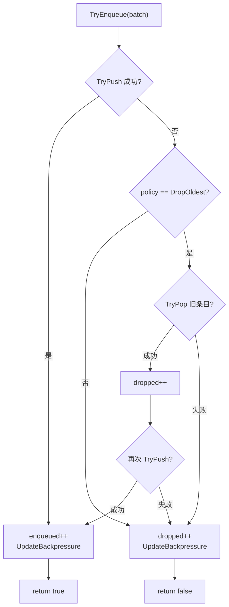
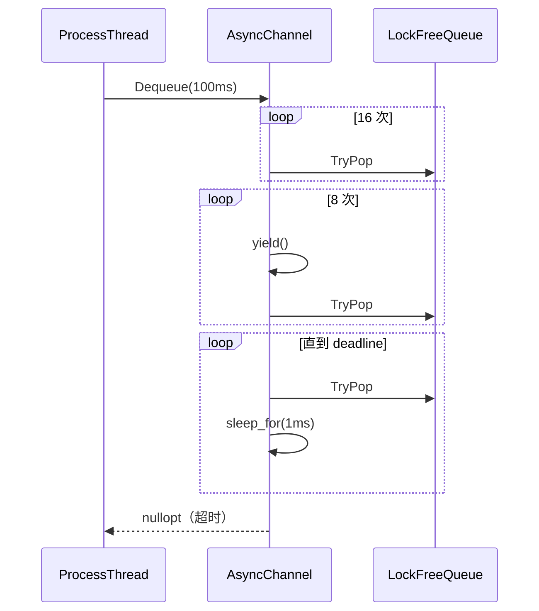
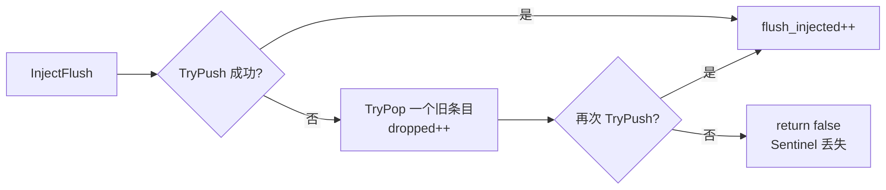
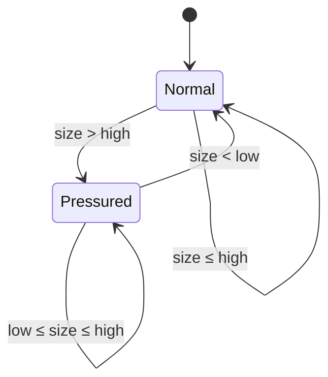

# 02-02 事件通道与无锁队列

`AsyncChannel` 是 Pipeline 的入口。它把“数据批次”和“刷新信号”放进同一条有界队列，并在这条队列上实现丢弃、水位和统计。本篇从使用者的角度讲清它的行为，再下钻到 `LockFreeQueue` 的序列号协议。

返回 [Pipeline v3 总览](./index.md)。

## 1. 为什么数据与 Flush 共用一条通道

如果 Flush 走另一条通道，处理线程就要同时监听两个来源，并自己决定“先处理哪个”。这会产生两个问题：

1. **顺序不确定**：无法表达“刷新发生在批次 A 之后、批次 B 之前”。
2. **两个队列都要处理满**：控制信号也会遇到容量问题。

v3 的答案是：把两者都变成 `ChannelItem`，让它们在**同一条 FIFO** 中排队。这样 Flush 的语义自然变成“处理到队列中的这个位置时刷新”。

```cpp
struct FlushSentinel {};
using DataBatchPtr = std::shared_ptr<DataBatch>;
using ChannelItem = std::variant<DataBatchPtr, FlushSentinel>;
```

代价是：当队列满时，控制信号也参与容量竞争；`InjectFlush()` 只能尽力保证入队。

## 2. AsyncChannel 接口

| 方法 | 线程 | 行为 |
| --- | --- | --- |
| `TryEnqueue(DataBatchPtr)` | 生产者 | 尝试入队；满时按 `DropPolicy` 处理 |
| `InjectFlush()` | 宿主定时器 | 尝试入队 Sentinel；满时驱逐一个旧条目再重试 |
| `Dequeue(100ms)` | ProcessThread | 阻塞式出队，三级退避 |
| `TryDequeue()` | ProcessThread（Drain） | 非阻塞出队 |
| `IsBackpressured()` | 任意 | 读取水位状态 |
| `SizeApprox()` | 任意 | 读写 `head_`/`tail_` 的近似差值 |
| `stats()` | 任意 | 五个原子计数 |

### 2.1 入队流程

<div style="overflow-x: auto; margin: 1.5rem 0;">



</div>

注意 `DropOldest` 的计数：驱逐成功计一次 `dropped`；如果随后再次入队仍失败，又计一次。因此 `dropped` 是**丢弃操作次数**，不严格等于“唯一丢失的条目数”。

### 2.2 出队的三级退避

<div style="overflow-x: auto; margin: 1.5rem 0;">



</div>

三个细节：

- 前两个阶段**不受 timeout 约束**。即使 `timeout=0`，也会先做 16 次 spin 和 8 次 yield。
- 没有生产者唤醒机制。ProcessThread 在空闲时最坏每 1ms 轮询一次。
- `Dequeue` 和 `TryDequeue` 都会给 `dequeued` 加一，**包括 FlushSentinel**。

## 3. LockFreeQueue 的序列号协议

`LockFreeQueue<T>` 是一个有界环形队列，容量向上取到 2 的幂，用位掩码取模。每个槽位有一个 `sequence`，用来判断“这个槽现在能不能读/写”。

```cpp
struct Cell {
    std::atomic<size_t> sequence;
    T data;
};
alignas(64) std::atomic<size_t> head_;  // 生产者争抢
alignas(64) std::atomic<size_t> tail_;  // 消费者争抢
```

### 3.1 三个状态

| `sequence` 相对位置 | 状态 | 含义 |
| --- | --- | --- |
| `seq == pos` | 可写 | 生产者可以占用这个槽 |
| `seq == pos + 1` | 可读 | 数据已发布，消费者可以取走 |
| `seq == pos + capacity` | 已回收 | 消费者已取走，槽位等待下一轮生产者 |

### 3.2 TryPush

```cpp
size_t pos = head_.load(relaxed);
for (;;) {
    Cell* cell = &cells_[pos & mask_];
    size_t seq = cell->sequence.load(acquire);
    intptr_t diff = seq - pos;
    if (diff == 0) {
        if (head_.compare_exchange_weak(pos, pos + 1, relaxed)) break;
    } else if (diff < 0) {
        return false;                 // 队列满
    } else {
        pos = head_.load(relaxed);    // 被其他生产者抢先
    }
}
cell->data = std::forward<U>(value);
cell->sequence.store(pos + 1, release);  // 发布数据
```

### 3.3 TryPop

```cpp
size_t pos = tail_.load(relaxed);
for (;;) {
    Cell* cell = &cells_[pos & mask_];
    size_t seq = cell->sequence.load(acquire);
    intptr_t diff = seq - (pos + 1);
    if (diff == 0) {
        if (tail_.compare_exchange_weak(pos, pos + 1, relaxed)) break;
    } else if (diff < 0) {
        return false;                 // 队列空
    } else {
        pos = tail_.load(relaxed);
    }
}
value = std::move(cell->data);
cell->sequence.store(pos + capacity_, release);  // 回收槽位
```

### 3.4 用 capacity=4 走一遍

假设初始 `sequence = [0,0,0,0]`，`head=0`，`tail=0`。

| 步骤 | 操作 | 槽位 | sequence 变化 | head/tail |
| --- | --- | --- | --- | --- |
| 1 | push A | 0 | 0 → 1 | head=1 |
| 2 | push B | 1 | 0 → 1 | head=2 |
| 3 | pop | 0 | 1 → 4 | tail=1 |
| 4 | push C | 2 | 0 → 1 | head=3 |
| 5 | push D | 3 | 0 → 1 | head=4 |
| 6 | push E | 0 | 4 → 5 | head=5 |
| 7 | pop | 1 | 1 → 5 | tail=2 |

第 6 步是关键：槽 0 的 `sequence` 已经是 4（= `pos + capacity`），所以 `pos=4` 的生产者看到 `seq==pos`，可以安全覆盖旧数据。

### 3.5 内存序

- `sequence` 的读取用 `acquire`，发布用 `release`：保证数据写入先于“可读”标记可见。
- `head_`/`tail_` 的 CAS 用 `relaxed`：互斥由 `sequence` 协议保证，位置本身不需要额外同步。
- `SizeApprox()` 只是两个 relaxed 读，**不是精确快照**；并发时可能偏大或偏小。

### 3.6 它实际是 MPMC，不是注释里的 MPSC

源码头注释写“MPSC（多生产者-单消费者）”，但：

- `TryPush` 对 `head_` 做 CAS，支持多生产者。
- `TryPop` 对 `tail_` 做 CAS，支持多消费者。
- `DropOldest` 和 `InjectFlush` 还会在**生产侧调用 `TryPop`**。

所以正确理解是：**实现具备 MPMC 能力；Pipeline 目前只用一个 ProcessThread 消费，测试也只覆盖多生产者单消费者**。不要因为注释就认为“多消费者不安全”，也不要把未测试的 MPMC 场景当成已验证能力。

## 4. InjectFlush 的真实语义

`InjectFlush()` 常被误解为“插到队首”或“高优先级”。实际行为是：

1. 先按普通 FIFO 尝试 `TryPush(FlushSentinel{})`。
2. 如果队列满，`TryPop` 一个最旧条目（可能是数据，也可能是另一个 Sentinel），计一次 `dropped`。
3. 再尝试入队一个新的 Sentinel。
4. 如果第二次仍失败，返回 `false`，`flush_injected` 不增加。

<div style="overflow-x: auto; margin: 1.5rem 0;">



</div>

因此：

- **不是优先级**，只是“满队列时保证新 Sentinel 有位置”。
- 被驱逐的可能是数据或旧 Sentinel。
- 并发下第二次入队仍可能被其他生产者抢占。
- `InjectFlush` 不调用 `UpdateBackpressure()`，不会改变水位状态。

## 5. 水位与滞回

```cpp
bool AboveHighWatermark(double ratio) const {
    return SizeApprox() > static_cast<size_t>(capacity_ * ratio);
}
bool BelowLowWatermark(double ratio) const {
    return SizeApprox() < static_cast<size_t>(capacity_ * ratio);
}
```

<div style="overflow-x: auto; margin: 1.5rem 0;">



</div>

两个阈值都先截断为整数，且使用严格大于/小于：

| 请求容量 | 实际容量 | high=0.8 进入反压 | low=0.2 解除反压 |
| --- | --- | --- | --- |
| 1024 | 1024 | size ≥ 820 | size ≤ 203 |
| 4096 | 4096 | size ≥ 3277 | size ≤ 818 |
| 16384 | 16384 | size ≥ 13108 | size ≤ 3275 |

中间区间保持原状态，这就是滞回：避免队列在阈值附近抖动时反复通知 Source。

### 5.1 反压通知链

`Pipeline::Enqueue` 在每次成功/失败入队后检查：

```cpp
bool bp = ingest_channel_.IsBackpressured() ||
          sink_pool_backpressured_.load(std::memory_order_acquire);
if (bp != last_backpressure_state_) {
    last_backpressure_state_ = bp;
    source_->OnBackpressure(bp);
}
```

三个边界：

- `OnBackpressure` 在**生产者线程**执行（通常是 CollectPool）。
- 只在状态变化时调用；状态不变不会重复通知。
- 如果通道一直处于反压、但不再有新的 `Enqueue`，就不会有新的检查，也就不会主动发出“解除”通知。

## 6. 统计字段

| 字段 | 增加时机 | 不能推导出什么 |
| --- | --- | --- |
| `enqueued` | `TryEnqueue` 成功 | 不包含 `InjectFlush` 的 Sentinel |
| `dequeued` | `Dequeue` / `TryDequeue` 成功 | 包含 Sentinel，不能与 `enqueued` 直接相减当队列长度 |
| `dropped` | 队列满丢弃、`DropOldest` 驱逐、`InjectFlush` 驱逐、`DropOldest` 重试失败 | 是操作次数，不是唯一记录/批次丢失数 |
| `flush_injected` | Sentinel 成功入队 | 不代表处理线程已经执行过 Flush |
| `backpressure_events` | 从 Normal 进入 Pressured | 不包含解除次数 |

另外，`Pipeline::Enqueue` 对以下情况**直接返回，不进入通道统计**：

- `batch == nullptr`
- `batch->Empty()`
- `running_ == false`

## 7. 容量与内存

通道条目本身只有 `shared_ptr` + variant 判别位，但每个 `DataBatch` 在构造时就会分配一个 64KiB 的 Arena 首块。因此：

```text
4096 批 × 64KiB ≈ 256MiB
```

这还不含记录容器、字段哈希表、堆栈样本、SinkPool 在途任务和文件缓冲。所以“把通道调大”不是无成本的：它会把更多批次留在内存里。

## 8. 测试映射

| 测试 | 验证内容 |
| --- | --- |
| `async_channel_test` 的 DropNewest / DropOldest | 满队列策略与计数 |
| `AsyncChannelBackpressure` | 水位进入/退出与回调次数 |
| `InjectFlushUsesPrioritySlot` | 满队列时驱逐旧条目后 Sentinel 成功入队 |
| `lock_free_queue_test` | 多生产者单消费者并发、容量与顺序 |

测试缺口：没有 MPMC 多消费者压力测试；没有验证 `InjectFlush` 第二次失败的分支；没有验证 `Dequeue(0)` 仍执行 spin/yield。

## 小结

- 数据与 Flush 共用一条有界 FIFO，Flush 是顺序标记，不是时间窗口。
- `DropNewest`/`DropOldest` 是两种满队列策略；`InjectFlush` 只是“满时驱逐再重试”，不是插队。
- 水位使用严格阈值与滞回，通知只在状态变化时发生。
- `LockFreeQueue` 实现具备 MPMC 能力，但 Pipeline 只使用单消费者。

## 边界与后续

- Sentinel 在极端并发下仍可能丢失（源码 TODO 已承认）。
- 没有字节级硬限额，也没有阻塞生产者；过载只能靠丢弃。
- `SizeApprox()` 不是精确值，不能用于精确配额计算。
- `dropped` 是操作计数，不能直接换算成丢失记录数。

返回 [Pipeline v3 总览](./index.md) · 上一篇：[模型与数据结构](./01-model-and-data-structures.md) · 下一篇：[TimerWheel](./03-timer-wheel.md)
